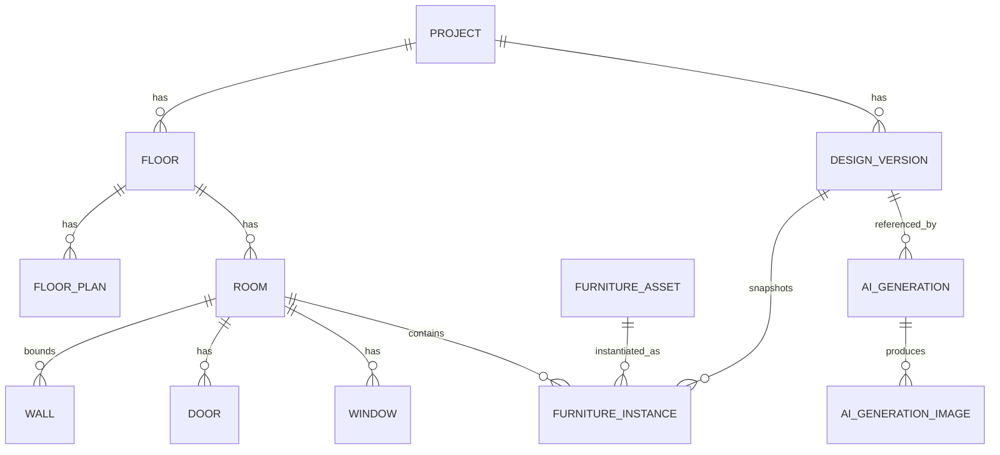

# Product Requirements Document (PRD)
## MyNest Design Studio — 0-to-1 Specification & Blueprint

### Document Control
- **Project Name**: MyNest Design Studio
- **Author**: AI PRD Generator (per `.agent/03-problem-idea-greenfield-prd-prompt.md`)
- **Date**: 2026-08-11
- **Version**: 1.0.0
- **Status**: Ready for Engineering Review
- **Reference Inputs**: Product brief (MyNest Design Studio concept), visual inspiration screenshots in `Reference/` (used for IA/UX grounding only — no UI is copied)

---

## 0. Guiding Architectural Principle (Non-Negotiable)

> **THE FLOOR-PLAN GEOMETRY IS THE SOURCE OF TRUTH. AI IS NEVER THE SOURCE OF TRUTH FOR GEOMETRY.**

The application's deterministic geometry engine and 2D editor are **authoritative** for all walls, rooms, doors, windows, openings, and furniture (coordinates, dimensions, orientation, placement). The AI layer is a **visualizer only** — it may enhance materials, textures, colors, lighting, shadows, reflections, decorative styling, and render realism, but it **must not** add/remove/move walls, alter room proportions, relocate doors/windows, or change furniture geometry.

The correct data flow — enforced throughout the codebase — is:

```
Floor Plan → Geometry Engine → Canonical Design JSON → 2D Editor → AI Renderer (non-authoritative)
```

**Never** build `Floor Plan → AI → Final Geometry`. This separation is a hard architectural constraint validated in code review and CI (see NFR-08 and §12).

---

## 1. Problem Statement & Opportunity

### 1.1 Core Friction
Interior-design sales and design teams (e.g., the MyNest studio workflow) currently bounce between disconnected tools: CAD/floor-plan viewers for geometry, spreadsheet-driven requirement gathering, and separate AI image generators for "mood" renders. The result:

- **Geometry drift**: AI render tools hallucinate walls, resize rooms, and invent furniture, so the "pretty picture" no longer matches the buildable plan. Clients approve a render that cannot be executed.
- **No single source of truth**: furniture placement lives in one tool, dimensions in another, and the client-facing visual in a third. Versions desync.
- **No deterministic validation**: nothing checks that a sofa fits, a door can swing, or circulation clearance is maintained before it's shown to a client.
- **Lost history**: iterating on a layout overwrites the previous one; there is no way to compare "Version 2 sofa moved" against "Version 4 final."

### 1.2 User Jobs-To-Be-Done (JTBD)
- When I **receive a floor plan** (PDF/image/vector), I want to **turn it into editable, dimensioned geometry**, so that every downstream design references a single accurate source.
- When I **lay out a room**, I want to **drag, resize, rotate, and precisely position furniture with snapping and collision checks**, so that the layout is physically valid before a client sees it.
- When I **finalize a layout**, I want to **generate a photorealistic AI visualization that preserves my exact geometry**, so that the render is a faithful, sellable representation of the buildable design.
- When I **explore options**, I want to **keep every design version and AI generation and compare them side-by-side**, so that I never lose work and can navigate Previous/Next.
- When I **close the sale**, I want to **export the plan, layout, dimensions, and render**, so that the client and the execution team get one coherent package.

### 1.3 Success Metrics (KPIs)
| KPI | Target |
|---|---|
| Geometry fidelity: AI render matches canonical geometry (manual QA sampling) | ≥ 99% of generations show **zero** wall/door/window/furniture displacement |
| Time from floor-plan upload → validated furnished room | ≤ 20 min for a typical 3-BHK room (baseline vs. multi-tool workflow) |
| Editor responsiveness with 100+ furniture objects | Sustained ≥ 55 FPS during drag; input latency < 32 ms |
| Placement validity at "finalize" | ≥ 95% of finalized rooms pass all deterministic rules with 0 INVALID warnings |
| Design-version data loss incidents | 0 (no version or generation is ever destroyed) |
| AI generation success rate (provider call → stored image) | ≥ 97%, with graceful fallback across providers |
| Crash-free editor sessions | ≥ 99.5% |

---

## 2. User Personas & Target Demographics

### Persona A — "Priya", Interior Designer (Primary)
- **Role**: Space planner / designer at a residential interior studio.
- **Tech literacy**: High for design tools (SketchUp/AutoCAD-adjacent), medium for dev concepts.
- **Key workflow**: Import plan → define rooms → furnish room-by-room → validate → generate AI render → present to client → export.
- **Needs**: Precise dimensions, snapping, collision warnings, fast iteration, beautiful client-ready renders that stay true to the plan.

### Persona B — "Rahul", Design Sales Lead (Primary)
- **Role**: Converts leads by showing furnished visualizations quickly.
- **Tech literacy**: Medium.
- **Key workflow**: Open an existing project → tweak a layout → generate 2–3 AI variations → compare → export a comparison sheet for the client.
- **Needs**: Speed, "wow" visuals, easy Previous/Next comparison, one-click export.

### Persona C — "Anjali", Studio Manager / Admin (Secondary)
- **Role**: Owns projects, clients, and team access.
- **Tech literacy**: Medium.
- **Key workflow**: Create projects, organize floors/rooms, manage design versions and provider configuration/budgets.
- **Needs**: Project dashboard, versioning oversight, cost control on AI providers, export/audit.

### Persona D — "Vikram", Execution/Site Engineer (Secondary, read-mostly)
- **Role**: Builds from the finalized layout.
- **Needs**: Accurate dimensioned exports (PDF/PNG, future DXF/SVG); trusts that geometry ≠ AI fantasy.

---

## 3. Executive Product Vision & Scope Matrix

### 3.1 Vision
MyNest Design Studio is a **premium, desktop-first interior-design workspace** that takes a raw floor plan and carries it through deterministic geometry, a professional 2D furniture-layout editor, rule-based validation, canonical versioning, and finally AI photorealistic visualization — **without ever letting AI corrupt the architecture.** The end feel: a professional interior designer's digital workspace where "Floor Plan → Final Furniture Layout + AI Interior Render" is one coherent, trustworthy pipeline.

### 3.2 In-Scope vs Out-of-Scope Matrix

| Capability | MVP (Phase 1) | Core (Phase 2) | Advanced (Phase 3) |
|---|---|---|---|
| Project dashboard & CRUD | ✅ | | |
| Multi-floor / multi-room organization & navigation | ✅ | | |
| Floor-plan upload (PNG/JPG/PDF/SVG) | ✅ (raster + SVG) | PDF vector extraction, structured JSON import | CAD/DXF ingest |
| Geometry model (walls/rooms/doors/windows/openings) | ✅ (manual define + edit) | Semi-auto room detection | Auto vector geometry extraction |
| 2D canvas: zoom/pan/fit/grid | ✅ | | |
| Layered canvas (bg/floorplan/furniture/dimension/interaction) | ✅ | | |
| SVG furniture library (searchable, categorized) | ✅ | Brand catalogs, larger library | User-uploaded assets |
| Drag/drop, move, resize, rotate, duplicate, delete, lock, hide | ✅ | | |
| Exact dimensions + X/Y numeric editing (two-way sync) | ✅ | | |
| Snap system (grid/wall/object/center/door/window) | ✅ | Tunable per-type tolerance | Smart alignment guides |
| Geometry validation + collision + clearance warnings | ✅ | Room-specific design rules engine | Auto-suggest fixes (deterministic) |
| Save/load persistence (canonical JSON) | ✅ | | |
| Design versioning (immutable history) | ✅ | Version diff view | Branch/merge versions |
| Design Intent panel (style/mood/materials/lighting) | | ✅ | Presets & saved themes |
| AI provider abstraction (multi-provider) | 1 provider behind adapter | ✅ OpenAI/Gemini/Claude/Mistral/Nvidia | Provider auto-routing/cost policy |
| AI prompt engine (geometry-faithful) | ✅ (basic) | ✅ (full spec + reference image) | Prompt A/B versions |
| AI generation + gallery + Previous/Next | | ✅ | |
| 2D↔AI comparison (split / slider / full) | | ✅ | |
| Variation generation | | ✅ | |
| Export PNG/JPG/PDF + comparison sheet | ✅ (PNG) | ✅ (PDF, comparison) | DXF/SVG/GLB/3D scene |
| Undo/redo (command history) | ✅ | | |
| Auth & multi-user projects | Basic auth | RBAC (Admin/Manager/Sales) | SSO / audit logs |

**Explicitly out of scope (all phases unless promoted):** AI-driven auto-layout of furniture, AI editing of geometry, full 3D modeling/BIM, structural/MEP engineering, procurement/e-commerce checkout.

---

## 4. Functional Specifications (FR-01 … FR-28)

> Schema per requirement: **ID · Name · Description · User Flow · Preconditions · Workflows · Postconditions · Data Affected · Acceptance Criteria · Priority**

### FR-01 — Project Dashboard & CRUD
- **Description**: Grid/list of projects; create, open, rename, archive.
- **User Flow**: Dashboard → "New Project" → fill name/client/property type/floors → save → card appears.
- **Preconditions**: Authenticated user.
- **Workflows**: Validate inputs → persist `projects` row → redirect to Floor Plan Manager.
- **Postconditions**: Project exists with ≥ 0 floors; `updated_at` set.
- **Data Affected**: `projects`.
- **Acceptance Criteria**: Card shows Project Name, Client, Property Type, #Floors, #Rooms, Last Updated, Design Status; "Open Design" enters the studio; archive is soft-delete (recoverable).
- **Priority**: P0.

### FR-02 — Multi-Floor Management
- **Description**: Add/rename/reorder/delete floors within a project (e.g., Ground, First, Second).
- **User Flow**: Left sidebar → Floors → "+ Add Floor".
- **Preconditions**: Open project.
- **Workflows**: Create `floors` row with `order_index`.
- **Postconditions**: Floor list updates; canvas can switch floors.
- **Data Affected**: `floors`.
- **Acceptance Criteria**: Switching floors reloads that floor's plan/rooms without page reload; deleting a floor warns if it has rooms.
- **Priority**: P0.

### FR-03 — Room Management & Navigation
- **Description**: Rooms belong to a floor; tree navigation; selecting a room focuses the canvas on it.
- **User Flow**: RoomTree → click "Living Room" → canvas pans/zooms to that room's bounds.
- **Preconditions**: Floor has ≥ 1 room defined.
- **Workflows**: Compute room bounding box → animate canvas fit-to-room.
- **Postconditions**: Active room set in editor state.
- **Data Affected**: `rooms`, editor state.
- **Acceptance Criteria**: Room selection focuses canvas ≤ 400 ms; active room highlighted; breadcrumbs show Project ▸ Floor ▸ Room.
- **Priority**: P0.

### FR-04 — Floor-Plan Upload & Ingest
- **Description**: Upload PNG/JPG/PDF/SVG; store original; place as a scaled background reference in the Floor Plan Layer.
- **User Flow**: Floor Plan Manager → "Upload Plan" → choose file → set scale (e.g., draw a known 1 m reference line) → confirm.
- **Preconditions**: Open floor.
- **Workflows**: Upload to object storage → create `floor_plans` row with `scale_mm_per_px`, `source_type` (raster/vector/pdf/svg) → render on canvas.
- **Postconditions**: Plan is visible and scaled; geometry can now be traced/defined over it.
- **Data Affected**: `floor_plans`, storage.
- **Acceptance Criteria**: Raster shows as background; SVG preserves vectors; a calibrated scale yields correct on-canvas mm measurements (±1%); **YOLO/auto-processing is NOT assumed** — if the source has vector geometry it is preserved for extraction, otherwise the user defines geometry manually (Phase 1) / semi-auto (Phase 2).
- **Priority**: P0.

### FR-05 — Wall Definition & Editing
- **Description**: Create/edit walls with endpoints and thickness.
- **Data Model**: `{id, x1, y1, x2, y2, thickness}` (mm).
- **Acceptance Criteria**: Draw wall by clicking two points (snapping to grid/endpoints); edit thickness; walls render on Floor Plan Layer; walls are collidable barriers (see FR-16).
- **Priority**: P0.

### FR-06 — Room Definition & Area
- **Description**: Define room polygon (traced or from enclosed walls); auto-compute width/depth/area.
- **Data Model**: `{id, name, polygon[], width, depth, area}`.
- **Acceptance Criteria**: `calculateRoomArea()` returns area in m² (±1%); room name editable; furniture is associated to a room by containment.
- **Priority**: P0.

### FR-07 — Doors, Windows, Openings, Balconies
- **Description**: Place doors/windows/openings on walls with position, width, rotation, swing.
- **Data Model (door)**: `{id, wall_id, x, width, rotation, swing}`. **(window)**: `{id, wall_id, x, width}`.
- **Acceptance Criteria**: Door swing arc rendered; door/window occupy wall span; used by clearance checks (FR-18/19); balconies/openings supported as room/edge types.
- **Priority**: P0 (doors/windows), P1 (balcony/opening types).

### FR-08 — 2D Canvas Core (Zoom / Pan / Fit / Grid)
- **Description**: Konva/react-konva stage with independent logical layers (Background/Grid, Floor Plan, Furniture, Dimension, Interaction).
- **Acceptance Criteria**: Smooth zoom (wheel + buttons), pan (space-drag/middle-drag), Fit-to-screen, toggleable grid; layers are separately toggle-able; **no full-app re-render on pointer move** (NFR-01).
- **Priority**: P0.

### FR-09 — Furniture Library (Searchable, Categorized)
- **Description**: Right-side library with categories/subcategories and search; SVG-first assets with exact default dimensions.
- **Categories**: Living Room, Bedroom, Dining, Kitchen, Bathroom, Foyer, Balcony, Office, Outdoor, Lighting, Decor, Storage, Appliances (with subcategories per brief).
- **Asset schema**: `{id, name, category, subcategory, asset_url, thumbnail_url, default_width, default_depth, default_height, default_rotation, style, tags, supported_rooms}`.
- **Acceptance Criteria**: Search by name/tag; filter by category and by `supported_rooms` for the active room; thumbnails load lazily.
- **Priority**: P0.

### FR-10 — Drag & Drop Placement
- **Description**: Drag a library item onto the canvas; drop creates a `furniture_instance`.
- **Workflows**: On drop → assign `room_id` (by containment), `x`, `y`, defaults for `width/depth/height/rotation`, `z_index`.
- **Acceptance Criteria**: New instance appears at drop point, snapped per active snap settings; immediately selectable; creation is an undoable command.
- **Priority**: P0.

### FR-11 — Selection & Contextual Handles
- **Description**: Click to select; show bounding box, resize handles, rotation handle, center marker, live dimensions/position, contextual toolbar. Multi-select via marquee/shift.
- **Acceptance Criteria**: Handles render on Interaction Layer; multi-select supports group move; toolbar offers Duplicate/Lock/Hide/Delete.
- **Priority**: P0.

### FR-12 — Move Furniture
- **Acceptance Criteria**: Drag moves the instance; position updates live in Properties (two-way sync, FR-15); respects wall collision (cannot pass through walls, FR-17); undoable.
- **Priority**: P0.

### FR-13 — Resize Furniture
- **Acceptance Criteria**: Corner/edge handles resize; width/depth update numerically; aspect-lock optional; min-size clamps; undoable.
- **Priority**: P0.

### FR-14 — Rotate Furniture
- **Acceptance Criteria**: Rotation handle rotates about center; snaps to 15°/45°/90° with modifier; `rotation` reflected in Properties; undoable.
- **Priority**: P0.

### FR-15 — Exact Numeric Properties (Two-Way Sync)
- **Description**: Properties panel edits Name, Position (X/Y mm), Size (W/D/H mm), Rotation (°), Scale; actions Duplicate/Lock/Hide/Delete.
- **Acceptance Criteria**: **Numeric change updates canvas immediately; canvas change updates numbers immediately**; invalid values rejected with inline feedback; each committed change is one undo step.
- **Priority**: P0.

### FR-16 — Snap System
- **Description**: Grid Snap, Wall Snap, Object Snap, Center Snap, Door Snap, Window Snap; configurable tolerance; toggle in bottom toolbar.
- **Acceptance Criteria**: `snapToGrid()`, `snapToWall()`, `snapToObject()` produce visible snap guides on the Interaction Layer; tolerance configurable; snapping can be disabled per session.
- **Priority**: P0 (grid/wall/object), P1 (center/door/window fine-tuning).

### FR-17 — Wall Intersection Guard
- **Description**: Furniture cannot freely pass through walls.
- **Acceptance Criteria**: `checkWallIntersection()` blocks/flags overlap; INVALID state when furniture intersects a wall; move is either constrained or clearly warned (configurable), never silently allowed.
- **Priority**: P0.

### FR-18 — Collision Detection
- **Acceptance Criteria**: `checkFurnitureCollision()` flags overlapping furniture bounds; overlapping items show a collision indicator; deterministic and real-time during drag (debounced).
- **Priority**: P0.

### FR-19 — Clearance & Circulation Checks
- **Acceptance Criteria**: `checkDoorClearance()`, `checkWindowClearance()`, `checkCirculationClearance()` produce VALID / WARNING (limited circulation) / INVALID (blocks door) states with human-readable messages; thresholds are deterministic constants (not AI).
- **Priority**: P1.

### FR-20 — Room-Specific Design Rules Engine
- **Description**: Deterministic, room-typed rules (Living/Bedroom/Dining/Kitchen/Bathroom) — e.g., bed clearance, wardrobe opening clearance, dining chair clearance, kitchen work-triangle heuristic, bathroom fixture clearance.
- **Acceptance Criteria**: Rules evaluate on change and on "Validate"; each rule returns pass/warn/fail + message; **no rule delegates to AI**.
- **Priority**: P1.

### FR-21 — Canonical Design JSON (Source of Truth)
- **Description**: One canonical representation per floor/version: `{project_id, floor_id, design_version, rooms[], walls[], doors[], windows[], furniture[], dimensions[], design_intent{}}`; furniture entries carry `x, y, width, depth, height, rotation, scale_x, scale_y, locked, z_index, asset_url, type, name, room_id`.
- **Acceptance Criteria**: Editor state serializes to/from this schema losslessly; schema-validated on save; this JSON is the single input to versioning, validation, and the AI prompt engine.
- **Priority**: P0.

### FR-22 — Save / Load Persistence
- **Acceptance Criteria**: Explicit Save + autosave (debounced) persist canonical JSON; reload restores exact editor state; optimistic UI with rollback on failure (see Edge Cases §10).
- **Priority**: P0.

### FR-23 — Design Versioning (Immutable)
- **Description**: Each save-as-version snapshots canonical geometry; versions are never destroyed.
- **Acceptance Criteria**: List versions (V1…Vn) with labels ("Sofa moved", "Final layout"); open any version read-only; "Duplicate to new version" to continue editing; AI generations reference the exact `design_version_id`.
- **Priority**: P1 (MVP: linear versioning).

### FR-24 — Design Intent Panel
- **Description**: Pre-AI inputs: Room, Style, Mood, Color Palette, Materials, Lighting, Budget Level, Theme.
- **Acceptance Criteria**: Stored in `design_versions.design_intent`; feeds the prompt engine; presets selectable; free-text notes allowed.
- **Priority**: P1.

### FR-25 — AI Provider Abstraction
- **Description**: `AIProvider` interface with `generateVisualization()` and `generateVariation()`; adapters for OpenAI/Gemini/Claude/Mistral/Nvidia; provider chosen via config, never hard-wired into core.
- **Acceptance Criteria**: Core code depends only on the interface; switching providers is a config change; **API keys are server-side only** (NFR-05); provider failures fall back per policy.
- **Priority**: P1 (MVP: one adapter behind the interface).

### FR-26 — AI Prompt Engine (Geometry-Faithful) + Pipeline
- **Description**: Auto-build the prompt from canonical JSON: ROOM, DIMENSIONS (m), WALL GEOMETRY, DOORS, WINDOWS, FURNITURE (each with X/Y/W/D/rotation in meters), plus the **Master AI Constraint** block. Pipeline: Canonical JSON → geometry validation → design spec → prompt builder → reference image prep (render the 2D plan as a control image) → provider → generated image → validation → store → gallery.
- **Master AI Constraint (verbatim intent)**: floor plan is absolute truth; do not move/add/remove walls; do not change room proportions/dimensions; do not move doors/windows or change their widths; do not change furniture location/dimension/orientation; do not remove specified furniture; do not add major unspecified furniture; preserve spatial relationships. AI creativity allowed **only** for materials/textures/lighting/colors/decor/realism/finishes/render quality. **Geometry preservation > artistic creativity.**
- **Acceptance Criteria**: Every generation request includes the constraint block and a reference image derived from canonical geometry; prompt is stored with `prompt_version`; generations that visibly violate geometry are flagged in QA sampling toward KPI (§1.3).
- **Priority**: P1.

### FR-27 — AI Generation, Gallery, Navigator & Comparison
- **Description**: Generate one/many visualizations per design version; gallery of generations; Previous/Next navigator (`< 3 / 8 >`); comparison in three modes — Split, Slider (draggable divider between 2D plan and AI render), Full render.
- **Acceptance Criteria**: Generations are never overwritten; each card shows Preview/Provider/Style/Date/Design Version with Open/Compare/Use/Download/Delete; navigator cycles without reload; "Generate Variation" keeps geometry identical and varies only color/materials/lighting/styling/decor/camera/mood.
- **Priority**: P1.

### FR-28 — Export Center
- **Description**: Export PNG/JPG/PDF of the 2D plan, furniture layout, dimensions, AI visualization, and a 2D↔AI comparison sheet. Future: DXF/SVG/GLB/3D scene.
- **Acceptance Criteria**: PNG export (MVP) is dimensionally labeled; PDF (Phase 2) includes plan + render + metadata; comparison sheet places 2D and AI side-by-side with project/floor/room/version captions.
- **Priority**: P0 (PNG), P1 (PDF/comparison), P3 (DXF/GLB).

### FR-29 — Undo / Redo (Command History)
- **Description**: Command/history architecture; all editor mutations (add/move/resize/rotate/delete/property change) are undoable.
- **Acceptance Criteria**: Undo/redo via toolbar and keyboard (Ctrl/Cmd+Z / Shift+Z); history is per-floor session; grouped operations (multi-select move) are a single step.
- **Priority**: P0.

---

## 5. Technical Architecture & Tech Stack

### 5.1 Frontend
- **Framework**: React + TypeScript + Vite.
- **Styling / Design System**: Tailwind CSS with a minimal, premium, technical component set (subtle borders, neutral backgrounds, clear hierarchy, professional typography). Avoid generic-admin look, heavy gradients, clutter.
- **Canvas Engine**: Konva + react-konva (Fabric.js as documented fallback), with the **layered stage** in §6.4.
- **State Management**: Zustand slices (separate stores — see §5.5) + TanStack Query for server cache; **no single giant state object**.
- **Undo/Redo**: command-pattern history stack (per editor session).

### 5.2 Backend
- **API**: FastAPI (Python), REST (§9), organized by **service boundaries** (§5.4) — not one giant API file.
- **Async/Jobs**: Celery + Redis for AI generation, export rendering, and heavy geometry/import jobs (long-running provider calls run async with status polling/webhooks).
- **Auth**: JWT access/refresh (MVP); RBAC roles Admin/Manager/Sales (Phase 2).

### 5.3 Data & Storage
- **Database**: PostgreSQL (UUID PKs).
- **Cache/Broker**: Redis.
- **Object Storage**: S3-compatible (floor-plan originals, SVG assets, AI images, exports). **No provider keys or secrets in the frontend.**

### 5.4 Backend Service Boundaries
`ProjectService`, `FloorPlanService`, `RoomService`, `GeometryService`, `FurnitureService`, `DesignVersionService`, `ValidationService`, `PromptService`, `AIProviderService`, `GenerationService`, `ExportService`. The **GeometryService + ValidationService are authoritative**; `AIProviderService`/`GenerationService` are strictly downstream consumers of frozen canonical JSON.

### 5.5 Frontend State Ownership (separate stores)
Project State · Floor Plan State · Editor State · Furniture State · Selection State · Design Version State · AI Generation State. Each is an isolated store with explicit actions; canvas subscribes narrowly to avoid full re-renders.

### 5.6 Deterministic Geometry Engine (shared contract)
Pure, side-effect-free functions (mirrored client + server): `validateRoomContainment()`, `checkFurnitureCollision()`, `checkWallIntersection()`, `checkDoorClearance()`, `checkWindowClearance()`, `checkCirculationClearance()`, `snapToWall()`, `snapToGrid()`, `snapToObject()`, `calculateRoomArea()`, `calculateFurnitureBounds()`. Server is the final validator before a version is frozen for AI.

---

## 6. Information Architecture & UX Wireframes

### 6.1 Navigation Tree & Route Mapping
```
/                                 → Project Dashboard
/projects/:projectId              → Floor Plan Manager (floors/rooms overview)
/projects/:projectId/floors/:floorId/rooms/:roomId/design   → 2D Design Studio
/projects/:projectId/.../ai       → AI Visualization Workspace
/projects/:projectId/.../gallery  → AI Generation Gallery
/projects/:projectId/.../export   → Export Center
```

### 6.2 Screen Breakdowns
1. **Project Dashboard** — cards (Project/Client/Property Type/#Floors/#Rooms/Last Updated/Status) + "Open Design".
2. **Floor Plan Manager** — floor list, plan upload/scale, room list/definition.
3. **2D Design Studio** — the main editor (layout below).
4. **AI Visualization Workspace** — Original 2D (left) vs AI render (right) with divider; header Back/Project/Floor/Room/Design Version/Provider/Generate; bottom `< Previous  3/8  Next >`.
5. **AI Generation Gallery** — generation cards with Open/Compare/Use/Download/Delete.
6. **Export Center** — format selection + comparison sheet.

### 6.3 2D Design Studio Layout (desktop-first, min 1280×720, ideal 1920×1080)
```
┌──────────────────────────────────────────────────────────────────────┐
│ TOP BAR: Logo · Project · Floor · Room · Undo · Redo · Save · Export · [2D | 3D/AI] │
├───────────┬──────────────────────────────────────────┬────────────────┤
│ LEFT       │                                          │ RIGHT           │
│ Project    │            LARGE 2D CANVAS               │ Furniture Lib   │
│ Floors     │        (layered Konva stage)             │ Properties      │
│ Rooms      │                                          │ Design Intent   │
│ Layers     │                                          │                 │
│ Versions   │                                          │                 │
├───────────┴──────────────────────────────────────────┴────────────────┤
│ BOTTOM: Zoom− Zoom+ Fit · Grid · Snap · Measure · Undo · Redo · Generate AI │
└──────────────────────────────────────────────────────────────────────┘
```

### 6.4 Canvas Layer Stack (logical layers — never one flat layer)
```
Stage
├─ Background / Grid Layer
├─ Floor Plan Layer  (Rooms · Walls · Doors · Windows · Openings)
├─ Furniture Layer   (instances by z_index)
├─ Dimension Layer   (labels/measurements)
└─ Interaction Layer (selection box · resize handles · rotation handle · snap guides)
```

### 6.5 Component Hierarchy (reusable)
- **Project**: `ProjectDashboard`, `ProjectHeader`, `FloorSelector`, `RoomTree`.
- **Editor**: `DesignCanvas`, `FloorPlanLayer`, `FurnitureLayer`, `DimensionLayer`, `SelectionLayer`, `GridLayer`.
- **Furniture**: `FurnitureLibrary`, `FurnitureCategory`, `FurnitureCard`, `FurnitureSearch`, `FurnitureProperties`, `FurnitureToolbar`.
- **Geometry**: `SnapGuides`, `DimensionLabels`, `MeasurementTool`, `CollisionIndicator`.
- **AI**: `AIWorkspace`, `AIProviderSelector`, `DesignIntentPanel`, `GenerationViewer`, `GenerationGallery`, `GenerationNavigator`, `ComparisonSlider`.

---

## 7. Non-Functional Requirements (NFR-01 … NFR-10)

- **NFR-01 Performance (editor)**: ≥ 55 FPS during drag with 100+ furniture objects; pointer-move must **not** re-render the whole app (narrow store subscriptions, `requestAnimationFrame`-batched canvas updates, memoized layers). Large SVG assets lazy-loaded and cached.
- **NFR-02 Performance (web budgets)**: Studio route LCP < 2.5 s on a mid desktop; initial JS bundle for the editor route ≤ 500 KB gzipped (code-split canvas/AI modules); API TTFB < 300 ms p95 for reads.
- **NFR-03 Scalability**: Support projects with many floors/rooms and 100+ furniture per room without degradation; AI/export offloaded to Celery workers (prefetch=1 for long jobs).
- **NFR-04 Reliability/Uptime**: 99.5% API availability; autosave + optimistic rollback so no edit is lost on transient failure; idempotent AI job submission.
- **NFR-05 Security (secrets)**: **AI provider API keys are server-side only**, via env vars (`OPENAI_API_KEY`, `GEMINI_API_KEY`, `ANTHROPIC_API_KEY`, `MISTRAL_API_KEY`, `NVIDIA_API_KEY`); never shipped to or callable from the browser. All provider calls proxied through `AIProviderService`.
- **NFR-06 Security (app)**: TLS 1.3 in transit; AES-256 at rest for stored assets; OWASP Top-10 safeguards; signed, expiring URLs for storage; per-project authorization checks on every endpoint.
- **NFR-07 Accessibility**: WCAG 2.1 AA for chrome/panels/dialogs; full keyboard support for editor commands (undo/redo, nudge, delete, duplicate); ARIA on library, properties, and dialogs; visible focus states. (Canvas manipulation offers keyboard nudge/rotate as an a11y path.)
- **NFR-08 Geometry-Integrity Invariant (hard gate)**: A CI/architecture test asserts that no module in the AI layer can mutate canonical geometry, and that generation requests consume a **frozen, validated** design version. Any code path enabling `Floor Plan → AI → Geometry` fails CI.
- **NFR-09 Cost Control (AI)**: Per-project/provider budgets and rate limits enforced server-side; generation cost logged per `ai_generation`.
- **NFR-10 Observability**: Structured logs, request tracing, and generation job status/metrics; backend logs and browser console must be clean of errors after each phase (per the brief's development rule).

---

## 8. Data Model & Database DDL

### 8.1 Entity-Relationship Diagram (Mermaid)


### 8.2 DDL (PostgreSQL, abridged but representative)
```sql
CREATE EXTENSION IF NOT EXISTS "pgcrypto";

CREATE TABLE projects (
  id            UUID PRIMARY KEY DEFAULT gen_random_uuid(),
  name          TEXT NOT NULL,
  client_name   TEXT,
  property_type TEXT,                       -- e.g. "3 BHK"
  design_status TEXT NOT NULL DEFAULT 'draft',
  created_at    TIMESTAMPTZ NOT NULL DEFAULT now(),
  updated_at    TIMESTAMPTZ NOT NULL DEFAULT now()
);

CREATE TABLE floors (
  id          UUID PRIMARY KEY DEFAULT gen_random_uuid(),
  project_id  UUID NOT NULL REFERENCES projects(id) ON DELETE CASCADE,
  name        TEXT NOT NULL,                -- "Ground Floor"
  order_index INT  NOT NULL DEFAULT 0,
  created_at  TIMESTAMPTZ NOT NULL DEFAULT now()
);
CREATE INDEX idx_floors_project ON floors(project_id, order_index);

CREATE TABLE floor_plans (
  id             UUID PRIMARY KEY DEFAULT gen_random_uuid(),
  floor_id       UUID NOT NULL REFERENCES floors(id) ON DELETE CASCADE,
  source_type    TEXT NOT NULL CHECK (source_type IN ('raster','vector','pdf','svg','json')),
  storage_url    TEXT NOT NULL,
  scale_mm_per_px NUMERIC(12,4),            -- calibration
  created_at     TIMESTAMPTZ NOT NULL DEFAULT now()
);

CREATE TABLE rooms (
  id        UUID PRIMARY KEY DEFAULT gen_random_uuid(),
  floor_id  UUID NOT NULL REFERENCES floors(id) ON DELETE CASCADE,
  name      TEXT NOT NULL,
  room_type TEXT,                           -- living/bedroom/kitchen/...
  polygon   JSONB NOT NULL,                 -- [[x,y],...] mm
  width_mm  NUMERIC(12,2),
  depth_mm  NUMERIC(12,2),
  area_m2   NUMERIC(12,3)
);
CREATE INDEX idx_rooms_floor ON rooms(floor_id);

CREATE TABLE walls (
  id        UUID PRIMARY KEY DEFAULT gen_random_uuid(),
  floor_id  UUID NOT NULL REFERENCES floors(id) ON DELETE CASCADE,
  x1 NUMERIC(12,2), y1 NUMERIC(12,2),
  x2 NUMERIC(12,2), y2 NUMERIC(12,2),
  thickness_mm NUMERIC(8,2) NOT NULL DEFAULT 150
);

CREATE TABLE doors (
  id        UUID PRIMARY KEY DEFAULT gen_random_uuid(),
  wall_id   UUID NOT NULL REFERENCES walls(id) ON DELETE CASCADE,
  x_mm      NUMERIC(12,2) NOT NULL,
  width_mm  NUMERIC(8,2)  NOT NULL,
  rotation  NUMERIC(6,2)  NOT NULL DEFAULT 0,
  swing     TEXT CHECK (swing IN ('inside','outside','left','right'))
);

CREATE TABLE windows (
  id       UUID PRIMARY KEY DEFAULT gen_random_uuid(),
  wall_id  UUID NOT NULL REFERENCES walls(id) ON DELETE CASCADE,
  x_mm     NUMERIC(12,2) NOT NULL,
  width_mm NUMERIC(8,2)  NOT NULL
);

CREATE TABLE furniture_assets (
  id              UUID PRIMARY KEY DEFAULT gen_random_uuid(),
  name            TEXT NOT NULL,
  category        TEXT NOT NULL,
  subcategory     TEXT,
  asset_url       TEXT NOT NULL,            -- SVG
  thumbnail_url   TEXT,
  default_width   NUMERIC(8,2) NOT NULL,    -- mm
  default_depth   NUMERIC(8,2) NOT NULL,
  default_height  NUMERIC(8,2) NOT NULL,
  default_rotation NUMERIC(6,2) NOT NULL DEFAULT 0,
  style           TEXT,
  tags            TEXT[],
  supported_rooms TEXT[]
);
CREATE INDEX idx_assets_category ON furniture_assets(category, subcategory);

CREATE TABLE design_versions (
  id             UUID PRIMARY KEY DEFAULT gen_random_uuid(),
  project_id     UUID NOT NULL REFERENCES projects(id) ON DELETE CASCADE,
  floor_id       UUID NOT NULL REFERENCES floors(id) ON DELETE CASCADE,
  version_number INT  NOT NULL,
  label          TEXT,                      -- "Sofa moved"
  canonical_json JSONB NOT NULL,            -- full source-of-truth snapshot
  design_intent  JSONB,
  is_frozen      BOOLEAN NOT NULL DEFAULT false,
  created_at     TIMESTAMPTZ NOT NULL DEFAULT now(),
  UNIQUE (floor_id, version_number)
);

CREATE TABLE furniture_instances (
  id                UUID PRIMARY KEY DEFAULT gen_random_uuid(),
  design_version_id UUID NOT NULL REFERENCES design_versions(id) ON DELETE CASCADE,
  room_id           UUID REFERENCES rooms(id) ON DELETE SET NULL,
  asset_id          UUID REFERENCES furniture_assets(id),
  type              TEXT,
  name              TEXT,
  x NUMERIC(12,2), y NUMERIC(12,2),
  width NUMERIC(8,2), depth NUMERIC(8,2), height NUMERIC(8,2),
  rotation NUMERIC(6,2) DEFAULT 0,
  scale_x NUMERIC(6,3) DEFAULT 1, scale_y NUMERIC(6,3) DEFAULT 1,
  locked  BOOLEAN DEFAULT false,
  z_index INT DEFAULT 0
);
CREATE INDEX idx_furni_version ON furniture_instances(design_version_id);

CREATE TABLE ai_generations (
  id                UUID PRIMARY KEY DEFAULT gen_random_uuid(),
  project_id        UUID NOT NULL REFERENCES projects(id) ON DELETE CASCADE,
  floor_id          UUID REFERENCES floors(id) ON DELETE SET NULL,
  room_id           UUID REFERENCES rooms(id) ON DELETE SET NULL,
  design_version_id UUID NOT NULL REFERENCES design_versions(id) ON DELETE CASCADE,
  provider          TEXT NOT NULL,          -- openai/gemini/claude/mistral/nvidia
  model             TEXT,
  prompt            TEXT NOT NULL,
  prompt_version    TEXT,
  style             TEXT,
  status            TEXT NOT NULL DEFAULT 'pending'
                    CHECK (status IN ('pending','processing','completed','failed')),
  is_variation      BOOLEAN NOT NULL DEFAULT false,
  parent_generation_id UUID REFERENCES ai_generations(id),
  cost_usd          NUMERIC(10,4),
  created_at        TIMESTAMPTZ NOT NULL DEFAULT now()
);
CREATE INDEX idx_gen_version ON ai_generations(design_version_id, created_at);

CREATE TABLE ai_generation_images (
  id            UUID PRIMARY KEY DEFAULT gen_random_uuid(),
  generation_id UUID NOT NULL REFERENCES ai_generations(id) ON DELETE CASCADE,
  image_url     TEXT NOT NULL,
  width_px INT, height_px INT,
  created_at    TIMESTAMPTZ NOT NULL DEFAULT now()
);
```

---

## 9. API Specifications & Data Contracts

REST conventions: JSON, UUID ids, JWT bearer auth, standard status codes (200/201/204/400/401/403/404/409/422/500).

| Method & Path | Purpose | Key Request | Success Response |
|---|---|---|---|
| `POST /api/projects` | Create project | `{name, client_name, property_type}` | `201 {project}` |
| `GET /api/projects` | List projects | — | `200 [{project…}]` |
| `GET /api/projects/{id}` | Project detail | — | `200 {project}` |
| `GET /api/projects/{id}/floors` | List floors | — | `200 [{floor}]` |
| `POST /api/projects/{id}/floors` | Add floor | `{name, order_index}` | `201 {floor}` |
| `POST /api/floors/{id}/plan` | Upload/attach plan | multipart file + `{scale}` | `201 {floor_plan}` |
| `GET /api/floors/{id}/rooms` | List rooms | — | `200 [{room}]` |
| `POST /api/floors/{id}/rooms` | Define room | `{name, room_type, polygon}` | `201 {room}` |
| `GET /api/rooms/{id}` | Room detail (geometry) | — | `200 {room, walls, doors, windows}` |
| `GET /api/furniture` | Search library | `?category=&q=&room=` | `200 [{asset}]` |
| `POST /api/design-versions` | Create version (snapshot) | `{project_id, floor_id, canonical_json, label}` | `201 {version}` |
| `GET /api/design-versions/{id}` | Get version | — | `200 {version, canonical_json}` |
| `POST /api/design-versions/{id}/validate` | Deterministic validation | — | `200 {results:[{rule,severity,message}]}` |
| `POST /api/design-versions/{id}/freeze` | Freeze for AI | — | `200 {is_frozen:true}` |
| `POST /api/design-versions/{id}/generate` | Start AI generation | `{provider, model?, design_intent}` | `202 {generation_id, status}` |
| `GET /api/design-versions/{id}/generations` | List generations | — | `200 [{generation}]` |
| `GET /api/generations/{id}` | Generation detail + images | — | `200 {generation, images[]}` |
| `POST /api/generations/{id}/variation` | Variation (geometry identical) | `{style?, mood?}` | `202 {generation_id}` |
| `DELETE /api/generations/{id}` | Delete a generation | — | `204` |
| `POST /api/design-versions/{id}/export` | Export | `{format:'png'|'pdf', mode?}` | `202 {export_id}` / `200 {url}` |

**Validation response contract** (`/validate`):
```json
{
  "version_id": "…",
  "results": [
    {"rule": "checkDoorClearance", "target": "furniture_012", "severity": "invalid",
     "message": "Furniture blocks door opening (door_001)."},
    {"rule": "checkCirculationClearance", "target": "room_living", "severity": "warning",
     "message": "Limited circulation space (< 750 mm path)."},
    {"rule": "validateRoomContainment", "target": "furniture_003", "severity": "valid",
     "message": "Furniture correctly placed."}
  ]
}
```

**Generate request** always includes the canonical geometry + Master AI Constraint server-side; the client sends only provider/intent — it can never inject geometry-mutating instructions (NFR-08).

---

## 10. Edge Cases & Error Recovery

- **Provider timeout/failure**: mark `ai_generations.status='failed'`, surface a retry with fallback provider (per config); never leave a stuck "processing" chip (poll + heartbeat timeout).
- **Optimistic edit + save failure**: editor applies change optimistically; on persistence error, roll back to last-saved canonical JSON and toast the user; autosave retries with backoff.
- **Furniture dropped outside any room**: allow placement but flag "no room association" WARNING; do not assign `room_id`.
- **Furniture through wall / off-plan**: `checkWallIntersection()`/`validateRoomContainment()` block or hard-warn; move is constrained per snap/collision settings — never silently accepted.
- **Race on concurrent edits (multi-user)**: version-number uniqueness + `409 Conflict` on stale save; client offers "reload latest / save as new version."
- **Scale not calibrated**: dimensions panel shows "uncalibrated" state; block AI generation until a real-world scale exists (geometry must be metric-true).
- **Corrupt/oversized upload**: validate MIME/size server-side; reject with `422` and inline feedback.
- **Non-vector PDF/raster**: fall back to manual/semi-auto geometry definition — **do not** silently run detection that could fabricate walls.
- **AI returns geometry-violating image**: image is still stored (never overwrites geometry) but flagged in QA; the canonical JSON is untouched — AI output is a sibling artifact, never fed back as truth.

---

## 11. Implementation Roadmap & Phased Milestones

Aligned to the brief's 20-phase build order, grouped into three releases. **Per the development rule: after each phase — run the app, test the feature, check browser console + backend logs, fix errors, verify prior functionality, then proceed. Never break existing functionality.**

### Phase 1 — MVP (Core loop, geometry-true)
Project shell/dashboard/layout → floor & floor-plan manager → 2D canvas (grid/zoom/pan, layered stage) → geometry (walls/rooms/doors/windows) → SVG furniture library → drag/drop → move/resize/rotate → exact dimensions + X/Y + snap → collision/containment/wall-guard validation → save/load canonical JSON → undo/redo → PNG export. **Seed data** (below).

### Phase 2 — V1.1 (Versioning + AI visualization + comparison)
Design versioning (immutable) → Design Intent panel → AI provider abstraction (multi-provider) → AI prompt engine + pipeline + reference-image prep → generation + gallery + Previous/Next → 2D↔AI comparison (split/slider/full) → variation generation → PDF & comparison-sheet export → room-specific rules engine + clearance/circulation checks.

### Phase 3 — V2.0 (Automation, scale, advanced export)
Auto/semi-auto geometry extraction from vector plans → structured floor-plan JSON & CAD/DXF ingest → provider auto-routing + cost policy → prompt A/B versions → version diff/branch → RBAC/SSO/audit → performance optimization pass → DXF/SVG/GLB/3D-scene export → production hardening.

### Seed Data (Phase 1 deliverable)
- Project: **Mynest Demo Residence** → Floors: **Ground Floor**, **First Floor**.
- Rooms: Foyer, Living Room, Dining, Kitchen, Master Bedroom, Bedroom 2, Bedroom 3, Bathroom, Balcony.
- Sample SVG furniture assets (with exact dimensions) + sample placements.

---

## 12. Verification & Acceptance Test Suite

### 12.1 Automated Test Plan
- **Unit (geometry engine — highest priority)**: `calculateRoomArea`, `calculateFurnitureBounds`, `checkFurnitureCollision`, `checkWallIntersection`, `validateRoomContainment`, `checkDoorClearance`, `checkWindowClearance`, `checkCirculationClearance`, `snapToGrid/Wall/Object`. Deterministic fixtures with known-answer geometry.
- **Unit (canonical JSON)**: serialize↔deserialize round-trip is lossless; schema validation rejects malformed geometry.
- **Unit (prompt engine)**: prompt always contains ROOM/DIMENSIONS/WALLS/DOORS/WINDOWS/FURNITURE + the full Master AI Constraint block; furniture coordinates emitted in meters matching canonical mm ÷ 1000.
- **Architecture/CI invariant (NFR-08)**: static test proving the AI layer cannot mutate canonical geometry and only consumes frozen versions.
- **Integration (API)**: create project → upload plan → add furniture → move furniture → save → create version → generate AI → retrieve generations.
- **E2E (Playwright)**: dashboard→studio→furnish→validate→version→generate→compare→export happy path; plus edge-case flows (provider failure retry, save-failure rollback, uncalibrated-scale block).
- **Performance test**: 100+ furniture objects — assert sustained FPS and no full-app re-render on drag.

### 12.2 Acceptance Criteria Checkbox Matrix (release gate)
- [ ] Geometry engine unit tests pass (100% of listed functions).
- [ ] Canonical JSON round-trip lossless; schema-validated on save.
- [ ] Drag/drop, move, resize, rotate, duplicate, delete, lock, hide all undoable.
- [ ] Numeric ↔ canvas two-way sync is immediate and correct.
- [ ] Snap (grid/wall/object) + wall-intersection guard enforced.
- [ ] Collision + containment + door/window/circulation checks return valid/warning/invalid with messages.
- [ ] Save/load restores exact editor state; autosave + rollback verified.
- [ ] Immutable versioning: no version or generation is ever destroyed.
- [ ] AI provider keys are **server-side only** (no key reachable from browser).
- [ ] Every AI request carries the Master AI Constraint + reference image; QA sampling shows ≥ 99% geometry fidelity.
- [ ] Gallery + Previous/Next + three comparison modes function; variations keep geometry identical.
- [ ] PNG export (MVP) / PDF + comparison sheet (Phase 2) produce dimensioned, captioned output.
- [ ] Seed "Mynest Demo Residence" loads with sample rooms, assets, and placements.
- [ ] Editor sustains ≥ 55 FPS with 100+ objects; no full-app re-render on pointer move.
- [ ] Browser console and backend logs are clean after each phase.

---

### Appendix A — Canonical Design JSON (reference shape)
```json
{
  "project_id": "PRJ-001",
  "floor_id": "floor_1",
  "design_version": 7,
  "rooms": [], "walls": [], "doors": [], "windows": [],
  "furniture": [
    {
      "id": "furniture_001", "type": "sofa", "name": "3 Seater Sofa",
      "room_id": "living_01",
      "x": 500, "y": 400,
      "width": 2100, "depth": 900, "height": 850,
      "rotation": 0, "scale_x": 1, "scale_y": 1,
      "locked": false, "z_index": 5,
      "asset_url": "/assets/furniture/sofa.svg"
    }
  ],
  "dimensions": [],
  "design_intent": { "style": "Modern Luxury", "mood": "Warm/Premium/Elegant",
    "colors": ["Warm Beige","Walnut","Soft Grey","Muted Blue"],
    "materials": ["Wood","Marble","Fabric"], "lighting": "Warm Indirect" }
}
```

### Appendix B — Critical Architecture Principle (restated for engineers)
```
NEVER:  Floor Plan → AI → Final Geometry
BUILD:  Floor Plan → Geometry Engine → Canonical Design → 2D Editor → AI Renderer
The geometry engine is authoritative. The 2D editor is authoritative. The AI renderer is NOT.
This separation must be preserved throughout the entire codebase.
```

*End of PRD.*
