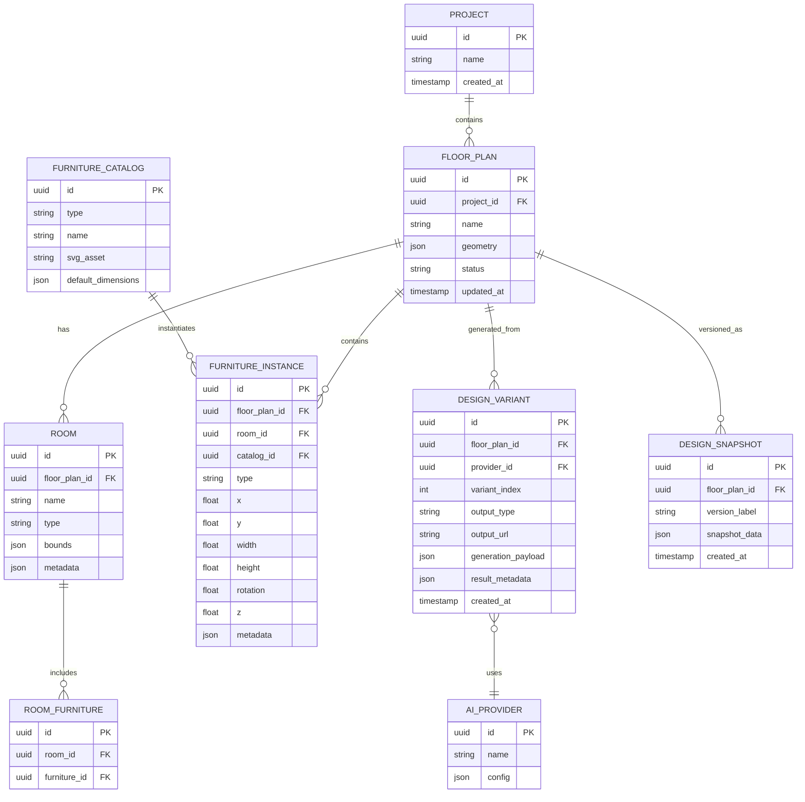

# Product Requirements Document (PRD)
## MYNEST DESIGN STUDIO — 0-to-1 Specification & Blueprint

### Document Control
- **Project Name**: MYNEST DESIGN STUDIO
- **Author**: AI PRD Generator
- **Date**: 2026-08-12
- **Version**: 1.0.0
- **Status**: Ready for Engineering Review
- **Product Type**: Desktop-first interior design and AI visualization application

---

### 1. Problem Statement & Opportunity

#### 1.1 Core Friction
Interior design and floor-plan planning are still fragmented across multiple disconnected tools: manual CAD workflows, basic 2D editors, and external AI image generation tools that do not understand spatial layout. Most users need a single workflow that allows them to:

- Open a floor plan
- Arrange furniture accurately in rooms
- Maintain layout fidelity in a backend design model
- Generate 3D interior interpretations using AI
- Compare raw floor plan vs generated 3D design in one workspace

Existing tools do not consistently connect the 2D design layout to a structured design/database layer, nor do they provide a repeatable mechanism for comparing multiple AI-generated design options for the same base input.

#### 1.2 User Jobs-To-Be-Done (JTBD)
- When I have a floor plan, I want to place furniture precisely and adjust its geometry, so that I can produce a complete interior layout.
- When I want to validate a concept visually, I want to generate multiple AI-based 3D interpretations from the same design, so that I can compare alternatives quickly.
- When I need to present a design to a client or stakeholder, I want a side-by-side comparison of the raw plan and generated 3D result, so that the design rationale is clear.

#### 1.3 Success Metrics (KPIs)
- Furniture placement accuracy within defined coordinate and dimension tolerances
- User can create a complete furniture layout for a floor plan without external tools
- AI generation acceptance rate: at least one usable 3D variant from a base plan
- Comparison workflow supports navigation across multiple generated design options
- Desktop application launch and key editor interactions retain responsiveness under normal project size

---

### 2. User Personas & Target Demographics

#### 2.1 Primary Persona: Interior Designer / Space Planner
- Needs: Floor-plan editing, room-wise furniture placement, design iteration, and presentation-ready layouts
- Technical comfort: Moderate to high
- Workflow: Opens floor plan, arranges room furniture, validates composition, and exports/compares AI concepts

#### 2.2 Primary Persona: Architect / Drafting Consultant
- Needs: Accurate spatial coordination, dimension-aware plan layouts, room adjacency, and conversion of conceptual layouts into structured design data
- Technical comfort: High
- Workflow: Imports/edits floor plan geometry, creates furniture layout, and uses AI to visualize optimization options

#### 2.3 Secondary Persona: Homeowner / Renovation Client
- Needs: Visualization of how rooms could look with furniture placement and AI-generated 3D concepts
- Technical comfort: Low to moderate
- Workflow: Reviews a design with limited editing, compares options, and chooses preferred concept

#### 2.4 Secondary Persona: Real Estate / Interior Stylist
- Needs: Fast concept generation, multiple layouts, and design repurposing for different room functions
- Technical comfort: Moderate
- Workflow: Creates alternate proposals quickly from the same floor plan

---

### 3. Executive Product Vision & Scope Matrix

#### 3.1 Product Summary
MYNEST DESIGN STUDIO is a desktop-first interior design product that combines a 2D floor-plan editor, furniture manipulation controls, a structured backend design data layer, and multi-provider AI-based 3D generation orchestration. The product enables users to create complete room layouts and compare those layouts against AI-generated 3D concepts side by side.

#### 3.2 In-Scope (MVP)
- Multiple floor-plan management
- 2D design canvas with rooms, walls, doors, windows, dimensions, and furniture
- Furniture library in SVG format
- Drag-and-drop placement, selection boxes, resizing, rotation, and height/width adjustments
- Structured backend design layer mirroring frontend geometry and furniture state
- AI generation provider abstraction for Gemini, Claude, OpenAI, Mistral, and NVIDIA
- Side-by-side 2D vs AI 3D comparison workspace
- Navigation between multiple generated design variants

#### 3.3 Out-of-Scope (Post-MVP)x`
- Full photorealistic 3D editing inside the same canvas
- Real-time collaborative multi-user editing
- Native AR/VR walkthrough
- Auto-layout optimization engine with ML-driven space recommendations
- Advanced BIM integration or IFC import/export
- Full cloud sync and multi-device collaboration

#### 3.4 Scope Matrix
| Area | MVP | Post-MVP |
| --- | --- | --- |
| Floor plan management | Yes | Yes |
| Furniture editing | Yes | Yes |
| 2D canvas design | Yes | Yes |
| Backend design representation | Yes | Yes |
| AI 3D generation | Yes | Yes |
| Multi-provider abstraction | Yes | Yes |
| 2D/3D comparison viewport | Yes | Yes |
| Multiple AI variant navigation | Yes | Yes |
| Collaboration | No | Yes |
| BIM integration | No | Yes |
| Advanced optimization | No | Yes |

---

### 4. Functional Specifications

#### FR-01: Floor Plan Workspace Management
- **ID**: FR-01
- **Name**: Manage Multiple Floor Plans
- **Description**: Users can open, create, rename, duplicate, and manage multiple floor plans within one project workspace.
- **User Flow**: User opens app > selects floor plan project > views floor-plan list > switches between plans.
- **Preconditions**: App launched with valid project state.
- **Workflows**: Create, open, duplicate, save, close, and delete a floor plan.
- **Postconditions**: Selected floor plan is active and available for editing.
- **Data Affected**: FloorPlan, Project, FloorPlanVersion
- **Acceptance Criteria**:
  - User can switch between floor plans without losing unsaved changes
  - Each floor plan has independent metadata, geometry, and furniture state
  - Plan list remains visible and searchable
- **Priority**: P0

#### FR-02: 2D Floor Plan Canvas
- **ID**: FR-02
- **Name**: 2D Design Canvas
- **Description**: The main floor-plan editor works as a drawing and editing surface displaying walls, rooms, doors, windows, dimensions, furniture, and selection overlays.
- **User Flow**: User selects floor plan > canvas loads > all geometry is visible > user edits layout.
- **Preconditions**: Floor plan exists and has room geometry.
- **Workflows**: Pan, zoom, select, move, and edit items.
- **Postconditions**: Canvas reflects current state and updates backend model.
- **Data Affected**: FloorPlan, Room, Wall, Door, Window, FurnitureItem
- **Acceptance Criteria**:
  - Floor-plan walls and rooms remain visible at all zoom levels
  - Selection overlays and control handles appear on active furniture
  - User can edit both geometry and furniture positions from the canvas
- **Priority**: P0

#### FR-03: Furniture Library Panel
- **ID**: FR-03
- **Name**: SVG Furniture Library
- **Description**: Right-side panel lists interior furniture items in SVG format and supports item selection and placement.
- **User Flow**: User selects furniture type in side panel > drags into floor-plan canvas > releases item into room.
- **Preconditions**: Plan loaded.
- **Workflows**: Browser list, search/filter, drag/drop, duplicate item.
- **Postconditions**: New furniture instance exists in the plan and control handles are active.
- **Data Affected**: FurnitureCatalogItem, FurnitureInstance
- **Acceptance Criteria**:
  - Library contains Sofa, Bed, Chair, Table, Wardrobe, TV Unit, and other furniture types
  - Furniture items render as SVG assets
  - Placement is supported via drag-and-drop and click-to-place actions
- **Priority**: P0

#### FR-04: Furniture Placement & Editing
- **ID**: FR-04
- **Name**: Furniture Manipulation
- **Description**: Furniture items are selectable, movable, resizable, rotatable, and adjustable in width, height, and position.
- **User Flow**: User selects furniture > bounding box and control handles appear > user drags/moves/resizes/rotates.
- **Preconditions**: Furniture item exists in plan.
- **Workflows**: Select, drag, resize from handles, set width/height, rotate, position in x/y coordinate space.
- **Postconditions**: Furniture geometry and transform state are updated in frontend and backend model.
- **Data Affected**: FurnitureInstance
- **Acceptance Criteria**:
  - Selection box renders around active furniture
  - Control points allow width and height adjustment
  - Rotational control is available on the bounding box
  - User can reposition item to any valid coordinate in floor plan
- **Priority**: P0

#### FR-05: Room-Wise Interior Layout Planning
- **ID**: FR-05
- **Name**: Full-Room Furniture Layout
- **Description**: The application supports complete layout planning across foyer, living area, kitchen, bedroom, dining area, bathroom, balcony, and other designated spaces.
- **User Flow**: User selects room > places furniture relevant to room function > arranges all required items.
- **Preconditions**: Rooms are defined in floor plan.
- **Workflows**: Add furniture to each room, align items to space constraints, adjust room-specific compositions.
- **Postconditions**: Full interior layout is completed and persists in design model.
- **Data Affected**: Room, RoomFurniturePlacement
- **Acceptance Criteria**:
  - Items can be assigned to specific rooms or open areas
  - Furniture layout can cover the full floor plan
  - Room functional groups are visually represented in canvas and design data
- **Priority**: P0

#### FR-06: Backend Design Layer
- **ID**: FR-06
- **Name**: Backend Design Data Model
- **Description**: A structured backend design layer mirrors the frontend 2D design state exactly, storing floor-plan geometry and furniture placement details.
- **User Flow**: User edits layout in canvas > state sync occurs > backend stores canonical design state.
- **Preconditions**: Design is active and saved.
- **Workflows**: Save design, read design, validate against room geometry, update objects.
- **Postconditions**: Backend model reflects the exact same layout as canvas.
- **Data Affected**: FloorPlan, Room, FurnitureInstance, DesignSnapshot
- **Acceptance Criteria**:
  - Same-to-same representation between canvas and backend design model
  - Floor-plan geometry, furniture type, rotation, width, height, and relationships are stored
  - Room-wise placements are persisted
- **Priority**: P0

#### FR-07: AI 3D Generation Workflow
- **ID**: FR-07
- **Name**: 3D Interior Generation from Structured Design Data
- **Description**: The completed 2D furniture layout is sent to an AI generation system to create a 3D interior model or image.
- **User Flow**: User clicks Generate 3D > system packages design context > provider generates 3D concept > result appears in comparison panel.
- **Preconditions**: Valid design state exists.
- **Workflows**: Generate, review, accept, iterate, regenerate.
- **Postconditions**: One or more 3D design alternatives are stored.
- **Data Affected**: AIJob, AIResult, DesignVariant
- **Acceptance Criteria**:
  - AI receives structured floor-plan and furniture metadata
  - Generation results are associated with original design plan
  - Result can be previewed in the comparison workspace
- **Priority**: P0

#### FR-08: Multiple AI Provider Integration
- **ID**: FR-08
- **Name**: Multi-Provider AI Layer
- **Description**: The system supports different AI providers: Gemini, Claude, OpenAI, Mistral, and NVIDIA.
- **User Flow**: User selects provider or system chooses based on availability and configuration > design payload is sent.
- **Preconditions**: Provider credentials/configuration are set.
- **Workflows**: Configure provider, submit generation request, receive result, aggregate metadata.
- **Postconditions**: AI results are stored and selectable.
- **Data Affected**: AIProviderConfig, AIJob
- **Acceptance Criteria**:
  - Each provider conforms to common request and response contract
  - A failed provider request does not break the whole workflow
  - Provider-specific errors are surfaced clearly
- **Priority**: P1

#### FR-09: 2D vs AI 3D Comparison Canvas
- **ID**: FR-09
- **Name**: Comparison Workspace
- **Description**: A dedicated comparison workspace shows the original floor plan on the left and AI-generated 3D design on the right, separated by a vertical divider.
- **User Flow**: User enters compare mode > raw plan and generated concept appear side by side > user evaluates match quality.
- **Preconditions**: A raw plan and at least one generated design exist.
- **Workflows**: Split view, compare, inspect detail, switch variant.
- **Postconditions**: User can evaluate and choose the preferred concept.
- **Data Affected**: DesignVariant, PresentationView
- **Acceptance Criteria**:
  - Left panel displays raw floor plan with overlay geometry and furniture
  - Right panel displays AI generated 3D layout or image
  - Divider is visible and adjustable
- **Priority**: P0

#### FR-10: Multiple AI-Generated Designs & Navigation
- **ID**: FR-10
- **Name**: Variant Navigation
- **Description**: The system supports multiple generated designs for a single floor plan and allows navigation via Previous and Next controls.
- **User Flow**: User reviews generated variants > clicks Previous/Next > right panel updates while left panel stays fixed.
- **Preconditions**: Multiple AI results are stored.
- **Workflows**: Browse variants, inspect metadata, select preferred variant.
- **Postconditions**: User chooses a current variant for presentation or iteration.
- **Data Affected**: DesignVariant, CurrentVariantSelection
- **Acceptance Criteria**:
  - Previous and Next controls are available when multiple variants exist
  - Counter shows current index and total count, e.g. 1 / 10
  - Left-hand raw plan remains constant while right-hand result changes
- **Priority**: P0

#### FR-11: Design Persistence & Revisioning
- **ID**: FR-11
- **Name**: Save and Version Design States
- **Description**: All 2D layout edits and AI variant generations are saved and versioned for traceability.
- **User Flow**: User edits or generates designs > app saves revisions > user loads previous states if needed.
- **Preconditions**: Valid project exists.
- **Workflows**: Save, autosave, restore revision, compare versions.
- **Postconditions**: Design history is recoverable.
- **Data Affected**: DesignSnapshot, RevisionHistory
- **Acceptance Criteria**:
  - Manual or autosave is available
  - Design revisions are timestamped and associated to a parent floor plan
  - Current design can be restored to a prior snapshot
- **Priority**: P1

#### FR-12: Export / Sharing / Presentation Support
- **ID**: FR-12
- **Name**: Design Delivery
- **Description**: The system supports exporting or presenting the current design and selected AI concept in a shareable format.
- **User Flow**: User finalizes plan > exports report or image > shares with client or teammate.
- **Preconditions**: A valid project with at least one design variant exists.
- **Workflows**: Export 2D plan, export AI concept, generate presentation summary.
- **Postconditions**: Design can be used externally or as a handoff artifact.
- **Data Affected**: ExportJob, ProjectAsset
- **Acceptance Criteria**:
  - Export includes a raw plan and selected comparison view
  - Generated design can be exported as image or structured asset bundle
- **Priority**: P2

---

### 5. Technical Architecture & Tech Stack

#### 5.1 Recommended Architecture
A desktop-first architecture with a rich client editor and a structured backend model is recommended:

- **Frontend**: React + TypeScript desktop shell (Electron or Tauri preferred for native desktop UX)
- **Rendering**: SVG-based 2D canvas with interactive transform logic; optional WebGL or lightweight 3D preview layer for AI outputs
- **State Management**: Zustand or Redux Toolkit for local workspace state and UI orchestration
- **Backend Design Layer**: Local service layer or Node API that stores canonical floor-plan structures and furniture metadata
- **Persistence**: SQLite or Postgres-based local/embedded database for structured design state and generated variant storage
- **AI Layer**: Provider abstraction service with adapter modules for Gemini, Claude, OpenAI, Mistral, and NVIDIA
- **File/Asset Storage**: Local file-based project storage with exported image and JSON snapshots

#### 5.2 Design Data Responsibilities
- Frontend canvas is a presentation layer for user editing and selection tasks.
- Backend design layer is the source of truth for floor-plan geometry and furniture transforms.
- AI generation API consumes structured design payloads and returns design variants, usually as generated images or 3D metadata.

#### 5.3 Provider Strategy
- Unified request format: floor-plan summary, room definitions, furniture catalog mapping, spatial metadata, and optional style/prompt instructions
- Provider adapters normalize outputs into a `DesignVariant` model
- Fallback logic and retry policy for transient AI provider failures

---

### 6. Information Architecture & UX Wireframes

#### 6.1 App Layout
The desktop application should follow a three-panel / workspace layout:

- Left: Floor-plan/project navigation and plan list
- Center: Main 2D editing canvas
- Right: Furniture library and properties panel
- Bottom or secondary workspace: AI results and comparison panel

#### 6.2 Core User Flow
1. Open or create floor plan
2. View rooms and floor-plan geometry
3. Select furniture from library
4. Drag and position furniture in rooms
5. Modify size, height, and rotation with handles
6. Save layout and synchronize backend model
7. Generate AI-based 3D design variants
8. Compare original plan vs selected generated result
9. Navigate between multiple design alternatives and choose final concept

#### 6.3 Canvas UX Requirements
- Selection border around active furniture item
- Resize handles on all corners and edges as applicable
- Rotation handle above furniture item
- Snap and alignment guides for room boundaries and adjacent furniture
- Dimension labels and room labels visible in plan view
- Clear status indicators for selected furniture, room, and AI variant

#### 6.4 Comparison View Layout
```text
┌──────────────────────┬──────────────────────┐
│                      │                      │
│    RAW FLOOR PLAN    │    AI GENERATED 3D   │
│                      │                      │
│                      │                      │
└──────────────────────┴──────────────────────┘
```

#### 6.5 Navigation Controls
- Previous button for earlier generated variants
- Next button for later generated variants
- Index indicator such as `1 / 10`
- Left panel remains the same raw floor plan
- Right panel swaps to each generated design variant

---

### 7. Non-Functional Requirements (NFR)

#### NFR-01: Performance
- 2D canvas should remain responsive during furniture dragging, multiselect, and rotation updates
- UI should target consistent interaction pacing under typical plan sizes of up to dozens of rooms and hundreds of furniture objects
- AI generation requests should not block the main editing workflow beyond explicit generation status states

#### NFR-02: Reliability
- User edits should be recoverable through autosave and revision history
- Failed AI generation requests should not corrupt the saved floor-plan design state
- Application should degrade gracefully during network or provider outages

#### NFR-03: Security
- All AI provider credentials must be stored using secure local secret management
- Authentication tokens should never be exposed in logs or frontend state
- API requests to provider endpoints must use encrypted transport

#### NFR-04: Accessibility
- Core editor controls must support keyboard navigation and focus states
- Selection state, resizing, and item identification must be available to assistive technologies
- UI must meet WCAG 2.1 AA for critical controls and contrast targets

#### NFR-05: Scalability
- Design document and floor-plan model should support future expansion to more rooms, furniture objects, and multiple variants
- AI workflow should allow multi-variant generation without breaking historical comparisons

#### NFR-06: Availability
- Local desktop app should support offline editing of floor plans and furniture placement
- AI generation availability depends on provider connectivity but should not prevent editing of saved plans

---

### 8. Data Model & Database DDL

#### 8.1 Core Entity Relationship Overview


#### 8.2 Canonical Data Structures
```json
{
  "floorPlan": {
    "id": "fp_123",
    "name": "Sample Apartment",
    "rooms": [
      {
        "id": "room_01",
        "name": "Living Area",
        "type": "living",
        "bounds": { "x": 0, "y": 0, "width": 480, "height": 360 },
        "doors": [],
        "windows": []
      }
    ],
    "furniture": [
      {
        "id": "f_001",
        "type": "sofa",
        "roomId": "room_01",
        "x": 120,
        "y": 80,
        "width": 180,
        "height": 90,
        "rotation": 0,
        "heightAdjust": 40,
        "catalogId": "catalog_sofa_01"
      }
    ]
  }
}
```

#### 8.3 Suggested Database DDL (SQLite/Postgres-ready)
```sql
CREATE TABLE project (
  id TEXT PRIMARY KEY,
  name TEXT NOT NULL,
  created_at TIMESTAMP NOT NULL DEFAULT CURRENT_TIMESTAMP
);

CREATE TABLE floor_plan (
  id TEXT PRIMARY KEY,
  project_id TEXT NOT NULL,
  name TEXT NOT NULL,
  geometry_json TEXT NOT NULL,
  status TEXT NOT NULL DEFAULT 'draft',
  updated_at TIMESTAMP NOT NULL DEFAULT CURRENT_TIMESTAMP,
  FOREIGN KEY (project_id) REFERENCES project(id)
);

CREATE TABLE room (
  id TEXT PRIMARY KEY,
  floor_plan_id TEXT NOT NULL,
  name TEXT NOT NULL,
  type TEXT NOT NULL,
  bounds_json TEXT NOT NULL,
  metadata_json TEXT,
  FOREIGN KEY (floor_plan_id) REFERENCES floor_plan(id)
);

CREATE TABLE furniture_catalog (
  id TEXT PRIMARY KEY,
  type TEXT NOT NULL,
  name TEXT NOT NULL,
  svg_asset TEXT NOT NULL,
  default_dimensions_json TEXT NOT NULL
);

CREATE TABLE furniture_instance (
  id TEXT PRIMARY KEY,
  floor_plan_id TEXT NOT NULL,
  room_id TEXT,
  catalog_id TEXT,
  type TEXT NOT NULL,
  x REAL NOT NULL,
  y REAL NOT NULL,
  width REAL NOT NULL,
  height REAL NOT NULL,
  rotation REAL NOT NULL DEFAULT 0,
  z REAL DEFAULT 0,
  metadata_json TEXT,
  FOREIGN KEY (floor_plan_id) REFERENCES floor_plan(id),
  FOREIGN KEY (room_id) REFERENCES room(id),
  FOREIGN KEY (catalog_id) REFERENCES furniture_catalog(id)
);

CREATE TABLE design_variant (
  id TEXT PRIMARY KEY,
  floor_plan_id TEXT NOT NULL,
  provider_id TEXT NOT NULL,
  variant_index INTEGER NOT NULL,
  output_type TEXT NOT NULL,
  output_url TEXT,
  generation_payload_json TEXT NOT NULL,
  result_metadata_json TEXT,
  created_at TIMESTAMP NOT NULL DEFAULT CURRENT_TIMESTAMP,
  FOREIGN KEY (floor_plan_id) REFERENCES floor_plan(id)
);

CREATE TABLE ai_provider (
  id TEXT PRIMARY KEY,
  name TEXT NOT NULL,
  config_json TEXT NOT NULL
);

CREATE TABLE design_snapshot (
  id TEXT PRIMARY KEY,
  floor_plan_id TEXT NOT NULL,
  version_label TEXT NOT NULL,
  snapshot_data_json TEXT NOT NULL,
  created_at TIMESTAMP NOT NULL DEFAULT CURRENT_TIMESTAMP,
  FOREIGN KEY (floor_plan_id) REFERENCES floor_plan(id)
);
```

---

### 9. API Specifications & Data Contracts

#### 9.1 Design Payload Contract (AI Input)
```json
{
  "projectId": "proj_01",
  "floorPlanId": "fp_123",
  "styleProfile": "modern minimal",
  "rooms": [
    {
      "id": "room_01",
      "name": "Living Area",
      "type": "living",
      "bounds": { "x": 0, "y": 0, "width": 480, "height": 360 }
    }
  ],
  "furniture": [
    {
      "id": "f_001",
      "type": "sofa",
      "position": { "x": 120, "y": 80 },
      "size": { "width": 180, "height": 90 },
      "rotation": 0,
      "roomId": "room_01"
    }
  ],
  "constraints": {
    "doorClearance": true,
    "windowClearance": true,
    "circulationSpace": true
  }
}
```

#### 9.2 AI Response Contract
```json
{
  "provider": "gemini",
  "variantIndex": 1,
  "status": "completed",
  "output": {
    "type": "image",
    "url": "https://example.com/result/variant_1.png"
  },
  "metadata": {
    "renderStyle": "modern",
    "confidence": 0.91,
    "generatedAt": "2026-08-12T12:00:00Z"
  }
}
```

#### 9.3 Application API Endpoints
- `POST /api/floorplans` — Create floor plan
- `GET /api/floorplans/:id` — Load floor plan state
- `PUT /api/floorplans/:id` — Update geometry and furniture state
- `POST /api/floorplans/:id/furniture` — Add furniture item
- `PUT /api/furniture/:id` — Update metadata and transform values
- `POST /api/ai/generate` — Generate 3D variant from design payload
- `GET /api/ai/providers` — List supported providers
- `GET /api/ai/variants/:floorPlanId` — Fetch generated results
- `POST /api/designs/snapshot` — Save version snapshot

---

### 10. Edge Cases & Error Recovery

- Invalid furniture placement outside room bounds should be prevented or flagged
- Rotation beyond supported range should be clamped or validated
- Duplicate furniture IDs should be rejected
- Provider API timeout should show generation status and allow retry
- Network failure should preserve unsaved local edits and queue AI job retry if configured
- Occupied spaces or collision overlaps should show warnings rather than silently merging furniture
- Large floor-plan editing operations should not freeze the canvas or crash the desktop app

---

### 11. Implementation Roadmap & Phased Milestones

#### Phase 1 (MVP)
- Floor plan workspace and canvas
- Furniture library and item manipulation
- Backend design representation mirroring the 2D canvas
- Save/revision support and local persistence
- One AI provider integration with base generation flow
- Side-by-side raw floor plan vs AI result

#### Phase 2 (V1.1)
- Multi-provider abstraction for Gemini/Claude/OpenAI/Mistral/NVIDIA
- Multi-variant generation and Previous/Next navigation
- Improved snapping, alignment guides, and room validation
- Export and presentation support

#### Phase 3 (V2.0)
- Advanced 3D preview and interactive model inspection
- Style presets, AI prompt refinement, and optimization suggestions
- Collaboration, cloud sync, and multi-project operations
- BIM-like advanced room intelligence and optimization workflows

---

### 12. Verification & Acceptance Test Suite

#### 12.1 Functional Acceptance Checklist
- [ ] User can create and switch between multiple floor plans
- [ ] User can place furniture in the 2D canvas via drag-and-drop
- [ ] Selection box appears on active furniture
- [ ] Furniture can be moved, resized, rotated, and positioned precisely
- [ ] Width and height adjustments update the stored geometry
- [ ] User can complete a full room-wise furniture layout across all required space types
- [ ] Backend design data matches the frontend layout state
- [ ] AI generation request includes structured room-furniture information
- [ ] Comparison view shows raw plan and generated 3D result side by side
- [ ] Previous/Next navigation cycles through multiple AI variants
- [ ] System persists design revisions and recoverable snapshots

#### 12.2 Test Matrix
| Test Area | Method | Success Criteria |
| --- | --- | --- |
| Floor plan creation | Unit + UI | Plan creates and loads without errors |
| Furniture editing | UI automation | Drag, resize, rotate, and position works accurately |
| Room validation | Integration | Furniture cannot be placed outside room bounds without warning |
| Design sync | Integration | Frontend and backend model remain aligned |
| AI provider adapters | API contract tests | Provider outputs are normalized to standard result format |
| Comparison view | UI automation | Layout remains stable with variant switching |
| Autosave | Integration | Revision is recorded after edits |

---

### 13. Summary of Product Requirements
MYNEST DESIGN STUDIO is designed as a desktop-first interior design workspace that combines precise 2D floor-plan editing, structured backend design modeling, and AI-powered 3D concept generation. The product delivers a unified workflow from raw plan to fully furnished layout to multi-variant 3D visualization, while maintaining a consistent representation between frontend canvas state and backend design data. This PRD provides the foundation for implementation planning, engineering design, and phased product delivery.

---

### 14. Final Implementation Note
This document is intentionally a product requirements specification and architecture blueprint. It is not a code implementation or a prompt for direct execution. It is intended to guide engineering, design, and AI integration decisions for the MYNEST DESIGN STUDIO product.
