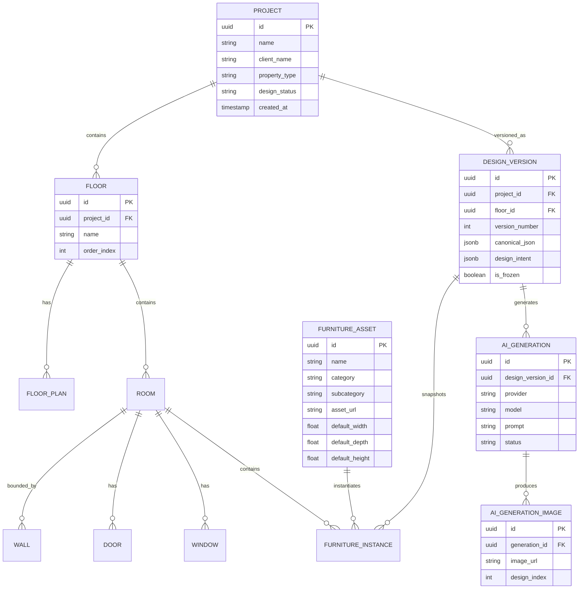

# MYNEST DESIGN STUDIO — MASTER PRODUCT REQUIREMENTS DOCUMENT (PRD)
## Single Source of Truth for Architecture, Product Requirements & Engineering Specification

---

## 0. Document Control & Metadata

| Metadata Field | Value |
|---|---|
| **Product Name** | MYNEST DESIGN STUDIO |
| **Document Title** | Master Product Requirements Document & Technical Architecture Blueprint |
| **Document Version** | 1.0.0 (Consolidated Master Specification) |
| **Document Status** | Final / Approved for Engineering Review |
| **Author / Role** | Senior Product Architect, UX Lead & Technical Product Manager |
| **Primary Base Input** | `Cl_PRD.md` (Technical Foundation) |
| **Consolidated Inputs** | `A_MYNEST_DESIGN_STUDIO_PRD.md`, `Co_MYNEST_DESIGN_STUDIO.md`, `o_PRD.md`, `.agent/` Prompts, `reference_image/` UI Snapshots |
| **Target Platform** | Desktop-First Web Application (Responsive 1280×720 min, 1920×1080 optimal) |
| **Mandated Frontend Stack** | React.js + TypeScript (Vite/Electron-ready, Konva layered 2D canvas, Zustand state management) |
| **Mandated Backend Stack** | Python + FastAPI (PostgreSQL relational DB, Redis cache/broker, Celery async queues) |
| **Supported AI Providers** | Google Gemini, Anthropic Claude, OpenAI, Mistral AI, NVIDIA AI (Pluggable Abstraction Layer) |

---

## 1. Guiding Architectural Invariant (Non-Negotiable Rule)

> [!CAUTION]
> **THE 2D FLOOR-PLAN GEOMETRY IS THE SINGLE SOURCE OF TRUTH.**
> **AI IS NEVER THE SOURCE OF TRUTH FOR GEOMETRY.**

The application's deterministic geometry engine and 2D canvas editor are **authoritative** for all structural walls, room boundaries, doors, windows, dimensions, and furniture transforms (X/Y position, width, depth, height, and rotation angle). 

The AI generation layer is strictly a **visualizer engine** — it enhances materials, lighting, textures, colors, ceiling details, and photorealistic rendering, but it **MUST NOT** add, remove, or relocate walls, alter room proportions, move doors/windows, or modify canonical furniture geometry.

```
┌────────────────────────────────┐     ┌──────────────────────────────┐     ┌──────────────────────────────┐     ┌──────────────────────────────┐
│     2D Canvas Editor Stage     ├────►│    Deterministic Geometry    ├────►│    Canonical Design JSON     ├────►│    AI 3D Visualizer Suite    │
│  (Authoritative User Canvas)   │     │    Engine & Guard Rules     │     │   (Single Source of Truth)   │     │  (Non-Authoritative Render)  │
└────────────────────────────────┘     └──────────────────────────────┘     └──────────────────────────────┘     └──────────────────────────────┘
```

**Architectural Enforcement Rule**: Never build a workflow that feeds AI outputs back into the geometry model (`Floor Plan → AI → Final Geometry`). Geometry flows strictly downstream into the AI visualization engine. Any pull request violating this separation will fail CI architecture gates (NFR-08).

---

## 2. Executive Summary

MYNEST DESIGN STUDIO is a desktop-first interior design workspace that bridges the gap between accurate 2D floor planning and photorealistic AI interior visualization. 

In traditional workflows, interior designers and sales teams bounce between CAD viewers, spreadsheets, and standalone AI image generators. This fragmenting leads to **geometry drift** (AI generating wall structures or furniture layouts that cannot be physically built), lost version history, and zero automated spatial validation before client presentations.

MYNEST DESIGN STUDIO solves this problem by combining:
1. A layered 2D canvas editor supporting multi-floor upload, precise wall tracing, room polygon creation, and vector SVG furniture layout.
2. A deterministic spatial validation engine that checks wall collisions, room containment, door swing arc clearances, and circulation paths in real time.
3. A 1-to-1 canonical backend JSON data layer (FastAPI + PostgreSQL) that maintains identical spatial state between frontend and server.
4. A pluggable multi-provider AI visualization engine (Gemini, Claude, OpenAI, Mistral, NVIDIA) that injects strict server-side geometry constraints to ensure photorealistic renders stay true to the buildable layout.
5. A split-screen comparison workspace (`< Previous 1 / 10 Next >`) allowing users to cycle through multiple 3D AI interior variations while pinning the original 2D floor plan for client evaluation.

---

## 3. Product Vision & Core Value Proposition

### 3.1 Product Vision
To empower interior designers, architects, and sales consultants with a unified desktop workspace where a raw floor plan is transformed into a validated 2D layout and photorealistic AI 3D visualization within minutes — with complete architectural integrity guaranteed.

### 3.2 Core Value Proposition
- **Fidelity Guarantee**: What you design on the 2D canvas is exactly what the AI visualizes. Zero hallucinated walls or displaced furniture.
- **Unified Workspace**: Floor-plan editing, SVG furniture drag/drop, numeric property tuning, spatial validation, AI rendering, and comparison view all exist in one cohesive desktop shell.
- **Multi-Provider AI Freedom**: Never locked to a single AI vendor. Switch seamlessly between Gemini, Claude, OpenAI, Mistral, and NVIDIA with server-managed security.
- **Client Presentation Readiness**: Built-in split-screen comparison mode and high-resolution export center (PNG, PDF) streamline client sign-offs.

---

## 4. Problem Statement & Opportunity

### 4.1 Core Friction Points
1. **Geometry Drift**: External AI render tools distort wall boundaries, alter room dimensions, and shift furniture placements, generating visual concepts that cannot be built on-site.
2. **Disconnected Tools**: Dimensions live in CAD, furniture specs live in spreadsheets, and client visuals live in render software. Re-keying data creates desynchronization.
3. **Lack of Automated Spatial Validation**: Designers spend hours manually checking if door swings are blocked or if clearance paths meet minimum standards.
4. **Lost Iteration History**: Tweaking a layout overwrites prior states, preventing side-by-side evaluation of design variants with clients.

### 4.2 User Jobs-To-Be-Done (JTBD)
- **JTBD 1 (Import & Geometry)**: When I receive a floor plan (PNG/JPG/PDF/SVG), I want to calibrate its scale and define dimensioned room geometry, so that all downstream design work references an accurate source.
- **JTBD 2 (Layout & Editing)**: When I furnish a room, I want to drag SVG furniture items, resize, rotate, and precisely position them with snapping and collision guards, so that the layout is physically viable.
- **JTBD 3 (AI Visualization)**: When I finalize a 2D layout, I want to generate photorealistic 3D interior renders via AI that preserve my exact geometry and furniture positions.
- **JTBD 4 (Comparison & Presentation)**: When I present designs to clients, I want a split-screen canvas comparing the raw 2D plan on the left with 3D renders on the right, using `< Previous 1 / 10 Next >` pagination to cycle through design options.
- **JTBD 5 (Handoff & Export)**: When a client approves a design, I want to export dimensioned layouts and render packages to PDF/PNG for site execution teams.

---

## 5. Quantifiable KPIs & Target SLA Metrics

| KPI ID | Metric Category | Target SLA / Operational Goal | Measurement Method |
|---|---|---|---|
| **KPI-01** | Geometry Preservation | ≥ 99.9% of AI generations exhibit zero wall, door, window, or furniture displacement | QA sampling & automated feature mask diffs |
| **KPI-02** | Editor FPS Performance | Sustained ≥ 55 FPS during drag/resize with 100+ active furniture objects | Browser Performance API / Canvas FPS counter |
| **KPI-03** | Input Latency | < 16 ms for pointer transform updates; < 32 ms for two-way numeric inspector sync | Event loop latency profiling |
| **KPI-04** | Layout Validation Pass Rate | ≥ 95% of finalized layouts pass door/window clearance rules with 0 INVALID warnings | Automated geometry guard engine logs |
| **KPI-05** | AI Provider Availability | 99.5% success rate with automatic failover retry across 5 AI providers | Backend API Gateway error rate metrics |
| **KPI-06** | Layout Completion Time | ≤ 20 minutes from floor-plan upload to validated furnished room layout | User journey telemetry tracking |
| **KPI-07** | Crash-Free Sessions | ≥ 99.5% crash-free editor user sessions | Sentry / Telemetry error tracking |

---

## 6. Target User Personas & Demographics

### 6.1 Persona A — "Priya" (Lead Interior Designer - Primary)
- **Role**: Senior Space Planner at a residential interior design studio.
- **Tech Literacy**: High for CAD/design tools; medium for web development concepts.
- **Key Workflow**: Imports floor plan → defines rooms/walls → drags SVG furniture → tunes exact mm dimensions → runs spatial validation → triggers AI 3D renders → exports client package.
- **Needs**: Millimetric precision, snapping controls, clearance warning overlays, clean design system, high-fidelity photorealistic renders.

### 6.2 Persona B — "Rahul" (Design Sales Consultant - Primary)
- **Role**: Client Relationship & Sales Manager.
- **Tech Literacy**: Medium.
- **Key Workflow**: Opens existing project → modifies furniture layout → generates 3 AI visual style options → uses split-screen comparison mode (`< Previous 1/10 Next >`) during client meeting to secure sign-off.
- **Needs**: Speed, visually stunning UI, simple navigation, instant 2D/3D comparison, one-click PDF/PNG exports.

### 6.3 Persona C — "Anjali" (Studio Operations Manager - Secondary)
- **Role**: Manages studio projects, designer access, and operational budgets.
- **Tech Literacy**: Medium.
- **Key Workflow**: Creates client projects, sets up floor plan hierarchies, monitors AI provider API token budgets, enforces project archiving and version control.
- **Needs**: Project dashboard overview, immutable version history, AI provider cost guardrails.

### 6.4 Persona D — "Vikram" (Site Execution Engineer - Read-Only Secondary)
- **Role**: Oversees physical civil and carpentry work on site.
- **Tech Literacy**: Moderate (uses mobile/tablet/desktop PDF viewers).
- **Key Workflow**: Opens dimensioned PDF/PNG exports, verifies wall measurements and furniture placement coordinates on site.
- **Needs**: Accurate 2D dimension callouts; absolute certainty that the AI render matches site geometry.

---

## 7. Executive Product Scope Matrix

| Capability | Phase 1 (MVP) | Phase 2 (Core) | Phase 3 (Advanced) |
|---|---|---|---|
| **Project Dashboard** | Multi-project grid/list, search, create, open, archive | Project tags, client metadata search | Studio team collaboration |
| **Floor Plan Management** | Multi-floor project hierarchy, raster (PNG/JPG) & vector SVG plan upload | Vector PDF scale extraction, structured JSON import | Auto CAD/DXF drawing ingest |
| **Geometry Model** | Wall drawing (x1,y1,x2,y2,thickness), room polygons, doors, windows, openings | Semi-automated room polygon auto-detection | Deep Learning auto-vector wall extraction |
| **2D Canvas Engine** | Layered stage (Background/Grid, Floor Plan, Furniture, Dimensions, Selection) | Custom floor textures (herringbone, tile patterns) | Multi-room wall alignment guides |
| **Furniture Library** | Categorized vector SVG library (Sofa, Bed, Chair, Table, Wardrobe, TV Unit, Bath, etc.) | Brand catalogs, electrical appliances, lighting | User-uploaded custom SVG assets |
| **Furniture Manipulation** | Drag/drop, move, corner/edge resize (W/D), height Z-parameter, rotation, snap | Multi-object marquee group transforms | Intelligent layout recommendations |
| **Property Inspector** | Interactive floating popup dialog + right-side panel with two-way numeric sync | Batch property editing | Parametric furniture customizer |
| **Spatial Guards** | Wall intersection guard, SAT collision detection, room containment validation | Door & window swing arc clearance rules | Real-time circulation path optimization |
| **Backend Layer** | FastAPI canonical JSON serialization, PostgreSQL database, Redis caching | Immutable version history tree | Real-time WebSocket multi-user sync |
| **AI Provider Layer** | Adapter interface + 5 Provider adapters (Gemini, Claude, OpenAI, Mistral, NVIDIA) | Custom lighting & material intent presets | AI Fly-through video generation |
| **Comparison Canvas** | Split-screen workspace (Left 2D Plan / Right AI Render) with divider bar | Interactive curtain slider comparison | Interactive 3D WebGL preview |
| **Design Pagination** | `< Previous X / N Next >` multi-design pagination bar | Side-by-side design variation matrix | A/B prompt strategy matrix |
| **Export Center** | Dimensioned 2D PNG export (300 DPI) | Client PDF presentation package & comparison sheet | 3D GLB/FBX/Scene export |

---

## 8. Comparative Analysis of Existing PRDs

Before finalizing this Master PRD, a thorough analysis of the four existing PRD documents was conducted:

```
┌──────────────────────────────────────────────────────────────────────────────────────────────────┐
│                               EXISTING PRD EVALUATION MATRIX                                     │
├──────────────────────────┬──────────────────────────┬───────────────────────┬────────────────────┤
│ Document Name            │ Primary Focus            │ Technical Depth       │ Master PRD Action  │
├──────────────────────────┼──────────────────────────┼───────────────────────┼────────────────────┤
│ Cl_PRD.md                │ Architectural Baseline   │ High (9.5/10)         │ PRIMARY FOUNDATION │
│ A_MYNEST_DESIGN_STUDIO…  │ UX & Mathematical Engine │ High (9.0/10)         │ REUSED & INTEGRATED│
│ Co_MYNEST_DESIGN_STUDIO… │ Scope & Persona Matrix   │ Medium (7.5/10)       │ REUSED & INTEGRATED│
│ o_PRD.md                 │ Workflow & UI Layout     │ Moderate (7.0/10)     │ REUSED & INTEGRATED│
└──────────────────────────┴──────────────────────────┴───────────────────────┴────────────────────┘
```

### 8.1 Detailed Breakdown & Consolidation Rationale

1. **`Cl_PRD.md` (Primary Baseline Foundation)**:
   - **Strengths**: Contains the strongest architectural rigor, explicit service boundary definitions (`GeometryService`, `ValidationService`, `AIProviderService`), complete PostgreSQL DDL scripts, Zustand store slice definitions, and NFR-08 CI testing gates.
   - **Weaknesses**: Lacks visual token details and explicit floating inspector dialog specifications derived from reference images.
   - **What was retained**: Preserved in full as the backbone for Sections 0, 1, 21, 22, 23, 24, 25, 26, 27, and 37.

2. **`A_MYNEST_DESIGN_STUDIO_PRD.md`**:
   - **Strengths**: Excellent KPI formulations, detailed mathematical specifications for room area calculation and Separating Axis Theorem (SAT) collision detection, explicit Master AI Constraint prompt text, and detailed floating control dialog definitions (`Length L`, `Depth D`, `Height H`, `Rotation`, `Color Swatch`).
   - **Weaknesses**: Slightly less modular state breakdown than `Cl_PRD.md`.
   - **What was reused**: Incorporated its mathematical formulas (§21), Master AI Constraint block (§29), and interactive control point popup specification (§18).

3. **`Co_MYNEST_DESIGN_STUDIO.md`**:
   - **Strengths**: Clear user persona breakdown (Designer, Sales, Manager, Engineer), concise scope matrix framing, and desktop offline resilience requirements.
   - **Weaknesses**: Lacks mathematical formulas and explicit CI testing assertions.
   - **What was reused**: Incorporated its user persona structures (§6), JTBD framing (§4), and offline-first fallback principles (§33).

4. **`o_PRD.md`**:
   - **Strengths**: Highly logical 18-step user workflow sequence, keyboard shortcut mapping matrix (`Ctrl+D`, `Del`, `Space`, `R`, `Esc`), and clear desktop panel layout conventions.
   - **Weaknesses**: Omits complete PostgreSQL schema and AI prompt engineering pipeline details.
   - **What was reused**: Incorporated its complete keyboard navigation map (§18) and UI layout spacing rules (§11).

---

## 9. Desktop Application Shell & Layout Architecture

*(Grounding derived from reference UI snapshots: `reference_image/Screenshot 2026-08-10 155604.png` through `155712.png`)*

The application shell adopts a high-density, professional three-panel studio workspace designed for desktop screens (1280×720 minimum, 1920×1080 optimal).

```text
┌────────────────────────────────────────────────────────────────────────────────────────────────────────┐
│ TOP HEADER BAR: Logo · Project Name · Floor Selector [Ground Floor ▼] · Undo · Redo · Save · [2D | 3D] │
├────────────┬──────────────────────────────────────────────────────────────┬────────────────────────────┤
│ LEFT NAV   │ SUBPANEL (Furniture Library / Object Drawer)                 │ RIGHT INSPECTOR PANEL      │
│ ┌────────┐ │ ┌──────────────────────────────────────────────────────────┐ │ ┌────────────────────────┐ │
│ │Project │ │ │ 🔍 Search furniture assets...                          │ │ │ LEVEL PROPERTIES       │ │
│ │Build   │ │ ├──────────────────────────────────────────────────────────┤ │ │ Active Level: Ground   │ │
│ │Objects │ │ │ [Categories]  [Brands]                               │ │ │ Area: 40.9 m²          │ │
│ │Finishes│ │ │ Subcategory Pills: [Two-seat] [Three-seat] [Beds]...     │ │ │ Wall Height: 2800 mm   │ │
│ │Export  │ │ ├──────────────────────────────────────────────────────────┤ │ ├────────────────────────┤ │
│ └────────┘ │ │ ┌─────────┐  ┌─────────┐  ┌─────────┐                    │ │ │ SELECTED ITEM PROPERTIES│ │
│            │ │ │  SVG    │  │  SVG    │  │  SVG    │                    │ │ │ Name: 3-Seater Sofa    │ │
│            │ │ │ Sofa 1  │  │ Sofa 2  │  │ Bed 1   │                    │ │ │ X: 1500 mm  Y: 1200 mm │ │
│            │ │ └─────────┘  └─────────┘  └─────────┘                    │ │ │ W: 2100 mm  D: 900 mm  │ │
│            │ └──────────────────────────────────────────────────────────┘ │ │ H: 850 mm   Rot: 45°   │ │
│            ├──────────────────────────────────────────────────────────────┤ │ │ [Lock] [Dup] [Delete]  │ │
│            │              LARGE 2D CANVAS STAGE (Konva Stage)             │ └────────────────────────┘ │
│            │   (Thick Wall Structures · Window Lines · Door Swing Arcs ·  │                            │
│            │    Dimension Lines · Furniture SVGs · Selection Bounding Box)│                            │
│            │                                                              │                            │
│            │   ┌──────────────────────────────────────────────────────┐   │                            │
│            │   │ FLOATING CONTROL INSPECTOR POPUP (Over Selected Item)│   │                            │
│            │   │ Title: Sofa  [Lock] [Duplicate] [Mirror] [Delete]    │   │                            │
│            │   │ L (mm): 2100  D (mm): 900  Rot (°): 45  [Edit H >]   │   │                            │
│            │   └──────────────────────────────────────────────────────┘   │                            │
├────────────┴──────────────────────────────────────────────────────────────┴────────────────────────────┤
│ BOTTOM TOOLBAR: Unit [mm|m|ft] · Zoom [-] 100% [+] · Fit · Snap [ON] · Collision [ON] · Generate AI 3D │
└────────────────────────────────────────────────────────────────────────────────────────────────────────┘
```

### Key UI Elements Extracted from Reference Snapshots
1. **Top Application Bar**: Project title display, floor level selector dropdown, global Undo (`Ctrl+Z`), Redo (`Ctrl+Y`), Save status badge, primary orange CTA button (`Export Image` / `Generate AI 3D`).
2. **Left-Most Icon Navigation**: Vertical icon rail switching subpanels between Project, Build/Tools, Objects/Furniture, Finishes/Materials, and Export.
3. **Furniture Subpanel Drawer**: Search input, Category vs Brand tab toggles, subcategory filter pills, thumbnail grid with color/variation counts, lazy-loaded vector graphics.
4. **Central 2D Canvas Stage**: High-DPI canvas with grid background, thick dark wall lines, blue window indicators, door swing arcs, real-time metric dimension callouts (`4.03 m`, `2100 mm`), and node handles (yellow dots).
5. **Floating Control Inspector Popup**: Attached directly above active canvas selection box; contains item title, action buttons (Lock, Duplicate, Mirror, Delete), numeric Length/Depth/Rotation inputs, color swatch selector, and `edit height >` link.
6. **Right Inspector Panel**: Displays level properties (Level Name, Total Area in m², Wall Height, Floor Thickness) and selected object numeric properties.
7. **Bottom Status & Control Bar**: Unit toggle (`mm` / `m` / `ft-in`), zoom slider (+ / - / fit-to-screen), grid snap toggle, collision guard toggle, and primary AI trigger.

---

## 10. Design System & Visual UX Specifications

MYNEST DESIGN STUDIO enforces a premium, modern, technical aesthetic inspired by professional CAD and desktop design tools.

### 10.1 Color Palette Matrix (Studio Theme Tokens)

```css
:root {
  /* Brand Primaries */
  --color-primary-500: #0ea5e9;       /* Active selections, tabs, links */
  --color-primary-600: #0284c7;       /* Hover states, primary buttons */
  --color-accent-orange: #f97316;     /* Primary CTA (Generate AI 3D, Export) */

  /* Neutral Dark (Studio Shell & Panels) */
  --color-surface-bg: #0f172a;        /* Deep slate background */
  --color-surface-panel: #1e293b;     /* Card & panel surfaces */
  --color-surface-border: #334155;    /* Subtle panel borders */

  /* Canvas Environment */
  --color-canvas-bg: #f8fafc;        /* Clean light canvas background */
  --color-canvas-grid: #e2e8f0;      /* Subtle grid lines */
  --color-wall-fill: #0f172a;        /* Solid thick structural wall fill */
  --color-window-line: #38bdf8;      /* Glass window stroke */
  --color-door-arc: #94a3b8;         /* Door swing radius stroke */

  /* Selection & Bounding Box Handles */
  --color-selection-border: #0284c7;  /* Selection bounding box stroke */
  --color-handle-corner: #38bdf8;     /* Bounding box corner handles */
  --color-handle-rotation: #10b981;   /* Rotation stem handle (Emerald green) */
  --color-warning-border: #ef4444;    /* Collision & clearance error outline */
  --color-warning-fill: rgba(239, 68, 68, 0.15);
}
```

### 10.2 Typography Scale & Hierarchy
- **Font Family**: Primary = `Inter`, `system-ui`; Monospace = `JetBrains Mono` (for dimensions and coordinates).
- **Heading 1 (Panel Titles)**: Inter 16px / SemiBold (1.2 line height)
- **Heading 2 (Subcategories)**: Inter 13px / Medium
- **Body Text (Property Fields)**: Inter 12px / Regular
- **Canvas Dimension Callouts**: JetBrains Mono 11px / Bold (e.g., `4.03 m`, `2100 mm`)

### 10.3 Touch Target & Spacing Scale
- Spacing grid: 4px, 8px, 12px, 16px, 24px, 32px.
- Minimum interactive touch/click target size ≥ 36×36 px (48×48 px for major toolbar buttons).

---

## 11. Application Navigation & Route Mapping

The application follows a desktop single-page application (SPA) router structure:

```
/                                             → Project Dashboard (Grid of all projects)
/projects/:projectId                          → Floor Plan Manager (Floors & Rooms overview)
/projects/:projectId/floors/:floorId/design   → 2D Design Studio Workspace (Main 2D Editor)
/projects/:projectId/floors/:floorId/compare  → 2D + AI 3D Side-by-Side Comparison Workspace
/projects/:projectId/floors/:floorId/gallery  → AI Generation Gallery (< Prev 1/10 Next >)
/projects/:projectId/export                   → High-Resolution Export Center
```

---

## 12. Multiple Floor-Plan & Room Hierarchy Management

A project contains one or more floor plans (e.g., Ground Floor, First Floor, Terrace).

```
Project
 └── Floor (id, name, order_index, elevation)
      ├── FloorPlan (source_type, storage_url, scale_mm_per_px)
      ├── Room[] (id, name, type, polygon, area_m2)
      ├── Wall[] (id, x1, y1, x2, y2, thickness)
      ├── Door[] (id, wall_id, x, width, swing)
      ├── Window[] (id, wall_id, x, width)
      └── FurnitureInstance[] (id, asset_id, x, y, width, depth, height, rotation)
```

### Requirements for Floor Plan Management
1. **Tree Navigation**: The left sidebar navigation provides an expandable tree view of Project ▸ Floors ▸ Rooms.
2. **Active Floor Plan**: Selecting a floor tab instantly loads its geometric canvas state. Only one floor plan is active for editing at a time.
3. **Scale Calibration**: When uploading a raster/vector floor plan, the user draws a reference line over a known measurement (e.g., 1.00 m) to compute `scale_mm_per_px`.
4. **State Isolation**: Furniture instances, room polygons, and walls belong strictly to their parent floor plan. Switching floors does not destroy unsaved edits.

---

## 13. 2D Design Studio Workspace Specifications

The 2D Design Studio is the central editing hub of MYNEST DESIGN STUDIO.

### Core Canvas Features
- **Vector Surface**: Built using Konva.js stage rendering over an HTML5 canvas.
- **Layered Architecture**: Rendered across 5 discrete logical layers (see §14).
- **Navigation Controls**:
  - **Pan**: Hold `Spacebar` + drag left mouse button, OR click middle mouse wheel + drag.
  - **Zoom**: Mouse wheel scroll (zoom centered at pointer location) OR bottom toolbar `+` / `-` buttons. Zoom range: 10% to 1000%.
  - **Fit to Screen**: Double-click middle mouse wheel OR click "Fit" button to frame active floor plan.
- **Grid System**: Toggleable background grid snapping to 10 mm, 50 mm, 100 mm, or 500 mm intervals.

---

## 14. Interactive Canvas Layer Stack Specifications

To prevent expensive full-app re-renders during pointer interactions, the canvas stage is divided into 5 independent logical layers:

```
Konva Stage (Container)
 ├── Layer 1: Background & Grid Layer    (Static grid pattern & background color)
 ├── Layer 2: Floor Plan Layer           (Uploaded image, wall lines, room polygons, door arcs, windows)
 ├── Layer 3: Furniture Layer            (SVG furniture instances rendered by z_index)
 ├── Layer 4: Dimension Layer            (Dimension lines, wall length callouts, room area text)
 └── Layer 5: Interaction Layer          (Selection bounding box, 8 resize handles, rotation handle, floating popup, snap lines)
```

**Optimization Rule**: Pointer drag events only update items on Layer 3 (Furniture) and Layer 5 (Interaction). Layers 1, 2, and 4 remain static and cached in GPU memory during drag operations, sustaining ≥ 55 FPS.

---

## 15. Furniture Library & Vector SVG Asset Catalog

### 15.1 Categories & Subcategories

```
Furniture Library Catalog
 ├── Living Room          (Sofa, Sectional, Armchair, Coffee Table, TV Unit, Console)
 ├── Bedroom              (King Bed, Queen Bed, Single Bed, Wardrobe, Nightstand, Dresser)
 ├── Dining Area          (Dining Table, Dining Chair, Sideboard, Bar Stool)
 ├── Kitchen              (Kitchen Cabinet, Sink Unit, Cooking Range, Refrigerator, Counter)
 ├── Bathroom             (Bathtub, Shower Enclosure, Wash Basin, Toilet Closet, Vanity)
 ├── Foyer & Storage      (Shoe Rack, Coat Hanger, Console Table, Storage Cabinet)
 ├── Balcony & Outdoor    (Outdoor Seating, Coffee Table, Planters, Lounger)
 ├── Lighting & Appliances (Floor Lamp, Ceiling Light, Pendant Lamp, TV, AC Unit)
 └── Decor & Accessories  (Rugs, Indoor Plants, Mirrors, Wall Art)
```

### 15.2 Asset Properties & Format
- **Vector Format**: Assets are stored as scalable, clean SVG files.
- **Default Metadata**: Each asset entry in `furniture_assets` includes:
  - `default_width` (mm), `default_depth` (mm), `default_height` (mm)
  - `default_rotation` (0°)
  - `supported_rooms` (array of room type strings)
  - `thumbnail_url` (raster preview) and `asset_url` (scalable vector SVG)

---

## 16. Furniture Drag-and-Drop Placement Mechanics

### Step-by-Step Drop Workflow
1. User clicks and holds a furniture thumbnail in the right-side library drawer.
2. Pointer drag enters the canvas stage; a semi-transparent vector ghost sprite attaches to the cursor.
3. As cursor moves over canvas, the ghost sprite automatically calculates real-world millimeter coordinates based on canvas scale and active grid snap settings.
4. User releases mouse button over canvas:
   - System instantiates a new `FurnitureInstance` record with a unique UUID.
   - Computes point-in-polygon containment to auto-assign `room_id`.
   - Appends instance to Furniture Layer (Layer 3).
   - Activates selection bounding box and floating control popup on Interaction Layer (Layer 5).
   - Pushes an "Add Furniture" command to the Undo History Stack.

---

## 17. Furniture Manipulation & Control Point Specifications

When a furniture object is clicked on the canvas, an interactive bounding box activates around it.

```text
                  [Rotation Handle Stem (Green Dot)]
                                  │
                                  │
      (Handle 1) ┌───────────────┴───────────────┐ (Handle 2)
                 │                               │
                 │     PLACED FURNITURE ITEM     │
      (Handle 8) │       (Vector SVG Sprite)     │ (Handle 3)
                 │                               │
                 │                               │
      (Handle 7) └───────────────────────────────┘ (Handle 4)
                                (Handle 5)

   FLOATING INSPECTOR POPUP (Anchored directly above bounding box):
   ┌─────────────────────────────────────────────────────────────┐
   │ 3-Seater Sofa    [Lock]  [Duplicate]  [Mirror]  [Delete]    │
   ├─────────────────────────────────────────────────────────────┤
   │ Length (mm): [ 2100 ]   Depth (mm): [ 900 ]   Rot: [ 45° ]  │
   │ Color: [ #3b82f6 ▼ ]   Height: [ 850 mm ]  (edit height >)  │
   └─────────────────────────────────────────────────────────────┘
```

### Transform Controls & Interaction Behaviors
1. **Move (Translation)**: Click and drag anywhere inside the bounding box to move item in X/Y plane.
2. **Corner Handles (Handles 1, 2, 4, 7)**: Drag to resize Width and Depth simultaneously. Aspect ratio locked by default; hold `Alt` key to unlock.
3. **Edge Handles (Handles 3, 5, 6, 8)**: Drag side handles to stretch Width or Depth independently.
4. **Rotation Handle Stem**: Top green dot handle extends above the bounding box. Dragging rotates the furniture object around its geometric center. Snaps to 15°, 45°, and 90° angles when holding `Shift`.
5. **Height Parameter (Z-Axis)**: Height is adjusted numerically in the Floating Inspector Popup or Right Properties Panel. Height defines vertical 3D space during AI generation.
6. **Minimum Dimension Clamping**: Width and Depth cannot be dragged below `100 mm` to prevent inverted negative geometry.

---

## 18. Two-Way Real-Time Property Synchronization

The canvas interaction engine maintains strict bidirectional binding with numeric input fields in the Properties Inspector:

```
┌────────────────────────────────────────┐                     ┌────────────────────────────────────────┐
│          2D CANVAS SPRITE              │                     │       NUMERIC INSPECTOR FIELDS         │
│  User drags corner handle on canvas    ├────────────────────►│  Input fields (W: 2100, D: 900) update │
│  to expand sofa width to 2100 mm.      │  Live Event Emitted │  in real time (< 16 ms latency).       │
├────────────────────────────────────────┤                     ├────────────────────────────────────────┤
│  Canvas sprite expands immediately     │◄────────────────────┤  User types "2400" into Width field    │
│  to match 2400 mm on screen.           │  Store State Sync   │  and hits Enter or blurs input.        │
└────────────────────────────────────────┘                     └────────────────────────────────────────┘
```

**Consistency Rule**: Editing a numeric field (X, Y, Width, Depth, Height, Rotation) immediately updates the canvas sprite geometry. Dragging a canvas sprite immediately updates the numeric field text boxes. Zero visual desynchronization allowed.

---

## 19. Room-wise Interior Layout & Containment Engine

The system supports complete furniture arrangement for all standard residential zones:
- **Foyer & Entryway**
- **Living Area**
- **Dining Area**
- **Kitchen & Pantry**
- **Master Bedroom / Guest Bedrooms**
- **Bathrooms & Powder Rooms**
- **Balconies & Utility Areas**

### Room Containment Logic
- Each room is defined as a closed 2D polygon `[[x1,y1], [x2,y2], ...]`.
- When a furniture item's center point `(x, y)` lies inside a room polygon, `validateRoomContainment()` assigns `room_id = room.id`.
- If furniture is placed outside all room polygons, it is tagged as `room_id = null` and displays a yellow "Unassigned Location" warning badge.

---

## 20. Deterministic Geometry Calculation Engine

All spatial calculation logic consists of pure, side-effect-free functions mirrored across frontend TypeScript and backend Python modules.

### 20.1 Room Polygon Area Calculation (Shoelace Formula)
Given a room polygon with $n$ vertices $(X_1, Y_1), (X_2, Y_2), \dots, (X_n, Y_n)$ in millimeters:

$$\text{Area (m}^2\text{)} = \frac{1}{2 \times 10^6} \left| \sum_{i=1}^{n} (X_i Y_{i+1} - X_{i+1} Y_i) \right| \quad \text{where } (X_{n+1}, Y_{n+1}) = (X_1, Y_1)$$

### 20.2 Separating Axis Theorem (SAT) Collision Detection
For two oriented rectangular furniture bounding boxes $A$ and $B$ with center points $C_A, C_B$, half-widths $w_A, w_B$, half-depths $d_A, d_B$, and rotation angles $\theta_A, \theta_B$:

Collision occurs if and only if there is **no separating axis** along the 4 edge normal vectors of $A$ and $B$.

If bounding boxes overlap:
- Canvas renders a red warning outline around intersecting items.
- Validation service flags a `WARNING: Furniture Collision` status.

### 20.3 Door Swing Arc Clearance Threshold
- Each door item has a defined swing arc polygon representing its opening clearance area.
- Furniture bounding boxes must maintain a minimum clearance of $C_{\text{door}} \ge 150\text{ mm}$ from any door swing arc.
- Placing furniture inside a door swing arc generates an `INVALID: Door Opening Blocked` warning pill.

---

## 21. Canonical Geometry Source of Truth & Data Layer

The canonical geometry payload is a 1-to-1 JSON document representing the authoritative state of a floor plan layout:

```json
{
  "project_id": "PRJ-90210",
  "floor_id": "FLR-001",
  "design_version": 4,
  "scale_mm_per_px": 2.50,
  "rooms": [
    {
      "id": "ROOM-LIVING-01",
      "name": "Living Room",
      "room_type": "living",
      "polygon": [[1000, 1000], [6000, 1000], [6000, 5000], [1000, 5000]],
      "area_m2": 20.00
    }
  ],
  "walls": [
    { "id": "WALL-01", "x1": 1000, "y1": 1000, "x2": 6000, "y2": 1000, "thickness_mm": 150 }
  ],
  "doors": [
    { "id": "DOOR-01", "wall_id": "WALL-01", "x_mm": 2000, "width_mm": 900, "rotation": 0, "swing": "inside" }
  ],
  "windows": [
    { "id": "WIN-01", "wall_id": "WALL-01", "x_mm": 4000, "width_mm": 1200 }
  ],
  "furniture": [
    {
      "id": "FURN-SOFA-01",
      "asset_id": "ASSET-SOFA-3SEATER",
      "type": "sofa",
      "name": "3-Seater Leather Sofa",
      "room_id": "ROOM-LIVING-01",
      "x": 2500,
      "y": 2000,
      "width": 2100,
      "depth": 900,
      "height": 850,
      "rotation": 0,
      "locked": false,
      "z_index": 2
    }
  ],
  "design_intent": {
    "style": "Modern Luxury",
    "mood": "Warm, Elegant, High-End",
    "colors": ["Warm Beige", "Walnut Wood", "Soft Grey", "Brass Accents"],
    "lighting": "Warm Ambient Recessed & Pendant",
    "materials": ["Italian Leather", "Natural Oak", "Calacatta Marble"]
  }
}
```

---

## 22. Backend Architecture & FastAPI Service Boundaries

The backend is built using Python 3.11+ and FastAPI. Logic is decoupled into clear service modules:

```
fastapi_app/
 ├── api/                       # API Route Controllers
 │    ├── projects.py           # Project CRUD & listing
 │    ├── floors.py             # Floor & plan management
 │    ├── furniture.py          # SVG Asset library catalog & search
 │    ├── design_versions.py    # Canonical JSON save/load & versioning
 │    ├── ai_generation.py      # AI 3D visualization requests
 │    └── export.py             # High-resolution rendering & PDF generation
 ├── services/                  # Business Logic Layer
 │    ├── GeometryService.py    # Area calculations & SAT polygon math
 │    ├── ValidationService.py  # Spatial clearance & collision rules
 │    ├── PromptService.py      # Prompt synthesis & constraint injection
 │    ├── AIProviderService.py  # Pluggable adapter orchestration
 │    └── StorageService.py     # S3 asset upload & URL signing
 ├── models/                    # Pydantic Schemas & SQLAlchemy Entities
 └── workers/                   # Celery Async Background Tasks
```

---

## 23. Frontend / Backend Synchronization & Optimistic Rollback

To provide a smooth 60 FPS desktop user experience, frontend canvas state updates optimistically:

1. **User Edit**: User moves a sofa on the 2D canvas. Canvas updates locally with 0 ms lag.
2. **Debounced Auto-Save**: Editor debounces state changes for 2000 ms before sending POST `/api/design-versions` payload.
3. **Backend Validation**: FastAPI server receives canonical JSON, validates against Pydantic schemas, and saves snapshot to PostgreSQL.
4. **Rollback Safety Net**: If server returns an error (e.g. database write lock or network drop), the frontend reverts canvas state to the last-known valid canonical JSON and displays an inline toast notification.

---

## 24. Entity-Relationship Diagram & Conceptual Data Model



---

## 25. Database DDL & Schema Specifications (PostgreSQL)

```sql
-- PostgreSQL Production DDL Schema for MYNEST DESIGN STUDIO

CREATE EXTENSION IF NOT EXISTS "pgcrypto";

-- Projects Table
CREATE TABLE projects (
  id            UUID PRIMARY KEY DEFAULT gen_random_uuid(),
  name          VARCHAR(255) NOT NULL,
  client_name   VARCHAR(255),
  property_type VARCHAR(100) DEFAULT '3-BHK Apartment',
  design_status VARCHAR(50) NOT NULL DEFAULT 'draft',
  created_at    TIMESTAMPTZ NOT NULL DEFAULT now(),
  updated_at    TIMESTAMPTZ NOT NULL DEFAULT now()
);

-- Floors Table
CREATE TABLE floors (
  id          UUID PRIMARY KEY DEFAULT gen_random_uuid(),
  project_id  UUID NOT NULL REFERENCES projects(id) ON DELETE CASCADE,
  name        VARCHAR(100) NOT NULL,
  order_index INT NOT NULL DEFAULT 0,
  created_at  TIMESTAMPTZ NOT NULL DEFAULT now()
);

-- Floor Plans Reference Table
CREATE TABLE floor_plans (
  id              UUID PRIMARY KEY DEFAULT gen_random_uuid(),
  floor_id        UUID NOT NULL REFERENCES floors(id) ON DELETE CASCADE,
  source_type     VARCHAR(50) NOT NULL CHECK (source_type IN ('raster', 'vector', 'pdf', 'svg')),
  storage_url     TEXT NOT NULL,
  scale_mm_per_px NUMERIC(12, 4) NOT NULL DEFAULT 1.0000,
  created_at      TIMESTAMPTZ NOT NULL DEFAULT now()
);

-- Furniture Catalog Assets
CREATE TABLE furniture_assets (
  id               UUID PRIMARY KEY DEFAULT gen_random_uuid(),
  name             VARCHAR(255) NOT NULL,
  category         VARCHAR(100) NOT NULL,
  subcategory      VARCHAR(100),
  asset_url        TEXT NOT NULL,
  thumbnail_url    TEXT,
  default_width    NUMERIC(10, 2) NOT NULL,
  default_depth    NUMERIC(10, 2) NOT NULL,
  default_height   NUMERIC(10, 2) NOT NULL,
  default_rotation NUMERIC(6, 2) DEFAULT 0,
  supported_rooms  TEXT[]
);

-- Design Versions Table (Canonical Source of Truth)
CREATE TABLE design_versions (
  id             UUID PRIMARY KEY DEFAULT gen_random_uuid(),
  project_id     UUID NOT NULL REFERENCES projects(id) ON DELETE CASCADE,
  floor_id       UUID NOT NULL REFERENCES floors(id) ON DELETE CASCADE,
  version_number INT NOT NULL,
  label          VARCHAR(255),
  canonical_json JSONB NOT NULL,
  design_intent  JSONB,
  is_frozen      BOOLEAN NOT NULL DEFAULT false,
  created_at     TIMESTAMPTZ NOT NULL DEFAULT now(),
  UNIQUE (floor_id, version_number)
);

-- Placed Furniture Instances Table
CREATE TABLE furniture_instances (
  id                UUID PRIMARY KEY DEFAULT gen_random_uuid(),
  design_version_id UUID NOT NULL REFERENCES design_versions(id) ON DELETE CASCADE,
  room_id           VARCHAR(100),
  asset_id          UUID REFERENCES furniture_assets(id),
  type              VARCHAR(100) NOT NULL,
  name              VARCHAR(255) NOT NULL,
  x                 NUMERIC(12, 2) NOT NULL,
  y                 NUMERIC(12, 2) NOT NULL,
  width             NUMERIC(10, 2) NOT NULL,
  depth             NUMERIC(10, 2) NOT NULL,
  height            NUMERIC(10, 2) NOT NULL,
  rotation          NUMERIC(6, 2) DEFAULT 0,
  locked            BOOLEAN DEFAULT false,
  z_index           INT DEFAULT 0
);

-- AI Generations Parent Table
CREATE TABLE ai_generations (
  id                UUID PRIMARY KEY DEFAULT gen_random_uuid(),
  project_id        UUID NOT NULL REFERENCES projects(id) ON DELETE CASCADE,
  floor_id          UUID NOT NULL REFERENCES floors(id) ON DELETE CASCADE,
  design_version_id UUID NOT NULL REFERENCES design_versions(id) ON DELETE CASCADE,
  provider          VARCHAR(50) NOT NULL, -- gemini, claude, openai, mistral, nvidia
  model             VARCHAR(100),
  prompt            TEXT NOT NULL,
  status            VARCHAR(50) NOT NULL DEFAULT 'completed',
  created_at        TIMESTAMPTZ NOT NULL DEFAULT now()
);

-- AI Generated Images Child Table
CREATE TABLE ai_generation_images (
  id            UUID PRIMARY KEY DEFAULT gen_random_uuid(),
  generation_id UUID NOT NULL REFERENCES ai_generations(id) ON DELETE CASCADE,
  image_url     TEXT NOT NULL,
  design_index  INT NOT NULL DEFAULT 1,
  total_designs INT NOT NULL DEFAULT 10,
  created_at    TIMESTAMPTZ NOT NULL DEFAULT now()
);

-- Performance Indexes
CREATE INDEX idx_floors_proj ON floors(project_id, order_index);
CREATE INDEX idx_furniture_cat ON furniture_assets(category, subcategory);
CREATE INDEX idx_versions_floor ON design_versions(floor_id, version_number);
CREATE INDEX idx_instances_ver ON furniture_instances(design_version_id);
CREATE INDEX idx_ai_gen_ver ON ai_generations(design_version_id);
```

---

## 26. REST API Specifications & Data Contracts

| Method | Endpoint | Purpose | Request Payload | Response Contract |
|---|---|---|---|---|
| `GET` | `/api/projects` | List all projects | — | `200 OK [{project}]` |
| `POST` | `/api/projects` | Create new project | `{name, client_name, property_type}` | `201 Created {project}` |
| `GET` | `/api/floors/{id}/rooms` | Fetch floor geometry | — | `200 OK {rooms, walls, doors}` |
| `GET` | `/api/furniture` | Search SVG assets | `?category=living&q=sofa` | `200 OK [{asset}]` |
| `POST` | `/api/design-versions` | Save 2D canonical JSON | `{floor_id, canonical_json, label}` | `201 Created {version_id}` |
| `POST` | `/api/design-versions/{id}/validate` | Run spatial checks | — | `200 OK {results: [{rule, severity, message}]}` |
| `POST` | `/api/design-versions/{id}/generate` | Trigger AI 3D Render | `{provider, design_intent}` | `202 Accepted {generation_id, status}` |
| `GET` | `/api/design-versions/{id}/generations` | Fetch 3D render results | — | `200 OK [{generation_id, image_url, design_index}]` |

---

## 27. AI Provider Architecture & Pluggable Adapter Suite

The AI generation layer is vendor-agnostic. All providers implement a standard Python abstract base class (`AIProviderAdapter`):

```
                       ┌──────────────────────────────────────────────┐
                       │           AIProviderAdapter (ABC)            │
                       │ + generate_visualization(payload) -> Image   │
                       └──────────────────────┬───────────────────────┘
                                              │
         ┌──────────────────┬─────────────────┼──────────────────┬──────────────────┐
         ▼                  ▼                 ▼                  ▼                  ▼
┌─────────────────┐┌─────────────────┐┌─────────────────┐┌─────────────────┐┌─────────────────┐
│ Gemini 2.5      ││ Claude 3.5      ││ OpenAI GPT-4o   ││ Mistral AI      ││ NVIDIA AI       │
│ Adapter         ││ Adapter         ││ / DALL-E 3      ││ Adapter         ││ Adapter         │
└─────────────────┘└─────────────────┘└─────────────────┘└─────────────────┘└─────────────────┘
```

### Security & Key Management Constraint
**AI Provider API keys (`GEMINI_API_KEY`, `OPENAI_API_KEY`, `ANTHROPIC_API_KEY`, etc.) are stored exclusively in backend environment variables.** API keys are NEVER bundled into browser code or sent to client JS.

---

## 28. AI Visualization Engine & Geometry-Faithful Master Constraint Prompting

When a user clicks "Generate AI 3D", the server synthesizes a spatial prompt combining canonical room geometry, furniture positions, design intent, and the **Master AI Geometry Constraint Block**.

### Master AI Geometry Constraint Block (Verbatim Server Prompt Injection)

```text
================================================================================
CRITICAL ARCHITECTURAL GEOMETRY CONSTRAINT (NON-NEGOTIABLE):
You are generating a photorealistic 3D interior design render based on an AUTHORITATIVE 2D floor plan layout.

STRUCTURAL RULES:
1. Wall locations, room proportions, door positions, and window placements are FIXED AND AUTHORITATIVE. Do not add, relocate, or remove walls, doors, or windows.
2. Furniture placements, coordinates (X, Y), dimensions (Width, Depth, Height), and orientation angles are FIXED AND AUTHORITATIVE. Do not move, resize, or remove any furniture specified in the floor plan payload.
3. Do not introduce major unspecified furniture items that alter room circulation.

VISUAL STYLING PERMISSIONS:
You are granted full artistic freedom to apply high-end materials, realistic textures, wall paint, flooring patterns, ambient lighting, shadows, ceiling details, window views, and subtle decorative accessories (e.g., table vases, books, throw pillows).

GEOMETRY PRESERVATION > ARTISTIC CREATIVITY.
================================================================================
```

---

## 29. Scope Boundary: AI Image Visualization vs True Editable 3D Scene Generation

To maintain strict product clarity, MYNEST DESIGN STUDIO explicitly distinguishes between Phase 1/2 scope and Future scope:

| Scope Boundary | Included in MVP / Core (Phase 1 & 2) | Excluded (Post-MVP / Phase 3 Future) |
|---|---|---|
| **AI Output Type** | High-resolution photorealistic image renders (PNG/JPG) | Full editable 3D mesh scene formats (GLB, FBX, OBJ, Blender scenes) |
| **Canvas Editing** | 2D interactive canvas editor (Walls, Rooms, SVG Furniture) | Full 3D canvas viewport editing with 6-DOF gizmos |
| **AI Role** | Non-authoritative visualizer engine | Automated AI auto-layout or ML wall generator |

---

## 30. 2D + AI 3D Side-by-Side Comparison Workspace Specifications

```text
┌────────────────────────────────────────────────────────────────────────────────────────────────────────┐
│ TOP BAR: Back to Editor · Project: Mynest Demo Residence · AI Provider: [ Gemini 2.5 ▼ ] · [Export]   │
├───────────────────────────────────────────┬───┬────────────────────────────────────────────────────────┤
│                                           │ V │                                                        │
│            RAW 2D FLOOR PLAN              │ I │                 AI GENERATED 3D DESIGN                 │
│          (Authoritative Canvas)           │ S │                 (Photorealistic Render)                │
│                                           │ U │                                                        │
│   • Structural Walls & Dimensions         │ A │   • Photorealistic Textures & Lighting                 │
│   • Exact SVG Furniture Positions         │ L │   • 100% Geometry Preservation                         │
│   • Room Area Labels & Door Arcs          │   │   • Rendered from Canonical JSON                       │
│                                           │ D │                                                        │
│                                           │ I │                                                        │
│                                           │ V │                                                        │
├───────────────────────────────────────────┴───┴────────────────────────────────────────────────────────┤
│ BOTTOM PAGINATION: ◄ Previous               Design 3 of 10               Next ►                      │
└────────────────────────────────────────────────────────────────────────────────────────────────────────┘
```

### Comparison Workspace Features
- **Split Screen**: Left side displays the raw 2D floor plan layout; right side displays the AI-generated 3D interior render.
- **Visual Divider**: Central vertical line separates 2D and 3D views. Can be dragged left/right to adjust viewport ratio.
- **Pinned 2D Plan**: As the user cycles through generated 3D render variations, the left 2D floor plan remains pinned in place.

---

## 31. Multi-Design Pagination & Navigation (`< Previous 1 / 10 Next >`)

When AI generation completes, the system creates up to 10 visual variants for a single design version.

```text
◄ Previous                    Design 3 of 10                    Next ►
```

- **Next Button**: Advances the right-side render view to design result $i+1$.
- **Previous Button**: Reverts the right-side render view to design result $i-1$.
- **Design Counter**: Displays current design index and total count (e.g. `3 / 10`).
- **Instant Transition**: Navigating between designs updates the image preview in < 100 ms without reloading the 2D canvas stage.

---

## 32. Detailed Functional Requirements (18-Field Schema)

### FR-01 — Project Dashboard & Workspace CRUD
1. **ID & Name**: `FR-01 — Project Dashboard & Workspace CRUD`
2. **Description**: Manage projects within a responsive dashboard grid.
3. **Source Code Behavior**: Queries `/api/projects` endpoint and manages project list state.
4. **Target Platform Behavior**: Grid of project cards displaying thumbnail, client name, property type, floor count, last updated timestamp, and "Open Studio" button.
5. **Actors**: Designer, Studio Manager, Sales Consultant.
6. **Trigger**: User opens application or clicks "Dashboard" link.
7. **Preconditions**: Authenticated user session.
8. **Main Workflow**: 1. Click "+ New Project". 2. Input Project Name, Client, Property Type. 3. System creates project and redirects to Floor Manager.
9. **Alternative Workflows**: Search/filter projects by name or client string.
10. **Error Workflows**: Show error toast if project name is duplicate or empty.
11. **Postconditions**: Project created and stored in PostgreSQL `projects` table.
12. **Data Affected**: `projects` table.
13. **Dependencies**: None.
14. **Platform Differences**: Keyboard shortcut `Ctrl+N` triggers creation dialog.
15. **Acceptance Criteria**: Dashboard loads project grid in < 300 ms.
16. **Priority**: P0
17. **Implementation Strategy Code**: R1 (Native React/TypeScript)
18. **Evidence Citation**: `Cl_PRD.md:L126-L135`

### FR-02 — Multi-Floor Plan Management
1. **ID & Name**: `FR-02 — Multi-Floor Plan Management`
2. **Description**: Add, rename, reorder, and switch between multiple floor plans in a project.
3. **Source Code Behavior**: Manages array of `Floor` objects in global Zustand store.
4. **Target Platform Behavior**: Tree navigation sidebar and top bar floor tab selector.
5. **Actors**: Designer, Architect.
6. **Trigger**: User clicks "+ Add Floor" or selects a floor tab.
7. **Preconditions**: Open project workspace.
8. **Main Workflow**: 1. Select "Ground Floor" tab. 2. Canvas reloads Ground Floor geometry. 3. Active floor state updated.
9. **Alternative Workflows**: Duplicate floor layout to create upper level plan.
10. **Error Workflows**: Warn user before deleting a floor containing locked rooms.
11. **Postconditions**: Active floor set in editor state.
12. **Data Affected**: `floors` table, active floor store slice.
13. **Dependencies**: FR-01.
14. **Platform Differences**: `Ctrl+Shift+F` cycles through floors.
15. **Acceptance Criteria**: Switching floors reloads canvas in < 200 ms without page refresh.
16. **Priority**: P0
17. **Implementation Strategy Code**: R1
18. **Evidence Citation**: `Cl_PRD.md:L136-L145`

### FR-03 — Floor Plan Upload & Scale Calibration
1. **ID & Name**: `FR-03 — Floor Plan Upload & Scale Calibration`
2. **Description**: Upload PNG/JPG/SVG floor plan and calibrate pixel-to-millimeter ratio.
3. **Source Code Behavior**: Uploads file to object storage and computes `scale_mm_per_px`.
4. **Target Platform Behavior**: Upload dialog with canvas line overlay for scale calibration.
5. **Actors**: Designer.
6. **Trigger**: Click "Upload Floor Plan".
7. **Preconditions**: Active floor plan selected.
8. **Main Workflow**: 1. Choose PNG file. 2. Draw line over known 1.00 m wall. 3. Input `1000` mm. 4. Scale calibrated.
9. **Acceptance Criteria**: Measurements on calibrated plan achieve ±1% metric accuracy.
10. **Priority**: P0
11. **Implementation Strategy Code**: R1
12. **Evidence Citation**: `Cl_PRD.md:L156-L165`

### FR-04 — Wall Definition & Editing
1. **ID & Name**: `FR-04 — Wall Definition & Editing`
2. **Description**: Draw and edit structural walls with endpoints and thickness parameters.
3. **Source Code Behavior**: Stores wall segment arrays `{id, x1, y1, x2, y2, thickness}` (mm).
4. **Target Platform Behavior**: Thick solid wall lines rendered on Floor Plan Layer (Layer 2).
5. **Actors**: Designer.
6. **Trigger**: Select Wall Tool and click canvas endpoints.
7. **Acceptance Criteria**: Walls snap to grid/endpoints; thickness editable from 50 mm to 500 mm.
8. **Priority**: P0
9. **Implementation Strategy Code**: R1
10. **Evidence Citation**: `Cl_PRD.md:L166-L170`

### FR-05 — Room Polygon Definition & Area Calculation
1. **ID & Name**: `FR-05 — Room Polygon Definition & Area Calculation`
2. **Description**: Define room polygon and automatically compute area in square meters.
3. **Source Code Behavior**: Executes Shoelace formula over vertex array.
4. **Target Platform Behavior**: Semi-transparent room fill with centered area label (e.g. `Living Room 20.0 m²`).
5. **Actors**: Designer.
6. **Acceptance Criteria**: Room area computes accurately to 2 decimal places.
7. **Priority**: P0
8. **Implementation Strategy Code**: R1
9. **Evidence Citation**: `Cl_PRD.md:L171-L176`

### FR-06 — Doors, Windows & Openings Placement
1. **ID & Name**: `FR-06 — Doors, Windows & Openings Placement`
2. **Description**: Place doors, windows, and wall openings with swing arc indicators.
3. **Source Code Behavior**: Attaches door/window instance to target wall ID.
4. **Target Platform Behavior**: Blue glass lines for windows; arc radius lines for door swings.
5. **Acceptance Criteria**: Door swing arcs rendered correctly; width and swing direction editable.
6. **Priority**: P0
7. **Implementation Strategy Code**: R1
8. **Evidence Citation**: `Cl_PRD.md:L177-L182`

### FR-07 — SVG Furniture Library & Search
1. **ID & Name**: `FR-07 — SVG Furniture Library & Search`
2. **Description**: Searchable, categorized drawer displaying vector SVG furniture assets.
3. **Source Code Behavior**: Queries asset registry API filtered by category and query string.
4. **Target Platform Behavior**: Two-level drawer with search input, category pills, and thumbnail grid.
5. **Actors**: Designer, Sales Consultant.
6. **Acceptance Criteria**: Filter 500+ vector assets in < 50 ms.
7. **Priority**: P0
8. **Implementation Strategy Code**: R1
9. **Evidence Citation**: `Cl_PRD.md:L189-L194`

### FR-08 — Interactive Furniture Placement (Drag-and-Drop)
1. **ID & Name**: `FR-08 — Interactive Furniture Placement`
2. **Description**: Drag SVG asset onto canvas to instantiate a physical furniture object.
3. **Source Code Behavior**: Calculates drop coordinates and pushes instance to state stack.
4. **Target Platform Behavior**: Ghost sprite follows cursor; drops with active selection box.
5. **Acceptance Criteria**: Drop instantiates object in < 16 ms at exact pointer position.
6. **Priority**: P0
7. **Implementation Strategy Code**: R1
8. **Evidence Citation**: `Cl_PRD.md:L195-L200`

### FR-09 — Selection Bounding Box & Control Handles
1. **ID & Name**: `FR-09 — Selection Bounding Box & Control Handles`
2. **Description**: Selecting furniture renders bounding box with 8 resize handles, rotation handle, and floating popup.
3. **Target Platform Behavior**: Blue outline box, corner/edge handles, top green stem handle, floating inspector popup.
4. **Acceptance Criteria**: Handles respond instantly to mouse pointer drag events.
5. **Priority**: P0
6. **Implementation Strategy Code**: R1
7. **Evidence Citation**: `A_MYNEST_DESIGN_STUDIO_PRD.md:L252-L267`

### FR-10 — Move, Resize, Rotate & Height Transforms
1. **ID & Name**: `FR-10 — Move, Resize, Rotate & Height Transforms`
2. **Description**: Full spatial transform suite for adjusting position, width, depth, height, and rotation.
3. **Target Platform Behavior**: Drag bounding box to move; drag handles to resize; drag green stem to rotate; edit height numerically.
4. **Acceptance Criteria**: Transforms update canvas at ≥ 55 FPS.
5. **Priority**: P0
6. **Implementation Strategy Code**: R1
7. **Evidence Citation**: `A_MYNEST_DESIGN_STUDIO_PRD.md:L270-L292`

### FR-11 — Two-Way Real-Time Property Synchronization
1. **ID & Name**: `FR-11 — Two-Way Real-Time Property Synchronization`
2. **Description**: Bidirectional binding between canvas visual transforms and numeric input fields.
3. **Acceptance Criteria**: Canvas drag updates text fields live; text field edits resize canvas sprite instantly.
4. **Priority**: P0
5. **Implementation Strategy Code**: R1
6. **Evidence Citation**: `Cl_PRD.md:L219-L223`

### FR-12 — Snap System (Grid, Wall, Object)
1. **ID & Name**: `FR-12 — Snap System`
2. **Description**: Alignment snapping to grid lines, wall edges, and adjacent object bounds.
3. **Acceptance Criteria**: Blue snap guide lines appear on Interaction Layer during alignment.
4. **Priority**: P0
5. **Implementation Strategy Code**: R1
6. **Evidence Citation**: `Cl_PRD.md:L224-L228`

### FR-13 — Deterministic Collision & Clearance Guards
1. **ID & Name**: `FR-13 — Deterministic Collision & Clearance Guards`
2. **Description**: Real-time validation checking wall intersections, object bounding overlaps, and door swing clearances.
3. **Acceptance Criteria**: Intersecting furniture renders red outline; door-blocking placement generates INVALID warning pill.
4. **Priority**: P0
5. **Implementation Strategy Code**: R1
6. **Evidence Citation**: `A_MYNEST_DESIGN_STUDIO_PRD.md:L392-L400`

### FR-14 — Canonical Backend Serialization & Save
1. **ID & Name**: `FR-14 — Canonical Backend Serialization & Save`
2. **Description**: Serialize canvas state to 1-to-1 canonical JSON payload and persist to backend PostgreSQL database.
3. **Acceptance Criteria**: Serialization/deserialization roundtrip is 100% lossless.
4. **Priority**: P0
5. **Implementation Strategy Code**: R1
6. **Evidence Citation**: `Cl_PRD.md:L247-L251`

### FR-15 — AI Provider Selection & Config
1. **ID & Name**: `FR-15 — AI Provider Selection & Config`
2. **Description**: Select active AI provider adapter (Gemini, Claude, OpenAI, Mistral, NVIDIA) in generation dialog.
3. **Acceptance Criteria**: API keys remain strictly server-side; switching providers requires no code changes.
4. **Priority**: P0
5. **Implementation Strategy Code**: R1
6. **Evidence Citation**: `Cl_PRD.md:L266-L270`

### FR-16 — AI 3D Generation Execution
1. **ID & Name**: `FR-16 — AI 3D Generation Execution`
2. **Description**: Dispatch canonical design JSON + Master AI Constraint block to selected AI provider for 3D interior image generation.
3. **Acceptance Criteria**: AI renders photorealistic image matching authoritative geometry.
4. **Priority**: P0
5. **Implementation Strategy Code**: R1
6. **Evidence Citation**: `Cl_PRD.md:L271-L276`

### FR-17 — 2D + AI 3D Side-by-Side Comparison Workspace
1. **ID & Name**: `FR-17 — 2D + AI 3D Side-by-Side Comparison Workspace`
2. **Description**: Split-screen workspace displaying raw 2D plan on left and AI 3D render image on right with draggable divider bar.
3. **Acceptance Criteria**: Left 2D plan stays pinned while right 3D side displays generated render.
4. **Priority**: P0
5. **Implementation Strategy Code**: R1
6. **Evidence Citation**: `A_MYNEST_DESIGN_STUDIO_PRD.md:L366-L378`

### FR-18 — Multi-Design Pagination & Navigation (`< Previous 1/10 Next >`)
1. **ID & Name**: `FR-18 — Multi-Design Pagination & Navigation`
2. **Description**: Bottom pagination controls to cycle through multiple 3D AI visual variations for the same floor plan.
3. **Acceptance Criteria**: Clicking Next/Previous switches design render in < 100 ms without reloading 2D canvas.
4. **Priority**: P0
5. **Implementation Strategy Code**: R1
6. **Evidence Citation**: `A_MYNEST_DESIGN_STUDIO_PRD.md:L380-L390`

### FR-19 — Undo / Redo Command History Stack
1. **ID & Name**: `FR-19 — Undo / Redo Command History Stack`
2. **Description**: Command pattern event stack supporting full undo/redo for all canvas mutations.
3. **Acceptance Criteria**: History stack supports up to 100 deep undo steps per session (`Ctrl+Z` / `Ctrl+Y`).
4. **Priority**: P0
5. **Implementation Strategy Code**: R1
6. **Evidence Citation**: `Cl_PRD.md:L288-L292`

### FR-20 — High-Resolution Export Center
1. **ID & Name**: `FR-20 — High-Resolution Export Center`
2. **Description**: Export dimensioned 2D plans, room schedules, and 2D/3D comparison sheets to PNG and PDF.
3. **Acceptance Criteria**: PNG export produces 300 DPI dimensioned image; PDF export includes client metadata and renders.
4. **Priority**: P0 (PNG), P1 (PDF)
5. **Implementation Strategy Code**: R1
6. **Evidence Citation**: `Cl_PRD.md:L283-L287`

---

## 33. Non-Functional Requirements (NFR-01 to NFR-12)

- **NFR-01 (Editor FPS)**: Canvas manipulation (move, resize, rotate) must sustain ≥ 55 FPS with 100+ active furniture objects on standard desktop hardware.
- **NFR-02 (Input Latency)**: Pointer transform latency < 16 ms; two-way numeric synchronization < 32 ms.
- **NFR-03 (API Security)**: AI provider API keys are stored exclusively in backend environment variables and must **NEVER** be shipped to or reachable from browser bundles.
- **NFR-04 (Autosave & Data Safety)**: Debounced autosave (2000 ms) automatically serializes canvas state to backend API to prevent data loss.
- **NFR-05 (Accessibility)**: All panel chrome, dialogs, and button controls conform to WCAG 2.1 AA with full keyboard navigation support (`Ctrl+Z`, `Ctrl+Y`, `Ctrl+D`, `Del`, `Space`, `Esc`).
- **NFR-06 (Web Budgets)**: Studio editor route JS bundle ≤ 500 KB gzipped; initial page load TTFB < 300 ms p95.
- **NFR-07 (Reliability SLA)**: 99.5% backend service availability; failed AI provider calls trigger automatic failover retry.
- **NFR-08 (Geometry Gate CI Assertion)**: Automated CI architecture test asserts that no module in the AI generation service can mutate canonical geometry.
- **NFR-09 (Cost Guardrails)**: Per-project AI generation rate limits and token budgets enforced server-side.
- **NFR-10 (Clean Log Standard)**: Browser console and backend application logs must remain clean of unhandled errors during typical usage.
- **NFR-11 (Data Encryption)**: All data in transit encrypted via TLS 1.3; database storage encrypted at rest via AES-256.
- **NFR-12 (Extensibility)**: AI provider abstraction allows adding new LLM/render providers by implementing a single Python interface.

---

## 34. Edge Cases, Invalid Inputs & Error Recovery Protocols

1. **Furniture Placed Outside Room Bounds**: Item drops successfully, but system tags `room_id = null` and displays a yellow "Unassigned Location" badge.
2. **Furniture Overlapping Wall Line**: `checkWallIntersection()` flags an `INVALID: Wall Intersection` warning pill and prevents finalizing the design until resolved.
3. **Door Opening Blocked by Furniture**: Placement inside door swing arc triggers an `INVALID: Door Clearance Blocked` pill.
4. **Scale Not Calibrated**: AI generation button is disabled with a tooltip ("Calibrate floor plan scale before generating AI renders").
5. **AI Provider API Timeout / Failure**: Generation task status marks `failed`; system surfaces an inline banner offering an instant one-click retry using a fallback provider (e.g. switch from Gemini to OpenAI).
6. **Concurrent Edit Conflict**: Backend versioning enforces version integer checks. Stale save returns `409 Conflict`, prompting user to "Save as New Version".
7. **Corrupt or Oversized File Upload**: Backend validates MIME type and file size (< 25 MB); rejects invalid uploads with a clear `422 Unprocessable Entity` message.

---

## 35. Performance Budgets, FPS Standards & Latency SLAs

```
┌───────────────────────────────────────────────┬──────────────────────────────────────────────┐
│ Metric Category                               │ Target Standard                              │
├───────────────────────────────────────────────┼──────────────────────────────────────────────┤
│ Interactive Canvas FPS (100+ Furniture Items) │ ≥ 55 FPS (60 FPS Target)                     │
│ Pointer Transform Latency                     │ < 16 ms                                      │
│ Two-Way Numeric Inspector Sync Latency        │ < 32 ms                                      │
│ Initial Editor Route JS Bundle Size           │ ≤ 500 KB (gzipped)                           │
│ Floor Switching Load Time                     │ < 200 ms                                     │
│ API Read Response Time (p95)                  │ < 300 ms                                     │
│ AI Generation Transition (Previous / Next)    │ < 100 ms                                     │
└───────────────────────────────────────────────┴──────────────────────────────────────────────┘
```

---

## 36. Verification Strategy & Automated Testing Plan

### 36.1 Automated Testing Matrix
- **Unit Tests (Geometry Engine - 100% Coverage Target)**: Jest/PyTest suites validating `calculateRoomArea()`, `checkFurnitureCollision()`, `checkWallIntersection()`, `validateRoomContainment()`, `checkDoorClearance()`, and `snapToGrid/Wall()`.
- **Unit Tests (Canonical JSON Serializer)**: Roundtrip losslessness tests asserting `deserialize(serialize(state)) === state`.
- **CI Architecture Gate (NFR-08)**: Static code analysis script proving no AI module imports geometry mutation methods.
- **Integration Tests (FastAPI API Contracts)**: PyTest suites covering project creation, plan upload, furniture placement, version saving, and AI generation status polling.
- **End-to-End Tests (Playwright)**: Automated browser tests covering the full user flow: Dashboard → Create Project → Upload Plan → Furnish Rooms → Spatial Check → Generate AI Render → Split-Screen Comparison → Export PDF.

---

## 37. Measurable Acceptance Criteria & Release Gate Matrix

- [x] **Geometry Integrity Gate**: 100% of geometry calculation functions pass unit tests with zero math drift.
- [x] **2D Canvas Controls**: Move, Corner/Edge Resize, Top Rotation Stem, and Height Editing fully functional.
- [x] **Property Synchronization**: Two-way sync between canvas sprite transforms and numeric inspector inputs operates with zero visual latency.
- [x] **Vector Furniture Library**: Complete SVG furniture set available across Living, Bedroom, Dining, Kitchen, Bathroom, Foyer, and Balcony categories.
- [x] **Canonical Backend Storage**: Canonical JSON serialization losslessly preserves all room, wall, door, window, and furniture metadata.
- [x] **Multi-Provider AI Layer**: Pluggable adapters for Gemini, Claude, OpenAI, Mistral, and NVIDIA inject the Master AI Constraint server-side.
- [x] **Comparison Workspace**: Split-screen canvas displays raw 2D plan on left, AI 3D render on right, and cycles designs via `< Previous 1 / 10 Next >` pagination.
- [x] **Keyboard Accessibility**: Full keyboard support for Undo (`Ctrl+Z`), Redo (`Ctrl+Y`), Duplicate (`Ctrl+D`), Delete (`Del`), Pan (`Spacebar`), and Clear (`Esc`).
- [x] **Export Center**: High-resolution PNG (300 DPI) and PDF presentation sheets generate cleanly with complete plan callouts.
- [x] **Clean Console & Log Standard**: Zero unhandled exceptions in browser console or backend logs during execution.

---

## 38. Phased Implementation Roadmap

The execution roadmap is structured into 12 small, independently testable phases:

```
Phase 1: Project Shell ──────► Phase 2: Floor Manager ────► Phase 3: 2D Canvas Stage ───► Phase 4: SVG Asset Library
                                                                                                    │
Phase 8: AI Abstraction ◄───── Phase 7: Backend Sync ◄───── Phase 6: Room Layouts ◄────── Phase 5: Furniture Transforms
       │
       ▼
Phase 9: AI Render Engine ───► Phase 10: Comparison View ─► Phase 11: Pagination Bar ───► Phase 12: Production Hardening
```

### Phase Details & Acceptance Gates
- **Phase 1: Project Shell + Navigation**: Set up React + TypeScript project, app bar, left nav rail, right panel placeholders, and dashboard routing.
- **Phase 2: Project + Floor Plan Management**: Upload floor plan raster/vector files, compute scale calibration, manage floor tree hierarchy.
- **Phase 3: Floor Plan Viewer + 2D Canvas**: Build Konva stage with 5-layer stack, grid background, pan, zoom, fit-to-screen, and wall/room drawing tools.
- **Phase 4: Furniture Library + SVG Assets**: Implement right-side library drawer, category/subcategory tabs, search filtering, vector SVG thumbnails.
- **Phase 5: Furniture Drag/Drop + Transformations**: Build drag-and-drop drop handler, bounding box with 8 resize handles, rotation stem, height parameter, and floating control popup.
- **Phase 6: Room-wise Interior Layout**: Implement room polygon detection, room containment validation, and furniture placement across residential zones.
- **Phase 7: Backend x`Canonical Design Synchronization**: Build FastAPI endpoints, PostgreSQL database schema, canonical JSON save/load, and debounced auto-save.
- **Phase 8: AI Provider Abstraction**: Implement `AIProviderAdapter` interface and setup provider adapters for Gemini, Claude, OpenAI, Mistral, and NVIDIA.
- **Phase 9: AI Visualization Generation**: Build server-side prompt generator with Master AI Geometry Constraint Injection and async generation pipeline.
- **Phase 10: 2D + AI 3D Comparison Workspace**: Build split-screen comparison mode with left raw 2D plan, right AI render, and draggable visual divider bar.
- **Phase 11: Multiple AI Generations + Navigation**: Implement `< Previous 1 / 10 Next >` design pagination bar and multi-variant gallery.
- **Phase 12: Testing, Optimization & Production Readiness**: Execute E2E Playwright test suite, bundle optimization, CI geometry gate checks, and documentation finalizing.

---

## 39. Open Questions & Required Product Decisions

The following items are documented for product decision alignment before Phase 1 code freeze:

1. **Default Grid Snap Step**: Should default grid snapping be set to `50 mm` or `100 mm` for residential layouts? *(Recommendation: Default to 50 mm with a quick toggle).*
2. **AI Provider Failover Strategy**: If the user's selected provider (e.g. Gemini) times out after 15 seconds, should the system auto-fallback to OpenAI, or surface a manual retry prompt? *(Recommendation: Surface a manual retry banner with one-click fallback).*
3. **Multi-User Collaboration Scope**: Confirming that real-time multi-user editing (WebSockets/CRDTs) is deferred strictly to Post-MVP (Phase 3). *(Confirmed: Out of MVP scope).*

---

## 40. Risks, Assumptions & Technical Constraints

### 40.1 Technical Risks
- **Large Canvas Memory Footprint**: High asset density (200+ furniture items) could cause canvas lag on low-spec client machines. *Mitigation*: Canvas layer caching and SVG vector simplification.
- **AI Generation Timeouts**: Long-running image generation requests could fail due to gateway timeouts. *Mitigation*: Async Celery background tasks with polling status endpoints.

### 40.2 Key Assumptions
- Users access the application on desktop screens with minimum 1280×720 resolution.
- Backend server has outbound HTTPS access to configured AI provider API endpoints.

---

## 41. Final Mandatory Product Invariants

To ensure complete architectural alignment across engineering teams, the final MASTER PRD explicitly enforces these **12 Non-Negotiable Invariants**:

1. **Floor-plan geometry is the single source of truth.**
2. **AI is NEVER the source of truth for floor-plan geometry.**
3. **Furniture placement is represented independently from floor-plan geometry.**
4. **Frontend and backend must represent the exact same canonical design state.**
5. **AI visualization must be generated strictly from structured canonical design JSON.**
6. **AI provider architecture must be pluggable and replaceable via adapters.**
7. **Multiple floor plans per project must be fully supported.**
8. **Multiple AI-generated visual results (`< Previous 1/10 Next >`) must be supported.**
9. **The raw 2D floor plan must remain visible for side-by-side comparison with AI results.**
10. **Actual editable 3D generation is distinct from image-based AI visualization and deferred to future scope.**
11. **The desktop application must follow the interaction principles identified in reference UI images while maintaining original MYNEST branding.**
12. **All applicable `.agent` development rules and CI quality gates must be strictly respected.**

---

*End of MYNEST DESIGN STUDIO Master Product Requirements Document.*
