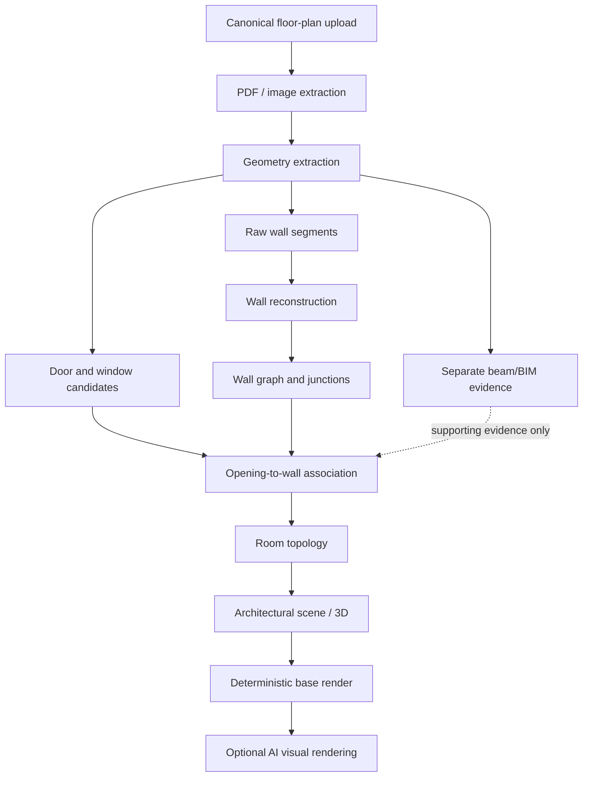

# MyNest Design Studio — Wall, Window & Door Reconstruction Implementation Plan

**Status:** Approved planning baseline — implementation not yet authorized  
**Scope:** Wall reconstruction, door/window detection and wall association, beam/BIM evidence handling, room topology integration, and deterministic 3D validation  
**Date:** 3 November 2026

---

## 1. Purpose

Define a controlled, evidence-based implementation plan for reconstructing walls, doors, windows, and room topology from the canonical floor plan.

The canonical 2D design remains the single source of truth. Reconstruction must preserve intended geometry. AI or heuristic processing must not silently move, invent, remove, or force-connect architectural elements.

This is a planning artifact. It does not claim that the repository has been re-inspected, defects have been confirmed, or code/tests have been changed/run.

## 2. Confirmed user decisions

| Area | Decision |
|---|---|
| Door lintel height | Read from the project setting. |
| Window placement | A window must be associated with a supporting wall. |
| Ceiling beam/BIM dashed lines | Supporting evidence only; they must not modify wall geometry. |
| Door clear width | 34–36 inches (approximately 864–914 mm) is the expected target. Use actual drawing dimensions when available; do not overwrite them to fit the target. |
| Door vertical extent | From floor level to configured lintel level. Preserve the wall portion above the lintel. |
| Window dimensions | Derive actual width and height from the drawing/geometry; do not impose fixed window sizes. |
| Uncertain association | Preserve as `UNVERIFIED` or `UNSUPPORTED`; never force an association merely to pass validation. |
| Drawing colors | Color may be optional supporting evidence only. Do not hard-code orange/gold as door or aqua/cyan as window across drawings. |

## 3. Non-negotiable geometry contract

The canonical 2D floor plan and its immutable/versioned snapshot are authoritative.

The reconstruction pipeline must not alter:
- Wall, room, door, or window identity and intended placement.
- Wall geometry, room boundaries, opening dimensions, or room relationships.
- Furniture identity, inventory, count, dimensions, position, orientation, or room assignment.
- Canonical source files or versioned design data.

The pipeline may derive geometry and improve visual appearance only within canonical design constraints. Deterministic rendering remains the trusted fallback until AI fidelity is demonstrated with adequate evidence.

## 4. Pipeline overview

This is the intended logical flow. Actual runtime call order and data contracts must be confirmed during Phase 0.

## 5. Relevant files and verification status

| File | Expected responsibility | Current evidence status |
|---|---|---|
| `backend/app/services/geometry_extraction_service.py` | PDF/vector extraction; raw wall and opening candidates | Previously shared code was reviewed; current checkout not independently verified |
| `backend/app/services/architectural_service.py` | Integration of structured walls, openings, room reconstruction | Previously shared flow reviewed; exact runtime call sites need verification |
| `backend/app/services/wall_reconstruction.py` | Fragment collapse, tolerances, junctions, graph, room polygons | Previously shared code reviewed; current checkout needs verification |
| `backend/app/services/room_reconstruction_raster.py` | Raster-based room reconstruction/fallback | Documentation-listed; implementation not independently verified |
| `backend/app/services/coordinates.py` | Coordinate/unit conversion | Documentation-listed; runtime values need verification |
| `backend/app/services/scene_service.py` | Deterministic 3D scene assembly | Documentation-listed; opening cutout behavior needs verification |
| Existing project settings/configuration | Door lintel height source | Exact setting key, units, validation, and consumer not yet verified |
| Existing tests and fixtures | Regression and integration coverage | Must be discovered during Phase 0 |

Read the project `README.md`, `CORE_PIPELINE_DOCUMENTATION.md`, `PROJECT_CONTEXT.md` (if present), existing issue register, and execution workflow before implementation. Do not create duplicate issue trackers if the project already has one.

## 6. Root-cause investigation candidates

The following are investigation candidates based on previously shared snippets, not confirmed current production defects.

### R1 — Opening status contract consistency

Previously shared extraction logic appeared to emit `status: "VALID"` while a downstream bridge validator appeared to check `validation_status == "VALID"`.

**Investigate:** Trace the exact payload from extraction through normalization, architectural integration, topology, and scene assembly. Confirm whether an adapter maps the fields.

**If confirmed:** Establish one canonical internal status representation while preserving existing API compatibility. Add a regression test proving valid and invalid opening statuses propagate correctly.

### R2 — Proximity-only opening association

Previously shared logic appeared to use nearest-wall and footprint-to-wall distance/buffer checks.

**Investigate:** Determine whether the current implementation also checks orientation, wall-axis projection, longitudinal bounds, actual opening evidence, and wall continuity.

**If confirmed insufficient:** Add the smallest evidence-supported geometric checks. Proximity alone must not produce a verified wall association.

### R3 — Unsafe wall bridge creation

Previously shared bridge logic appeared capable of accepting a wall-buffer intersection without proving wall fragments on both sides of the opening.

**Investigate:** Trace bridge construction and prove whether it requires valid opening evidence and compatible wall fragments on both sides.

**If confirmed unsafe:** Require sufficient two-sided geometric evidence and orientation/longitudinal consistency. A one-sided intersection must not fabricate wall continuity.

### R4 — Openings not passed to topology

A previously shared call resembled `reconstruct_rooms_topology(seg, furniture)`, while the previously shared signature included an optional `openings` argument.

**Investigate:** Confirm the actual function signature, call sites, and whether openings are consumed elsewhere.

**If confirmed:** Pass normalized openings at the correct existing integration point without changing unrelated service responsibilities.

### R5 — Overlapping span coverage

Previously shared `_edge_supported()` logic appeared to sum overlap lengths directly, which can double-count overlapping intervals.

**Investigate:** Compare all room-edge coverage implementations, especially any interval-union implementation already present.

**If confirmed:** Use interval-union coverage and add duplicate/overlapping segment regression cases. Do not introduce a duplicate algorithm if a correct helper already exists.

### R6 — Beam lines contaminating wall geometry

Dashed beam/BIM lines may align with walls but are not proof of a structural wall.

**Requirement:** Keep beam evidence separate. It must not enter wall spans, thickness measurement, junction creation, room polygonization, wall endpoints, or opening placement as structural geometry.

## 7. Target data concepts

Preserve existing schemas where possible. Do not add database migrations or break API contracts without explicit approval.

### 7.1 Wall

Required concepts:
- Stable wall ID.
- Geometry in the existing canonical coordinate system.
- Orientation where supported.
- Thickness plus its source (`measured`, `configured`, or unknown).
- Original source segment IDs/references.
- Status such as `CONFIRMED`, `UNVERIFIED`, or `UNSUPPORTED`, using existing project conventions.
- Evidence/provenance linking the reconstructed wall to source geometry.

### 7.2 Door

Required concepts:
- Stable door ID and original detected geometry.
- Actual clear width and its measurement source.
- `lintel_height_mm` sourced from the project setting.
- Supporting wall ID only when association is verified.
- Projected position along the host wall.
- Swing geometry only when supported by drawing evidence.
- Separate detection and wall-association statuses.
- Evidence references for dimensions, opening, and wall checks.

If the project lintel setting is absent or invalid, do not silently invent a value. Follow the existing configuration/error convention and keep the vertical geometry unverified until resolved.

### 7.3 Window

Required concepts:
- Stable window ID and original candidate geometry.
- Drawing-derived width and height, with measurement provenance.
- Supporting wall ID only when verified.
- Projected position along the host wall.
- Frame/glazing and opening evidence references.
- Separate detection and association statuses.

No fixed window dimensions or universal color classifier.

### 7.4 Beam/BIM evidence

Keep a separate evidence collection with:
- Stable evidence ID.
- Original line geometry and source page/element reference.
- Line style (dashed/dotted/other), orientation, and length where measurable.
- Detection status/confidence, if supported by calibrated logic.
- Links to the evidence it may support.

Do not merge beam records into wall records.

### 7.5 Status separation

Avoid using one ambiguous `VALID` flag for multiple meanings. At minimum, reason separately about:
- `detection_status`: whether an object candidate was detected.
- `association_status`: whether its supporting wall was established.
- `geometry_status` or equivalent: whether the geometry is sufficiently supported for downstream use.

Use the existing project vocabulary and compatibility adapters rather than introducing inconsistent new enums.

## 8. Wall reconstruction work

### W1 — Source extraction and coordinate integrity

**Primary file:** `geometry_extraction_service.py`

1. Map PDF/vector and raster input paths.
2. Verify PDF points, world pixels, and physical-unit conversions against `coordinates.py` and actual runtime configuration.
3. Verify page/frame filtering and ensure drawing borders are not mistaken for structural walls.
4. Identify supported orientations. Do not silently add angled-wall support if the current architecture does not support it; report scope/impact first.
5. Preserve source IDs and provenance through duplicate removal and fragment processing.
6. Segregate dashed beam/BIM candidates from wall candidates.
7. If scale calibration is absent, do not label physical dimensions as verified.

**Acceptance:** repeated extraction of the same source is deterministic within defined tolerances; coordinate transformations preserve the existing contract.

### W2 — Wall fragment reconstruction

**Primary file:** `wall_reconstruction.py`

1. Group collinear fragments using existing tolerance logic.
2. Merge only gaps justified by source geometry and calibrated tolerances.
3. Derive centerlines/thickness from double-line walls only when the evidence supports that interpretation.
4. For single-line walls, identify whether thickness is measured or configured; do not represent a default as a measurement.
5. Preserve unpaired/ambiguous segments with evidence rather than silently discarding them.
6. Keep source IDs through junction detection and graph splitting.
7. Ensure nearby independent junctions are not merged by an overly broad tolerance.
8. Ensure graph edges remain on their source spans unless a separately justified and tested operation permits otherwise.

**Acceptance:** supported fragments merge, distinct nearby walls remain distinct, and no unsupported endpoints or wall extensions are introduced.

### W3 — Room topology

**Primary file:** `wall_reconstruction.py`; integration in `architectural_service.py`

1. Build junctions from supported wall spans.
2. Build a provenance-bearing wall graph.
3. Check each polygon boundary edge against actual graph-edge coverage.
4. Use interval-union coverage to avoid double-counting overlapping spans.
5. Confirm a room only when its boundary and required junction evidence meet existing acceptance rules.
6. Preserve sliver, unsupported, and invalid states distinctly.
7. Keep raster fallback evidence separate from vector topology evidence.

**Acceptance:** a closed-looking polygon is not automatically a confirmed room; each accepted boundary edge must have traceable support.

## 9. Door detection and wall connection

**Primary files:** `geometry_extraction_service.py`, `architectural_service.py`, `wall_reconstruction.py`; downstream scene handling in `scene_service.py`.

### D1 — Candidate detection

- Do not use drawing color as the authoritative door classifier.
- Inspect geometric cues such as leaf lines, swing arcs, opening gaps, orientation, and dimension annotations.
- Color may be optional supporting evidence only.
- Preserve original candidate geometry and source references.

### D2 — Width handling

- Use explicit drawing dimensions when available.
- Treat 864–914 mm as the expected target range, not a forced normalization rule.
- Preserve a credible drawing-derived width outside that range and flag it for review rather than changing it.
- If scale is uncalibrated, preserve source-space geometry but do not claim a verified millimetre width.

### D3 — Host-wall association

Before confirming association, inspect:
1. Candidate orientation relative to the host wall.
2. Projected position within the wall’s longitudinal bounds.
3. Evidence of compatible wall fragments on both sides where the opening geometry requires them.
4. Whether the candidate footprint represents an actual opening through the wall band.
5. Whether the result is merely nearby or is geometrically supported as an opening.

A nearest-wall result or one-sided intersection is insufficient by itself. If evidence is incomplete, preserve the candidate as `UNVERIFIED`; do not fabricate a bridge.

### D4 — Lintel and vertical geometry

- Read lintel height from the project setting.
- Door vertical extent is floor level to lintel level.
- Preserve the wall portion from lintel level to ceiling.
- Ensure 3D wall cutout/mesh generation removes only the supported door opening volume.
- Missing/invalid project setting must not trigger a silent guessed height.

### D5 — Swing direction

Infer swing direction only when the drawing provides sufficient leaf/arc evidence. Do not infer it from width alone. Otherwise keep swing direction unverified.

**Acceptance:** every confirmed door has a traceable host wall, supported opening geometry, actual width provenance, configured lintel height, and preserved wall above the lintel.

## 10. Window detection and wall association

**Primary files:** `geometry_extraction_service.py`, `architectural_service.py`, `wall_reconstruction.py`.

### N1 — Candidate detection

- Inspect parallel glazing lines, frame boundaries, opening gaps, and dimension annotations.
- Do not hard-code aqua/cyan or any other universal color.
- Preserve candidate geometry and source references.
- Prefer explicit drawing dimensions; otherwise derive dimensions from geometry only when scale is calibrated.

### N2 — Mandatory wall association

A window cannot be treated as a confirmed wall-hosted window without a supporting wall.

Check:
1. Frame/glazing geometry.
2. Candidate orientation relative to the host wall.
3. Projected location within the wall’s longitudinal bounds.
4. Geometric relationship between the candidate and an actual wall opening.
5. Whether the evidence proves association rather than simple proximity.

If association is not proven, preserve the candidate as `UNVERIFIED` and do not create an authoritative wall cutout or confirmed hosted window.

### N3 — Dimensions

- No fixed default width or height.
- Use drawing dimensions first.
- Otherwise derive from geometry and calibrated scale.
- Without calibration, preserve source-space dimensions but do not claim physical millimetre accuracy.

**Acceptance:** each confirmed window has a verified supporting wall, wall position, source evidence, and drawing-derived dimensions.

## 11. Beam/BIM dashed-line evidence

**Initial location:** extraction/segregation in `geometry_extraction_service.py`; integrate only where existing architecture requires it.

1. Detect dashed-line candidates only to the extent supported by the current extractor.
2. Store them in a separate evidence collection.
3. Preserve source coordinates and line-style metadata.
4. Keep them out of structural wall candidate lists.
5. They may be referenced as supporting annotation/evidence during review, but cannot substitute for wall or opening proof.
6. They must not change wall graph, room polygons, wall thickness, endpoints, or opening placement.
7. Any UI overlay must use the existing layer architecture. Do not redesign the UI as part of this scope without approval.

**Acceptance:** enabling/disabling beam evidence produces identical wall geometry and room boundaries.

## 12. Architectural service integration

**Primary file:** `architectural_service.py`

Proposed integration sequence:
1. Obtain raw wall segments, opening candidates, and separate beam evidence from extraction.
2. Build structured walls using existing wall-building logic.
3. Normalize door/window candidate fields at one compatibility boundary.
4. Read lintel height from the project setting.
5. Validate door and window associations separately.
6. Keep beam evidence separate.
7. Pass only appropriately validated opening evidence to topology where the existing design requires it.
8. Confirm the actual `reconstruct_rooms_topology()` call signature and arguments.
9. Preserve raster fallback with its own provenance/status.
10. Keep detection, association, and room-topology statuses distinct in the final payload.

Before changing field names, trace all API consumers and persisted records. Preserve backward compatibility.

## 13. Deterministic 3D scene integration

**Primary file:** `scene_service.py`; inspect existing frontend consumers only if needed.

1. Build wall meshes from confirmed wall geometry.
2. Create door/window cutouts only from sufficiently validated opening-to-wall associations.
3. Limit door cutout height to the project-configured lintel level.
4. Preserve wall geometry above the lintel.
5. Use drawing-derived window dimensions and verified host-wall position.
6. Do not use `UNVERIFIED` openings as authoritative cutouts.
7. Do not extrude beam/BIM evidence into wall meshes.
8. Compare deterministic scene output against the same canonical 2D design before any optional AI visual-rendering step.

## 14. Regression test matrix

Use the existing test framework and fixtures. Add tests only where coverage is absent.

| Group | Case | Expected result |
|---|---|---|
| Wall fragments | Collinear segments with a small supported gap | Merge within justified tolerance |
| Wall fragments | Two nearby parallel walls | Remain distinct |
| Thickness | Double-line wall | Thickness measured within fixture tolerance |
| Thickness | Single-line wall | Thickness source explicit; no false measurement claim |
| Junction | L-junction | Correct junction and source IDs |
| Junction | T-junction | Correct incident wall references |
| Junction | Two close independent junctions | Must not merge incorrectly |
| Topology | Overlapping wall spans | Interval-union coverage; no double count |
| Topology | Unsupported polygon edge | Room not confirmed |
| Door | Opening with compatible wall fragments on both sides | Verified association only if all checks pass |
| Door | One-sided wall intersection | No fabricated bridge; unverified |
| Door | Candidate near wall but not an opening | No association |
| Door | 34-inch and 36-inch clear widths | Actual widths preserved |
| Door | Credible width outside target range | Preserve actual value; flag review |
| Door | Missing lintel setting | No guessed height |
| Door | Lintel-to-ceiling wall region | Wall portion preserved |
| Window | Different window sizes | Actual dimensions preserved |
| Window | Valid host-wall association | Supporting wall ID verified |
| Window | Near wall without sufficient opening evidence | Unverified; no forced association |
| Window | Glazing lines without supporting wall | Not confirmed |
| Beam | Dashed line crosses wall | No wall split or geometry modification |
| Beam | Beam line parallel to wall | Stored separately |
| Beam | Beam evidence toggled | Wall geometry remains identical |
| Coordinates | PDF → world → physical units | Existing transform contract preserved |
| Scale | Uncalibrated drawing | Physical dimensions not falsely verified |
| Fallback | Raster-only plan | Existing raster fallback preserved |
| Multi-page | Multi-page PDF | Existing behavior preserved unless scope explicitly approved |

### Essential regression invariants

- Canonical source design remains unchanged.
- Furniture inventory and transforms remain unchanged.
- No wall, door, window, or room geometry is silently moved.
- Unverified openings never become confirmed cutouts.
- Beam evidence never changes wall geometry.
- Existing API consumers continue to work.
- Deterministic fallback remains available.

## 15. Phased implementation order

### Phase 0 — Repository verification

Inspect:
- Current branch, commit, and working-tree changes.
- Actual file paths and current source contents.
- Function signatures and all relevant call sites.
- Existing schemas, project settings, and API consumers.
- Existing tests, fixtures, reports, and issue register.
- `README.md`, `CORE_PIPELINE_DOCUMENTATION.md`, `PROJECT_CONTEXT.md` if present, and the existing execution workflow.

**Deliverable:** verified file-by-file call graph and defect-to-test mapping.

### Phase 1 — Contract and integration

Trace:
- Opening status fields.
- `supporting_wall_id` versus `wall_id`.
- Opening normalization.
- Topology function arguments.
- Project-setting lookup and units.
- Downstream API consumers.

Fix only confirmed mismatches with backward-compatible changes.

**Deliverable:** consistent wall/opening data flow and regression tests.

### Phase 2 — Wall reconstruction

Address only proven defects in fragment merging, thickness estimation, junctions, graph provenance, and edge coverage.

**Deliverable:** deterministic wall graph and evidence-backed room topology.

### Phase 3 — Door reconstruction

Implement project-configured lintel handling, supported opening association, safe bridge rules, and correct vertical cutout extent.

**Deliverable:** verified door-to-wall association and preserved lintel wall.

### Phase 4 — Window reconstruction

Implement drawing-derived dimensions and mandatory wall association using available geometric evidence.

**Deliverable:** verified wall-hosted windows; ambiguous candidates remain unverified.

### Phase 5 — Beam evidence segregation

Add separate detection/provenance and tests proving beam evidence cannot change wall or room geometry.

**Deliverable:** non-destructive beam evidence.

### Phase 6 — Scene and end-to-end validation

Compare deterministic 3D output against the canonical 2D design, run targeted/integration tests, and inspect comparable visual views.

**Deliverable:** reviewable reconstruction artifacts and evidence-backed issue statuses.

## 16. Acceptance criteria

The implementation is complete only when evidence demonstrates:

1. **Walls:** source-to-reconstruction provenance is traceable; unsupported geometry is not forced.
2. **Doors:** verified host wall, actual width provenance, project-configured lintel height, correct floor-to-lintel cutout, and intact wall above lintel.
3. **Windows:** verified host wall, frame/glazing and opening evidence, and drawing-derived dimensions.
4. **Beams:** separate evidence that does not alter wall or room geometry.
5. **Topology:** accepted room boundaries have supported edges and junctions.
6. **3D:** deterministic walls, openings, lintel portions, and room boundaries match the canonical design.
7. **Compatibility:** APIs, persisted data, furniture layout, and fallback behavior do not regress.
8. **Validation:** exact commands, results, artifacts, and limitations are recorded.

A passing single fixture does not establish production-wide accuracy. Benchmark multiple drawing styles, scales, line weights, opening types, and raster/vector inputs.

## 17. Risks and stop conditions

| Risk | Required response |
|---|---|
| Scale unavailable | Preserve source-space geometry; physical dimensions remain `UNVERIFIED` |
| Lintel setting missing | Do not generate a confirmed door vertical extent from a guessed value |
| Wall support ambiguous | No forced association or bridge |
| Window evidence incomplete | Preserve candidate as unverified |
| Beam line overlaps a wall | Keep beam evidence separate |
| Existing API relies on legacy field names | Use compatible normalization; do not break consumers |
| Current code differs from previously shared snippets | Re-map actual implementation before editing |
| Schema migration or production behavior change is required | Stop and obtain explicit approval |
| Existing tests conflict with canonical geometry | Investigate the discrepancy; never weaken tests to pass |
| Paid provider/API call is proposed | Obtain explicit authorization before any potentially chargeable request |

## 18. Coding-agent deliverables

When implementation is authorized, require:
- Actual file-by-file call graph.
- Root-cause report with evidence and affected functions.
- Minimal changed-file list and rationale.
- Updated wall, door, window, and beam data contracts.
- Regression tests and exact commands/results.
- Before/after artifacts for the same canonical input.
- Geometry comparison covering wall segments, opening locations, room boundaries, and lintel preservation.
- Git diff and Git status.
- Remaining `UNVERIFIED`/`UNSUPPORTED` cases, risks, and next actions.

The agent must inspect source before editing, report root cause before implementation, preserve user changes, and stop if the work requires unapproved scope expansion.

## 19. Current status and next action

**Current status:** Planning baseline prepared. No repository code has been changed and no tests have been run as part of preparing this document.

**Next action:** Execute Phase 0 as a read-only repository inspection. Map findings to the existing issue register and workflow. Do not begin implementation until the verified findings and proposed minimal changes are reviewed and authorized.

**Overall mission remains incomplete** until a deterministic reconstruction and, where separately authorized, an actual AI render are demonstrated against the canonical design with reviewable evidence.

## 20. Phase 0 verification results & lintel implementation (2026-11-03)

Read-only Phase 0 was executed against the current source (not a git repo → working-tree only). Root-cause candidates were verified, not assumed:

| ID | Verified status | Evidence (current source) |
|---|---|---|
| R1 status contract (`status` vs `validation_status`) | `NOT_REPRODUCIBLE` | Extraction emits `validation_status="VALID"` (`geometry_extraction_service.py:308`); the bridge check reads `validation_status=="VALID"` (`architectural_service.py:511`) — same field. Residual value-overload (`VALID` vs `CONFIRMED/UNCERTAIN`) works via call ordering; §7.5 separation is optional, not a bug. |
| R2 proximity-only association | `NOT_REPRODUCIBLE` | Extraction requires the opening footprint to **cross** the wall band — "a box lying beside a wall is rejected" (`geometry_extraction_service.py:271-288`); `CONFIRMED` also needs `on_wall` + architectural-room membership (`architectural_service.py:485-490`). |
| R3 unsafe wall bridge | `NOT_REPRODUCIBLE (as described)` | `select_bridge_openings` bridges only VALIDATED PDF openings, never furniture/UNCERTAIN (`scene_service.py:130`). Two-sided fragment proof lives in `room_reconstruction_raster`. |
| R4 openings→topology | `NOT_APPLICABLE (production) / PARTIAL (fallback)` | Production rooms = `reconstruct_rooms_raster` fed validated `bridge_openings`; `reconstruct_rooms_topology(walls, furniture=None, openings=None)` is a fallback and already supports `openings=`. `architectural_service.py:268` fills the `furniture` slot (not mis-mapped). |
| R5 overlap double-count | `NOT_APPLICABLE` | `sum(_overlap(...))` is in the **legacy** `reconstruct_rooms` (`wall_reconstruction.py:334`) with no live caller; production uses raster; topology uses `polygonize(unary_union(...))`. |
| R6 beam/BIM separation | `CONFIRMED_GAP (design) / UNVERIFIED (impact)` | No separate beam evidence collection; the extractor merges dashed fragments as wall spans. Whether it contaminates the real plan is unverified (needs real-plan extraction). Feature-sized. |

**D4 door lintel — IMPLEMENTED (smallest safe slice):** there was **no lintel setting anywhere**. Added authoritative project setting `DOOR_LINTEL_HEIGHT_MM` (`config.py`, optional, env-overridable, mm). Each **door** opening placement now carries `lintel_height_mm` / `lintel_verified` / `lintel_source` (`scene_service._attach_opening_placements`); when the setting is unset or invalid (non-finite / ≤ 0) the lintel is honestly `UNVERIFIED` and **no height is guessed** (§17). The deterministic 3D scene uses the configured lintel as the door head height when verified, else keeps its default 2.1 m (`RoomScene3D.tsx`) — so default (unset) renders are byte-identical. Regression tests: `tests/test_door_lintel_setting.py`.

**Not implemented (separate, approval-gated):** a true floor-to-lintel **wall cutout preserving the wall above** (§13/D4) requires a wall-shell CSG change — the current renderer uses solid full-height wall boxes with doors/windows as overlay objects (no cutouts), and altering it changes the deterministic base render the AI pipeline depends on (RULE #1). R6 beam segregation needs real-plan evidence first.

**Known live-data fragility (AIR-10, NOT this change — proven):** many tests read the live latest design version of plan `f6b65d2b`. The owner edited it from **v84 → v119** on 2026-11-03; the live room set is now generic `['Room 1'..'Room 5']` (no "Bedroom 1"/"Kitchen & Dining Area"/six-room layout), so **43 live-FID-dependent tests fail** (`IndexError`/`StopIteration`/`status=='failed'` — stale expected structure), spanning `test_fal_boundary`, `test_region_generation`, `test_generation_pipeline_fix`, `test_handoff12_base_render_binding`, `test_air03_*`, `test_opening_*`, the `v79`-named real-plan tests, etc. **Isolation proof:** neutralizing this change's door-field addition leaves the same 43 failures; and the count reconciles exactly — morning run 1127 passed/0 failed at v84, now 1089 passed = 1127 + 5 new lintel tests − 43 drifted (1089+43 = 1132 = 1127+5). Full suite now: **43 failed, 1089 passed, 17 skipped** (pytest exit 1), entirely from the v119 drift. Durable fix = pin these to a frozen design-version fixture, as done for the two Execution 04 tests. Tracked under AIR-10.
