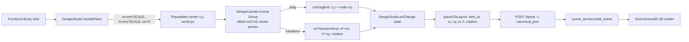
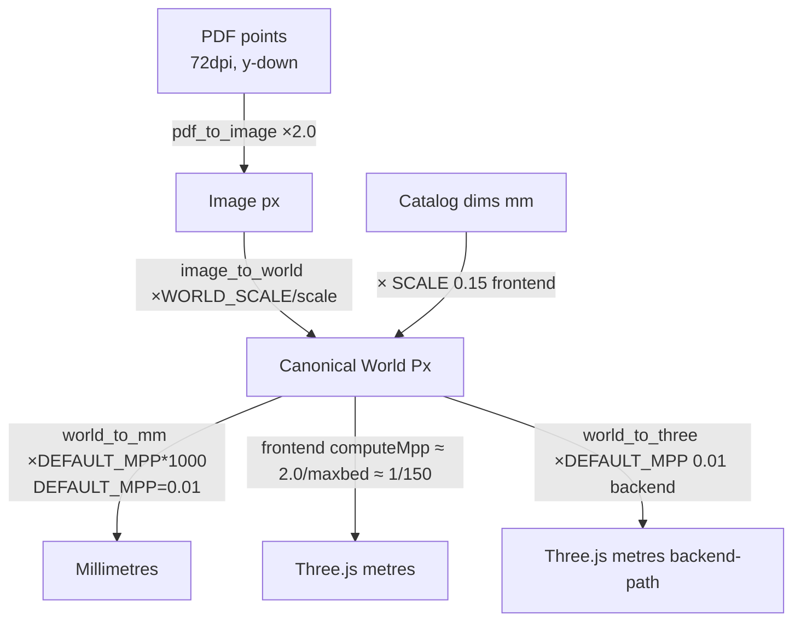

# Furniture Shape Library & Positioning Logic — Current-State Technical Audit

**Status:** REPORT-ONLY. No application code, tests, schemas, or canonical data were changed.
**Scope:** Furniture catalog/shapes, placement logic, coordinates, room association, wall/corner distance, collision/containment validation, and existing tests.
**Date:** 2026-11-14
**Repository state:** Not a Git repository (working-tree only) — no `git status` available.
**Evidence labels:** `VERIFIED_DEFECT` · `AGENT_REPORTED` · `INFERRED_RISK` · `NOT_IMPLEMENTED` · `NOT_ASSESSABLE`

---

## 1. Executive Summary

The system places furniture **faithfully but blindly**. Every placed item is stored and round-tripped as an oriented rectangle (center `cx,cy`, size `w,h`, `rotation`) in **world pixels**, and the 2D→3D pipeline preserves that transform within ±0.5 px / ±0.5°. Positions are therefore **not corrupted** by the pipeline.

What is missing is **positioning intelligence and shape fidelity**:

1. **Shapes are rectangles only.** The catalog has no shape variants, no polygon/composite footprint, and no anchor field. "L-Shaped Sofa" is a plain rectangle by name. (`VERIFIED_DEFECT`)
2. **No placement-time validation anywhere in the UI.** The canvas performs no collision, room-containment, wall-distance, or snapping checks, and never calls the backend validator. (`VERIFIED_DEFECT` / `NOT_IMPLEMENTED`)
3. **Room association and containment test the center point only** — never the rotated footprint — so an item whose footprint crosses a wall or leaves the room is silently accepted/assigned. (`VERIFIED_DEFECT`)
4. **A capable geometry engine exists but is largely unused.** `rects_collide` (SAT) runs only in a dormant standalone endpoint the UI never calls; `rect_polygon_min_distance` has **no callers at all**; the frontend mirror `src/lib/geometry.ts` is **imported nowhere**. (`VERIFIED_DEFECT`)
5. **Two incompatible pixel↔millimetre scales coexist** — `coordinates.DEFAULT_MPP = 0.01` (1 px = 10 mm) vs the frontend `SCALE = 0.15` (1 px ≈ 6.667 mm). Physical-mm claims are not reliable. (`VERIFIED_DEFECT` / `INFERRED_RISK`)
6. **No wall/corner/clearance distance measurement exists** in any active flow. (`NOT_IMPLEMENTED`)

The good news: the authoritative data model (oriented-rect canonical) and the primitive geometry library are the right foundation. A deterministic positioning/validation layer can be added **additively** without changing the canonical contract.

---

## 2. Documentation Read & Verification

| Doc | Location | Status vs code |
|---|---|---|
| `README.md` | repo root | General overview; not contradicted. |
| `CORE_PIPELINE_DOCUMENTATION.md` | `docs/` | Present; pipeline description consistent with observed `/scene` flow. |
| `PROJECT_CONTEXT.md` | `Document/PROJECT_CONTEXT.md` | Present. **Overstates** geometry usage — see below. |
| `docs/ARCHITECTURE.md`, PRD, prior audit reports | `docs/` | Reviewed for context. |

**Verification finding (`VERIFIED_DEFECT`, doc/code):** `Document/PROJECT_CONTEXT.md:415` states `geometry_service.py` (`rects_collide`, `point_in_polygon`, `rect_polygon_min_distance`) is *"Used by validation_service.py and mirrored on frontend in src/lib/geometry.ts."* In reality:
- `rect_polygon_min_distance` has **no caller** anywhere in `backend/app`.
- `src/lib/geometry.ts` is **imported by no frontend module** (grep of `frontend/src`).
So the documentation describes an active capability that is actually dormant/dead code.

---

## 3. Furniture Catalog & Shape Coverage

**Source:** `frontend/src/data/furniture.ts`

Every catalog entry is `{ id, name, width, depth, height, icon }` with dimensions in **millimetres** (`furniture.ts:3-11`). There is **no** shape-type field, **no** polygon/composite footprint, and **no** anchor/reference-point field. The footprint is implicitly an axis-aligned rectangle `width × depth`.

### Placeable catalog (`furniture.ts:24-72`)

| Category | id | W×D×H (mm) | Footprint |
|---|---|---|---|
| Living Room | `lounger-sofa` | 1900×900×800 | rect |
| | `center-table` | 1000×600×400 | rect |
| | `console` | 1100×350×800 | rect |
| | `partition` | 1800×300×1800 | rect |
| Bedroom | `bed` | 1800×2000×1100 | rect |
| | `side-table` | 450×450×550 | rect |
| | `wardrobe` | 1200×600×2100 | rect (**straight only**) |
| | `dressing-table` | 1200×600×750 | rect |
| Dining & Kitchen | `dining-table` | 1500×900×750 | rect |
| | `dining-chair` | 450×500×900 | rect |
| | `kitchen-base` | 2400×600×900 | rect |
| | `chimney` | 900×500×600 | rect |
| Entry & Structure | `bay-window-seat` | 1500×600×450 | rect |
| | `shoe-rack` | 900×350×600 | rect |
| | `door` | 900×900×2100 | rect (opening) |
| | `window` | 1200×200×1200 | rect (opening) |
| Annotations | `room-tag` | 600×300×1 | not furniture (stripped) |

### Legacy items (`furniture.ts:79-99`, resolve-only, not offered)

Includes `sofa-3`, **`sofa-l` "L-Shaped Sofa" (2600×1800 — still a rectangle)**, `armchair`, `queen-bed` (1600×2000), `king-bed` (1800×2000), `dresser`, `refrigerator`, `cooktop`, `sink`, `bathtub`, `shower`, etc. All rectangles.

### Shape-coverage vs the request

| Requested | Present? | Reality |
|---|---|---|
| Wardrobe: straight | ✅ | `wardrobe` rect |
| Wardrobe: L-shaped / sliding / hinged / corner | ❌ `NOT_IMPLEMENTED` | no variants; single rect |
| Bed: single / double / queen / king | ⚠️ partial | `bed`, legacy `queen-bed`/`king-bed`; **no "single"**; all rects, no shape difference beyond W×D |
| Sofa: straight | ✅ | `lounger-sofa` |
| Sofa: L / U / sectional | ❌ `NOT_IMPLEMENTED` | only legacy `sofa-l` **as a rectangle** |

### 2D vs 3D geometry consistency

- **2D (`Furniture.tsx`, `DesignCanvas.tsx`):** the footprint is a Konva `Rect` of `w × h` (`DesignCanvas.tsx:362-383`).
- **3D (`frontend/src/lib/furniture3d.ts` + `Furniture.tsx`):** `furniture3d(itemId)` maps id → `{ height, color, kind }` (`furniture3d.ts:36-98`); `Furniture.tsx` builds a *procedural decoration* (legs, cushions, doors, counter seams) **bounded by the same `w × d` rectangle** (`Furniture.tsx:142-377`).

**Both renderers share the same rectangular footprint** (`w,h` from canonical) and the **same rotation**, so 2D and 3D agree on footprint and orientation. The only 2D/3D divergence is the **vertical** dimension:

- **`VERIFIED_DEFECT` (minor, intentional):** the catalog `height` (e.g. bed 1100 mm) is **not** the 3D height. `furniture3d.ts` hardcodes a separate per-kind height (bed `0.5`), independent of `furniture.ts.height`. The catalog `height` field is effectively **unused by rendering**. This is deliberate (3D heights are art-directed), but it means catalog `height` is not authoritative anywhere.

**Gap summary:** no structured shape library, no polygon footprints, no anchor concept, no corner/L/U/sliding variants.

---

## 4. Current Positioning Implementation (placement lifecycle)



| Stage | Function / file:line | Input | Output | Coord / units | Validation |
|---|---|---|---|---|---|
| Add to plan | `DesignStudio.tsx:406-422` (`handlePlace`) | catalog item + click world pt | PlacedItem `{x,y, w=width*0.15, h=depth*0.15, rotation:0}` | world px | **none** |
| Render/select | `DesignCanvas.tsx:323-334` | PlacedItem | Konva Group, `offsetX=w/2, offsetY=h/2`, `rotation` | world px, **center anchor** | — |
| Drag | `DesignCanvas.tsx:346` (`onDragEnd`) | pointer | `onChange(uid,{x,y})` | world px center | **none** (free move) |
| Resize/Rotate | `DesignCanvas.tsx:347-360` (`onTransformEnd`) | transformer scale/rot | `w*=sx, h*=sy, rotation`; min 10 px | world px | min-size clamp only |
| Place click→world | `DesignCanvas.tsx:231` | screen pointer | `(px-offsetX)/scale` | screen→world | — |
| Persist | `DesignStudio.tsx:84-92` (`placedToLayout`) | PlacedItem | `{item_id, cx, cy, w, h, rotation}` | world px | — |
| Load | `DesignStudio.tsx:306-315` | layout | PlacedItem | world px | — |
| Scene build | `scene_service.build_scene` → `RoomScene3D.tsx` | canonical | 3D meshes | world px → metres (mpp) | fidelity check (§8) |

**Reference point:** the Konva Group uses `offsetX = p.w/2`, `offsetY = p.h/2` with `x = p.x`, `y = p.y` (`DesignCanvas.tsx:329-331`), so **`(x,y)` is the item CENTER** and rotation is about the center. Confirmed in `types/design.ts:11-12` ("center X/Y, world px").

**Key determinations:**
- Placement/footprint conversion: catalog `mm × SCALE(0.15)` = world-px `w,h` (`DesignStudio.tsx:79,420-421`).
- Rotation affects orientation about the center; the **rotated footprint is computed only for rendering** (Konva rotates the Rect), **never for any placement check**.
- **Room assignment is not done in the canvas at all** — the canvas has no concept of rooms/walls. It happens server-side (§7).
- **Furniture can extend outside room boundaries, cross walls, and overlap** other items with no feedback. (`VERIFIED_DEFECT` / `NOT_IMPLEMENTED`)
- **No snapping** — `GRID_STEP = 50` draws visual grid lines only (`DesignCanvas.tsx:40,260-276`, `listening={false}`); nothing snaps canonical positions.
- 2D and 3D interpret the same `cx,cy,w,h,rotation` consistently (same center/rotation convention).

---

## 5. Coordinate & Unit Conversion Map



**Constants:**
- `coordinates.DEFAULT_WORLD_SCALE = 2.0`, `coordinates.DEFAULT_MPP = 0.01` → 1 px = 10 mm = 0.01 m (`coordinates.py:13-14`).
- Frontend `SCALE = 0.15` (`DesignStudio.tsx:79`) → furniture 1 px = 1/0.15 ≈ **6.667 mm**.
- Frontend 3D `computeMpp ≈ 2.0 / max(bed.w,bed.h)` ≈ **1/150 = 0.006667 m/px** (furniture-anchored; from prior Phase-3A audit of `scene.ts`).

**`VERIFIED_DEFECT` (D3 — scale conflict):** `coordinates.world_to_mm`/`mm_to_world` assume **0.01 m/px** (1 px = 10 mm), but furniture placed via the editor uses **0.006667 m/px** (1 px ≈ 6.667 mm). The two disagree by a factor of **1.5×**. Any physical-mm number produced from a furniture world-px value via `coordinates.world_to_mm` is therefore wrong by 1.5×. The furniture-anchored `computeMpp` (1/150) is internally consistent with `SCALE=0.15`; the `coordinates.DEFAULT_MPP=0.01` constant belongs to the separate YOLO/raster `scene_bridge` path and must not be used to measure editor furniture.

**`INFERRED_RISK` (physical calibration):** furniture world-px size derives from catalog mm, while wall world-px size derives from the PDF raster (`WORLD_SCALE=2.0 × pdf_pt`). The two are in the **same pixel space but calibrated from different sources**, so a "1800 mm bed" matches the plan's walls only if the plan's implicit drawing scale happens to equal ~1 px = 6.667 mm. There is **no stored physical calibration** tying furniture mm to the plan. Real wall/furniture distances in mm are therefore **not reliable** without a calibration source. (Consistent with the prior deterministic-3D accuracy audit: scene scale is anchored to furniture, not the plan.)

**Rotation convention:** degrees; `0°` = N/up, clockwise E/S/W (`coordinates.py:76-135`). Same convention used by Konva (`rotation` degrees) and the 3D renderer (negated to `-rotation·DEG`).

---

## 6. Wall & Corner Distance Capabilities

| # | Capability | Status | Notes |
|---|---|---|---|
| 1 | Furniture → left-wall distance | `NOT_IMPLEMENTED` | no axis-wall decomposition anywhere |
| 2 | Furniture → right-wall distance | `NOT_IMPLEMENTED` | — |
| 3 | Furniture → top-wall distance | `NOT_IMPLEMENTED` | — |
| 4 | Furniture → bottom-wall distance | `NOT_IMPLEMENTED` | — |
| 5 | Furniture → nearest-wall distance | `NOT_IMPLEMENTED` (primitive exists, unused) | `rect_polygon_min_distance` (`geometry_service.py:86`) could compute rect-corner→polygon-edge min distance, but **has no caller** |
| 6 | Furniture → room-corner distance | `NOT_IMPLEMENTED` | no corner enumeration/measurement |
| 7 | Furniture → adjacent-furniture clearance | `NOT_IMPLEMENTED` as a measurement; **overlap** boolean exists via `rects_collide` (`geometry_service.py:55`) but returns only true/false in the dormant `validate_canonical` endpoint — no gap distance |

For every present primitive: it operates on **world-pixel** inputs (canonical), uses the **room boundary polygon** (not wall centerlines or faces), includes rotation for `rects_collide`/`rect_corners`, but **`rect_polygon_min_distance` measures to the polygon, not to individual labelled walls**, and gives a **plain Euclidean** distance in **world px** (not perpendicular, not mm). It would be unreliable for angled/irregular rooms as a "wall distance" because it returns the nearest edge regardless of orientation, and it returns `0` whenever the center is inside the polygon (`geometry_service.py:89`).

**Conclusion:** no reliable wall-distance, corner-distance, or clearance measurement exists in any active path.

---

## 7. Room Boundary & Collision Validation

### Room boundary generation
- Rooms/boundaries are reconstructed server-side from walls: `architectural_service.reconstruct_rooms` (`architectural_service.py:225`) using Shapely polygons; `geometry_source` is `"architectural"` (wall-proven) or a furniture-bbox fallback.
- Per-room proof state: `CONFIRMED` vs `UNCERTAIN/UNSUPPORTED/INVALID` (`validation_service.py:137-138`).

### Furniture → room association
`architectural_service.py:294-328`:
```
pt = Point(cx, cy)                      # CENTER only
matched = first proven polygon where poly.covers(pt)
else nearest_wall_id owned by exactly one room  # wall-ownership fallback
else UNCERTAIN leftover
```
**`VERIFIED_DEFECT` (D1 — center-only association):** association tests only the **center point** (`architectural_service.py:315`), never the rotated footprint. Coordinates are never altered here (good — RULE #1 preserved), but an item whose center sits in room A while half its footprint lies in room B (or outside all rooms) is assigned wholly to A with no flag.

### Collision / containment validation
`validation_service.validate_canonical` (`validation_service.py:51-97`):
1. **Furniture–furniture overlap:** `rects_collide` SAT over all pairs (`:60-71`) → `warning`. ✅ footprint + rotation aware.
2. **Room containment:** `point_in_polygon(center, poly)` (`:76-86`) → `warning` if center is in no room. ❌ **center-only**, footprint ignored.
3. **No wall-clearance and no door/window-clearance code exists** in this function, despite the module docstring claiming *"Wall and door-clearance checks activate automatically once walls/doors exist"* (`validation_service.py:3-5`). (`VERIFIED_DEFECT`, doc/code — D4.)

### Wiring
- Exposed at `POST /api/floor-plans/{id}/validate` (`floor_plans.py:94-100`).
- **The frontend never calls `/validate`** (grep of `frontend/src` — no reference), so collision/containment **warnings are never surfaced** during design.
- `rect_polygon_min_distance` and the frontend mirror `src/lib/geometry.ts` have **no callers/importers** → dead capability. (`VERIFIED_DEFECT` — D2.)

**Can the system validate a full footprint against an irregular room polygon?** The *primitives* can (`rect_corners` + `point_in_polygon`/`rect_polygon_min_distance`), but **no code does** — containment is center-only, and the footprint test is never invoked. The exact failure case the request names (center inside, footprint outside) is therefore **undetected**.

---

## 8. Canonical Data Integrity

- **Canonical store:** `design_versions.canonical_json` is the single source of truth (`backend/app/db/models.py:115`; CLAUDE.md RULE #1). Furniture serialized as `{ item_id, cx, cy, w, h, rotation }` (`DesignStudio.tsx:84-92`).
- **Round-trip identity:** load (`DesignStudio.tsx:306-315`) is the exact inverse of save; `item.id ↔ item_id`, center/size/rotation preserved. ✅
- **Scene fidelity gate:** `validation_service.validate_scene_against_canonical` (`validation_service.py:141+`) treats canonical `(uid, item_id, cx, cy, w, h, rotation)` as truth and fails on any added/removed/**moved**/resized/rotated/retyped item; tolerances `_POS_EPS = _ROT_EPS = 0.5` (`:29-30`). This is what keeps 2D→3D (and the AI base) honest. ✅
- **Consistency across 2D canvas, persistence, snapshots, scene API, 3D:** identity/dimensions/position/rotation are consistent (same `cx,cy,w,h,rotation`, same center+degrees convention). ✅

**Conflicts / mismatches found:**
- `VERIFIED_DEFECT` D3: dual px↔mm scales (0.01 vs 0.006667) — §5.
- `VERIFIED_DEFECT`: catalog `height` (mm) is unused by 3D, which uses `furniture3d.ts` heights — §3.
- `NOT_ASSESSABLE`: whether `validate_canonical` ever runs with `rooms` populated depends on `service.get_canonical` merging reconstructed rooms into the canonical payload; the saved layout (`placedToLayout`) carries **furniture only** (no rooms). Not fully traced; the containment branch is a no-op when `rooms` is empty (`validation_service.py:74`).

---

## 9. Verified Root Causes & Evidence

| ID | Label | Finding | Evidence | Impact |
|---|---|---|---|---|
| D1 | `VERIFIED_DEFECT` | Room **association** and **containment** use the center point only, never the rotated footprint | `architectural_service.py:315`; `validation_service.py:78` | Footprint overrun / wall-straddle / wrong-room assignment undetected |
| D2 | `VERIFIED_DEFECT` | Geometry capability is dead: `rect_polygon_min_distance` has no caller; `src/lib/geometry.ts` imported nowhere; `/validate` never called by UI | grep `backend/app`, `frontend/src` | Advertised distance/validation not actually available to users |
| D3 | `VERIFIED_DEFECT` | Conflicting px↔mm scales: `DEFAULT_MPP=0.01` vs `SCALE=0.15` (1.5× apart) | `coordinates.py:14`; `DesignStudio.tsx:79,420-421` | Physical-mm values via `world_to_mm` wrong by 1.5× |
| D4 | `VERIFIED_DEFECT` (doc/code) | `validation_service` docstring claims wall/door-clearance checks that the code does not implement | `validation_service.py:3-5` vs `:51-97` | Misleads maintainers; clearance unimplemented |
| D5 | `VERIFIED_DEFECT` (minor) | Catalog `height` not used by rendering; 3D uses separate hardcoded heights | `furniture.ts:9` vs `furniture3d.ts:38-76` | `height` field is non-authoritative |
| R1 | `INFERRED_RISK` | No physical calibration ties furniture mm to the plan's wall scale | §5 | Furniture may be mis-sized vs walls unless hand-resized |
| R2 | `INFERRED_RISK` | Rectangular bbox for L/U/corner items | `furniture.ts`, `Furniture.tsx` | False overlaps / apparent wall intersections in corners |
| N1 | `NOT_IMPLEMENTED` | No placement-time validation, snapping, or clearance in the UI | `DesignCanvas.tsx` (no checks) | No guidance; easy to mis-place |
| N2 | `NOT_IMPLEMENTED` | No left/right/top/bottom/nearest-wall or corner distance | §6 | Cannot answer any wall/corner distance query |

**Note on "incorrect positioning":** evidence shows positions are **preserved**, not mutated, by the pipeline (D3 aside, which affects *reported mm*, not stored px). The perceived "incorrect furniture positioning" is best explained by the **absence of placement assistance/validation** (N1, N2, D1) and **shape/scale limits** (R1, R2), not by the pipeline moving furniture.

---

## 10. Missing Functionality (summary)

- Structured shape library (shape types, polygon/composite footprints, anchors, variants).
- Rotated-footprint room containment (center-in + all-corners-in / min-distance).
- Wall-axis distances (L/R/T/B), nearest-wall, corner distance, furniture-to-furniture **clearance** (gap, not just boolean).
- Placement-time feedback in the canvas (warnings, optional snapping).
- A single authoritative px↔mm calibration (remove the 0.01 vs 0.15 ambiguity).
- Shape-specific placement constraints (e.g. wardrobe back-to-wall, corner wardrobe corner-fit).

---

## 11. Proposed Minimal Architecture (NO implementation)

### A. Structured Furniture Shape Library (additive)
Extend `FurnitureItem` **without** breaking the current rectangle contract:
```
FurnitureItem {
  id, name, width, depth, height,         // unchanged (mm)
  shapeType?: 'rect' | 'l' | 'u' | 'corner' | 'composite',   // default 'rect'
  footprint?: Polygon (local mm, origin = anchor),            // default derived rect
  anchor?: 'center' | 'back-center' | 'corner',               // default 'center'
  placement?: { backToWall?, cornerFit?, minClearanceMm? },
}
```
- Keep **one** catalog (`furniture.ts`) — add optional fields; existing items default to `shapeType:'rect'`, `footprint` derived from `width×depth`, `anchor:'center'` (byte-identical behavior).
- 2D (`Furniture.tsx`/Konva) and 3D (`furniture3d.ts`) read the **same** `footprint` so geometry stays consistent. The 3D `kind` map stays for art direction.
- **No duplicate catalog, no canonical change:** canonical still stores `cx,cy,w,h,rotation`; `w,h` remain the footprint's bounding box. A polygon footprint is a *rendering + validation* detail keyed off `item_id`, exactly as `furniture3d.ts` already is.

### B. Deterministic Positioning/Validation Engine (additive, read-only)
A pure module (reuse/extend `geometry_service.py` + its mirror `geometry.ts`) that, given canonical furniture + room polygons + wall segments, computes:
- rotated footprint (`rect_corners`, or polygon-transform for shaped items),
- containment (center-in **and** footprint-in / min-distance to boundary),
- L/R/T/B + nearest-wall distance, corner distance (perpendicular where axis-aligned),
- furniture-to-furniture clearance (signed gap; `rects_collide` for overlap),
- shape-specific constraints.

Integration: surface results as **non-blocking warnings/measurements** in the canvas (call the existing `/validate`, extended, or compute client-side via `geometry.ts`). **Validation must never move furniture** (RULE #1) — it only reports.

**Reliability caveat:** any **millimetre** output (wall clearance in mm, "30 cm from wall") is only correct **after** a single authoritative px↔mm calibration is established (resolve D3 / the open physical-scale decision). Pixel-space checks (containment, overlap, relative clearance) are reliable **now**.

---

## 12. Regression Test Plan (proposed; none modified)

Existing coverage (offline, DB-free): `tests/test_geometry.py`, `tests/test_validation_geometry.py`, `tests/test_furniture_placement_2d_to_3d.py`, `tests/test_furniture_ownership_boundary.py`, `tests/test_containment_sectioning.py`, `tests/test_canonical_assembly.py` — **30 passed** (see §14). These cover SAT collision, center containment, and 2D→3D transform preservation; they do **not** cover footprint containment or wall/corner distance (those are unimplemented).

Proposed new cases (expected geometric behavior):
| Case | Expected |
|---|---|
| Straight wardrobe flush to straight wall | footprint inside room; nearest-wall distance ≈ 0; no overlap |
| L-shaped wardrobe in corner | polygon footprint fits corner; both wall distances ≈ 0; no false overlap with adjacent walls |
| Sliding-door wardrobe | footprint = carcass only (no door-swing); clearance in front unaffected |
| Straight & L sofa | straight = rect; L = polygon; corner clearance correct |
| Bed sizes (single/double/queen/king) | distinct W×D; containment honored |
| Rotated furniture (0/45/90°) | rotated footprint containment & clearance stable |
| Furniture near corner | corner distance = min distance to corner vertex |
| Furniture against angled wall | perpendicular distance to that wall edge |
| Irregular room polygon | footprint-in-polygon correct for concave shapes |
| Footprint partially outside room | flagged (center-in but corner-out) |
| Overlapping items | overlap flagged; clearance negative |
| Canonical preservation | after any validation pass, `cx,cy,w,h,rotation` unchanged (±0) |

Do not run paid AI/API calls for any of these (all are pure geometry).

---

## 13. Key Files & Functions (line references)

| Concern | File:line |
|---|---|
| Catalog (rect-only) | `frontend/src/data/furniture.ts:3-104` |
| 3D spec map / heights | `frontend/src/lib/furniture3d.ts:36-98` |
| Procedural 3D shapes (rect-bounded) | `frontend/src/components/design-studio/Furniture.tsx:142-377` |
| Canvas placement/drag/rotate (center anchor, no validation) | `frontend/src/components/design-studio/DesignCanvas.tsx:221-235,323-360` |
| PlacedItem (center world px) | `frontend/src/types/design.ts:8-31` |
| SCALE, placedToLayout, add/load | `frontend/src/pages/DesignStudio.tsx:79,84-92,306-315,406-422` |
| Coordinate transforms / MPP | `backend/app/services/coordinates.py:13-57` |
| Geometry primitives (SAT, PIP, rect-poly dist) | `backend/app/services/geometry_service.py:14-108` |
| Canonical validation (collision + center containment) | `backend/app/services/validation_service.py:51-97` |
| Scene fidelity gate (transform preservation) | `backend/app/services/validation_service.py:141+` |
| Validate endpoint (dormant) | `backend/app/api/floor_plans.py:94-100` |
| Furniture→room assignment (center) | `backend/app/services/architectural_service.py:294-328` |
| Frontend geometry mirror (unused) | `frontend/src/lib/geometry.ts` |

---

## 14. Risks, Limitations & Unresolved Questions

- **Physical scale is unresolved** (D3 / prior Phase-3B decision). Any mm distance is unreliable until one authoritative px↔mm calibration is chosen. (`NOT_ASSESSABLE` until owner decides calibration source.)
- **`get_canonical` room population** not fully traced — whether `/validate` containment ever has rooms to test. (`NOT_ASSESSABLE`.)
- **Backend unavailable during audit:** the Supabase DB is currently down ("tenant not found"), so no live `/scene` or `/validate` response was exercised; findings are from source + offline unit tests only.
- **Shaped-footprint rendering** would require `Furniture.tsx` and the Konva layer to consume a polygon; today both assume a rectangle.

**Test commands executed (offline, venv Python — did not bind :8000):**
```
backend/.venv/Scripts/python.exe -m pytest tests/test_geometry.py tests/test_validation_geometry.py tests/test_furniture_placement_2d_to_3d.py -q
# → 30 passed, 5 warnings in 1.61s
```
All other proposed tests: `NOT_RUN`.

---

## 15. Recommended Implementation Sequence (after separate authorization)

1. **Resolve px↔mm calibration (D3)** — single source of truth; retire/scope `DEFAULT_MPP=0.01` to the raster path only. *(Unblocks all mm measurements.)*
2. **Footprint-based containment (D1)** — extend `validate_canonical` + association to test rotated corners / `rect_polygon_min_distance`; report-only, no moves.
3. **Wire validation into the UI (D2/N1)** — call `/validate` (or the `geometry.ts` mirror) and surface non-blocking warnings; optional opt-in snapping that still writes canonical explicitly.
4. **Distance engine (N2)** — nearest-wall, L/R/T/B, corner, clearance (px now; mm after step 1).
5. **Structured shape library (R2)** — additive `shapeType`/`footprint`/`anchor`; default rect; consistent 2D/3D consumption.
6. **Fix docs (D4/D5)** — correct `validation_service` docstring and `PROJECT_CONTEXT.md` geometry-usage claims; mark catalog `height` as non-authoritative.

Each step is additive and must preserve the canonical contract and existing transforms (CLAUDE.md RULE #1). No automatic rearrangement; validation reports, never moves.

---

*End of report. This audit created only this file; it modified no application code, tests, schemas, canonical data, or existing documentation.*
