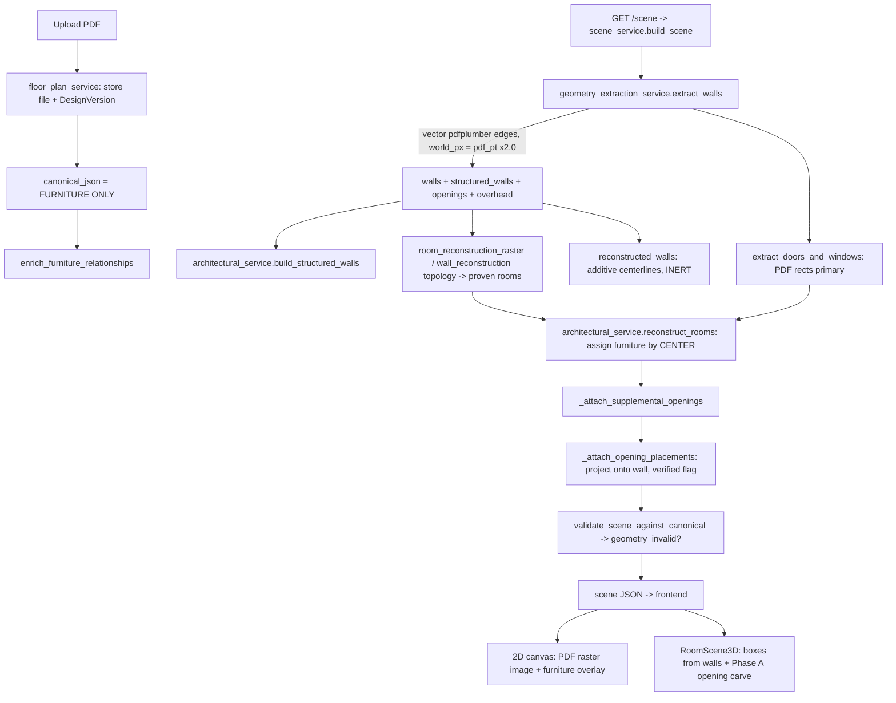

# Phase 1 — Empty 2D Architectural Plan: Read-Only Inspection Report

**Task:** READ-ONLY audit before Phase 1 implementation. No source code, schemas, tests, or canonical data were modified.
**Date:** 2026-11-14
**Evidence classes:** `VERIFIED` · `AGENT-REPORTED` · `INFERRED` · `UNKNOWN` · `NOT_ASSESSABLE`
**Leverage note:** builds on three prior read-only audits this session (deterministic-3D accuracy, wall/door/window/3D sync, furniture/positioning); every claim re-verified against current source on this branch.

---

## 1. Git Baseline Verification `VERIFIED`

| Check | Result |
|---|---|
| Repo root | `D:\Latest_mynest_design_version\mynest-design-studio` |
| Is Git repo | Yes (initialized this session) |
| Baseline commit exists | Yes — `d1d65f7` *"Initial baseline: MyNest Design Studio working tree"* |
| HEAD / branch | Created and checked out **`feature/phase-1-empty-architectural-plans`** off `d1d65f7` |
| Working tree | Clean (`git status -s` empty) before this report |
| `.gitignore` protects secrets | Yes — `git check-ignore backend/.env` → ignored; `.venv/`, `node_modules/`, `backend/storage/`, `*.zip`, `*.pt/*.onnx` excluded |
| Uncommitted changes appeared | None (this report is the only new file; creating it does not modify source) |

No unsafe Git state. Safe to inspect; branch ready for a later, separately-authorized implementation.

---

## 2. Documentation Reviewed `VERIFIED`

`README.md`, `docs/CORE_PIPELINE_DOCUMENTATION.md`, `Document/PROJECT_CONTEXT.md`, `CLAUDE.md`, and prior session audits (`docs/audits/FURNITURE_SHAPE_AND_POSITIONING_AUDIT.md`, and the scratchpad Phase-3A / wall-door-window sync plans).

**Doc↔code contradictions found:**
- `backend/app/db/models.py` comment (~L4/L115) describes `canonical_json` as the *"single source of truth: rooms, walls, doors, windows, furniture, dimensions."* **Actual** `save_layout` persists **furniture only** (`floor_plan_service.py:272-281`); rooms/walls/doors/windows are re-derived from the PDF each `build_scene`. (`VERIFIED` doc/code mismatch.)
- `Document/PROJECT_CONTEXT.md:415` states `geometry_service` distance/collision functions are *"Used by validation_service.py and mirrored on frontend."* `rect_polygon_min_distance` has **no caller**, and `src/lib/geometry.ts` is imported nowhere. (`VERIFIED`, carried from furniture audit.)
- `validation_service.py:3-5` docstring claims *"Wall and door-clearance checks activate automatically once walls/doors exist."* `validate_canonical` implements **no** clearance checks. (`VERIFIED`.)

Treat docs as intent, not implementation — several overstate current behavior.

---

## 3. Actual Architecture & Data Flow `VERIFIED`



**Key architectural facts:**
- `canonical_json` = **furniture only** (world px `cx,cy,w,h,rotation,item_id`). Architecture is **derived deterministically from the immutable PDF** on every `build_scene` — never persisted, never AI-generated (`scene_service.py:334-525`).
- The scene JSON carries: `walls` (raw face strokes), `structured_walls`, `reconstructed_walls` (additive), `doors`, `windows`, and per-room `boundary`, `opening_placements`, `supplemental_*`, plus a `geometry_validation` self-check.

---

## 4. Wall Extraction Findings

| Finding | Class | Evidence |
|---|---|---|
| Vector extraction via `pdfplumber.page.edges` (materializes axis-aligned sub-segments of lines/rects/paths); `world_px = pdf_pt × WORLD_SCALE(2.0)` | `VERIFIED` | `geometry_extraction_service.py:25,127-136,185` |
| **Only axis-aligned (h/v) edges become walls — angled/diagonal walls are dropped** | `VERIFIED` | `:158-161` (`if not (is_v or is_h): continue`, `_AXIS_TOL=0.9`) |
| Wall thickness = **`10.0` CONFIGURED_FALLBACK** per `structured_wall`, explicitly *not* a measurement | `VERIFIED` | `:203-212`; `architectural_service.py:46-53` |
| `structured_walls` are **individual face-strokes (1:1 with raw PDF edges)**; a double-line wall = two separate strokes; no merge | `VERIFIED` | `:189-217` + comments |
| Plan-wide thickness **is** measured (`wall_reconstruction.measure_tolerances`) but used only for the opening-cross band and `reconstructed_walls` | `VERIFIED` | `:219-230` |
| `reconstructed_walls` = additive centerline layer with measured thickness where double faces pair; **carries no mm claim and is consumed by no renderer (inert)** | `VERIFIED` | `scene_service.py:483-494`; prior Phase-3A audit |
| Dashed strokes → `overhead_candidates` (beams/ceiling), never walls; strong-red → annotation dropped; sheet frame dropped | `VERIFIED` | `:102-112,167-184` |
| No silent segment merging / snapping / rescaling of `structured_walls` (geometry preserved 1:1) | `VERIFIED` | `:189-217` |
| Detached below-plan block (legend/title) dropped **only** when ≤25% of total wall length | `VERIFIED` | `scene_service.py:365-392` |
| No raster wall **detection** fallback for a scanned/vectorless PDF (then `walls=[]`) | `INFERRED` / `NOT_ASSESSABLE` | `scene_service.py:353-363` (no fixture to confirm) |

**Root cause (angled walls):** the extractor's axis-aligned filter. Fixing it safely is **not** trivial (risks altering geometry) — flag for a scoped sub-task, not Phase 1 baseline.

---

## 5. Door & Window Findings

| Finding | Class | Evidence |
|---|---|---|
| **Primary** opening source = PDF colored rects (door gold `#9e7700`, window cyan `#00ffff`); furniture-naming is **fallback only** when the PDF has no openings | `VERIFIED` | `geometry_extraction_service.py:35-36,256-283`; `architectural_service.py:84-88` |
| Opening `VALID` requires finite+positive dims **AND** a wall within `link_tol=max(60, max(w,h)·1.5)` **AND** footprint crosses that wall (`band` test) | `VERIFIED` | `:305-326` |
| Non-VALID → `UNCERTAIN`/`INVALID`, `supporting_wall_id=None`; **opening kept at authored cx/cy (no teleport, no fabricated default)** | `VERIFIED` | `:315-348` |
| Opening→wall tie trusts a VALID PDF `supporting_wall_id`; else nearest within `door_tol`(≈thickness·2.5/80px) / `win_tol`(≈thickness·1.5/50px); `on_wall=False` beyond tol (honest flag, **no forced snap**) | `VERIFIED` | `architectural_service.py:506-533` |
| Opening `CONFIRMED` only when `on_wall` **and** assignment ∈ {contained, wall_owned} **and** an architectural room; else `UNCERTAIN` | `VERIFIED` | `:487-497` |
| Scene `opening_placements`: `_find_supporting_wall` requires projection strictly within the segment, rotation match ≤25°, perp ≤ max_perp (100 door/60 window); match → projected onto wall (`verified:true`); no match → authored pos, `verified:false, status:NEEDS_REVIEW` | `VERIFIED` | `scene_service.py:224-331` |
| Door lintel (head) height from **Project Setting** (`DOOR_LINTEL_HEIGHT_MM`); unset → `lintel_verified:false`, renderer default, **no guess** | `VERIFIED` | `scene_service.py:26-37,302-303` |
| Wall is genuinely **carved** in 3D for VERIFIED openings (Phase A, this session); unverified stay solid; pre-Phase-A overlay defect is resolved for verified openings | `VERIFIED` | `RoomScene3D.tsx` + `lib/wallCarve.ts` |
| Window sill height is a **renderer constant** (`WIN_SILL_H=0.9`), not sourced from the PDF | `INFERRED` | `RoomScene3D.tsx:52` (no source provenance for sill) |

**Assessment:** the door/window → wall-opening contract is largely **already satisfied and honest** (evidence-gated, no nearest-wall forcing, no invented defaults). No confirmed *defect* here beyond sill-provenance (cosmetic) — the prior "no real cutout" issue is fixed by Phase A.

---

## 6. Room Topology Findings

| Finding | Class | Evidence |
|---|---|---|
| Rooms are authoritative from **raster reconstruction** (preferred) or **vector topology**; furniture **never creates a room** (only assigned) | `VERIFIED` | `scene_service.py:415-439`; `architectural_service.py:253-279` |
| Room `CONFIRMED` only when `geom_source` is architectural (wall-proven); furniture-hull fallback → `UNCERTAIN` | `VERIFIED` | `architectural_service.py:557,569` |
| Open-plan handled via majority labeling (`"Kitchen & Dining"`); boundaries never force-closed; no fabricated walls | `VERIFIED` | `:330-354` |
| **Furniture→room assignment uses the CENTER point** (`poly.covers(Point(cx,cy))`) + wall-ownership fallback — the rotated footprint is never tested | `VERIFIED` | `:313-328` |
| Opening→room by boundary-polygon containment, then wall-ownership, else nearest-bbox tagged `uncertain` | `VERIFIED` | `:437-499` |
| Concave rooms supported (Shapely `Polygon`, shoelace area); **angled-wall rooms limited upstream** by axis-aligned extraction | `VERIFIED` / `INFERRED` | `:558-564`; §4 |
| Shared walls tracked via `wall_owner`; a shared-wall opening is assigned to one room and placed in the adjacent via supplementals | `VERIFIED` | `:289-292`; `scene_service.py:171-207` |

A room marked CONFIRMED **is** backed by structural evidence (wall-proven cycle). Confidence/uncertainty is honest.

---

## 7. Coordinate-System Findings

| Space | Conversion | Evidence |
|---|---|---|
| PDF pt → world px | `× WORLD_SCALE 2.0` (walls/openings) | `geometry_extraction_service.py:25` |
| Catalog mm → world px | `× SCALE 0.15` (furniture, frontend) | `DesignStudio.tsx:79` |
| World px → mm (backend) | `× DEFAULT_MPP 0.01 × 1000` (1 px = 10 mm) | `coordinates.py:14,30` |
| World px → metres (3D) | frontend `computeMpp ≈ 2.0/max(bed) ≈ 1/150 = 0.006667` | `scene.ts` (prior audit) |

- **`VERIFIED` D-SCALE conflict:** `architectural_service` emits physical mm (`distance_to_wall_mm`, `real_width_mm`, `real_depth_mm`) via `DEFAULT_MPP=0.01` (`:178,209-210`), i.e. **1 px = 10 mm**, while furniture world-px derive from **1 px ≈ 6.667 mm** (`SCALE=0.15`) and the 3D scale from `1/150`. The two disagree by **1.5×**, so backend mm outputs are not reliable physical measurements.
- **`VERIFIED`:** no stored physical calibration ties furniture mm or wall px to a real-world scale; mpp is furniture-anchored. Physical dimensions are **not** calibration-backed (consistent with the Phase-3A audit).
- **`VERIFIED`:** rotation convention consistent across 2D (Konva degrees, center anchor) and 3D (`-rotation·DEG`); `coordinates.py` N=0/E=90 mapping.
- No coordinate systems or API contracts were modified.

---

## 8. Empty 2D Canvas Assessment

| Capability | State | Evidence |
|---|---|---|
| Display architectural **walls** | ✅ via the **rasterized PDF image** (walls are drawn in the source PDF) | `DesignCanvas.tsx:310-312` (KonvaImage of plan) |
| Wall **thickness** shown | ✅ as drawn in the PDF raster; ❌ not as a vector/measured overlay | `DesignCanvas.tsx` |
| Room boundaries + labels | ⚠️ only as drawn in the PDF; **no vector room-polygon/label overlay** in the editor | — |
| Door / window openings | ⚠️ visible in the PDF raster; **no vector opening markers** in the editor 2D canvas | — |
| Opening dimensions | ❌ not rendered as 2D overlays (exist in scene JSON, consumed by 3D) | `scene_service` |
| **Empty plan, zero furniture** | ✅ works — furniture is a separate Konva layer; with none placed, the PDF (walls/doors/windows) shows alone | `DesignCanvas.tsx:316-411` |

**`VERIFIED`:** the editor's "2D architectural view" **is the source PDF raster** plus a furniture overlay. There is **no vector architectural canvas** that draws extracted walls/rooms/openings as editable/overlaid shapes. An empty architectural plan is already representable (just don't place furniture). The vector architecture is surfaced in **3D** (`RoomScene3D`) and the backend control raster, not in a 2D vector view.

> If Phase 1 acceptance requires an explicit **vector** 2D architectural canvas (walls as lines, room polygons/labels, opening markers, dimension annotations), that component **does not exist** and would be new, additive frontend work (out of this read-only scope).

---

## 9. Deterministic 3D Compatibility

| 3D need | Supported? | Evidence / gap |
|---|---|---|
| Wall extrusion inputs | ✅ each scene `walls` segment → a box | `RoomScene3D.tsx` (realWalls/boundaryWalls) |
| Wall **thickness** | ⚠️ renderer uses a **fixed `WALL_THICKNESS=0.1 m`**, not the data's `10px` fallback nor the measured `reconstructed_walls` thickness | `RoomScene3D.tsx:47` |
| Single vs double walls | ⚠️ `structured_walls`/`walls` are **face strokes**, so double-line walls render as **two thin boxes**; the measured-thickness `reconstructed_walls` centerline layer is emitted but **not consumed** | `scene_service.py:487-494`; `RoomScene3D.tsx` |
| Door openings | ✅ Phase A carves verified doors (jambs + header at lintel) | `wallCarve.ts`, `RoomScene3D.tsx` |
| Window openings | ✅ Phase A carves verified windows (jambs + header + sill + glass) | same |
| Floor surfaces | ✅ polygon floor from `room.boundary` (architectural) else bbox plane | `RoomScene3D.tsx:427-439` |
| Shared walls | ⚠️ rooms render their own in-box segments → a shared wall can be **drawn twice** (duplicate geometry) | `RoomScene3D.tsx:317-334` (per-room inBox filter) |
| Consistent scale | ⚠️ mpp furniture-anchored, **uncalibrated** to the plan | prior Phase-3A audit |

**For Phase 2 (reported, not fixed here):** the biggest deterministic-3D gaps are (a) double-line walls not collapsed to single measured-thickness walls (the data exists in `reconstructed_walls` but is inert), and (b) shared-wall duplication, and (c) scale calibration.

---

## 10. Confirmed Defects & Root Causes

| ID | Class | Defect | Root cause | Impact |
|---|---|---|---|---|
| CD1 | `VERIFIED` | Angled/diagonal walls not extracted | `geometry_extraction_service.py:158-161` keeps only h/v edges | Angled rooms/intersections unsupported from vector source |
| CD2 | `VERIFIED` | 3D walls are double thin boxes at a fixed 0.1 m, not single measured-thickness walls | `structured_walls` = face strokes; `reconstructed_walls` centerlines emitted but consumed by no renderer; `WALL_THICKNESS` constant | 3D architecture not thickness-faithful |
| CD3 | `VERIFIED` | Dual px↔mm scales (`0.01` vs `0.15`, 1.5×) | `coordinates.DEFAULT_MPP=0.01` used for architectural mm vs furniture `SCALE=0.15` | Backend mm outputs unreliable |
| CD4 | `VERIFIED` | Room/opening containment & furniture→room assignment use the **center**, not the rotated footprint | `architectural_service.py:315`; `validation_service.py:78` | Footprint overrun / wrong-room undetected |
| CD5 | `VERIFIED` (doc/code) | `canonical_json` is furniture-only, yet docs claim it holds rooms/walls/doors/windows; `/validate` containment branch is dead (no rooms in canonical) | `floor_plan_service.py:272-281` vs `models.py` docstring; `validation_service.py:74` | Misleading docs; dormant validation |

**Not a defect (resolved/by-design):** openings are evidence-gated with no teleport/fabrication (good); the pre-Phase-A "opening as overlay with no hole" is fixed by Phase A for verified openings.

---

## 11. Suspected Defects & Hypotheses

| ID | Class | Hypothesis |
|---|---|---|
| SD1 | `INFERRED` / `NOT_ASSESSABLE` | A vectorless/scanned PDF yields `walls=[]` (no raster wall-detection fallback); needs a non-vector fixture to confirm |
| SD2 | `INFERRED` | Shared walls render as duplicated 3D geometry (per-room in-box rendering) |
| SD3 | `INFERRED` | No explicit vector 2D architectural canvas — if Phase 1 acceptance expects one, it's missing (§8) |
| SD4 | `INFERRED` | `reconstructed_walls` quality on fragmented real plans is unvalidated per-plan (`WALL_RECONSTRUCTION_ENABLED` defaults OFF), so relying on it for CD2 needs its own validation |

---

## 12. Test Commands & Exact Results `VERIFIED`

Offline, venv Python, did **not** bind :8000, no paid APIs, no DB:
```
backend/.venv/Scripts/python.exe -m pytest \
  tests/test_geometry_extraction.py tests/test_opening_placement.py \
  tests/test_opening_placement_fidelity.py tests/test_room_reconstruction_geometry.py \
  tests/test_reconstructed_walls_layer.py tests/test_wall_thickness_provenance.py \
  tests/test_validation_geometry.py tests/test_geometry.py tests/test_containment_sectioning.py -q
# → 84 passed, 5 warnings in ~27s   (independently reproduced the reported baseline of 84)
```
Warnings: 5 × Pydantic v2 class-based-config deprecation (library, non-blocking). Skips: 0. Failures: 0.
**Coverage nature:** these exercise **real production functions** (extraction, opening placement, room reconstruction, reconstructed-walls, validation) against synthetic/fixture plans — not only toy stubs. They do **not** cover: footprint-based containment, angled-wall extraction, vectorless PDFs, or live end-to-end `/scene` (DB-dependent).

---

## 13. Minimal Proposed Phase 1 Implementation (for separate approval)

Smallest, additive, contract-preserving steps — **most of the door/window/room contract is already satisfied**, so Phase 1 should target the real gaps:

1. **Consume `reconstructed_walls` in 3D** (CD2): render single measured-thickness walls from the already-emitted centerline layer instead of doubled face strokes; fall back to face strokes when no reconstruction. Renderer-only, additive, data already exists. *(Also reduces SD2 duplication.)*
2. **Single px↔mm calibration** (CD3): one authoritative scale; scope `DEFAULT_MPP=0.01` to the raster/ML path only. Unblocks every mm claim.
3. **(Optional) Vector 2D architectural overlay** (§8/SD3): a read-only Konva layer drawing scene `walls`/`boundary`/`opening_placements` with labels/dimensions, toggleable, furniture-independent — if an explicit empty-architecture view is required.
4. **Footprint-aware containment** (CD4): extend `validate_canonical`/assignment to test rotated corners (report-only; never move furniture).
5. **Doc fixes** (CD5): correct `models.py`, `PROJECT_CONTEXT.md`, `validation_service.py` docstrings.

**Explicitly deferred (not Phase 1 baseline):** angled-wall extraction (CD1) — non-trivial, risks altering geometry; needs its own scoped task and fixtures.

---

## 14. Required Regression Tests (proposed)

Connected straight walls; L-shaped boundary; multiple rooms with a shared wall; T/cross junctions; **angled intersection (expected: currently dropped — assert honest handling)**; door opening in a straight wall; window opening in a straight wall; multiple openings on one wall; door/window associated to the wrong wall (expected `on_wall=False`/UNCERTAIN); open/incomplete boundary (expected UNCERTAIN, not force-closed); duplicate wall segments; overlapping segments; concave boundary; ambiguous detection (expected UNCERTAIN); **empty plan, zero furniture** (expected: scene builds, rooms from walls, no furniture error). For each: assert canonical transforms and extracted geometry are **unchanged** by the operation.

---

## 15. Files Likely To Require Changes (when authorized)

| File | Reason | Nature |
|---|---|---|
| `frontend/src/components/design-studio/RoomScene3D.tsx` | consume `reconstructed_walls` (CD2) | additive |
| `backend/app/services/coordinates.py` + `frontend/src/lib/scene.ts` | single calibration (CD3) | scoped |
| `backend/app/services/validation_service.py` + `architectural_service.py` | footprint containment (CD4) | additive, report-only |
| `frontend/src/components/design-studio/DesignCanvas.tsx` | optional vector architecture overlay (§8) | additive layer |
| `backend/app/db/models.py`, `Document/PROJECT_CONTEXT.md`, `validation_service.py` docstring | doc fixes (CD5) | docs |

No schema migration or API contract change is required for items 1, 3, 4, 5. Item 2 (calibration) must preserve existing canonical values — a scale *interpretation* change, not a stored-data change.

---

## 16. Remaining Blockers & Risks

- **Backend DB down** (Supabase tenant not found): live before/after evidence on real plans and end-to-end `/scene` cannot be produced until restored. Offline source inspection + tests are unaffected (per directive §13, not a reason to abandon inspection). `NOT_ASSESSABLE` for live evidence.
- **Angled walls (CD1):** correct handling may require inventing/rotating geometry — out of safe Phase 1 scope; must not be forced.
- **Calibration decision (CD3):** owner must choose the authoritative scale; all mm claims depend on it.
- **`reconstructed_walls` reliability (SD4):** must be validated per-plan before 3D relies on it.
- **Vectorless PDFs (SD1):** no fixture available to confirm raster fallback behavior.

---

## 17. Git Branch & Working-Tree Status `VERIFIED`

- Branch: **`feature/phase-1-empty-architectural-plans`** (off baseline `d1d65f7`).
- Working tree before this report: clean. This report adds one untracked file: `docs/audits/PHASE1_EMPTY_ARCHITECTURE_INSPECTION.md`. **No source code, tests, schemas, or canonical data changed.** Phase A work, `vite.config.ts`, the harness, and the furniture audit are preserved untouched.

---

### Bottom line
The empty-2D-architecture foundation is **substantially sound and honest**: deterministic vector extraction, evidence-gated openings with no teleport/fabrication, wall-proven CONFIRMED rooms, and (post-Phase-A) real 3D openings. The genuine Phase 1 gaps are **wall-thickness fidelity in 3D (inert `reconstructed_walls`)**, **px↔mm calibration**, **center-only containment**, and **doc drift** — plus the absence of an explicit vector 2D architectural view if one is required. Angled-wall extraction is the one item that cannot be fixed without risking geometry and must be scoped separately. Await the next task to define the smallest safe implementation.

*End of report. Read-only inspection; no application code or canonical data was modified.*
