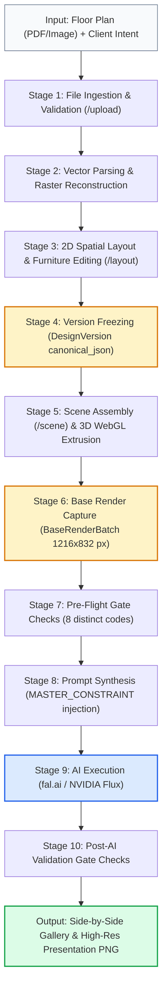
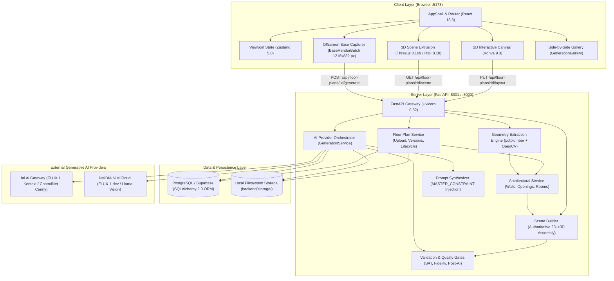
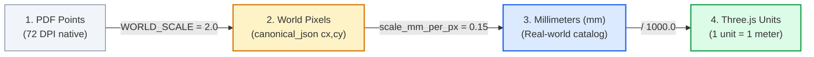
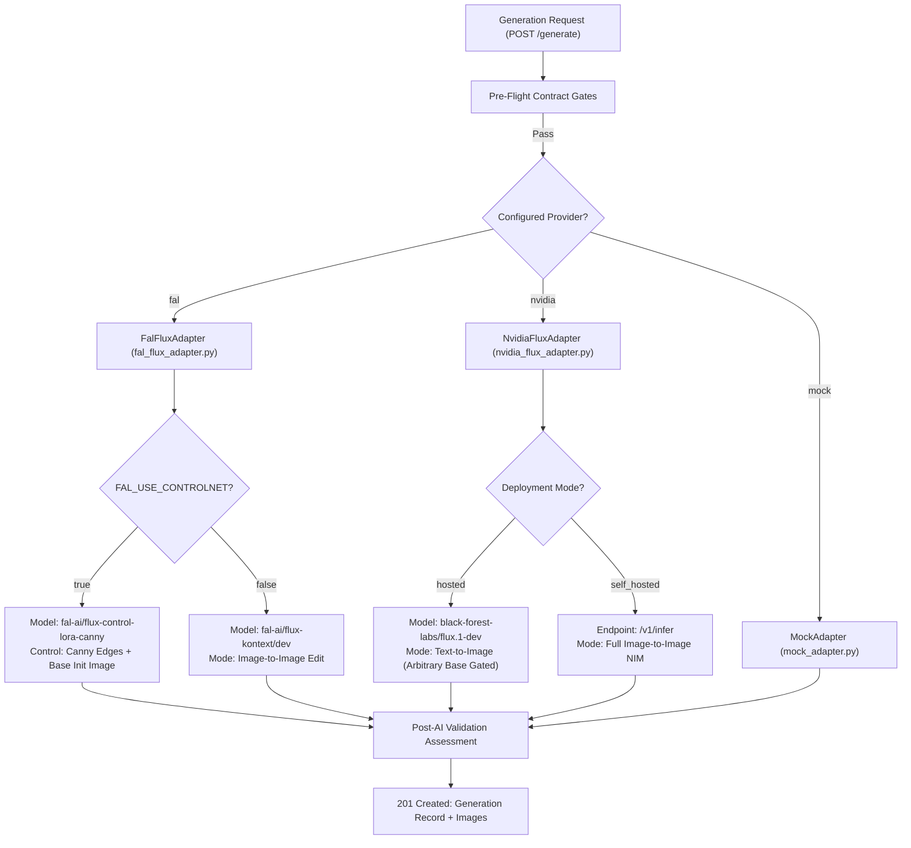
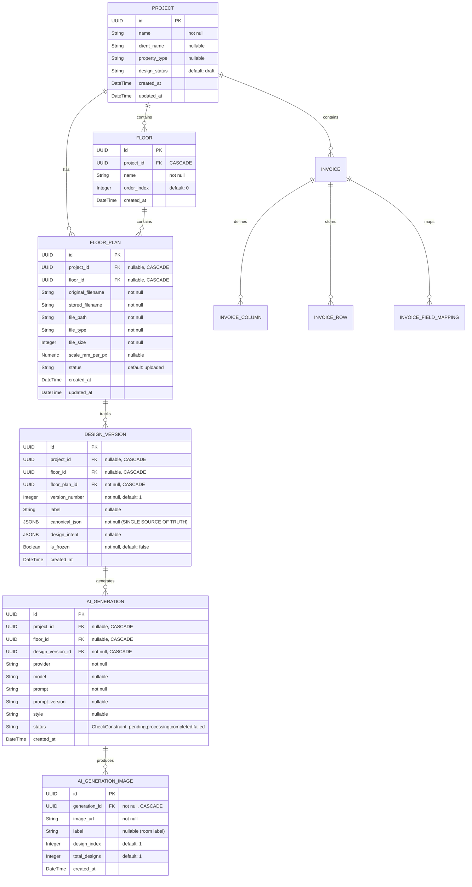
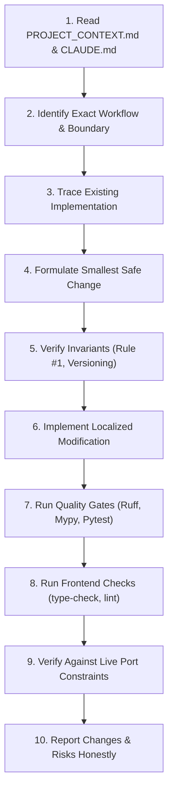

# MyNest Design Studio — Project Context & Engineering Knowledge Base

> **Authoritative Engineering Reference & Architectural Knowledge Document**  
> *The 2D architectural floor plan is the single source of truth. AI is strictly a non-authoritative visualizer.*  
> **Status:** Authoritative Repository Baseline | **Version:** 1.0.0 | **Last Updated:** October 2026

---

## Document Purpose & Audience

This document is the central, authoritative engineering knowledge base for **MyNest Design Studio**. It provides an exhaustive, ground-truth analysis of the actual codebase for any AI coding agent, software engineer, or technical contributor prior to undertaking bug fixes, feature extensions, performance optimizations, or architectural changes.

Every technical claim, workflow diagram, data contract, and configuration specification herein has been verified against the physical repository files (`backend/`, `frontend/`, `docs/`, `tests/`).

---

## Table of Contents

1. [A. Project Identity and Business Purpose](#a-project-identity-and-business-purpose)
   - [Vision & Value Proposition](#vision--value-proposition)
   - [Industry Problems Solved](#industry-problems-solved)
   - [Target Users & Primary Use Cases](#target-users--primary-use-cases)
   - [Core Application Capabilities](#core-application-capabilities)
   - [Inputs, Processing Stages, and Outputs](#inputs-processing-stages-and-outputs)
   - [Platform Differentiators](#platform-differentiators)
2. [B. Core Architectural Principles & Non-Negotiable Invariants](#b-core-architectural-principles--non-negotiable-invariants)
   - [Rule #1 — Authoritative Geometry Invariant](#rule-1--authoritative-geometry-invariant)
   - [Enforced vs. Intended Architectural Invariants](#enforced-vs-intended-architectural-invariants)
   - [Data Ownership & Snapshot Isolation Invariant](#data-ownership--snapshot-isolation-invariant)
   - [Deterministic Precedence & Fallback Invariant](#deterministic-precedence--fallback-invariant)
   - [The Strict Base-Render Contract](#the-strict-base-render-contract)
3. [C. Complete Repository & File Responsibility Map](#c-complete-repository--file-responsibility-map)
   - [Repository Directory Tree](#repository-directory-tree)
   - [Backend File Responsibility Map](#backend-file-responsibility-map)
   - [Frontend File Responsibility Map](#frontend-file-responsibility-map)
   - [Auxiliary Modules & Sub-Repositories (`floorplan-parser`)](#auxiliary-modules--sub-repositories-floorplan-parser)
4. [D. Technology Stack & System Architecture](#d-technology-stack--system-architecture)
   - [System Topology & High-Level Architecture](#system-topology--high-level-architecture)
   - [Technology Inventory & Version Matrix](#technology-inventory--version-matrix)
   - [Cross-Boundary Communication & Data Movement](#cross-boundary-communication--data-movement)
5. [E. End-to-End Application Workflows](#e-end-to-end-application-workflows)
   - [Workflow 1: Project Creation and Floor Organization](#workflow-1-project-creation-and-floor-organization)
   - [Workflow 2: Floor Plan Upload and File Ingestion](#workflow-2-floor-plan-upload-and-file-ingestion)
   - [Workflow 3: Architectural Geometry Extraction & Coordinate Calibration](#workflow-3-architectural-geometry-extraction--coordinate-calibration)
   - [Workflow 4: Room Boundary Reconstruction & Validation](#workflow-4-room-boundary-reconstruction--validation)
   - [Workflow 5: Interactive 2D Canvas Editing & Furniture Placement](#workflow-5-interactive-2d-canvas-editing--furniture-placement)
   - [Workflow 6: Furniture Customization, Transforms & Layout Persistence](#workflow-6-furniture-customization-transforms--layout-persistence)
   - [Workflow 7: Design Versioning, Deduplication & Snapshot Isolation](#workflow-7-design-versioning-deduplication--snapshot-isolation)
   - [Workflow 8: Deterministic 3D Scene Construction](#workflow-8-deterministic-3d-scene-construction)
   - [Workflow 9: Offscreen 3D Base Render Capture & Pre-Flight Validation](#workflow-9-offscreen-3d-base-render-capture--pre-flight-validation)
   - [Workflow 10: AI Generation Construction & Multi-Provider Execution](#workflow-10-ai-generation-construction--multi-provider-execution)
   - [Workflow 11: Post-Render Validation & Error Handling](#workflow-11-post-render-validation--error-handling)
   - [Workflow 12: Render Gallery Inspection, Split-View Verification & Export](#workflow-12-render-gallery-inspection-split-view-verification--export)
6. [F. Canvas, Furniture, and Customization System](#f-canvas-furniture-and-customization-system)
   - [Canvas Rendering Architecture & Coordinate Spaces](#canvas-rendering-architecture--coordinate-spaces)
   - [Viewport Navigation, Selection, Snapping & Transforms](#viewport-navigation-selection-snapping--transforms)
   - [Furniture Catalog Schema, Units & Identification](#furniture-catalog-schema-units--identification)
   - [Layout Data Structures & Canonical Persistence](#layout-data-structures--canonical-persistence)
   - [Spatial Constraints, Wall Proximity & Room Assignment](#spatial-constraints-wall-proximity--room-assignment)
   - [Visual Customization & Design Intent Influence](#visual-customization--design-intent-influence)
   - [Authoritative vs. Derived UI State](#authoritative-vs-derived-ui-state)
7. [G. Deterministic 3D and AI Rendering Architecture](#g-deterministic-3d-and-ai-rendering-architecture)
   - [Extrusion of 2D Vector Geometry to 3D WebGL](#extrusion-of-2d-vector-geometry-to-3d-webgl)
   - [Procedural 3D Furniture Synthesis (`furniture3d.ts`)](#procedural-3d-furniture-synthesis-furniture3dts)
   - [Deterministic AI Camera Solver (`aiCamera.ts`)](#deterministic-ai-camera-solver-aicamerats)
   - [Base Render Capture Pipeline (`BaseRenderBatch.tsx`)](#base-render-capture-pipeline-baserenderbatchtsx)
   - [Server-Side Prompt Synthesis & Master Constraint (`prompt_service.py`)](#server-side-prompt-synthesis--master-constraint-prompt_servicepy)
   - [AI Provider Adapters (`fal_flux_adapter.py`, `nvidia_flux_adapter.py`, `mock_adapter.py`)](#ai-provider-adapters-fal_flux_adapterpy-nvidia_flux_adapterpy-mock_adapterpy)
   - [Multi-Tier Post-AI Geometry & Inventory Validation](#multi-tier-post-ai-geometry--inventory-validation)
8. [H. APIs, Database, Data Contracts, and Storage](#h-apis-database-data-contracts-and-storage)
   - [Complete REST API Route Catalog](#complete-rest-api-route-catalog)
   - [Database Schema & SQLAlchemy ORM Models](#database-schema--sqlalchemy-orm-models)
   - [Storage Architecture, File Paths & Naming Conventions](#storage-architecture-file-paths--naming-conventions)
   - [Transaction Boundaries & Unit of Work](#transaction-boundaries--unit-of-work)
9. [I. Development Setup and Engineering Conventions](#i-development-setup-and-engineering-conventions)
   - [Prerequisites & Local Environment Setup](#prerequisites--local-environment-setup)
   - [Backend Execution & Startup Guarantees](#backend-execution--startup-guarantees)
   - [Frontend Execution & Development Server](#frontend-execution--development-server)
   - [Automated Quality Gates, Linting & Type Checking](#automated-quality-gates-linting--type-checking)
   - [Engineering Conventions & Boundary Rules](#engineering-conventions--boundary-rules)
10. [J. Current Implementation Status Matrix](#j-current-implementation-status-matrix)
11. [K. Known Issues, Risks, and Troubleshooting](#k-known-issues-risks-and-troubleshooting)
12. [L. Future Improvements and Product Roadmap](#l-future-improvements-and-product-roadmap)
13. [M. Safe Change and Regression Protocol](#m-safe-change-and-regression-protocol)
14. [N. Context Maintenance Rules](#n-context-maintenance-rules)

---

## A. Project Identity and Business Purpose

### Vision & Value Proposition
**MyNest Design Studio** is an architectural interior design workspace that bridges the gap between precision CAD/vector floor plans and cutting-edge generative AI visualization.

The central value proposition is **deterministic geometry preservation coupled with photorealistic visual synthesis**. It solves the fundamental flaw of modern generative AI in architecture: unconstrained diffusion models hallucinate walls, shift doors, eliminate windows, mutate room proportions, and invent random furniture pieces, rendering their outputs useless for real-world construction, procurement, or client presentations.

MyNest Design Studio guarantees that **every wall, door, window, dimension, and placed furniture item is locked to the millimeter-scale floor plan**, while utilizing diffusion models strictly to restyle materials, finishes, lighting, reflections, and atmosphere.

```
┌─────────────────────────┐      ┌──────────────────────────────┐      ┌───────────────────────────────┐
│ User Floor Plan Upload  │ ───► │ Deterministic Extraction     │ ───► │ Immutable Design Version      │
│ (Vector PDF / Raster)   │      │ (OpenCV / PyMuPDF / Shapely) │      │ (canonical_json: single truth)│
└─────────────────────────┘      └──────────────────────────────┘      └───────────────┬───────────────┘
                                                                                       │
┌─────────────────────────┐      ┌──────────────────────────────┐                      │
│ AI Photoreal Output     │ ◄─── │ Deterministic 3D Base Render │ ◄────────────────────┘
│ (fal.ai / NVIDIA Flux)  │      │ (Three.js WebGL 1216x832 px) │
└─────────────────────────┘      └──────────────────────────────┘
```

### Industry Problems Solved

| Industry Problem | Conventional CAD / 3D Tools | Unrestricted AI Image Tools (Midjourney, DALL-E) | MyNest Design Studio Solution |
| :--- | :--- | :--- | :--- |
| **Hallucinated Geometry** | Requires manual 3D modeling (2-5 days per room in 3ds Max / SketchUp). | Hallucinates walls, bends corners, changes room shapes, breaks architectural code. | **Authoritative 2D Vector Lock.** Geometry is extracted deterministically and conditioned via ControlNet (Canny / Depth) on real 3D WebGL base renders. |
| **Furniture Inventory Drift** | Manual asset placing and UV texturing. Extremely labor-intensive. | Arbitrary furniture is imagined. A specified 3-seat sofa turns into a sectional; desks vanish; dining sets multiply. | **Frozen Inventory Snapshot.** Placed furniture is catalog-referenced with verified mm dimensions. Master AI constraints enforce strict 1-to-1 inventory preservation. |
| **Window & Door Displacement** | Manual boolean operations in CAD. | Doors relocate across structural walls; windows disappear or become balconies. | **Wall-Projected Openings.** Doors and windows are identified from drawing layers, projected onto structural supporting walls, and locked in 3D. |
| **Design Reversion & Version Chaos** | CAD files are overwritten; changes lack audit trails. | Prompts are regenerated; previous layouts cannot be reproduced. | **Append-Only Design Versioning.** Edits create immutable version records in PostgreSQL. Background AI jobs reference frozen snapshots. |

### Target Users & Primary Use Cases
1. **Interior Designers & Decorators**: Rapidly produce client-ready photorealistic concepts from architectural blueprints without waiting days for external 3D rendering teams.
2. **Architects & Real Estate Developers**: Generate faithful interior marketing visualizations for apartment units while ensuring spatial dimensions match actual construction floor plans.
3. **Turnkey Contractors & Homeowners**: Lay out furniture to exact physical dimensions, check circulation clearances, and visualize luxury material upgrades.

### Core Application Capabilities
- **Floor Plan Ingestion**: Upload vector PDFs (multi-page/single-page) and raster images (PNG, JPG, WEBP) up to 25 MB.
- **Deterministic Vector Extraction**: Parse native PDF lines, rectangles, and path curves into structured walls, wall thickness, and color-coded opening layers.
- **Interactive 2D Design Workspace**: HTML5 Canvas (Konva) workspace with real-time zooming, panning, 8-way compass north orientation, grid toggling, snapping, and transformer controls (drag, rotate, resize, label).
- **Millimeter-Scale Furniture Catalog**: Placeable library of real-scale furniture (beds, sofas, tables, cabinets, doors, windows) with fixed millimeter footprints.
- **Full-House Connected 3D Model**: Real-time WebGL (Three.js / React Three Fiber) extrusion of walls, floor slabs, ceilings, and procedural 3D furniture models.
- **Offscreen Base Render Generation**: Automated, headless WebGL capture producing exact 1216x832 px base renders per room with an intelligent camera solver.
- **Two-Pass AI Visualization Pipeline**: Structural conditioning via fal.ai FLUX (Canny ControlNet + Image-to-Image initialization) and NVIDIA NIM.
- **Post-AI Quality Gates**: Automated inspection checking image decodability, non-blank luminance, aspect ratio, and layout difference.

### Expected Inputs, Processing Stages, and Outputs



### Platform Differentiators
- **Not a standard 2D CAD tool**: It does not just draw vector lines; it semantically categorizes architecture, extracts room topology, and bridges 2D layouts into 3D environments.
- **Not a generic 3D modeling suite**: Designers do not manipulate polygonal vertices or UV maps; 3D scenes are deterministically assembled from 2D coordinates.
- **Not an unconstrained text-to-image generator**: AI does not design the room. AI acts strictly as an **advanced neural shader** rendering materials onto an unyielding geometric armature.

---

## B. Core Architectural Principles & Non-Negotiable Invariants

The repository enforces strict architectural invariants across the backend, frontend, and AI adapters. Any code modification violating these rules degrades the core value proposition.

### Rule #1 — Authoritative Geometry Invariant
As codified in `CLAUDE.md` and enforced in `backend/app/services/`:
> **RULE #1 — GEOMETRY IS AUTHORITATIVE, NEVER ALTER IT (DO NOT BREAK)**  
> The 2D floor plan is the **single source of truth**. The following are **FIXED and must never be changed, moved, rescaled, added, or removed** by any code, prompt, AI model, or feature:
> 1. **Walls** — positions, lengths, thickness, angles.
> 2. **Windows and doors** — positions, sizes, opening orientations.
> 3. **Room proportions and dimensions** — the boundary shape and scale of every room.
> 4. **User-placed furniture** — exact $X, Y$, rotation, scale, and item identities recorded in `canonical_json`.

Concretely:
- **AI is a non-authoritative visualizer only.** AI may restyle materials, lighting, textures, and decor, but must never rewrite wall coordinates, drop doors, or reposition furniture.
- **The Master AI Constraint (`prompt_service.py:MASTER_CONSTRAINT`)** is injected into every server-synthesized prompt and must never be weakened or omitted.
- **No silent normalization.** Algorithms must never "clean up", snap, re-scale, or re-center the plan or its geometry as a side effect of another operation.

### Enforced vs. Intended Architectural Invariants

| Invariant | Enforced by Code | Enforcement Mechanism & File Location | Failure Behavior |
| :--- | :---: | :--- | :--- |
| **Geometry Unchanged by AI** | **YES** | `generation_service.py:_verify_geometry_unchanged` asserts `canonical_json` is byte-identical before and after generation. | Throws internal assertion; generation aborts. |
| **Append-Only Design Versioning** | **YES** | `floor_plan_service.py:save_layout` compares `_furniture_fingerprint()`. Any edit creates a new `DesignVersion` record with incremented `version_number`. | Old versions are never mutated or deleted. |
| **Snapshot Isolation during AI Render** | **YES** | `generation_service.py:generate` calls `capture_generation_snapshot()` which marks `is_frozen=True` and binds the run to that exact `design_version_id`. | Edits during rendering append version $N+1$; rendering completes on version $N$. |
| **Base-Render Dimension Gate** | **YES** | `base_render_service.py:validate_base_render` strictly rejects any image not matching `1216×832` px. | HTTP 400 `BASE_RENDER_WRONG_SIZE`. |
| **Base-Render Version Match** | **YES** | `base_render_service.py:validate_base_render` compares `base_render_meta.design_version_id` against current generation snapshot. | HTTP 409 `BASE_RENDER_WRONG_VERSION`. |
| **Non-Blank Base Render Gate** | **YES** | `generation_service.py:_is_blank` checks luminance mean ($<12$) and spread ($<6$) on downsampled pixels. | Rejects with `BASE_RENDER_BLANK`. |
| **Non-Empty Room Gate** | **YES** | `generation_service.py:_classify_base_gate` checks `manifest["furniture_count"] > 0`. | Gated with `ROOM_EMPTY`. |
| **Post-AI Decodability & Quality** | **YES** | `validation_service.py:assess_ai_output_geometry` checks non-blank, aspect ratio, and mean luminance difference against base render. | Fails room with `FAILED_GEOMETRY_VALIDATION`. |
| **Vision-LLM Semantic Filtering** | **INTENDED / OPT-IN** | `vision_validation_service.py` is gated behind `NVIDIA_VISION_ENABLED=false` (default off). | Disabled by default; runs deterministic fallback. |
| **Experimental Wall Reconstruction** | **INTENDED / OPT-IN** | `wall_reconstruction.py` is gated behind `WALL_RECONSTRUCTION_ENABLED=false` (default off). | Disabled by default; uses proven polygon or bbox fallback. |

### Data Ownership & Snapshot Isolation Invariant
- **Single Source of Truth**: The full spatial layout lives solely in `design_versions.canonical_json` (`models.py:DesignVersion`). The database intentionally omits a separate `furniture_instances` table to avoid divergent state.
- **Snapshot Isolation**: When a generation starts, the backend retrieves or creates a frozen `DesignVersion`. If a user continues editing in the 2D canvas, debounced autosaves create new version numbers ($N+1, N+2$). The generation worker continues reading from snapshot $N$.

### Deterministic Precedence & Fallback Invariant
- **Deterministic Precedence**: If an AI visual output conflicts with deterministic floor plan geometry, **the floor plan geometry always wins**.
- **No Masquerading Fallback**: If an AI generation fails, the system **must not return the deterministic 3D base render masquerading as an AI output** unless `AI_ALLOW_DETERMINISTIC_FALLBACK=true` (which is strictly `false` by default). Failures must be surfaced honestly with structured error codes.

### The Strict Base-Render Contract
A base render submitted to `/api/floor-plans/{id}/generate` must satisfy:
1. Exact dimensions: `1216` width by `832` height in pixels.
2. Formatted as valid PNG bytes.
3. Non-blank and non-corrupt.
4. Linked to the exact `design_version_id` active on the server.
5. Keyed by the matching room identifier or label.

---

## C. Complete Repository & File Responsibility Map

### Repository Directory Tree

```
mynest-design-studio/
├── CLAUDE.md                             # Agent guardrails & Cardinal Rule #1
├── README.md                             # High-level product overview & usage guide
├── PROJECT_CONTEXT.md                    # (This document) Authoritative engineering knowledge base
├── package.json                          # Root tooling & Playwright dependencies
├── yolov8n.pt                            # Pre-trained base weights for YOLO object detection
│
├── docs/                                 # Architectural specifications & engineering audits
│   ├── ARCHITECTURE.md                   # Foundational system architecture & service boundaries
│   ├── CORE_PIPELINE_DOCUMENTATION.md     # 16-stage pipeline & multi-pass AI integration specification
│   ├── PIPELINE_AUDIT_REPORT.md          # 13-stage end-to-end audit with automated evidence
│   ├── AI_RENDER_FIX_REPORT.md           # Two-pass ControlNet Canny + Image-to-Image investigation
│   └── BASE_RENDER_FIX_REPORT.md         # DPR-scaling bug investigation & dpr={1} capture resolution
│
├── backend/                              # FastAPI Python backend (Python 3.11/3.12)
│   ├── pyproject.toml                    # Ruff (lint/format) and Mypy (strict) configurations
│   ├── requirements.txt                  # Production runtime dependencies
│   ├── requirements-dev.txt              # Testing & development dependencies
│   ├── .env.example                      # Template for environment configuration
│   │
│   ├── app/
│   │   ├── main.py                       # FastAPI entry point, lifespan, CORS, health & diagnostics
│   │   │
│   │   ├── api/                          # REST API route handlers
│   │   │   ├── floor_plans.py            # Floor plan upload, layout CRUD, scene graph, AI trigger
│   │   │   ├── generations.py            # Generation record retrieval & high-res image streaming
│   │   │   ├── projects.py               # Project & floor level CRUD operations
│   │   │   └── invoices.py               # BOQ / invoice parsing & column mapping endpoints
│   │   │
│   │   ├── core/
│   │   │   └── config.py                 # Central settings, paths, provider flags, upload limits
│   │   │
│   │   ├── db/
│   │   │   ├── base.py                   # SQLAlchemy engine, session maker, session_scope, init_db
│   │   │   └── models.py                 # ORM models (Project, Floor, FloorPlan, DesignVersion, etc.)
│   │   │
│   │   ├── schemas/                      # Pydantic v2 schemas for request/response validation
│   │   │   ├── floor_plan.py             # LayoutPayload, FloorPlanResponse, SceneGraph schemas
│   │   │   ├── generation.py             # GenerationRequest, GenerationResponse, Image schemas
│   │   │   └── invoice.py                # InvoiceUploadResponse, ColumnMapping schemas
│   │   │
│   │   ├── storage/
│   │   │   └── file_storage.py           # Filesystem storage abstraction (uploads, generations, renders)
│   │   │
│   │   ├── services/                     # Core domain business logic & algorithmic engines
│   │   │   ├── floor_plan_service.py     # Plan lifecycle, upload streaming, layout versioning
│   │   │   ├── generation_service.py     # AI generation orchestration, pre/post gates, caching
│   │   │   ├── prompt_service.py         # Room grouping & MASTER_CONSTRAINT prompt synthesis
│   │   │   ├── base_render_service.py    # Strict base-render contract enforcement (1216x832 px)
│   │   │   ├── scene_service.py          # 2D to 3D scene assembly, wall projection of openings
│   │   │   ├── canonical_assembly_service.py # Unified canonical JSON assembly from multi-modal inputs
│   │   │   ├── validation_service.py     # Collision (SAT), room containment, 2D-to-3D fidelity gates
│   │   │   ├── fidelity_service.py       # Room architectural fidelity scoring (0-100%)
│   │   │   ├── vision_validation_service.py # NVIDIA Vision LLM semantic validation (opt-in)
│   │   │   ├── geometry_extraction_service.py # PyMuPDF vector edge & opening extraction
│   │   │   ├── architectural_service.py  # Structured walls, room reconstruction, wall relationships
│   │   │   ├── wall_reconstruction.py    # Topological double-line wall collapse & cycle detection
│   │   │   ├── room_reconstruction_raster.py # Raster flood-fill & contour room reconstruction
│   │   │   ├── shape_extraction_service.py # OpenCV Hough line detection on raster drawings
│   │   │   ├── text_extraction_service.py# OCR extraction (Tesseract/EasyOCR) for labels & dimensions
│   │   │   ├── furniture_detection_service.py # YOLO 2D symbol candidate extraction
│   │   │   ├── furniture_detector_hybrid.py # COCO YOLOv8 + OWLv2 hybrid detector for AI outputs
│   │   │   ├── furniture_manifest.py     # Authoritative room furniture inventory manifests
│   │   │   ├── furniture_inventory_validation_service.py # Post-AI inventory validation via VLM
│   │   │   ├── furniture_object_validation_service.py # Object-level spatial assignment & gating
│   │   │   ├── furniture_geometry_validation_service.py # OWLv2 bounding-box geometry validation
│   │   │   ├── coordinates.py            # Coordinate transformations (PDF pt, World px, mm, Three.js)
│   │   │   ├── geometry_service.py       # Pure 2D computational geometry (Shoelace, SAT overlap)
│   │   │   ├── project_service.py        # Project & floor domain service
│   │   │   ├── invoice_service.py        # Invoice PDF/Excel parsing & table extraction
│   │   │   ├── diagnostics_service.py    # System health & AI capability introspection
│   │   │   │
│   │   │   ├── ai/                       # Generative AI provider adapters
│   │   │   │   ├── base.py               # AIProviderAdapter interface & GenerationRequest schema
│   │   │   │   ├── fal_flux_adapter.py   # fal.ai FLUX.1 Kontext & ControlNet Canny adapter
│   │   │   │   ├── nvidia_flux_adapter.py# NVIDIA NIM FLUX.1 text-to-image & img2img adapter
│   │   │   │   ├── mock_adapter.py       # Offline synthetic mock adapter for testing
│   │   │   │   └── registry.py           # Provider registration & configuration validation
│   │   │   │
│   │   │   └── ml/                       # Machine learning object detection pipeline
│   │   │       ├── yolo_detector.py      # Ultralytics YOLO inference wrapper
│   │   │       ├── scene_bridge.py       # Mapping ML bounding boxes to canonical furniture
│   │   │       └── svg_rasterizer.py     # Vector rasterization for ML dataset generation
│   │
│   └── tests/                            # 55 automated test suites (500+ unit & integration tests)
│
├── frontend/                             # React 18 + TypeScript + Vite SPA
│   ├── package.json                      # Frontend scripts and npm dependencies
│   ├── vite.config.ts                    # Vite build configuration and /api proxy
│   ├── tsconfig.json                     # TypeScript strict configuration
│   ├── eslint.config.js                  # ESLint 9 configuration
│   ├── playwright.config.ts              # Playwright E2E configuration
│   │
│   ├── src/
│   │   ├── main.tsx                      # React DOM root entry point
│   │   ├── App.tsx                       # React Router configuration & AppShell layout
│   │   ├── harness.tsx                   # Headless test harness for Playwright 3D audits
│   │   │
│   │   ├── pages/                        # Primary screen views
│   │   │   ├── Dashboard.tsx             # Project management, client details, floor navigation
│   │   │   ├── DesignStudio.tsx          # 2D canvas workspace, furniture tools, 3D modal, AI trigger
│   │   │   ├── FloorPlans.tsx            # Floor plan repository, search, upload trigger
│   │   │   ├── FloorPlanDetail.tsx       # Single floor plan metadata, inspection & debug links
│   │   │   ├── AIGenerations.tsx         # Historical rendering audit log & download gallery
│   │   │   ├── Projects.tsx              # Projects overview table
│   │   │   └── Settings.tsx              # System preferences & AI provider status
│   │   │
│   │   ├── components/
│   │   │   ├── design-studio/            # Core workspace components
│   │   │   │   ├── DesignCanvas.tsx      # HTML5 Konva interactive canvas (pan/zoom/drag/transform)
│   │   │   │   ├── Furniture.tsx         # Konva furniture shape rendering & transformer binding
│   │   │   │   ├── FurnitureLibrary.tsx  # Categorized furniture palette with click-to-place mode
│   │   │   │   ├── RoomScene3D.tsx       # Three.js / React Three Fiber deterministic 3D room viewer
│   │   │   │   ├── Scene3DModal.tsx      # Full-house connected 3D WebGL inspection modal
│   │   │   │   ├── BaseRenderBatch.tsx   # Offscreen headless 3D capture engine (1216x832 px, dpr=1)
│   │   │   │   ├── GenerationGallery.tsx # Side-by-side split view (Plan/Base vs Photoreal Render)
│   │   │   │   ├── RoomSection2D.tsx     # Isolated 2D vector room reference preview
│   │   │   │   ├── PlanRegion.tsx        # High-resolution raster 2D room crop renderer
│   │   │   │   └── NorthCompass.tsx      # 8-way interactive compass rose for solar orientation
│   │   │   │
│   │   │   ├── floor-plans/              # Upload & plan management UI
│   │   │   │   ├── UploadModal.tsx       # Drag-and-drop file upload modal with project scoping
│   │   │   │   ├── FloorPlanCard.tsx     # Card component for plan list
│   │   │   │   └── FloorPlanToolbar.tsx  # Search and filter controls
│   │   │   │
│   │   │   ├── layout/                   # Global chrome layout
│   │   │   │   ├── AppShell.tsx          # Two-column layout container (sidebar + content)
│   │   │   │   ├── Sidebar.tsx           # Primary navigation rail with user profile
│   │   │   │   └── Header.tsx            # Contextual breadcrumbs & backend health badge
│   │   │   │
│   │   │   └── ui/                       # Reusable design system primitives
│   │   │       ├── Button.tsx            # Styled variant button component
│   │   │       ├── Card.tsx              # Container card
│   │   │       ├── Modal.tsx             # Accessible dialog container
│   │   │       ├── ConfirmDialog.tsx     # Action confirmation modal
│   │   │       └── EmptyState.tsx        # Zero-data state placeholder
│   │   │
│   │   ├── data/
│   │   │   └── furniture.ts              # Millimeter-scale furniture catalog & legacy item map
│   │   │
│   │   ├── lib/                          # Client utilities, API client & mathematical models
│   │   │   ├── api.ts                    # Low-level fetch wrapper with error translation
│   │   │   ├── floorPlans.ts             # Floor plan, layout persistence & upload API services
│   │   │   ├── generations.ts            # AI generation trigger & status polling API client
│   │   │   ├── scene.ts                  # Scene graph interfaces (Scene, SceneRoom, OpeningPlacement)
│   │   │   ├── furniture3d.ts            # Procedural 3D furniture mesh specs (height, kind, color)
│   │   │   ├── furnitureBoxes.ts         # Three.js 3D bounding box computation
│   │   │   ├── aiCamera.ts               # Deterministic camera solver for 3/4 corner viewpoints
│   │   │   ├── geometry.ts               # Client-side 2D vector math & SAT collision detection
│   │   │   ├── loadPlanImage.ts          # PDF rasterization via PDF.js & image loading
│   │   │   └── fileValidation.ts         # Client-side file extension & size validation
│   │   │
│   │   ├── store/
│   │   │   └── useEditorStore.ts         # Zustand store for viewport, zoom, snap, grid & compass
│   │   │
│   │   └── types/                        # TypeScript domain interfaces
│   │       ├── design.ts                 # PlacedItem, CanvasItem, FurniturePayload
│   │       └── floorPlan.ts              # FloorPlan entity contract
│   │
│   └── e2e/                              # Playwright end-to-end regression test specifications
│
└── floorplan-parser/                     # Standalone reference sub-project (NOT imported by backend)
    ├── README.md                         # VLM & trimesh+manifold3d prototype documentation
    └── floorplan/                        # Experimental parser & reconstruction package
```

---

### Backend File Responsibility Map

#### Core Framework & API Routing
| File Path | Primary Responsibility | Key Classes / Functions | Inputs & Outputs | Important Callers & Downstream Dependencies | When to Modify |
| :--- | :--- | :--- | :--- | :--- | :--- |
| `backend/app/main.py` | FastAPI application initialization, lifespan management, CORS configuration, and root health diagnostics. | `lifespan()`, `health_check()`, `ai_diagnostics()`, `_active_ai()` | Inputs: HTTP requests.<br>Outputs: JSON diagnostics & router dispatch. | Uvicorn entry point; consumed by frontend proxy. | When altering CORS domains, adding global middleware, or modifying boot diagnostics. |
| `backend/app/core/config.py` | Central configuration loading from `.env`, path definitions, AI provider flags, and limits. | `DATABASE_URL`, `DEFAULT_AI_PROVIDER`, `FAL_IMAGE_MODEL`, `NVIDIA_API_KEY`, upload constraints. | Inputs: Environment variables.<br>Outputs: Typed constants. | Imported by every backend service, database layer, and adapter. | When introducing new environment variables, AI provider models, or adjusting timeouts. |
| `backend/app/api/floor_plans.py` | Primary REST router for floor plan lifecycle, layout persistence, scene retrieval, and AI generation. | `upload_floor_plan()`, `get_layout()`, `put_layout()`, `scene()`, `generate()`, `control_image()` | Inputs: Multipart uploads, JSON layout/generation payloads.<br>Outputs: `FloorPlanResponse`, `LayoutPayload`, `SceneResponse`. | Directly called by frontend `floorPlans.ts` and `generations.ts`. | When updating REST endpoints, request/response validation, or route permissions. |
| `backend/app/api/generations.py` | Read-only REST router for inspecting historical generation batches and streaming rendered PNG files. | `get_generation()`, `get_generation_image()` | Inputs: `generation_id`, image index.<br>Outputs: Generation metadata, binary image stream (`image/png`). | Consumed by `GenerationGallery.tsx` and `AIGenerations.tsx`. | When modifying generation audit routes or image streaming headers. |
| `backend/app/api/projects.py` | CRUD REST router for client design engagements and nested floor levels. | `list_projects()`, `create_project()`, `delete_project()` | Inputs: Project JSON bodies.<br>Outputs: Project lists, created records. | Consumed by frontend `Dashboard.tsx` and `CreateProjectModal.tsx`. | When adding project metadata fields or changing cascading deletion rules. |
| `backend/app/api/invoices.py` | REST router for invoice / BOQ ingestion, automated table parsing, and column mapping. | `upload_invoice()`, `update_column_mapping()`, `create_field_mapping()` | Inputs: PDF/Excel multipart uploads, column mapping JSON.<br>Outputs: Extracted rows/columns. | Auxiliary feature; consumed by BOQ tools. | When extending tabular financial data extraction. |

#### Database & Storage
| File Path | Primary Responsibility | Key Classes / Functions | Inputs & Outputs | Important Callers & Downstream Dependencies | When to Modify |
| :--- | :--- | :--- | :--- | :--- | :--- |
| `backend/app/db/base.py` | SQLAlchemy 2.0 engine setup, connection pooling, session lifecycle, and transactional boundaries. | `engine`, `SessionLocal`, `session_scope()`, `init_db()`, `get_session()` | Inputs: `DATABASE_URL`.<br>Outputs: Active DB sessions. | Used by all services to read/write database entities. | When tuning connection pool sizes (`pool_pre_ping`, `pool_recycle`) or switching DB engines. |
| `backend/app/db/models.py` | Declarative SQLAlchemy ORM models establishing relational schema and constraints. | `Project`, `Floor`, `FloorPlan`, `DesignVersion`, `AIGeneration`, `AIGenerationImage`, `Invoice` | Tables, relationships, foreign keys, and indexes. | Queried by services and Alembic migrations. | When schema additions are required. **Must preserve `canonical_json` single-truth invariant.** |
| `backend/app/storage/file_storage.py` | Filesystem storage manager for binary uploads, generated AI images, and debug artifacts. | `save_upload_stream()`, `save_generation_image()`, `get_generation_image_path()`, `abs_path()` | Inputs: Byte streams, filenames.<br>Outputs: Resolved relative/absolute file paths. | Called by `floor_plan_service.py` and `generation_service.py`. | When altering storage directory hierarchy or integrating S3/cloud storage adapters. |

#### Architectural Geometry & Extraction Services
| File Path | Primary Responsibility | Key Classes / Functions | Inputs & Outputs | Important Callers & Downstream Dependencies | When to Modify |
| :--- | :--- | :--- | :--- | :--- | :--- |
| `backend/app/services/geometry_extraction_service.py` | High-fidelity vector parsing of floor plan PDFs via `pdfplumber`, extracting walls and color-coded openings. | `extract_walls()`, `_extract_openings()`, `_find_frame()`, `_stroke_hex()` | Inputs: PDF file path.<br>Outputs: Extracted walls, structured walls, and opening objects. | Called by `scene_service.py` and `canonical_assembly_service.py`. | When modifying PDF vector edge parsing, margin filtering, or stroke color classification. |
| `backend/app/services/architectural_service.py` | Derives structural entities, room boundaries, and furniture-to-wall relationships. | `build_structured_walls()`, `reconstruct_rooms()`, `calculate_wall_relationship()`, `extract_doors_and_windows()` | Inputs: Extracted wall segments, furniture layouts.<br>Outputs: Enclosed rooms, wall IDs, distances in mm, adjacency. | Core engine for `scene_service.py` and `floor_plan_service.py`. | When adjusting furniture-to-wall distance thresholds (attached vs adjacent) or room majority labeling. |
| `backend/app/services/wall_reconstruction.py` | Topological analysis of double-line architectural walls, centerline collapse, and planar cycle detection. | `measure_tolerances()`, `collapse_double_lines()`, `find_room_cycles()`, `reconstruct_rooms_topology()` | Inputs: Raw wall segments.<br>Outputs: Wall thickness, merged centerlines, closed polygon cycles. | Called by `architectural_service.py` when topological reconstruction is enabled. | When refining wall thickness estimation or resolving fragmented vector intersections. |
| `backend/app/services/room_reconstruction_raster.py` | Raster fallback room polygon extraction via OpenCV morphological closing and flood-fill contours. | `reconstruct_rooms_raster()`, `_polygonize_contours()` | Inputs: Raster plan image.<br>Outputs: Wall-supported room polygon boundaries. | Fallback in `scene_service.py` when vector cycles are incomplete. | When tuning raster morphological kernel sizes or contour area thresholds. |
| `backend/app/services/coordinates.py` | Mathematical coordinate transforms between PDF points, World pixels, Millimeters, and Three.js meters. | `pdf_to_image()`, `world_to_mm()`, `mm_to_world()`, `world_to_three()`, `three_to_world()` | Inputs: Coordinates & scale factors.<br>Outputs: Transformed spatial coordinates. | Imported across all geometry, scene, and validation services. | When adjusting default millimeter-per-pixel scales or Three.js unit factors. |
| `backend/app/services/geometry_service.py` | Pure, side-effect-free computational geometry algorithms. | `calculate_room_area_m2()`, `rects_collide()` (SAT), `point_in_polygon()`, `rect_polygon_min_distance()` | Inputs: Vertices, rectangles.<br>Outputs: Collision booleans, minimum distances, areas. | Used by `validation_service.py` and mirrored on frontend in `src/lib/geometry.ts`. | When updating 2D collision math or polygon containment algorithms. |

#### Scene Assembly, Versioning & AI Services
| File Path | Primary Responsibility | Key Classes / Functions | Inputs & Outputs | Important Callers & Downstream Dependencies | When to Modify |
| :--- | :--- | :--- | :--- | :--- | :--- |
| `backend/app/services/floor_plan_service.py` | Floor plan file management, layout serialization, and append-only versioning. | `create_floor_plan()`, `save_layout()`, `get_layout()`, `capture_generation_snapshot()`, `_latest_version()` | Inputs: Uploaded files, `LayoutPayload`.<br>Outputs: `FloorPlanResponse`, version records. | Called by `api/floor_plans.py`. Central manager of `design_versions`. | When modifying version deduplication rules, file deletion cascades, or metadata lookups. |
| `backend/app/services/scene_service.py` | Builds the authoritative 2D/3D scene graph consumed by the Three.js WebGL engine. | `build_scene()`, `_attach_opening_placements()`, `_find_supporting_wall()`, `_room_bbox()` | Inputs: Floor plan ID, canonical design.<br>Outputs: Full scene graph with world-pixel walls, rooms, openings, furniture. | Called by `api/floor_plans.py:scene`. Primary input to Three.js viewer and base capture. | When adjusting how openings project onto structural walls or how room bounding boxes are calculated. |
| `backend/app/services/generation_service.py` | High-level orchestration of the AI rendering pipeline, pre/post gates, caching, and image persistence. | `generate()`, `_render_room()`, `room_eligibility()`, `_classify_base_gate()`, `_verify_geometry_unchanged()` | Inputs: `file_id`, base render PNGs, `base_render_meta`.<br>Outputs: `GenerationResponse` with output images. | Called by `api/floor_plans.py:generate`. Direct consumer of AI adapters. | When adjusting generation orchestration, rate-limiting delays, gate codes, or caching rules. |
| `backend/app/services/prompt_service.py` | Server-side prompt synthesis injecting room metadata, placed furniture inventory, and Master AI Constraint. | `build_room_prompt()`, `group_by_room()`, `MASTER_CONSTRAINT` | Inputs: Room label, furniture items, design intent.<br>Outputs: Fully synthesized geometry-locked text prompts. | Called by `generation_service.py` before invoking AI adapters. | When updating luxury style presets, room visual descriptors, or prompt conditioning rules. |
| `backend/app/services/base_render_service.py` | Single deterministic checkpoint enforcing the strict base-render contract (exact 1216x832 px, valid version). | `validate_base_render()`, `_result()` | Inputs: Base render PNG bytes, expected version, expected room.<br>Outputs: Validation status, gate codes. | Called by `generation_service.py` before any AI request is dispatched. | When updating base-render dimension constraints or version validation checks. |
| `backend/app/services/validation_service.py` | Deterministic spatial validation and post-AI visual quality gate inspection. | `validate_scene_against_canonical()`, `validate_scene_2d_to_3d()`, `assess_ai_output_geometry()` | Inputs: Canonical layouts, 3D scenes, AI output PNGs.<br>Outputs: Error lists, fidelity booleans. | Called by `floor_plans.py:validate` and `generation_service.py:_render_room`. | When altering 2D-to-3D equality tolerances or post-AI luminance/aspect-ratio gates. |
| `backend/app/services/ai/fal_flux_adapter.py` | fal.ai FLUX adapter supporting FLUX.1 Kontext (image-editing) and FLUX Control-LoRA Canny (ControlNet). | `FalFluxAdapter.generate()`, `_build_control_body()`, `_resolve_queue()`, `fal_config_summary()` | Inputs: `GenerationRequest` with base render data-URI.<br>Outputs: List of generated PNG bytes. | Instantiated by `ai/registry.py` and called by `generation_service.py`. | When altering fal.ai API parameters (guidance scale, inference steps, control strength). |
| `backend/app/services/ai/nvidia_flux_adapter.py` | NVIDIA NIM hosted and self-hosted Flux adapter with mode-aware endpoint resolution. | `NvidiaFluxAdapter.generate()`, `resolve_endpoint()`, `effective_arbitrary_image_input()` | Inputs: `GenerationRequest`.<br>Outputs: List of generated PNG bytes. | Instantiated by `ai/registry.py` and called by `generation_service.py`. | When configuring self-hosted NIM endpoints (`/v1/infer`) or tuning NVIDIA retry budgets. |

---

### Frontend File Responsibility Map

#### Application Core & State
| File Path | Primary Responsibility | Key Classes / Functions / Hooks | Inputs & Outputs | Important Callers & Downstream Dependencies | When to Modify |
| :--- | :--- | :--- | :--- | :--- | :--- |
| `frontend/src/App.tsx` | Root application router configuration and top-level route mappings wrapped in `AppShell`. | `App()`, React Router `Routes` | Inputs: Browser URL.<br>Outputs: Rendered page view. | Rendered by `main.tsx`. Defines `/dashboard`, `/design-studio`, `/floor-plans`, `/ai-generations`. | When adding new pages or changing route paths. |
| `frontend/src/store/useEditorStore.ts` | Global Zustand state store managing canvas viewport, zoom, grid, snap, compass north, and zen mode. | `useEditorStore`, `NORTH_DEG`, `MIN_SCALE`, `MAX_SCALE` | Persists viewport preferences to `localStorage`. | Subscribed to by `DesignCanvas.tsx`, `NorthCompass.tsx`, and `DesignStudio.tsx`. | When adding global workspace settings or modifying compass orientation states. |
| `frontend/src/data/furniture.ts` | Authoritative frontend furniture catalog specifying categories, millimeter dimensions, and icons. | `furnitureCatalog`, `legacyFurniture`, `furnitureById`, `FurnitureItem` | Exports immutable catalog arrays and ID lookup map. | Used by `FurnitureLibrary.tsx`, `DesignStudio.tsx`, and `Furniture.tsx`. | When introducing new placeable furniture pieces or retiring catalog items. |

#### Design Studio & 2D Canvas
| File Path | Primary Responsibility | Key Classes / Functions / Hooks | Inputs & Outputs | Important Callers & Downstream Dependencies | When to Modify |
| :--- | :--- | :--- | :--- | :--- | :--- |
| `frontend/src/pages/DesignStudio.tsx` | Central workspace orchestrator managing active floor plan, furniture placement, autosave, and AI generation. | `DesignStudio()`, `handleGenerate()`, `captureBaseRenders()`, `saveLayout()` | Inputs: URL search params (`project`, `floor`, `plan`).<br>Outputs: Synchronized 2D/3D workspace. | Primary application screen. Coordinates canvas, 3D modals, and generation gallery. | When altering autosave debouncing, AI generation triggers, or studio toolbars. |
| `frontend/src/components/design-studio/DesignCanvas.tsx` | Interactive 2D Konva canvas managing pan/zoom, grid rendering, selection, dragging, and transformers. | `DesignCanvas`, `DesignCanvasHandle`, `handleWheel()`, `handleDragEnd()` | Inputs: Background plan image, placed items array.<br>Outputs: Canvas events, capture data-URL. | Rendered by `DesignStudio.tsx`. Contains `Furniture.tsx` children. | When modifying canvas interaction physics, zoom limits, or snapping behavior. |
| `frontend/src/components/design-studio/Furniture.tsx` | Individual furniture item rendering on the Konva canvas, selection bounding boxes, and label tags. | `FurnitureShape`, `handleTransformEnd()` | Inputs: PlacedItem props, selection state.<br>Outputs: Transformed coordinates ($X, Y, W, H, 	heta$). | Rendered within Konva Layer in `DesignCanvas.tsx`. | When changing 2D furniture footprint visuals, rotation handles, or inline renaming. |
| `frontend/src/components/design-studio/FurnitureLibrary.tsx` | Collapsible sidebar drawer displaying categorized furniture pieces with click-to-place interaction. | `FurnitureLibrary()`, search filter | Inputs: Active selection, catalog categories.<br>Outputs: `onSelectFurniture` callback. | Rendered on the right rail of `DesignStudio.tsx`. | When updating furniture categorization UI, search filtering, or library styling. |
| `frontend/src/components/design-studio/NorthCompass.tsx` | Interactive 8-way compass rose allowing designers to orient the building's north direction. | `NorthCompass()`, 8 cardinal/intercardinal buttons | Inputs: Current north angle from Zustand.<br>Outputs: Dispatches `setNorth()` updates. | Rendered over the canvas in `DesignStudio.tsx`. | When modifying solar orientation controls or compass graphics. |

#### Deterministic 3D & AI Gallery
| File Path | Primary Responsibility | Key Classes / Functions / Hooks | Inputs & Outputs | Important Callers & Downstream Dependencies | When to Modify |
| :--- | :--- | :--- | :--- | :--- | :--- |
| `frontend/src/components/design-studio/RoomScene3D.tsx` | WebGL 3D scene builder using Three.js and React Three Fiber to extrude walls and render procedural 3D furniture. | `RoomScene3D()`, `WallMesh`, `FurnitureMesh`, `OpeningPlacements` | Inputs: `Scene` object, room selection, camera preset, `dpr`.<br>Outputs: Rendered WebGL canvas. | Used in `Scene3DModal.tsx` and offscreen in `BaseRenderBatch.tsx`. | When updating 3D wall materials, lighting setups, ceiling extrusion, or opening cutouts. |
| `frontend/src/components/design-studio/Scene3DModal.tsx` | Modal dialog providing an interactive, orbitable 3D inspection view of the entire connected floor plan. | `Scene3DModal()`, camera presets (Perspective, Top, Eye Level) | Inputs: Active floor plan ID.<br>Outputs: Interactive WebGL view, high-res 3D PNG export. | Triggered via `☰ Menu` → `Deterministic 3D` in `DesignStudio.tsx`. | When adding 3D camera controls, model measurement tools, or full-screen 3D view modes. |
| `frontend/src/components/design-studio/BaseRenderBatch.tsx` | Headless, offscreen Three.js batch capturer producing deterministic 1216x832 px base renders per room for AI. | `BaseRenderBatch()`, sequential room capture loop | Inputs: `Scene` object.<br>Outputs: Resolves map of `Record<roomLabel, base64PNG>`. | Mounted dynamically by `DesignStudio.tsx:captureBaseRenders()`. | When tuning capture timing, camera settle delays, or fixed capture resolutions. |
| `frontend/src/components/design-studio/GenerationGallery.tsx` | Side-by-side verification gallery comparing authoritative 2D/3D geometry against the photorealistic AI render. | `GenerationGallery()`, room carousel, fidelity badge badges | Inputs: `Generation` record, original plan image.<br>Outputs: Visual comparison UI, high-res download. | Opened automatically upon AI completion or via `View AI Renders` menu. | When enhancing side-by-side comparison tools, slider overlays, or fidelity badge displays. |

#### Client Libraries & Math
| File Path | Primary Responsibility | Key Functions / Types | Inputs & Outputs | Important Callers & Downstream Dependencies | When to Modify |
| :--- | :--- | :--- | :--- | :--- | :--- |
| `frontend/src/lib/aiCamera.ts` | Deterministic camera solver scoring 4 corner candidate viewpoints to maximize furniture FOV. | `solveAiCamera()` | Inputs: Room window segments, furniture points, aspect ratio.<br>Outputs: Deterministic `[x,y,z]` position and look-at target. | Called by `RoomScene3D.tsx` when setting up base render cameras. | When adjusting viewpoint candidate heuristics, human eye height ($1.4	ext{m}$), or FOV scoring. |
| `frontend/src/lib/furniture3d.ts` | Maps 2D furniture catalog IDs to procedural 3D geometry kinds, realistic heights, and base colors. | `furniture3d`, `FurnitureKind`, `Furniture3DSpec` | Inputs: `item_id`.<br>Outputs: 3D height in meters, shape kind, base color. | Consumed by `RoomScene3D.tsx` to instantiate 3D geometries. | When adding 3D representations for newly introduced furniture catalog items. |
| `frontend/src/lib/floorPlans.ts` | Client API service for floor plan fetching, upload streaming, layout retrieval, and autosave. | `listFloorPlans()`, `getLayout()`, `saveLayout()`, `deleteFloorPlan()` | Inputs: API payloads.<br>Outputs: Promises resolving typed domain objects. | Used by `DesignStudio.tsx`, `FloorPlans.tsx`, `Dashboard.tsx`. | When altering client API endpoints or request error mappings. |
| `frontend/src/lib/scene.ts` | API service for fetching authoritative 2D/3D scene graphs and declaring capture dimensions. | `fetchScene()`, `BASE_CAPTURE_W` (1216), `BASE_CAPTURE_H` (832) | Inputs: Plan ID.<br>Outputs: `Scene` object with walls, rooms, openings. | Used by `DesignStudio.tsx`, `BaseRenderBatch.tsx`, `Scene3DModal.tsx`. | When updating scene graph schema consumption on the frontend. |

---

### Auxiliary Modules & Sub-Repositories (`floorplan-parser`)

The root directory contains a companion folder named `floorplan-parser/`:
- **Implementation Status**: Standalone experimental reference project / prototype.
- **Architectural Linkage**: **It is NOT imported or executed anywhere by `backend/app` or `frontend/src`**.
- **Capabilities**: Contains reference implementations for VLM-based floor plan parsing (Qwen2.5-VL via HuggingFace) and 3D mesh boolean operations using `trimesh` and `manifold3d`.
- **Engineering Directive**: Do not attempt to refactor `floorplan-parser` when fixing core studio bugs. Core production floor plan extraction resides strictly in `backend/app/services/geometry_extraction_service.py` and `architectural_service.py`.

---

## D. Technology Stack & System Architecture

### System Topology & High-Level Architecture



### Technology Inventory & Version Matrix

| Layer / Subsystem | Technology | Verified Version | Core Responsibility & Rationale |
| :--- | :--- | :--- | :--- |
| **Frontend Framework** | React + TypeScript | React `18.3.1`, TS `5.6.3` | Core single-page application component architecture and strict static typing. |
| **Frontend Bundler** | Vite | Vite `5.4.11` | High-speed local dev server with HMR; reverse proxies `/api` calls to `:8001`. |
| **2D Geometry Canvas** | Konva / react-konva | Konva `9.3.16`, react-konva `18.2.10` | High-performance HTML5 Canvas rendering for plan background and interactive furniture. |
| **3D Graphics Engine** | Three.js / React Three Fiber | Three `0.169.0`, R3F `8.18.0`, Drei `9.122.0` | WebGL extrusion of architectural walls, ceilings, floors, and 3D furniture meshes. |
| **PDF Ingestion (Client)** | PDF.js | `pdfjs-dist 4.7.76` | In-browser client-side rasterization of PDF documents onto HTML canvas elements. |
| **Client State Store** | Zustand | Zustand `5.0.1` | Isolated store for canvas viewport, zoom, grid, snap, and compass direction. |
| **Icons & UI Primitives** | Lucide React | `lucide-react 0.462.0` | Enterprise iconography across navigation, toolbars, and furniture catalogs. |
| **Backend Framework** | Python + FastAPI | Python `3.11`/`3.12`, FastAPI `0.115.5` | High-throughput asynchronous REST API framework with Pydantic v2 validation. |
| **ASGI Web Server** | Uvicorn | `uvicorn 0.32.1` | Asynchronous server implementation binding HTTP routes on port `8001`. |
| **Relational Database** | PostgreSQL / Supabase | SQLAlchemy `2.0.36`, psycopg `3.2.3` | Relational persistence with JSONB document containment; sync engine with pooling. |
| **Database Migrations** | Alembic | `alembic 1.14.0` | Declarative schema migration framework. |
| **PDF Vector Extraction** | pdfplumber | `pdfplumber 0.11.10` | Native extraction of vector path primitives (`edges`, `rects`, `curves`) from architectural PDFs. |
| **Computer Vision & Image** | OpenCV & Pillow | OpenCV `4.8.0+`, Pillow `11.0.0` | Morphological image operations, Hough line detection, base-render PNG validation. |
| **Computational Geometry**| Shapely | `shapely 2.0.0+` | Planar computational geometry: Shoelace area, polygon buffers, ray-casting containment. |
| **Object Detection (ML)** | Ultralytics YOLOv8 | `yolov8n.pt` (embedded) | Optional candidate detection of 2D floor plan symbols and furniture icons. |
| **AI Cloud Integration** | HTTPX | `httpx 0.28.1` | Asynchronous & synchronous HTTP client for communicating with external AI APIs. |
| **Primary AI Provider** | fal.ai FLUX Gateway | FLUX.1 Kontext / ControlNet Canny | Hosted image-to-image editing and Canny ControlNet conditioning on 3D base renders. |
| **Secondary AI Provider** | NVIDIA NIM Cloud | `stabilityai/flux1-dev` | Hosted text-to-image and self-hosted NIM image-to-image endpoints. |
| **Backend Quality Gates** | Ruff, Mypy, Pytest | Ruff `0.8.4`, Mypy `1.13.0`, Pytest `8.3.4` | Strict automated quality enforcement (formatting, strict typing, 55 test suites). |
| **Frontend Quality Gates** | TypeScript, ESLint, Playwright | TS `5.6.3`, ESLint `9.15.0`, Playwright `1.63.0` | Type checking (`tsc --noEmit`), linting, and automated browser regression suites. |

### Cross-Boundary Communication & Data Movement

1. **Client to Backend**:
   - Communication occurs via JSON REST API calls over HTTP, routed through Vite's development proxy (`/api` -> `http://127.0.0.1:8001`).
   - File uploads utilize standard `multipart/form-data` with streaming disk writes to minimize memory footprint.
   - Spatial layouts are transmitted as structured JSON arrays (`items`) containing millimeter-derived world-pixel coordinates.
2. **Backend to Database**:
   - Database operations use SQLAlchemy 2.0 synchronous sessions wrapped in the `session_scope()` context manager.
   - Connections are recycled every 300 seconds (`pool_recycle=300`) with pre-ping validation (`pool_pre_ping=True`) to gracefully handle dropped cloud connections.
   - Canonical spatial data is persisted directly into the `canonical_json` JSONB column of `design_versions`.
3. **Backend to AI Providers**:
   - The backend communicates with `fal.ai` (`https://fal.run`) or NVIDIA Cloud Functions via HTTPS using bearer tokens or key headers.
   - **Crucial Security Invariant**: AI provider credentials (`FAL_KEY`, `NVIDIA_API_KEY`) reside exclusively in server-side environment variables and are never transmitted to the browser client or logged.
   - Base renders are passed to fal.ai as base64 data-URIs or via fal's asset storage endpoints.

---

## E. End-to-End Application Workflows

### Workflow 1: Project Creation and Floor Organization
- **User Action**: Designer opens the Dashboard (`/dashboard`) and clicks **"New Project"**.
- **Frontend Flow**: `CreateProjectModal.tsx` collects project name, client name, property type, and floor names. Dispatches `POST /api/projects`.
- **Backend Flow**: `projects.py:create_project()` invokes `project_service.create_project()`. Within a database transaction, a `Project` record is created, and nested `Floor` records are generated with sequential `order_index`.
- **Persistence**: Records committed to PostgreSQL tables `projects` and `floors`.
- **UI Transition**: Dashboard updates immediately. Clicking **"Open Design"** navigates to `/design-studio?project={project_id}&floor={floor_id}`.
- **Failure Points**: Missing required project name (HTTP 422); database connection failure (HTTP 500).

### Workflow 2: Floor Plan Upload and File Ingestion
- **User Action**: Designer clicks **"Upload Floor Plan"** in the Design Studio or Floor Plans view.
- **Frontend Flow**: `UploadModal.tsx` validates file extension (`.pdf`, `.png`, `.jpg`, `.jpeg`, `.svg`) and size ($< 25	ext{MB}$) via `fileValidation.ts`. Dispatches `POST /api/floor-plans/upload` with `file`, `project_id`, and `floor_id`.
- **Backend Flow**: `floor_plans.py:upload_floor_plan()` calls `floor_plan_service.create_floor_plan()`:
  1. Validates destination project and floor exist (`_validate_destination`).
  2. Enforces allowed extensions and MIME types (`_validate_file`).
  3. Streams file directly to disk via `file_storage.save_upload_stream()`, generating a unique file UUID and saving as `storage/floor_plans/{project_id}/{floor_id}/{file_id}/original{ext}`.
  4. Creates a `FloorPlan` database record with status `"uploaded"`.
- **Failure Points**: File exceeds 25 MB (HTTP 413 `File too large`); unsupported format (HTTP 415 `Unsupported file type`); storage write error (HTTP 500).

### Workflow 3: Architectural Geometry Extraction & Coordinate Calibration
- **Trigger**: System automatically executes extraction during scene graph generation or when requested via `/control-image`.
- **Backend Flow**:
  1. `geometry_extraction_service.py:extract_walls()` opens the PDF using `pdfplumber`.
  2. Inspects `page.edges` rather than `page.lines` to capture path curves, rectangle edges, and line segments.
  3. Filters drawing sheet margins via `_find_frame()` (largest rectangle between 30% and 95% of page area).
  4. Filters annotation colors (red strokes $>170	ext{ R}$) and separates door leaves (gold `#9e7700`) and window glazing (cyan `#00ffff`).
  5. Scales PDF points to world pixels via `WORLD_SCALE = 2.0` (matching frontend viewport scale).
  6. Derives `structured_walls` with ID, coordinates (`x1, y1, x2, y2`), length, angle, thickness, and source provenance.
- **Calibration**: Coordinates map directly: $	ext{world\_px} = 	ext{pdf\_pt} 	imes 2.0$. Scale in millimeters uses calibrated or default `scale_mm_per_px` (default $0.15	ext{ px/mm}$).
- **Failure Points**: Corrupt PDF stream; password-protected PDF; pure raster scans with no vector edge layer (triggers raster fallback in `room_reconstruction_raster.py`).

### Workflow 4: Room Boundary Reconstruction & Validation
- **Trigger**: Called by `scene_service.py:build_scene()` to partition the floor plan into individual rooms.
- **Execution Logic**:
  1. Primary source: Vector wall cycles extracted by `wall_reconstruction.py` or raster flood-fill polygons from `room_reconstruction_raster.py`.
  2. Invariant: **Furniture never creates a room**. Rooms are derived solely from physical architectural boundaries.
  3. In `architectural_service.py:reconstruct_rooms()`, placed furniture items are assigned to rooms via geometric point-in-polygon containment (`poly.covers(pt)`).
  4. Wall-embedded items (doors, windows, wall-mounted counters) outside eroded interior polygons are assigned via **provenance-based wall-ownership** (`wall_owner` lookup).
  5. Room labeling: Room labels are determined by majority vote of placed furniture or OCR text labels. Open-plan rooms (e.g., Kitchen & Dining) receive co-major labels (`"Kitchen & Dining"`).
- **Validation State**: Rooms backed by closed wall loops are marked `CONFIRMED`; unproven rooms remain honest fallbacks (`furniture_fallback`, marked `UNCERTAIN`).

### Workflow 5: Interactive 2D Canvas Editing & Furniture Placement
- **User Action**: Designer browses `FurnitureLibrary.tsx`, selects an item (e.g., Bed, $1800	imes 2000	ext{ mm}$), and clicks on the canvas.
- **Frontend Interaction**:
  1. Clicking a library item puts the canvas into **Placement Mode**.
  2. Hovering displays cursor feedback; clicking on `DesignCanvas.tsx` invokes `handlePlace(worldX, worldY)`.
  3. Generates a collision-resistant UID (`${item.id}-${Date.now()}-${randomSuffix}`).
  4. Calculates initial footprint: $	ext{width\_px} = 	ext{width\_mm} 	imes 	ext{SCALE}$, $	ext{height\_px} = 	ext{depth\_mm} 	imes 	ext{SCALE}$ ($	ext{SCALE} = 0.15$).
  5. Appends the item to `placed: PlacedItem[]` state.
  6. Automatically selects the placed item, attaching Konva transformer handles.

### Workflow 6: Furniture Customization, Transforms & Layout Persistence
- **User Action**: Designer drags, rotates, resizes, renames, or deletes furniture items.
- **Frontend Flow**:
  - **Dragging**: Konva updates $(cx, cy)$ in real time.
  - **Transforming**: Corner handles scale width/depth or apply rotation in degrees.
  - **Renaming**: Double-clicking opens inline text editing for custom labels.
  - **Deletion**: Pressing `Delete` or `Backspace` removes the active item from state.
- **Autosave Pipeline**:
  - `DesignStudio.tsx` monitors changes to `placed` state via `useEffect`.
  - Debounces persistence requests by **600 milliseconds**.
  - Formats layout into `items: [{uid, item_id, cx, cy, w, h, rotation, label}]`.
  - Dispatches `PUT /api/floor-plans/{id}/layout`.
  - Status indicator in the top toolbar transitions: `Saving…` -> `Saved`.

### Workflow 7: Design Versioning, Deduplication & Snapshot Isolation
- **Backend Flow (`floor_plan_service.py:save_layout`)**:
  1. Serializes incoming items into canonical dictionary: `{"furniture": [...]}`.
  2. Fetches the latest `DesignVersion` for the floor plan.
  3. Computes cryptographic fingerprint: `_furniture_fingerprint(canonical)`.
  4. **Deduplication Check**: If fingerprint matches `latest.canonical_json`, saving is a **no-op** (returns immediately without DB write).
  5. **Append-Only Creation**: If layout changed, inserts a **NEW** `DesignVersion` record with `version_number = latest.version_number + 1`. Old version records remain immutable.
  6. **Snapshot Isolation**: When `/generate` is triggered, `capture_generation_snapshot()` marks `is_frozen = True` and binds the run to that exact `design_version_id`. Canvas edits made during rendering append version $N+1$, while the background worker renders version $N$.

### Workflow 8: Deterministic 3D Scene Construction
- **Trigger**: Click `☰ Menu` -> `Deterministic 3D` or during AI base render capture.
- **API Call**: Frontend calls `GET /api/floor-plans/{id}/scene`.
- **Backend Flow (`scene_service.py:build_scene`)**:
  1. Retrieves active canonical design and extracted vector walls.
  2. Converts all entities into world pixels.
  3. Projects every door and window onto its supporting architectural wall (`_attach_opening_placements`), eliminating perpendicular placement drift.
  4. Groups furniture into rooms, returning a complete scene graph with `page`, `walls`, `rooms`, and `design_version_id`.
- **Frontend 3D Rendering (`RoomScene3D.tsx`)**:
  1. Extrudes structural walls to $2.7	ext{m}$ height using Three.js `ExtrudeGeometry`.
  2. Generates floor slabs and ceilings for each room.
  3. Maps furniture items through `furniture3d.ts`, instantiating procedural 3D meshes (e.g., bed frame with mattress and pillows, counter with sink and toe-kick) at verified physical heights.

### Workflow 9: Offscreen 3D Base Render Capture & Pre-Flight Validation
- **Trigger**: Designer clicks **"✨ AI Render"** in `DesignStudio.tsx`.
- **Capture Sequence (`BaseRenderBatch.tsx`)**:
  1. Fetches latest scene graph and extracts `design_version_id`.
  2. Mounts offscreen headless Three.js WebGL canvas at **fixed resolution `1216×832` px with `dpr={1}`**.
  3. Computes deterministic camera viewpoint per room using `solveAiCamera()`:
     - Tests 4 room corner candidates.
     - Evaluates horizontal field of view to ensure all furniture items are visible.
     - Derives look-at target from the furniture centroid.
  4. Waits 3 frames for WebGL scene graph to settle.
  5. Executes `canvas.toDataURL('image/png')` to capture deterministic base PNG.
  6. Aggregates captures into dictionary: `base_renders = {room_label: base64_png}`.
  7. Formats metadata: `base_render_meta = {room_label: {design_version_id, room_key, width: 1216, height: 832}}`.
- **Dispatch**: Posts payload to `POST /api/floor-plans/{id}/generate`.

### Workflow 10: AI Generation Construction & Multi-Provider Execution
- **Backend Flow (`generation_service.py:generate`)**:
  1. Validates base renders against strict pre-flight gates (`base_render_service.py:validate_base_render`):
     - `ROOM_EMPTY`: Room contains no furniture.
     - `BASE_GEOMETRY_INVALID`: Room polygon not wall-supported.
     - `BASE_RENDER_MISSING`: No capture arrived for room.
     - `BASE_RENDER_BLANK`: Image is uniformly black or transparent.
     - `BASE_RENDER_CORRUPT`: Image cannot be decoded.
     - `BASE_RENDER_WRONG_VERSION`: Base captured from stale design version.
     - `BASE_RENDER_WRONG_ROOM`: Room key mismatch.
     - `BASE_RENDER_WRONG_SIZE`: Dimensions do not match `1216×832` px.
  2. For passing rooms, invokes `prompt_service.build_room_prompt()`:
     - Injects `MASTER_CONSTRAINT` (priority hierarchy: geometry > inventory > camera > style > creativity).
     - Injects room-specific furniture manifest and luxury design intent.
  3. Executes AI Provider Adapter (`FalFluxAdapter` or `NvidiaFluxAdapter`):
     - **fal.ai ControlNet Path**: Calls `fal-ai/flux-control-lora-canny` via queue gateway, sending prompt, Canny control image, and base render as image-to-image init.
     - **fal.ai Edit Path**: Calls `fal-ai/flux-kontext/dev` with prompt and base render data-URI.
  4. Enforces inter-room delay (`AI_ROOM_DELAY_SECONDS = 4.0s`) to prevent HTTP 429 provider rate-limiting.

### Workflow 11: Post-Render Validation & Error Handling
- **Backend Inspection (`validation_service.py:assess_ai_output_geometry`)**:
  1. Checks output image is non-empty and decodable via Pillow.
  2. Verifies output image is non-blank (`_is_blank_img`).
  3. Verifies aspect ratio matches base render within 5% tolerance.
  4. Measures mean absolute luminance difference (`_mean_abs_diff_imgs` at $64	imes 64$). Output must not be identical to base (must reflect material restyling) and must not be completely black.
- **Persistence**:
  - Passing images are written to `storage/generations/{generation_id}/{room_index}.png` via `file_storage.save_generation_image()`.
  - Database record created in `ai_generation_images`.
  - Generation status set to `"completed"` (or `"partial"` if some rooms were gated).
  - Failed rooms record explicit, non-masquerading error reasons in `room_errors`.

### Workflow 12: Render Gallery Inspection, Split-View Verification & Export
- **User Interface (`GenerationGallery.tsx`)**:
  1. Automatically opens modal upon completion of generation.
  2. **Split-View Display**:
     - **Left Pane**: Displays authoritative 2D plan crop or 3D base render reference.
     - **Right Pane**: Displays high-resolution photorealistic AI render.
  3. **Room Navigation**: Previous (`◀`) and Next (`▶`) controls cycle through all rooms.
  4. **Fidelity Badges**: Real-time indicators display verified metrics: Wall Count, Door Alignment, Furniture Match, and Geometry Lock.
  5. **Export Action**: Clicking **"Export"** downloads the full-resolution PNG directly to the designer's workstation.

---

## F. Canvas, Furniture, and Customization System

### Canvas Rendering Architecture & Coordinate Spaces

The 2D design workspace (`DesignCanvas.tsx`) is built on HTML5 Canvas using Konva and `react-konva`. It translates user inputs across four distinct spatial coordinate systems:



1. **PDF Points (`pdf_pt`)**: Native coordinate frame of architectural drawing vectors (72 points per inch, top-left origin, Y-down).
2. **Canonical World Pixels (`world_px`)**: The authoritative coordinate system stored in `design_versions.canonical_json`. Derived via `WORLD_SCALE = 2.0`, exactly matching the client-side viewport scale in `loadPlanImage.ts`:
   $$	ext{world\_px} = 	ext{pdf\_pt} 	imes 2.0$$
3. **Physical Millimeters (`mm`)**: True physical dimension frame used for furniture dimensions and architectural measurements:
   $$	ext{mm} = rac{	ext{world\_px}}{	ext{scale\_mm\_per\_px}} \quad (	ext{default scale: } 0.15	ext{ px/mm})$$
4. **Three.js Scene Units (`m`)**: Metric WebGL world space where 1 unit represents 1 meter:
   $$	ext{three\_units} = rac{	ext{mm}}{1000.0} = rac{	ext{world\_px} 	imes 	ext{scale\_mm\_per\_px}}{1000.0}$$

### Viewport Navigation, Selection, Snapping & Transforms
- **Pan & Zoom**: Handled on the root Konva Stage. Mouse wheel zooming applies scale clamping between `MIN_SCALE = 0.1` and `MAX_SCALE = 10.0` centered on the pointer. Middle-click drag or spacebar-drag pans the stage offset (`offsetX`, `offsetY`).
- **Selection**: Clicking a furniture shape marks its `uid` in `selectedUid` state. Konva attaches a `Transformer` handle allowing uniform scaling, non-uniform resizing, and rotation.
- **Snapping**: When `snapEnabled` is active in `useEditorStore`, dragging snaps coordinates to the configurable grid step (default $20	ext{ px}$).
- **Rotation**: Transformer anchor points compute degrees in $[0, 360)$. Angles are normalized through `coordinates.py:normalize_angle()`.
- **Keyboard Shortcuts**: `Delete` or `Backspace` deletes selected item; `Escape` deselects or exits Zen Mode.

### Furniture Catalog Schema, Units & Identification
The placeable catalog is defined in `frontend/src/data/furniture.ts`. Every item specifies default physical dimensions in millimeters:

| Category | Item ID | Display Name | Width (mm) | Depth (mm) | Height (mm) | 3D Kind (`furniture3d.ts`) |
| :--- | :--- | :--- | :---: | :---: | :---: | :--- |
| **Living Room** | `lounger-sofa` | Loungers Sofa | 1900 | 900 | 800 | `sofa` |
| | `center-table` | Center Table | 1000 | 600 | 400 | `coffee_table` |
| | `console` | Console | 1100 | 350 | 800 | `dresser` |
| | `partition` | Partition | 1800 | 300 | 1800 | `generic` |
| **Bedroom** | `bed` | Bed | 1800 | 2000 | 1100 | `bed` |
| | `side-table` | Side Table | 450 | 450 | 550 | `side_table` |
| | `wardrobe` | Wardrobe | 1200 | 600 | 2100 | `wardrobe` |
| | `dressing-table` | Dressing | 1200 | 600 | 750 | `dresser` |
| **Dining & Kitchen** | `dining-table` | Dining Table | 1500 | 900 | 750 | `dining_table` |
| | `dining-chair` | Dining Chair | 450 | 500 | 900 | `dining_chair` |
| | `kitchen-base` | Kitchen Base | 2400 | 600 | 900 | `counter` |
| | `chimney` | Chimney | 900 | 500 | 600 | `generic` |
| **Entry & Structure**| `bay-window-seat`| Bay Window Seating| 1500 | 600 | 450 | `bench` |
| | `shoe-rack` | Shoe Rack | 900 | 350 | 600 | `dresser` |
| | `door` | Doors | 900 | 900 | 2100 | `door` |
| | `window` | Window | 1200 | 200 | 1200 | `window` |

**Legacy Item Preservation**: A separate `legacyFurniture` export in `furniture.ts` retains historical IDs (`sofa-3`, `sofa-l`, `armchair`, `coffee-table`, `tv-unit`, `queen-bed`, `king-bed`, `refrigerator`). These items are hidden from the UI catalog palette to prevent clutter, but will successfully resolve and render in 2D/3D on older floor plan designs.

### Layout Data Structures & Canonical Persistence
When persisted via `PUT /api/floor-plans/{id}/layout`, the client transmits a `LayoutPayload`:
```json
{
  "items": [
    {
      "uid": "bed-1718293847291-a8f9",
      "item_id": "bed",
      "cx": 842.50,
      "cy": 612.30,
      "w": 270.0,
      "h": 300.0,
      "rotation": 90.0,
      "label": "Master Bed"
    }
  ]
}
```
The backend stores this directly within `design_versions.canonical_json` under the key `"furniture"`.

### Spatial Constraints, Wall Proximity & Room Assignment
`architectural_service.py:calculate_wall_relationship()` analyzes each placed item against extracted `structured_walls`:
1. Calculates shortest distance from furniture center $(cx, cy)$ to the nearest wall segment.
2. Derives surface clearance:
   $$	ext{surface\_dist\_mm} = \max(0, 	ext{dist\_mm} - 	ext{half\_extent\_mm})$$
3. Classifies physical adjacency:
   - **`attached`**: $	ext{surface\_dist\_mm} \le 50	ext{ mm}$ or center within half-extent $+ 15	ext{ px}$.
   - **`adjacent`**: $50	ext{ mm} < 	ext{surface\_dist\_mm} \le 150	ext{ mm}$.
   - **`freestanding`**: $	ext{surface\_dist\_mm} > 150	ext{ mm}$.

### Visual Customization & Design Intent Influence
Design styling is configured via `AI_DESIGN_INTENT` in `DesignStudio.tsx`:
- **Style**: `"Modern Luxury"`
- **Mood**: `"Warm, elegant, architectural digest aesthetic with layered lighting"`
- **Lighting**: `"Concealed 3000K warm LED cove strip lighting, recessed anti-glare downlights, soft sheer window daylight"`
- **Materials**: Statuario porcelain marble slab accent walls, vertical fluted natural oak/walnut slat panels with bronze brass inlays, textured bouclé upholstery, large-format polished Italian marble floor tiles.
- **Influence Mechanism**: The design intent is injected directly into `prompt_service.py:build_room_prompt()`. Diffusion models restyle wall surfaces, floor textures, and light reflections, but cannot alter the underlying furniture geometry.

### Authoritative vs. Derived UI State

| State Property | Authority Classification | Source of Truth Location | Lifecycle & Persistence |
| :--- | :--- | :--- | :--- |
| **Wall & Opening Geometry** | **Authoritative** | Source PDF / `geometry_extraction_service.py` | Extracted once; immutable on disk. |
| **Placed Furniture Coordinates** | **Authoritative** | `design_versions.canonical_json` | Synchronized via debounced `saveLayout()`. |
| **Furniture Dimensions (mm)** | **Authoritative** | `data/furniture.ts` & `canonical_json` | Defined in catalog; scaled by transformer. |
| **Compass North Direction** | **Authoritative** | `useEditorStore.ts` (`localStorage`) | Preserved per-user workstation. |
| **Room Boundary Polygons** | **Authoritative** | `architectural_service.py` / `scene_service.py` | Derived deterministically from walls. |
| **Zoom & Stage Pan Offset** | **Temporary UI State** | `useEditorStore.ts` | Volatile; resets on view refresh. |
| **Active Furniture Selection** | **Temporary UI State** | `DesignStudio.tsx:selectedUid` | Volatile client selection. |
| **Placement Mode Banner** | **Temporary UI State** | `DesignStudio.tsx:selectedFurniture` | Cleared immediately upon placement click. |
| **Base Render WebGL Canvas** | **Derived Artifact** | `BaseRenderBatch.tsx` | Captured offscreen per generation request. |
| **AI Output Image Files** | **Derived Artifact** | `backend/storage/generations/` | Generated by diffusion models; linked in DB. |

---

## G. Deterministic 3D and AI Rendering Architecture

### Extrusion of 2D Vector Geometry to 3D WebGL
The 3D environment (`RoomScene3D.tsx`) uses Three.js and React Three Fiber to construct true-to-geometry architectural environments:
1. **Wall Extrusion**: Vector wall segments are converted into 2D polygon paths with measured thickness ($10	ext{ px}$ world) and extruded to standard ceiling height ($2.7	ext{m}$) using Three.js `ExtrudeGeometry`.
2. **Door & Window Cutouts**: Openings attached via `opening_placements` are boolean-subtracted from structural walls or rendered with frame meshes and translucent glass panes (`#00e5ff`, opacity $0.4$).
3. **Floors & Ceilings**: Polygons for proven room boundaries form floor meshes (light wood/marble material) and ceiling planes with ambient occlusion downlights.

### Procedural 3D Furniture Synthesis (`furniture3d.ts`)
Rather than relying on heavy, uncalibrated glTF assets that drift in size, the 3D engine procedurally constructs recognizable, realistic furniture models matching catalog footprints:
- **`bed`**: Base platform ($0.3	ext{m}$), mattress ($0.2	ext{m}$), fabric headboard ($1.1	ext{m}$), and dual pillows.
- **`sofa`**: Base plinth, seat cushions, backrest ($0.75	ext{m}$), and side armrests.
- **`dining_table`**: Polished tabletop with 4 cylindrical corner legs ($0.75	ext{m}$).
- **`counter`**: Kitchen cabinet run with toe-kick, body plinth, and polished stone countertop ($0.9	ext{m}$).
- **`wardrobe`**: Tall storage body ($2.1	ext{m}$) with vertical door seam dividers.

### Deterministic AI Camera Solver (`aiCamera.ts`)
Camera positioning for the AI base render is governed by a deterministic solver (`solveAiCamera`):
1. **Candidate Viewpoints**: Tests the 4 corner coordinates of the room bounding box at $3/4$ perspective height ($1.4	ext{m}$ eye level).
2. **Horizontal Field of View (FOV) Scoring**: For each candidate corner, computes whether all placed furniture items fall within the camera FOV angle ($50^\circ$ FOV).
3. **Window Facing Weight**: Favors viewpoints where windows sit behind or to the side of the camera, preventing blown-out backlighting.
4. **Target Derivation**: Derives the camera look-at target from the **centroid of the room's placed furniture**, ensuring the primary composition is centered.
5. **Determinism Guarantee**: Identical floor plan input strictly yields identical camera position and orientation vectors.

### Base Render Capture Pipeline (`BaseRenderBatch.tsx`)
The offscreen batch capturer guarantees the base render contract:
- **Fixed Dimensions**: Renders exclusively to a canvas sized at `BASE_CAPTURE_W = 1216` px by `BASE_CAPTURE_H = 832` px.
- **DPR Lock (`dpr={1}`)**: Forces Three.js pixel ratio to `1.0` regardless of the host machine's physical screen display density (Retina, HiDPI 125%/150%/200%), preventing the `2432×1664` dimension mismatch error.
- **Settle Frames**: Waits 3 render ticks after camera positioning to guarantee geometry, lighting, and shadow passes are fully composited before invoking `toDataURL('image/png')`.

### Server-Side Prompt Synthesis & Master Constraint (`prompt_service.py`)
Prompts sent to diffusion models are synthesized server-side and inject the non-negotiable **`MASTER_CONSTRAINT`**:
- **Hierarchy of Priority**:
  $$	ext{Layout \& Inventory Fidelity} > 	ext{Architectural Fidelity} > 	ext{Camera} > 	ext{Style} > 	ext{Creativity}$$
- **Strict Inventory Clause**: Models are instructed: *"Render ONLY the furniture explicitly listed for this room. Do NOT omit any listed furniture. Do NOT add, move, remove, or rotate any furniture. Preserve the exact furniture count."*
- **Positive Room Descriptors**: Replaces raw internal IDs with luxurious design terminology (e.g., `"Italian travertine coffee table"`, `"bouclé modular sofa"`, `"concealed 3000K LED architectural cove"`).

### AI Provider Adapters



1. **`FalFluxAdapter` (`fal_flux_adapter.py`)**:
   - **FLUX Control-LoRA Canny**: Opt-in structural lock (`FAL_USE_CONTROLNET=true`). Extracts Canny edges from base render and conditions generation alongside init image (`FAL_CONTROL_USE_INIT=true`). Uses asynchronous queue gateway (`submit` -> poll `status` -> fetch `response`) to eliminate timeouts and duplicate billing.
   - **FLUX.1 Kontext [dev]**: Default production path (`FAL_IMAGE_MODEL="fal-ai/flux-kontext/dev"`). Instruction-based image editing receiving the base render data-URI directly in `image_url`.
2. **`NvidiaFluxAdapter` (`nvidia_flux_adapter.py`)**:
   - Hosted API (`ai.api.nvidia.com/v1/genai/`) is text-to-image only and rejects arbitrary uploaded images (`NVIDIA_ARBITRARY_IMAGE_SUPPORTED=false`).
   - Self-hosted NIM (`/v1/infer`) accepts arbitrary base64 base renders when pointed at dedicated NGC microservice instances.
3. **`MockAdapter` (`mock_adapter.py`)**:
   - Deterministic offline mock used for automated tests and demo environments (`AI_DEMO_MODE=true`). Renders synthetic colored frames without external API calls.

### Multi-Tier Post-AI Geometry & Inventory Validation
1. **Level 1 — Deterministic Decodability & Quality (`validation_service.py`)**:
   - Decodes bytes into Pillow image; rejects corrupted streams.
   - Verifies image is non-blank (mean luminance $\ge 12$, spread $\ge 6$).
   - Verifies aspect ratio matches base render within 5% tolerance.
   - Measures mean luminance difference against base render (must be $> 0$ and $< 250$).
2. **Level 2 — Post-AI Furniture Inventory Validation (`furniture_inventory_validation_service.py`)**:
   - Optional VLM audit stage using NVIDIA Vision LLM.
   - Compares expected catalog inventory against detected items in the AI output.
3. **Level 3 — Object-Level Geometry Alignment (`furniture_object_validation_service.py`)**:
   - Uses open-vocabulary object detectors (OWLv2 / COCO YOLOv8) to perform bipartite matching between 3D base boxes and AI render bounding boxes.

---

## H. APIs, Database, Data Contracts, and Storage

### Complete REST API Route Catalog

#### System & Diagnostics
| Method | Path | Function & Service | Request Schema | Response Schema | Purpose |
| :--- | :--- | :--- | :--- | :--- | :--- |
| `GET` | `/api/health` | `main.py:health_check` | None | `{"status": "ok"}` | Liveness check for load balancers and frontend health indicator. |
| `GET` | `/api/ai-diagnostics` | `main.py:ai_diagnostics` | None | `dict` (pid, provider, model, capabilities) | Introspects running backend process and active AI adapter configuration. |

#### Projects & Floors
| Method | Path | Function & Service | Request Schema | Response Schema | Purpose |
| :--- | :--- | :--- | :--- | :--- | :--- |
| `GET` | `/api/projects` | `projects.py:list_projects` | None | `list[ProjectResponse]` | Retrieves all client projects with associated floor levels. |
| `POST` | `/api/projects` | `projects.py:create_project` | `ProjectCreate` | `ProjectResponse` (201) | Creates a new design project and initializes floor records. |
| `DELETE`| `/api/projects/{id}` | `projects.py:delete_project` | None | `{"deleted": true}` | Permanently deletes project, cascading to floors, plans, and layouts. |

#### Floor Plans & Layout Workspace
| Method | Path | Function & Service | Request Schema | Response Schema | Purpose |
| :--- | :--- | :--- | :--- | :--- | :--- |
| `POST` | `/api/floor-plans/upload` | `floor_plans.py:upload_floor_plan` | `multipart/form-data` (`file`, `project_id`, `floor_id`) | `FloorPlanResponse` (201) | Ingests PDF or image floor plan, streams to disk, records in DB. |
| `GET` | `/api/floor-plans` | `floor_plans.py:list_floor_plans` | Query: `project_id`, `floor_id`, `search` | `list[FloorPlanResponse]` | Lists floor plans filtered by project or search query. |
| `GET` | `/api/floor-plans/{id}` | `floor_plans.py:get_floor_plan` | None | `FloorPlanResponse` | Retrieves metadata for a single floor plan. |
| `GET` | `/api/floor-plans/{id}/file` | `floor_plans.py:get_floor_plan_file` | None | Binary stream (`application/pdf`, `image/*`) | Streams raw uploaded file inline for canvas display. |
| `DELETE`| `/api/floor-plans/{id}` | `floor_plans.py:delete_floor_plan` | None | `{"deleted": true}` | Permanently deletes floor plan, stored files, layouts, and renders. |
| `GET` | `/api/floor-plans/{id}/layout` | `floor_plans.py:get_layout` | None | `LayoutPayload` (`items: [...]`) | Retrieves latest authoritative furniture layout. |
| `PUT` | `/api/floor-plans/{id}/layout` | `floor_plans.py:put_layout` | `LayoutPayload` | `LayoutPayload` | Persists furniture layout; creates immutable append-only version. |
| `POST` | `/api/floor-plans/{id}/validate` | `floor_plans.py:validate_floor_plan` | None | `ValidationResponse` | Runs collision (SAT) and boundary containment checks. |
| `GET` | `/api/floor-plans/{id}/scene` | `floor_plans.py:scene` | None | `SceneResponse` | Assembles authoritative 2D/3D scene graph with `design_version_id`. |
| `GET` | `/api/floor-plans/{id}/room-eligibility` | `floor_plans.py:room_eligibility` | None | `RoomEligibilityResponse` | Pre-flight check reporting which rooms are eligible for AI rendering. |
| `GET` | `/api/floor-plans/{id}/extraction-report` | `floor_plans.py:extraction_report` | None | `ExtractionReport` | Returns metrics on extracted vector walls and detected openings. |
| `GET` | `/api/floor-plans/{id}/control-image` | `floor_plans.py:control_image` | None | `image/png` | Renders high-contrast vector PNG of walls and furniture footprints. |
| `POST` | `/api/floor-plans/{id}/generate` | `floor_plans.py:generate` | `GenerationRequestPayload` | `GenerationResponse` (201) | Triggers multi-room AI rendering pipeline with base renders. |
| `GET` | `/api/floor-plans/{id}/generations` | `floor_plans.py:list_generations` | None | `list[GenerationResponse]` | Lists past rendering batches for this floor plan. |
| `POST` | `/api/floor-plans/{id}/detect-furniture` | `floor_plans.py:detect_furniture` | None | `FloorPlanDetectionResponse` | Runs YOLO symbol detector on floor plan drawing. |
| `GET` | `/api/floor-plans/{id}/debug-detection` | `floor_plans.py:debug_detection` | None | `dict` | Returns raw bounding boxes and confidence scores from detector. |
| `GET` | `/api/floor-plans/{id}/detection-overlay` | `floor_plans.py:detection_overlay` | None | `image/png` | Streams source plan annotated with colored detection boxes. |
| `GET` | `/api/floor-plans/{id}/validate-3d` | `floor_plans.py:validate_3d_projection` | None | `dict` | Validates 2D-to-3D projection equality across all objects. |

#### AI Generations
| Method | Path | Function & Service | Request Schema | Response Schema | Purpose |
| :--- | :--- | :--- | :--- | :--- | :--- |
| `GET` | `/api/generations/{id}` | `generations.py:get_generation` | None | `GenerationResponse` | Retrieves metadata and status of a specific generation batch. |
| `GET` | `/api/generations/{id}/images/{index}`| `generations.py:get_generation_image` | None | `image/png` | Streams high-resolution generated photorealistic PNG image. |

#### Invoices & BOQ
| Method | Path | Function & Service | Request Schema | Response Schema | Purpose |
| :--- | :--- | :--- | :--- | :--- | :--- |
| `POST` | `/api/invoices/upload` | `invoices.py:upload_invoice` | `multipart/form-data` | `InvoiceUploadResponse` (201) | Ingests BOQ / invoice file, parses tabular structure. |
| `GET` | `/api/invoices` | `invoices.py:list_invoices` | Query: `project_id` | `list[InvoiceResponse]` | Lists uploaded invoice documents. |
| `GET` | `/api/invoices/{id}` | `invoices.py:get_invoice` | None | `InvoiceResponse` | Retrieves invoice record metadata. |
| `GET` | `/api/invoices/{id}/detail`| `invoices.py:get_invoice_detail` | None | `InvoiceDetailResponse` | Retrieves parsed columns, rows, and field mappings. |
| `GET` | `/api/invoices/{id}/file` | `invoices.py:get_invoice_file` | None | Binary stream | Streams raw invoice file inline. |
| `DELETE`| `/api/invoices/{id}` | `invoices.py:delete_invoice` | None | `{"deleted": true}` | Permanently deletes invoice and parsed tables. |
| `PATCH` | `/api/invoices/{id}/columns/{col_id}` | `invoices.py:update_column_mapping` | `ColumnMappingUpdate` | `InvoiceColumnResponse` | Updates column header mapping rule. |
| `POST` | `/api/invoices/{id}/field-mappings` | `invoices.py:create_field_mapping` | `FieldMappingCreate` | `FieldMappingResponse` (201) | Creates semantic field mapping for tabular BOQ. |
| `PATCH` | `/api/invoices/{id}/field-mappings/{m_id}` | `invoices.py:update_field_mapping` | `FieldMappingUpdate` | `FieldMappingResponse` | Updates field mapping rule. |
| `DELETE`| `/api/invoices/{id}/field-mappings/{m_id}` | `invoices.py:delete_field_mapping` | None | `{"deleted": true}` | Removes field mapping rule. |
| `GET` | `/api/invoices/{id}/field-mapping-suggestions` | `invoices.py:get_field_mapping_suggestions` | None | `list[Suggestion]` | Returns heuristic mapping suggestions for table columns. |

---

### Database Schema & SQLAlchemy ORM Models



### Storage Architecture, File Paths & Naming Conventions
Files reside in local filesystem storage structured relative to `backend/storage/`:
- **Floor Plan Uploads**: `storage/floor_plans/{project_id}/{floor_id}/{file_id}/original{ext}`
  - Example: `storage/floor_plans/e4b.../f1a.../d2c.../original.pdf`
- **AI Output Renders**: `storage/generations/{generation_id}/{room_index}.png`
  - Example: `storage/generations/9a8b.../0.png`
- **Render Cache (Hash-Based)**: `storage/render_cache/{plan_id}_{room_hash}.png`
- **Debug Artifacts**: `storage/debug_artifacts/{file_id}/` (stores vector debug overlays and inspection crops).
- **Embedded Models**: `storage/models/` (stores YOLO weights e.g., `best.pt`).

### Transaction Boundaries & Unit of Work
The backend utilizes the `session_scope()` context manager (`backend/app/db/base.py`) for all write operations:
```python
@contextmanager
def session_scope() -> Generator[Session, None, None]:
    session = SessionLocal()
    try:
        yield session
        session.commit()
    except Exception:
        session.rollback()
        raise
    finally:
        session.close()
```
- **Atomicity**: Changes within a service call either fully commit or fully roll back on any unhandled exception.
- **Cascade Deletion**: Deleting a project automatically cascades in PostgreSQL to delete all associated floors, floor plans, design versions, and AI generations. The service layer intercepts deletions to remove corresponding binary files from disk.

---

## I. Development Setup and Engineering Conventions

### Prerequisites & Local Environment Setup
To run and develop MyNest Design Studio locally, the workstation must have:
- **Node.js**: v18.x or v20.x LTS (tested with npm 10.x).
- **Python**: v3.11.x or v3.12.x (Python 3.11 recommended for C-extensions like PyMuPDF and OpenCV).
- **PostgreSQL / Supabase**: Accessible PostgreSQL database instance (or Supabase URL).
- **Git**: Version control client.

### Backend Execution & Startup Guarantees
1. **Navigate to Backend Directory**:
   ```powershell
   cd backend
   ```
2. **Create and Activate Virtual Environment**:
   ```powershell
   python -m venv .venv
   .venv\Scripts\Activate.ps1
   ```
3. **Install Dependencies**:
   ```powershell
   pip install -r requirements.txt
   pip install -r requirements-dev.txt
   ```
4. **Configure Environment Variables**:
   Copy `.env.example` to `.env` in `backend/`:
   ```powershell
   cp .env.example .env
   ```
   Configure the essential settings:
   - `DATABASE_URL`: PostgreSQL connection string (`postgresql+psycopg://...`).
   - `DEFAULT_AI_PROVIDER`: Set to `fal` (default production provider).
   - `FAL_KEY`: API key for fal.ai.
   - `FAL_IMAGE_MODEL`: `fal-ai/flux-kontext/dev`.
5. **Start the FastAPI Server**:
   ```powershell
   python -m uvicorn app.main:app --reload --host 127.0.0.1 --port 8001
   ```
   > [!IMPORTANT]
   > **PORT BINDING WORKING AGREEMENT (`CLAUDE.md`)**:
   > The user runs their own development instance on port `8000`. **Never start a uvicorn process that binds port 8000**, as it blocks the user's active session. Run your backend on port `8001` (which the Vite frontend proxies by default in `vite.config.ts`).
   > When testing backend scripts, run them directly through the `.venv` python binary rather than launching server daemons.

### Frontend Execution & Development Server
1. **Navigate to Frontend Directory**:
   ```powershell
   cd frontend
   ```
2. **Install NPM Packages**:
   ```powershell
   npm install
   ```
3. **Start Vite Development Server**:
   ```powershell
   npm run dev
   ```
   The development server starts at `http://localhost:5173`.
   Vite is pre-configured (`vite.config.ts`) to forward all `/api/*` HTTP calls to `http://127.0.0.1:8001`.

### Automated Quality Gates, Linting & Type Checking
Before committing any changes, all code must pass strict quality gates:

#### Backend Quality Gates
```powershell
cd backend
# 1. Linting & import sorting with Ruff
ruff check .

# 2. Code formatting verification with Ruff
ruff format --check .

# 3. Strict static type analysis with Mypy
mypy app

# 4. Automated test suite with Pytest
python -m pytest tests/
```

#### Frontend Quality Gates
```powershell
cd frontend
# 1. Strict TypeScript type check without emitting files
npm run type-check

# 2. ESLint verification
npm run lint

# 3. Production build compilation check
npm run build
```

### Engineering Conventions & Boundary Rules
1. **Preserve Documentation Integrity**: Preserve all existing docstrings, module comments, and architectural notes. Never strip explanatory comments when refactoring.
2. **Single Truth for Furniture**: Furniture layouts belong strictly in `design_versions.canonical_json`. Never create secondary database tables for furniture coordinates.
3. **Never Expose AI API Keys**: Secrets live in the gitignored `backend/.env`. Never transmit keys to the browser, return them in API responses, or log them.
4. **Isolate Geometry from Styling**: The AI layer must never return coordinate locations or rewrite architectural boundaries.
5. **Graceful Degraded States**: When an external provider fails or an API key is missing, return structured, descriptive domain errors (`AIProviderError`, `FloorPlanError`) rather than bare 500s or synthetic fallback images masquerading as AI outputs.

---

## J. Current Implementation Status Matrix

The following matrix documents the verified status of all system components based on code inspection and automated test suites:

| Subsystem / Capability | Verified Status | Evidence & Code Location | Notes & Limitations |
| :--- | :---: | :--- | :--- |
| **Project & Floor Management** | ✅ Implemented & Verified | `backend/app/api/projects.py`, `models.py:Project` | Full CRUD with cascading deletion to floor plans and layouts. |
| **Floor Plan File Ingestion** | ✅ Implemented & Verified | `floor_plan_service.py:create_floor_plan`, `storage/file_storage.py` | Streaming disk upload with 25 MB size gate and MIME validation. |
| **Vector Geometry Extraction** | ✅ Implemented & Verified | `geometry_extraction_service.py:extract_walls` | Extracts walls, wall thickness, sheet frames, door/window strokes from PDF vectors. |
| **Raster Fallback Extraction** | ✅ Implemented & Verified | `room_reconstruction_raster.py`, `shape_extraction_service.py` | OpenCV flood-fill and Hough lines for raster floor plan drawings. |
| **OCR Text & Dimension Layer** | ✅ Implemented & Verified | `text_extraction_service.py:extract_text_from_image` | Uses Tesseract / EasyOCR; parses architectural dimensions (mm/inches). |
| **Authoritative 2D Canvas** | ✅ Implemented & Verified | `frontend/src/components/design-studio/DesignCanvas.tsx` | HTML5 Konva stage with pan, zoom, snap, drag, rotate, resize, delete. |
| **Furniture Catalog (mm scale)** | ✅ Implemented & Verified | `frontend/src/data/furniture.ts` | Categorized catalog with verified millimeter dimensions and legacy fallback. |
| **Append-Only Versioning** | ✅ Implemented & Verified | `floor_plan_service.py:save_layout`, `models.py:DesignVersion` | Append-only snapshots with cryptographic fingerprint deduplication. |
| **Snapshot Isolation during AI** | ✅ Implemented & Verified | `floor_plan_service.py:capture_generation_snapshot` | Freezes version snapshot (`is_frozen=True`); concurrent edits append version $N+1$. |
| **Connected 3D WebGL Scene** | ✅ Implemented & Verified | `RoomScene3D.tsx`, `Scene3DModal.tsx` | Three.js extrusion of walls, floor slabs, ceilings, and procedural furniture. |
| **Deterministic Camera Solver** | ✅ Implemented & Verified | `frontend/src/lib/aiCamera.ts:solveAiCamera` | Evaluates 4 room corners, FOV furniture coverage, targets furniture centroid. |
| **Offscreen Base Render Engine** | ✅ Implemented & Verified | `frontend/src/components/design-studio/BaseRenderBatch.tsx` | Headless WebGL capture batch producing exact `1216x832` px base PNGs with `dpr={1}`. |
| **Strict Base-Render Gate** | ✅ Implemented & Verified | `backend/app/services/base_render_service.py` | Validates non-blank, non-corrupt, matching version, and exact `1216x832` px. |
| **fal.ai FLUX.1 Kontext Adapter** | ✅ Implemented & Verified | `backend/app/services/ai/fal_flux_adapter.py` | Image-to-image instruction editing on arbitrary base render data-URIs. |
| **fal.ai ControlNet Canny Adapter**| ✅ Implemented & Verified | `fal_flux_adapter.py:_build_control_body` | Opt-in structural edge lock (`FAL_USE_CONTROLNET=true`) via queue gateway. |
| **NVIDIA NIM Adapter** | ✅ Implemented & Verified | `backend/app/services/ai/nvidia_flux_adapter.py` | Hosted text-to-image mode and self-hosted NIM image-to-image inference (`/v1/infer`). |
| **Deterministic Post-AI Gate** | ✅ Implemented & Verified | `validation_service.py:assess_ai_output_geometry` | Rejects blank images, corrupted streams, aspect ratio drift, and identical frames. |
| **Side-by-Side Render Gallery** | ✅ Implemented & Verified | `frontend/src/components/design-studio/GenerationGallery.tsx` | Split-view inspector comparing 2D plan / 3D base against AI photoreal render. |
| **Collision Detection (SAT)** | ✅ Implemented & Verified | `backend/app/services/geometry_service.py:rects_collide` | Separating Axis Theorem overlap check between oriented furniture boxes. |
| **NVIDIA Vision Semantic Gate** | ⚠️ Implemented (Opt-in) | `backend/app/services/vision_validation_service.py` | Gated behind `NVIDIA_VISION_ENABLED=false` (default off). |
| **Experimental Wall Reconstruction**| ⚠️ Implemented (Opt-in) | `backend/app/services/wall_reconstruction.py` | Gated behind `WALL_RECONSTRUCTION_ENABLED=false` (default off). |
| **Invoice / BOQ Table Extraction**| ⚠️ Backend Ready / UI Partial | `backend/app/api/invoices.py`, `services/invoice_service.py` | Full backend endpoints and DB models exist; UI integration is auxiliary. |
| **Direct CAD (.dwg/.dxf) Import** | 📋 Planned | `README.md` | Currently accepts PDF, PNG, JPG, SVG; direct CAD parsing planned for future. |
| **Cloud S3 Object Storage Adapter**| 📋 Planned | `storage/file_storage.py` | Local disk storage implemented with clean abstraction ready for S3 provider. |

---

## K. Known Issues, Risks, and Troubleshooting

### 1. Base-Render HiDPI DPR Dimension Defect (History and Resolution)
- **Observable Symptom**: On high-DPI displays (MacBook Retina, 4K monitors with Windows 125%/150%/200% display scaling), every AI render request previously failed with HTTP 400 `BASE_RENDER_WRONG_SIZE`.
- **Root Cause**: The Three.js `<Canvas>` component in `RoomScene3D.tsx` previously used dynamic device pixel ratio (`dpr={[1, 2]}`), causing the offscreen WebGL canvas to render at $2432	imes 1664$ px on DPR=2 displays, while `base_render_meta` declared $1216	imes 832$ px.
- **Resolution in Code**: Resolved in `BaseRenderBatch.tsx` by explicitly passing `dpr={1}` to the offscreen canvas. The backing store is now deterministically $1216	imes 832$ px across all client devices.
- **Verification Rule**: Never remove `dpr={1}` from `BaseRenderBatch.tsx`.

### 2. NVIDIA Hosted Arbitrary Image Restriction
- **Observable Symptom**: If `NVIDIA_SUPPORTS_IMG2IMG=true` is set against the hosted `ai.api.nvidia.com` endpoint, generation fails with HTTP 422 or hangs until timeout (surfacing as HTTP 502/504).
- **Confirmed Root Cause**: The hosted preview endpoint (`ai.api.nvidia.com/v1/genai/black-forest-labs/flux.1-dev`) OpenAPI specification only accepts pre-defined example images (`data:image/png;example_id,{0-3}`) and explicitly rejects arbitrary base64 uploads. Real image-to-image conditioning requires a self-hosted NIM microservice.
- **Safe Operation**: Keep `NVIDIA_ARBITRARY_IMAGE_SUPPORTED=false` when using hosted NVIDIA APIs. Use `fal` as `DEFAULT_AI_PROVIDER` for arbitrary base render conditioning.

### 3. Default AI Provider Configuration Fallback
- **Observable Symptom**: If `backend/.env` is omitted or does not define `DEFAULT_AI_PROVIDER`, the system defaults to `"nvidia"` in `config.py:DEFAULT_AI_PROVIDER = os.getenv("DEFAULT_AI_PROVIDER", "nvidia")`.
- **Mitigation**: Ensure `DEFAULT_AI_PROVIDER=fal` is explicitly declared in `backend/.env`. Check `GET /api/ai-diagnostics` on boot to verify the active provider is `fal`.

### 4. Optional OCR and PDF Tooling Dependencies
- **Observable Symptom**: `test_invoice_upload.py` unit tests may fail if `reportlab` is not installed in the Python environment.
- **Resolution**: `reportlab` is an auxiliary dependency used solely for generating test PDF invoices. Runtime floor plan extraction uses `pdfplumber` and `pypdf`, which are fully installed. Install development requirements via `pip install -r requirements-dev.txt`.

### 5. Open-Plan Room Boundary Closure
- **Observable Symptom**: Open-plan architectural spaces (e.g., combined Kitchen and Dining spaces with no dividing wall) cannot form two separate topological wall cycles.
- **Handling in Code**: Handled gracefully by `architectural_service.py:reconstruct_rooms()`. The algorithm merges co-major furniture representations and issues a composite label (`"Kitchen & Dining"`), preventing either room from being dropped.

### 6. AI Provider Quota & Rate Limiting (HTTP 429)
- **Observable Symptom**: Rapid multi-room generations fail midway with HTTP 429 "Too Many Requests" or "Quota Exceeded".
- **Handling in Code**: `generation_service.py` enforces `AI_ROOM_DELAY_SECONDS = 4.0` between sequential room renders to stay within provider burst limits. The UI displays clear toast notifications distinguishing credit exhaustion from geometry errors.

---

## L. Future Improvements and Product Roadmap

### P0 — Critical (Data Integrity, Architectural Correctness & Reliability)
1. **Automated Headless Camera Regression Suite**:
   - *Problem*: `solveAiCamera()` in `aiCamera.ts` is deterministic but lacked a continuous automated test runner in CI.
   - *Acceptance Criteria*: Add automated Playwright / Vitest unit tests verifying that standard room geometries produce byte-identical camera vectors.
2. **End-to-End Base Render Dimension Audit**:
   - *Problem*: Browser zoom changes could theoretically alter canvas backing stores if DPR overriding fails.
   - *Acceptance Criteria*: Implement automated Playwright assertions testing base render capture under simulated DPR=1, DPR=1.5, and DPR=2.

### P1 — High (Rendering Fidelity, Usability & Performance)
1. **Enhanced Procedural 3D Furniture Detail**:
   - *Problem*: Kitchen counters and appliances currently render as basic geometric blocks in the 3D base render, which provides limited edge detail for ControlNet.
   - *Acceptance Criteria*: Extend `furniture3d.ts` with richer procedural features (recessed sink basins, burner trivets, handle inlays) to supply crisper Canny edges to the diffusion model.
2. **Real-Time Generation Progress via Server-Sent Events (SSE)**:
   - *Problem*: Multi-room generations can take 30-45 seconds, during which the frontend polls `/generations`.
   - *Acceptance Criteria*: Implement an SSE streaming endpoint (`/api/floor-plans/{id}/generate/stream`) emitting real-time per-room progress events (`room_started`, `room_completed`, `gate_passed`).
3. **Multi-Floor Building 3D Stacking**:
   - *Problem*: The 3D viewer currently renders one floor plan at a time.
   - *Acceptance Criteria*: Allow stacking multiple floors within a project vertically by stacking wall extrusions along the Y-axis using floor `order_index`.

### P2 — Medium (Canvas & Workflow Efficiency)
1. **Direct CAD (.dwg / .dxf) Vector Importer**:
   - *Problem*: Users must currently export CAD drawings to vector PDF before uploading.
   - *Acceptance Criteria*: Integrate `ezdxf` on the backend to parse DXF layer entities directly into `structured_walls`.
2. **Interactive Material & Color Palette Selector**:
   - *Problem*: Visual styling is currently defined via static `AI_DESIGN_INTENT` presets in code.
   - *Acceptance Criteria*: Provide a UI drawer allowing designers to select wood species (Walnut, Light Oak), stone types (Carrara, Black Marquina), and lighting temperatures (2700K Warm, 4000K Neutral).

### P3 — Future (Enterprise & Cloud Scalability)
1. **Cloud Object Storage Adapter (AWS S3 / Cloudflare R2)**:
   - *Problem*: Floor plans and renders reside on local server storage (`backend/storage/`).
   - *Acceptance Criteria*: Implement an S3-compatible storage driver in `file_storage.py` toggleable via `STORAGE_BACKEND=s3`.
2. **Automated Bill of Quantities (BOQ) Pricing Sync**:
   - *Problem*: Placed furniture pieces and invoice tables are not linked.
   - *Acceptance Criteria*: Automatically generate an itemized procurement schedule matching placed canvas furniture items to unit costs extracted by `invoice_service.py`.

---

## M. Safe Change and Regression Protocol

Every future AI coding agent, engineer, or contributor modifying this codebase must adhere to the following **10-step protocol**:



1. **Read Baseline Context First**: Read `PROJECT_CONTEXT.md` and `CLAUDE.md` before making any proposal. Verify the problem against the actual codebase rather than making assumptions.
2. **Identify Affected Boundaries**: Determine precisely which subsystems are touched (2D Canvas, 3D WebGL, Vector Extraction, AI Adapters, Database).
3. **Trace Data Flow Before Editing**: Follow data movement from frontend component -> API route -> domain service -> database/storage -> AI provider.
4. **Smallest Safe Modification**: Always prefer the minimal localized change that solves the issue without refactoring adjacent working systems.
5. **Protect Invariants**: Verify that no geometry is altered, no walls are snapped, `canonical_json` remains the single truth, and AI keys remain server-side.
6. **Implement Change**: Apply surgical edits preserving all unrelated comments and docstrings.
7. **Execute Backend Verification**: Run `ruff check .`, `ruff format --check .`, `mypy app`, and `python -m pytest tests/`.
8. **Execute Frontend Verification**: Run `npm run type-check`, `npm run lint`, and verify production build via `npm run build`.
9. **Respect Port 8000 Constraint**: Never launch a background process binding port 8000. Run scripts directly via the virtual environment Python interpreter.
10. **Document Findings Honestly**: Clearly state what was changed, the confirmed root cause, test evidence, and any remaining limitations. Never claim an unverified feature is working.

---

## N. Context Maintenance Rules

To ensure this document remains the authoritative source of engineering truth as the codebase evolves:
1. **Synchronize on Architectural Changes**: Whenever API routes, database models, AI adapter configurations, or coordinate math are modified, update the corresponding sections of `PROJECT_CONTEXT.md`.
2. **Record Confirmed Bug Fixes**: When architectural bugs are resolved (e.g., base-render DPR scaling, queue timeouts), document the root cause and permanent fix in Section K.
3. **Maintain Roadmap Separation**: Proposed features must remain strictly within Section L (Roadmap) and must never be documented as implemented until backed by production code and automated tests.
4. **Preserve Concrete Evidence**: Ground all statements in specific file paths, function names, and configuration flags. Avoid abstract or hypothetical descriptions.
5. **Complement, Do Not Contradict `CLAUDE.md`**: `CLAUDE.md` contains mandatory agent working rules. This document provides deep structural knowledge that complements those rules.


## O. Phase 4 — AI-Render Fidelity Evidence & Exit Audit (2026-10-15)

### O.1 Scope and status

This section records the Phase 4A/4B evidence and limitations reported in the Phase 4B.5 exit audit. It is an evidence/status record, not a claim that AI-render fidelity has been proven. The canonical 2D design remains authoritative; AI output must not change furniture inventory, identity, count, position, dimensions, rotation, room assignment, walls, rooms, doors, or windows.

- **Phase 4A / 4A.1 persistence foundation:** reported as implemented and tested; retain as evidence capture only.
- **Phase 4B reviewer protocol:** rules are now recorded here to avoid remaining transcript-only.
- **Phase 4 closeout:** `READY_WITH_DOCUMENTED_LIMITATIONS` is the recommended status based on the Phase 4B.6 repository-verification report supplied on 2026-10-15. The test and code-inspection results below are agent-reported evidence; this context-file update did not independently rerun tests or inspect the active checkout.
- **Fidelity calibration / Phase 5:** blocked pending required evidence; `PHASE_5_SCOPE_UNKNOWN` until an explicit Phase 5 objective and acceptance criteria are documented.

### O.2 Base-render persistence and integrity

The Phase 4A.1 report identifies these implementation points:

- `backend/app/services/generation_service.py::_persist_base_render`
- `backend/app/services/generation_service.py::_atomic_write_bytes`
- `backend/tests/test_base_render_persistence.py`

Reported behavior: capture the exact base PNG bytes; persist under private `STORAGE_ROOT/debug_artifacts/{generation_id}/room_{index}_{label}/`; record generation/design-version/room/provider/model/base-use metadata; write atomically using a temporary file, flush/fsync, and `os.replace`; reread and verify the PNG SHA-256 before publishing metadata; preserve best-effort generation behavior when capture/persistence fails. No endpoint, public URL, database migration, or response-schema change was part of Phase 4A.1.

Reported test evidence from Phase 4B.6 (2026-10-15): focused persistence/generation/adapter suites passed **91 tests, 0 failed** (49.1s); the full backend suite reported **718 passed, 7 failed** (578.98s). The Phase 4B.6 report states that the same seven failures existed before Phase 4, when the suite reportedly had 697 passes, and that the 21-test increase reflects added tests. These results are agent-reported here and were not independently reproduced by this document update. The failures are not represented as fixed by Phase 4.

**Known contract-enforcement gap:** the persistence metadata does not, by itself, cause a production consumer to reject invalid or incomplete evidence. The Phase 4 work was evidence-only; do not infer enforcement where no consumer has been verified.

### O.3 Evidence classes and provenance

Keep these categories separate:

- `CONTRACT_VALID`: evidence satisfies the complete Phase 4A base-render integrity/provenance contract and has adequate identity linkage for the corresponding AI output.
- `LEGACY_NON_CONTRACT`: legacy/test/audit evidence that does not satisfy that contract. It may inform a human review but cannot be counted as contract-valid production evidence or detector calibration evidence.
- Provenance linkage (`self_attested`, `base_sha_chain`, `directory_only`, `unknown`) is a separate attribute from evidence class. A matching hash alone does not promote legacy evidence to `CONTRACT_VALID`.

The Phase 4B.1 audit reported 45 `base_render_meta.json` files, 44 with `persisted=false`, and one persisted test artifact with incomplete identity; it reported **zero contract-valid production base↔AI pairs**. The Phase 4B.2 Bedroom 1 artifact was classified `LEGACY_NON_CONTRACT`, with the base↔AI association derived from a SHA chain rather than complete AI-output self-attestation. These figures are audit-time findings and must be rescanned before future data collection or evaluation.

### O.4 Human review schema and decision rules

Record the following independently for each reviewed render:

1. **Identity/provenance:** evidence class; identity source; generation ID; immutable design-version ID; room ID/index; provider/model; conditioning method; whether the base render was used; base and AI-output hashes.
2. **Camera comparability:** `camera_comparable` and relevant framing/perspective limitations. Do not report precise transform deltas when camera/perspective comparability is not established.
3. **Canonical inventory:** expected item UIDs/types/counts from the immutable design version; assess presence separately from transforms.
4. **Per-object outcomes:** presence `present` / `missing` / `not_assessable`; transform `preserved` / `changed` / `not_assessable`; include independent confidence for each assessed field. `not_assessable` has no confidence score.
5. **Type-count outcomes:** `confirmed`, `provisional`, or `not_assessable`. A count is confirmed only when all relevant canonical locations are framed, occlusion is not plausible, and instances are individually distinguishable. Provisional observed counts are lower bounds; they do not establish which specific UID is missing.
6. **Doors/windows:** assess visual presence separately from wall association and transform. Wall association defaults to `not_assessable` unless the image provides sufficient evidence of the wall.
7. **Extras/merges:** distinguish a confirmed AI-generated extra from a changed representation of a canonical object, a plausible merge/occlusion, and an ambiguous case. Do not force a classification when evidence is insufficient.

Decision precedence:

- `FAIL` only when at least one violation is confirmed: confirmed count discrepancy, clearly changed transform with comparable camera, or confirmed extra with no plausible canonical counterpart.
- `FAITHFUL` only when full preservation is confirmed and no unresolved extra remains. If all transforms are `not_assessable`, full-geometry `FAITHFUL` is not justified.
- `UNVERIFIED` when neither a confirmed violation nor confirmed full preservation is established. Missing evidence alone is not a failure.

### O.5 Bedroom 1 pilot record

The Phase 4B.4 report records the pilot as `UNVERIFIED`, evidence class `LEGACY_NON_CONTRACT`, confidence not generalized beyond the assessed fields. The apparent side-table count change from two to approximately one remains a **provisional concern** because perspective, occlusion, or merging were not excluded; per-UID presence and transforms are `not_assessable` where the evidence does not support them. The earlier provisional `FAIL` was corrected to `UNVERIFIED`. This is not production-wide accuracy evidence and must not be used to calibrate an uncalibrated detector.

### O.6 Exit decision, blockers, and next actions

- **Persistence foundation:** closeable with documented limitations after the implementation/test evidence is rechecked against the active MyNest checkout.
- **Fidelity evaluation/calibration:** blocked until contract-valid base↔AI pairs exist and are traceable to an immutable design version, room, generation, provider/model, conditioning path, and output hash.
- **Paid collection:** any FAL/API collection run requires explicit approval before execution. No provider/default, prompt, seed, conditioning, geometry, detector, or validator behavior is changed by this record.
- **Phase 5:** scope is unknown in the project records reviewed for this audit. Do not invent a Phase 5 objective; define it and its acceptance criteria before starting it.
- **Known residual limitations:** no verified production consumer enforces the validity contract; the available legacy pilot is insufficient for calibration; single perspective renders may not support reliable inventory or transform judgments; the detector remains uncalibrated; earlier full-suite failures/live-data drift remain unresolved unless separately demonstrated otherwise.

### O.7 Phase 4B.6 repository verification and test-failure ledger

The Phase 4B.6 report supplied on 2026-10-15 states that the active checkout was confirmed as MyNest Design Studio (README title, FastAPI backend paths, and no Django `manage.py`), and that `generation_service.py:454-557` implements atomic byte persistence, SHA-256 re-verification, honest missing-base metadata, and best-effort error handling. It also reports that the canonical geometry invariant was not changed by Phase 4. These are **agent-reported verification results**, not independently reproduced by this file update.

The same report records seven remaining full-suite failures, classified as outside Phase 4 persistence scope:

| Failing test(s) | Reported cause | Safe follow-up direction (not yet implemented) |
|---|---|---|
| `test_door_window_merge::test_real_plan_supplements…`; `test_door_window_merge::test_merge_is_additive…` | Hard-coded counts compared against mutable live design data (`f6b65d2b`, reported furniture count 34) | Use an immutable, version-pinned fixture or derive expected counts from that fixture; do not simply rewrite expected values to match current live data. |
| `test_opening_geometry_audit::test_step3_counts_regression` | Expected 11 verified openings while the current live plan reportedly has 10 | Pin the design-version fixture and separately assert intended opening-placement behavior. |
| `test_opening_placement::test_furniture_unchanged_by_placement` | Expected furniture count 33 while the live plan reportedly has 34 | Compare the exact pre/post canonical inventory for a pinned fixture rather than a mutable global count. |
| `test_validation_geometry::test_assess_ai_render_trust_rules` | Test expects pre-P0 `geometry_faithful is True`, while the tri-state trust contract reportedly returns `None`/`UNVERIFIED` | Update the test to assert the current documented tri-state contract, after inspecting current implementation and neighboring tests. |
| `test_invoice_upload::test_upload_invoice_pdf`; `test_invoice_upload::test_delete_invoice` | `ModuleNotFoundError: reportlab` | Verify dependency-group intent, then install the declared dev dependencies or add `reportlab` to the correct development dependency file; do not silently skip these tests. |

**No fixes to these failures are claimed here.** Their root causes and safe follow-up directions come from the supplied report. Before changing code, inspect the active checkout, fixture/data lifecycle, test assertions, and dependency declarations. Keep this work separate from Phase 4 closure; preserve canonical design data and do not alter expected values merely to obtain a green suite.

### O.8 Evidence classification note

This section consolidates the Phase 4B.1–4B.6 reports supplied in the project conversation. Items described above as “reported” are not independently revalidated by this documentation-only update. The update makes no code, tests, fixtures, dependency, schema, database, dataset, application-state, or AI-provider changes.

---

*MyNest Design Studio — Engineered for architectural precision, spatial fidelity, and photorealistic generative design.*
