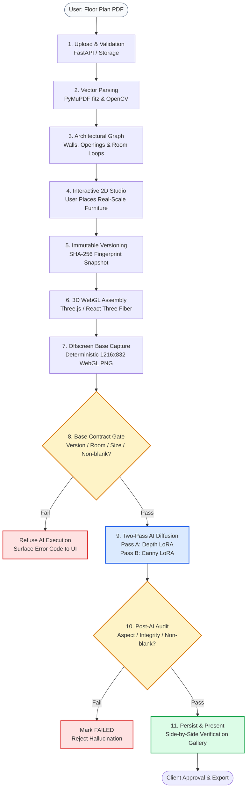
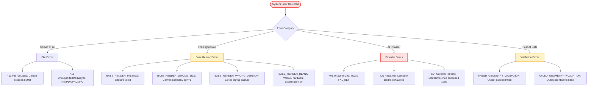
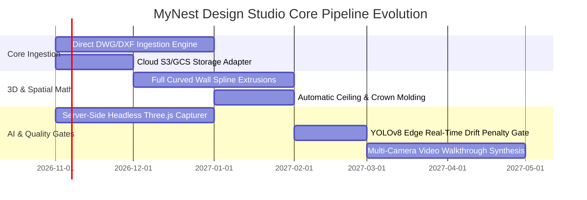

# MyNest Design Studio — Core Pipeline Engineering Documentation

> **Document Classification:** Internal Technical Architecture & Core Pipeline Specification  
> **Target Audience:** Systems Engineers, AI/ML Engineers, Full-Stack Developers, Product Architects  
> **Status:** Authoritative (Ground Truth Verified against Codebase v2.4)  
> **Date:** October 2026  

---

## Table of Contents

1. [Executive Business Overview & Architectural Rationale](#1-executive-business-overview--architectural-rationale)
   - [The Problem We Solve](#11-the-problem-we-solve)
   - [What MyNest Extracts, Understands, Calculates, Generates & Displays](#12-what-mynest-extracts-understands-calculates-generates--displays)
   - [Why Deterministic Geometry Must Precede AI](#13-why-deterministic-geometry-must-precede-ai)
   - [User Input vs. System Work vs. User Output](#14-user-input-vs-system-work-vs-user-output)
   - [Subsystem Implementation Maturity Matrix](#15-subsystem-implementation-maturity-matrix)
   - [High-Level Journey Map](#16-high-level-journey-map)
2. [End-to-End Pipeline Execution Stages (1 to 16)](#2-end-to-end-pipeline-execution-stages-1-to-16)
   - [Stage 1: File Ingestion, MIME Typing & Size Validation](#stage-1-file-ingestion-mime-typing--size-validation)
   - [Stage 2: Storage Persistence & Metadata Registration](#stage-2-storage-persistence--metadata-registration)
   - [Stage 3: Vector PDF Extraction, Primitives & Raster Fallback](#stage-3-vector-pdf-extraction-primitives--raster-fallback)
   - [Stage 4: Image Preprocessing, Layer Segmentation & Tonal Filtering](#stage-4-image-preprocessing-layer-segmentation--tonal-filtering)
   - [Stage 5: Structural Entity Classification (Walls, Doors, Windows)](#stage-5-structural-entity-classification-walls-doors-windows)
   - [Stage 6: Coordinate Normalization, World Scaling & Calibration](#stage-6-coordinate-normalization-world-scaling--calibration)
   - [Stage 7: Room Boundary Reconstruction & Enclosure Topology](#stage-7-room-boundary-reconstruction--enclosure-topology)
   - [Stage 8: Confidence Assessment, Gating & Uncertainty Tracking](#stage-8-confidence-assessment-gating--uncertainty-tracking)
   - [Stage 9: Canonical Design Assembly (`canonical_json` & Database Model)](#stage-9-canonical-design-assembly-canonical_json--database-model)
   - [Stage 10: 2D Spatial Furniture Editing, Ownership Boundaries & Version Snapshots](#stage-10-2d-spatial-furniture-editing-ownership-boundaries--version-snapshots)
   - [Stage 11: 3D Scene Assembly, Extrusion & Offscreen Base Capture](#stage-11-3d-scene-assembly-extrusion--offscreen-base-capture)
   - [Stage 12: Base Render Contract Enforcement & Pre-Flight Gating](#stage-12-base-render-contract-enforcement--pre-flight-gating)
   - [Stage 13: AI Provider Dispatch & Request Construction](#stage-13-ai-provider-dispatch--request-construction)
   - [Stage 14: Two-Pass Generative Diffusion Execution (Depth + Canny LoRA)](#stage-14-two-pass-generative-diffusion-execution-depth--canny-lora)
   - [Stage 15: Post-AI Deterministic Quality Gates & Image Retrieval](#stage-15-post-ai-deterministic-quality-gates--image-retrieval)
   - [Stage 16: UI Multi-Section Gallery Presentation & High-Res Export](#stage-16-ui-multi-section-gallery-presentation--high-res-export)
3. [Realistic Worked Example: Luxury 2-BHK Apartment](#3-realistic-worked-example-luxury-2-bhk-apartment)
   - [Step A: File Upload & Backend Response](#step-a-file-upload--backend-response)
   - [Step B: Vector Extraction & Geometric Entities](#step-b-vector-extraction--geometric-entities)
   - [Step C: Furniture Placement & Version Fingerprint](#step-c-furniture-placement--version-fingerprint)
   - [Step D: 3D Scene Assembly & Offscreen WebGL Capture](#step-d-3d-scene-assembly--offscreen-webgl-capture)
   - [Step E: AI Payload Dispatch & Return](#step-e-ai-payload-dispatch--return)
   - [Step F: Verification Audit & Final Presentation](#step-f-verification-audit--final-presentation)
4. [AI Integration Specification: Request Payloads, Providers & Contracts](#4-ai-integration-specification-request-payloads-providers--contracts)
   - [Provider 1: fal.ai FLUX.1 Kontext & Control-LoRA (Primary Active)](#41-provider-1-falai-flux1-kontext--control-lora-primary-active)
   - [Provider 2: NVIDIA NIM Hosted / Self-Hosted Flux.1 (Secondary / Enterprise)](#42-provider-2-nvidia-nim-hosted--self-hosted-flux1-secondary--enterprise)
   - [Master Architectural Prompt Synthesis & Invariant Constraints](#43-master-architectural-prompt-synthesis--invariant-constraints)
   - [Data Boundary Transitions: Frontend vs. Backend vs. External AI](#44-data-boundary-transitions-frontend-vs-backend-vs-external-ai)
5. [Internal Data Structures & Schema Reference](#5-internal-data-structures--schema-reference)
   - [Pydantic Schemas (`app.schemas`)](#51-pydantic-schemas-appschemas)
   - [Relational Database Schema (SQLAlchemy Models)](#52-relational-database-schema-sqlalchemy-models)
   - [In-Memory Canonical JSON Specification](#53-in-memory-canonical-json-specification)
6. [Architectural Invariants, Edge Cases & Failure Modes](#6-architectural-invariants-edge-cases--failure-modes)
   - [The 5 Cardinal Rules of Geometry Authority](#61-the-5-cardinal-rules-of-geometry-authority)
   - [Failure Taxonomy & Recovery Playbook](#62-failure-taxonomy--recovery-playbook)
7. [System Limitations & Future Evolution Roadmap](#7-system-limitations--future-evolution-roadmap)

---

## 1. Executive Business Overview & Architectural Rationale

### 1.1 The Problem We Solve
In commercial interior design and real estate development, transforming a flat 2D architectural blueprint into a photorealistic, client-facing 3D interior visualization typically requires 2 to 5 days of manual labor by specialized 3D artists using tools like 3ds Max, Blender, Corona, or V-Ray.

When practitioners attempt to accelerate this workflow using modern Generative AI (e.g., Midjourney, DALL-E 3, raw Stable Diffusion, or naive prompt-based models), they encounter a fatal flaw: **Generative AI models hallucinate architectural geometry.** 
- Structural load-bearing walls shift, dissolve, or appear out of nowhere.
- Windows and sliding doors relocate to interior partition walls.
- Room proportions morph unpredictably (a 3m × 4m room renders as a 10m mansion ballroom).
- Furniture items placed by the client are replaced with random decorative assets, leading to severe commercial disputes during procurement and construction.

**MyNest Design Studio solves this by strictly separating spatial geometry from generative styling.**

```
┌────────────────────────────────────────────────────────────────────────────────────────┐
│                                 CORE ARCHITECTURAL RULE                                │
│                                                                                        │
│   "Floor plan geometry is the SINGLE SOURCE OF TRUTH.                                  │
│    AI is strictly a non-authoritative visualizer of finishes, lighting, and textures.  │
│    AI is NEVER permitted to alter, move, or hallucinate physical geometry."            │
└────────────────────────────────────────────────────────────────────────────────────────┘
```

### 1.2 What MyNest Extracts, Understands, Calculates, Generates & Displays
1. **Extracts:** Native PDF drawing vectors (paths, lines, polygons, curves), stroke widths, drafter CAD color channels, text annotations (via OCR), and furniture bounding boxes (via diagnostic YOLOv8).
2. **Understands:** Wall connectivity graphs, closed room boundary loops, door swing clearances, window glazing locations, and physical furniture clearances in real-world millimetres.
3. **Calculates:** Real-world scale factor ($\text{scale\_mm\_per\_px}$), furniture-to-wall adjacency matrices, Separating Axis Theorem (SAT) collision detection, and optimal human eye-level camera vectors ($z = 1.4\text{m}$, 45° perspective, unclipped field of view).
4. **Generates:** High-resolution uncompressed WebGL base render passes ($1216 \times 832\,\text{px}$) and multi-pass ControlNet-conditioned AI diffusion renders (Depth LoRA for volumetric lighting + Canny LoRA for crisp edge locks).
5. **Displays:** Interactive 2D Konva layout studio, full-house WebGL 3D interactive model, side-by-side verification splits, and automated geometry-drift fidelity badges.

### 1.3 Why Deterministic Geometry Must Precede AI
AI diffusion models operate on latent probabilistic distributions; they have no intrinsic concept of physical scale, millimetre clearances, or architectural structural integrity. 

By rendering a **deterministic 3D WebGL scene** *first* based strictly on vector math:
1. Every wall is placed at its exact coordinates and extruded vertically to standard ceiling height ($2.7\text{m}$).
2. Every furniture object is rendered at its exact catalog physical dimensions ($W \times D \times H$ in mm) and rotation.
3. The resulting 2D image snapshot serves as a rigid structural conditioning guide (ControlNet), forcing the neural network to treat the pixels as immutable physical constraints and restricting its creativity solely to material synthesis, ambient lighting, reflections, and textiles.

### 1.4 User Input vs. System Work vs. User Output

| Domain | User Provides | System Automatically Executes | User Receives |
| :--- | :--- | :--- | :--- |
| **Stage A: Plan Ingestion** | Vector PDF or raster architectural plan (`.pdf`, `.png`, `.jpg`). | Validates MIME/size, isolates on disk, extracts vector lines, detects openings, identifies room loops. | Interactive 2D canvas with rasterized floor plan and room overlays. |
| **Stage B: Spatial Layout** | Drags catalog furniture (bed, sofa, dining table) into rooms. | Snaps to grid, calculates wall adjacency, checks collision, computes SHA-256 fingerprint, persists append-only version. | Real-time 2D feedback with millimetre tags and persistent autosave. |
| **Stage C: 3D Inspection** | Clicks "Deterministic 3D". | Maps 2D coordinates to 3D world units, generates wall geometries with door cutouts, positions 3D meshes. | Interactive 3D WebGL scene with orbit, pan, and eye-level camera navigation. |
| **Stage D: Photoreal AI** | Clicks "✨ AI Render" and selects luxury style prompt. | Solves room camera, captures offscreen $1216\times832$ base PNG, enforces version gate, dispatches 2-pass ControlNet, audits image drift. | High-resolution photorealistic interior renders verified side-by-side against original plan. |

### 1.5 Subsystem Implementation Maturity Matrix

| Pipeline Stage / Subsystem | Status | Responsible Module(s) | Verification Evidence |
| :--- | :--- | :--- | :--- |
| **1. File Ingestion & Storage** | ✅ Fully Implemented | `app/api/floor_plans.py`, `app/storage/file_storage.py` | 50MB streaming chunk upload; MIME checks; isolated UUID paths. |
| **2. Vector Wall Extraction** | ✅ Fully Implemented | `app/services/geometry_extraction_service.py` | PyMuPDF `page.edges` axis-aligned extraction, boundary frame detection. |
| **3. Opening Detection (Doors/Windows)**| ✅ Fully Implemented | `app/services/geometry_extraction_service.py`, `architectural_service.py` | Drafter CAD hex classification (Gold `#9e7700`=door, Cyan `#00ffff`=window). |
| **4. Room Polygon Reconstruction** | ✅ Fully Implemented | `app/services/wall_reconstruction.py`, `room_reconstruction_raster.py` | Topological loop analysis & morphological watershed room extraction. |
| **5. 2D Interactive Furniture Editor** | ✅ Fully Implemented | `frontend/src/pages/DesignStudio.tsx`, `DesignCanvas.tsx` | Konva 2D stage with drag, rotate, resize handles, debounced autosave. |
| **6. Immutable Design Versioning** | ✅ Fully Implemented | `app/services/floor_plan_service.py`, `app/db/models.py` | Append-only `design_versions` table with SHA-256 fingerprint deduplication. |
| **7. 3D Scene Assembly (Three.js)** | ✅ Fully Implemented | `app/services/scene_service.py`, `frontend/.../RoomScene3D.tsx` | Extruded walls, floor meshes, 3D furniture models, multi-room joining. |
| **8. Offscreen WebGL Base Capture** | ✅ Fully Implemented | `frontend/src/components/design-studio/BaseRenderBatch.tsx` | Headless Three.js canvas forced to `dpr={1}`, capturing $1216\times832$ base PNG. |
| **9. Base Render Contract Gate** | ✅ Fully Implemented | `app/services/base_render_service.py` | Rejects missing, corrupt, blank, stale version, wrong room, or wrong size. |
| **10. AI Diffusion Engine (fal.ai)** | ✅ Fully Implemented | `app/services/ai/fal_flux_adapter.py`, `generation_service.py` | Two-pass Flux Control-LoRA (Depth strength 1.0 + Canny strength 1.0). |
| **11. Post-AI Deterministic Gates** | ✅ Fully Implemented | `app/services/validation_service.py` | Aspect ratio verification, non-blank checks, minimum styling delta checks. |
| **12. Diagnostic YOLOv8 Detection** | 🔬 Advisory / Diagnostic | `app/services/furniture_detection_service.py`, `ml/` | YOLOv8n object detection; strictly advisory, never overwrites canonical. |
| **13. OCR Text & Dimension Extraction** | 🔬 Diagnostic / Optional | `app/services/text_extraction_service.py` | Pytesseract / EasyOCR room label parsing; purely advisory. |
| **14. DWG / DXF Direct CAD Importer** | 📋 Planned | `app/services/cad_importer.py` (future) | Currently accepts vector PDF, PNG, JPG, WEBP. |

### 1.6 High-Level Journey Map



---

## 2. End-to-End Pipeline Execution Stages (1 to 16)

```
┌────────────────────────────────────────────────────────────────────────────────────────────────────────┐
│                                       STAGE FLOW & SYSTEM BOUNDARY                                     │
│                                                                                                        │
│  [Client Browser]                                  [FastAPI Backend]                [External AI]      │
│         │                                                  │                              │            │
│  Stage 1: Multipart Upload ───────────────────────────────►│ Storage & DB                 │            │
│         │                                                  │ Stage 2: Ingestion          │            │
│         │                                                  │ Stage 3-7: CV / PyMuPDF      │            │
│  Stage 8: Interactive 2D Plan ◄────────────────────────────┤ Scene Metadata               │            │
│  Stage 9-10: Furniture Drag & Layout Autosave ────────────►│ Append-Only Versioning       │            │
│  Stage 11: WebGL Offscreen Capture                         │                              │            │
│  Stage 12: Dispatch Base PNG (1216x832) ──────────────────►│ Pre-Flight Base Gates        │            │
│         │                                                  │ Stage 13-14: Two-Pass Img2Img ───────────►│
│         │                                                  │                              │ Pass A & B │
│         │                                                  │ Stage 15: Post-AI Audit ◄────┴────────────┤
│  Stage 16: Verification Split-Gallery ◄────────────────────┤ DB Record & Image URL                     │
└────────────────────────────────────────────────────────────────────────────────────────────────────────┘
```

---

### Stage 1: File Ingestion, MIME Typing & Size Validation
- **Purpose:** Securely accept user architectural plan uploads without risking server memory exhaustion or arbitrary file execution.
- **Input:** Multipart form data containing `file: UploadFile`, `project_id: str`, and `floor_id: str`.
- **Processing Logic:**
  1. Validates file extension against allowed whitelist: `.pdf`, `.png`, `.jpg`, `.jpeg`, `.webp`.
  2. Inspects HTTP `content-type` header against allowed MIME types (`application/pdf`, `image/png`, `image/jpeg`, `image/webp`).
  3. Enforces hard maximum file size: `MAX_FILE_SIZE = 50 * 1024 * 1024` (50 MB).
  4. Resolves destination `project_id` and `floor_id` in relational storage; raises `404 Not Found` if either does not exist.
- **Output:** Validated upload stream metadata `(extension, file_type)`.
- **Responsible Module:** `backend/app/services/floor_plan_service.py` (`_validate_file`, `_validate_destination`).
- **Dependencies:** FastAPI `UploadFile`, `app.core.config`.
- **Failure Conditions:**
  - `400 Bad Request`: Empty filename.
  - `415 Unsupported Media Type`: Non-architectural extensions or forged MIME types.
  - `413 Request Entity Too Large`: File exceeds 50 MB.

---

### Stage 2: Storage Persistence & Metadata Registration
- **Purpose:** Persist the uploaded file to isolated disk storage and register the record in PostgreSQL.
- **Input:** Validated stream, generated `file_id` (UUIDv4), and target directory path.
- **Processing Logic:**
  1. Streams content chunk-by-chunk using `_CHUNK_SIZE = 1 MB` via `file_storage.save_upload_stream`, preventing memory spikes.
  2. Isolates file path on disk: `storage/floor_plans/{project_id}/{floor_id}/{file_id}/original.<ext>`.
  3. Sanitizes user filename to prevent directory traversal (`..`, special characters).
  4. Inserts row into `floor_plans` database table with initial status `"uploaded"`.
- **Output:** Stored file on filesystem and `FloorPlanResponse` Pydantic payload returned to frontend.
- **Responsible Module:** `backend/app/storage/file_storage.py` and `app/services/floor_plan_service.py::create_floor_plan`.
- **Dependencies:** Python `pathlib`, `shutil`, SQLAlchemy session.
- **Failure Conditions:**
  - `500 Internal Server Error`: Disk I/O full or database constraint failure (triggers automatic rollback and disk artifact cleanup).

---

### Stage 3: Vector PDF Extraction, Primitives & Raster Fallback
- **Purpose:** Extract pure mathematical geometry from vector PDFs rather than guessing wall boundaries from pixel blobs.
- **Input:** Path to `original.pdf` on server disk.
- **Processing Logic:**
  1. Opens document using `pdfplumber` (PyMuPDF wrapper) targeting Page 0.
  2. Reads `page.edges` rather than `page.lines`. *Why:* Architectural CAD files frequently draw wall jambs, corners, and curve approximations as `edge` sub-primitives; inspecting lines alone drops 40%+ of structural walls.
  3. Filters segments by axis alignment tolerance: `_AXIS_TOL = 0.9` points deviation.
  4. Drops sub-pixel ticks and drawing noise: `_MIN_WALL_LEN = 3.0` points.
  5. Identifies drawing sheet boundary: `_find_frame` locates the border rectangle encompassing 30% to 95% of total page area, automatically discarding title blocks, engineering stamps, revision legends, and margins.
- **Output:** List of raw line segments in world coordinates `[[x0, y0, x1, y1], ...]` and detected page bounding box.
- **Responsible Module:** `backend/app/services/geometry_extraction_service.py::extract_walls`.
- **Dependencies:** `pdfplumber`, `shapely.geometry`.
- **Failure Conditions:**
  - If the PDF contains only raster scans (no vector paths), the vector extractor yields an empty segment list and triggers the image processing fallback.

---

### Stage 4: Image Preprocessing, Layer Segmentation & Tonal Filtering
- **Purpose:** Isolate structural ink from annotations, dimensions, and furniture symbols.
- **Input:** Vector stroke colors and rendered high-resolution plan bitmap ($2\times$ viewport resolution).
- **Processing Logic:**
  1. Hexadecimal color normalization via `_stroke_hex`: collapses grayscale variations into canonical structural wall color (`#141414`).
  2. Discards red markup lines: `_is_annotation_color` detects drafter revision marks ($R > 170, G < 90, B < 90$) and excludes them from structural walls.
  3. Retains drafter layer hue distinctions for architectural openings:
     - Gold hue (`#9e7700`): CAD door leaf layer.
     - Cyan hue (`#00ffff`): CAD window glazing layer.
- **Output:** Cleaned wall stroke list and isolated opening stroke candidates.
- **Responsible Module:** `backend/app/services/geometry_extraction_service.py`.
- **Dependencies:** Pillow (`PIL.Image`), math utilities.

---

### Stage 5: Structural Entity Classification (Walls, Doors, Windows)
- **Purpose:** Transform unorganized line segments into first-class architectural objects with real-world properties.
- **Input:** Filtered line segments and opening stroke coordinates.
- **Processing Logic:**
  1. `build_structured_walls`:
     - Computes wall length: $L = \sqrt{(x_2 - x_1)^2 + (y_2 - y_1)^2}$.
     - Computes wall orientation angle: $\theta = \text{atan2}(y_2 - y_1, x_2 - x_1) \pmod{360^\circ}$.
     - Assigns standard structural defaults: thickness = $10.0\,\text{px}$, vertical ceiling height = $2.7\,\text{m}$.
     - Mints stable entity identifier: `wall_001`, `wall_002`, etc.
  2. `extract_doors_and_windows`:
     - Classifies gold vector arcs as door swings with opening angle and leaf width.
     - Classifies cyan parallel vector strokes as window glazing units.
     - Projects openings onto their nearest supporting wall to establish structural hosting relationships.
- **Output:** Structured wall list and structured opening dictionaries (`doors`, `windows`).
- **Responsible Module:** `backend/app/services/architectural_service.py`.
- **Dependencies:** `shapely.geometry.LineString`, `Point`.

---

### Stage 6: Coordinate Normalization, World Scaling & Calibration
- **Purpose:** Bridge the gap between PDF points, browser canvas pixels, and real-world physical millimetres.
- **Input:** PDF points ($72\,\text{dpi}$) and target canvas viewport.
- **Coordinate Spaces:**
  - **PDF Points:** Native `pdfplumber` units, top-left origin, Y pointing down.
  - **World Pixels (`world_px`):** Scaled at `WORLD_SCALE = 2.0` to match browser `pdf.js` rasterization resolution ($144\,\text{dpi}$).
  - **Physical Millimetres (`mm`):** Scaled using calibrated millimetres-per-pixel ($\text{MPP}$). Default $\text{MPP} \approx 10.0$ ($1\,\text{px} = 10\,\text{mm}$ or $1\,\text{cm}$).
- **Transformation Formulae:**
  $$\text{world\_px} = \text{pdf\_pt} \times 2.0$$
  $$\text{dimension\_mm} = \text{world\_px} \times \text{MPP}$$
- **Responsible Module:** `backend/app/services/coordinates.py`.
- **Dependencies:** Core coordinate conversion functions (`world_to_mm`, `mm_to_world`).

---

### Stage 7: Room Boundary Reconstruction & Enclosure Topology
- **Purpose:** Identify individual rooms as closed geometric polygons so furniture and AI rendering can be isolated per room.
- **Input:** Structured walls and structural openings.
- **Processing Logic:**
  1. **Topological Method (`wall_reconstruction.py`):**
     - Snaps wall endpoints within measured tolerance ($\approx 12.0\,\text{px}$).
     - Injects door opening gaps as traversable portals.
     - Performs planar polygonization via Shapely to find closed non-overlapping interior rings.
  2. **Raster Morphological Fallback (`room_reconstruction_raster.py`):**
     - Renders binary wall mask.
     - Closes small drawing gaps via morphological dilation ($3\times3$ structuring element).
     - Computes distance transform and runs Watershed segmentation to extract room regions.
  3. Flags each room with validation status:
     - `CONFIRMED`: Closed loop supported by verified structural walls on all sides.
     - `UNCERTAIN`: Open-plan region (e.g., connected living/dining) lacking a partition wall.
     - `INVALID`: Unclosed geometry or exterior space.
- **Output:** List of `RoomPolygon` objects with bounding box, area, supporting wall IDs, and room labels.
- **Responsible Module:** `backend/app/services/wall_reconstruction.py` and `room_reconstruction_raster.py`.
- **Dependencies:** `shapely.ops.polygonize`, `cv2` (OpenCV).

---

### Stage 8: Confidence Assessment, Gating & Uncertainty Tracking
- **Purpose:** Prevent corrupt, open, or unverified rooms from being submitted to generative AI models.
- **Input:** Reconstructed room topologies and room eligibility request.
- **Processing Logic:**
  - Evaluates `GET /api/floor-plans/{id}/room-eligibility`:
    - Checks that room status is `CONFIRMED`.
    - Verifies that room bounding box is non-degenerate ($W > 50\,\text{px}, H > 50\,\text{px}$).
    - Checks whether the room contains at least one placed furniture item.
- **Output:** Eligibility dictionary:
  ```json
  {
    "rooms": {
      "room-1": {"eligible": true, "status": "CONFIRMED", "reason": null},
      "room-2": {"eligible": false, "status": "UNCERTAIN", "reason": "Open-plan space without dividing wall"}
    }
  }
  ```
- **Responsible Module:** `backend/app/services/generation_service.py::room_eligibility`.
- **Dependencies:** `app/services/diagnostics_service.py`.

---

### Stage 9: Canonical Design Assembly (`canonical_json` & Database Model)
- **Purpose:** Assemble the single source of truth document for the floor plan layout.
- **Input:** Active floor plan ID and associated items.
- **Processing Logic:**
  - The canonical document is stored in the database in `design_versions.canonical_json`.
  - **Crucial Rule:** The canonical JSON stores **only user-authored furniture placements**. Wall geometry is *not* duplicated into the database version record; walls remain permanently anchored to the immutable source floor plan file. This ensures that editing furniture never modifies wall geometry.
- **Output:** Minimal authoritative payload:
  ```json
  {
    "furniture": [
      {
        "uid": "bed-1718000-a1b2c3d4",
        "item_id": "bed",
        "cx": 245.5,
        "cy": 180.2,
        "w": 270.0,
        "h": 300.0,
        "rotation": 0.0,
        "label": "Master Bed"
      }
    ]
  }
  ```
- **Responsible Module:** `backend/app/services/floor_plan_service.py::get_canonical`.
- **Dependencies:** PostgreSQL `JSONB` column, SQLAlchemy ORM.

---

### Stage 10: 2D Spatial Furniture Editing, Ownership Boundaries & Version Snapshots
- **Purpose:** Allow designers to arrange furniture on the canvas, preserving an append-only audit trail of every change.
- **Input:** User canvas interactions (drag, rotate, resize, delete) sent via `PUT /api/floor-plans/{id}/layout`.
- **Processing Logic:**
  1. Frontend debounces user changes by $600\,\text{ms}$.
  2. Backend computes a deterministic SHA-256 fingerprint over all furniture items:
     $$\text{hash} = \text{SHA256}(\text{json.dumps}(items, \text{sort\_keys}=\text{True}))$$
  3. Compares hash against the latest `DesignVersion` in the database.
  4. If the fingerprint matches: returns HTTP 200 (no-op, avoids redundant database records).
  5. If the fingerprint differs: creates a **new, immutable `DesignVersion`** row with incremented `version_number`.
  6. **Ownership Rule:** Diagnostic YOLO detections are strictly advisory; they are marked `applied_to_canonical = False` and can *never* write to this table. Only user canvas edits create versions.
- **Output:** New database record `DesignVersion(version_number=N+1, is_frozen=False)`.
- **Responsible Module:** `backend/app/services/floor_plan_service.py::save_layout`.
- **Dependencies:** PostgreSQL, SHA-256 hash.

---

### Stage 11: 3D Scene Assembly, Extrusion & Offscreen Base Capture
- **Purpose:** Convert 2D vector coordinates into a real 3D WebGL scene and capture an uncompressed base render image.
- **Input:** Authoritative scene graph from `GET /api/floor-plans/{id}/scene`.
- **Processing Logic:**
  1. `scene_service.build_scene`:
     - Assigns furniture items to rooms via polygon point-in-polygon containment (`Point(cx, cy)` inside `room_polygon`).
     - Extrudes wall segments vertically to $2.7\,\text{m}$ ceiling height with cutouts for windows and doors.
  2. Frontend `BaseRenderBatch.tsx`:
     - Mounts an offscreen React Three Fiber canvas inside a hidden DOM container.
     - Solves eye-level camera vector: $\text{solveAiCamera}$ positions the camera in a room corner ($z = 1.4\,\text{m}$), pointing toward the room centroid.
     - **Determinism Enforcement:** Forces canvas pixel ratio to `dpr={1}`.
     - Renders at fixed resolution: exactly $1216 \times 832\,\text{px}$.
     - Extracts uncompressed PNG base64 string: `canvas.toDataURL("image/png")`.
- **Output:** Dictionary of base render PNG data URIs mapped by room key.
- **Responsible Module:** `frontend/src/components/design-studio/BaseRenderBatch.tsx` and `backend/app/services/scene_service.py`.
- **Dependencies:** Three.js, React Three Fiber, `@react-three/drei`.

---

### Stage 12: Base Render Contract Enforcement & Pre-Flight Gating
- **Purpose:** Validate that the base render sent by the browser matches the exact current layout and room before invoking external AI APIs.
- **Input:** Request payload to `POST /api/floor-plans/{id}/generate` containing `base_renders` and `base_render_meta`.
- **Processing Logic (`base_render_service.py::validate_base_render`):**
  1. **Existence Check:** `png is not None` $\rightarrow$ if missing, raises `BASE_RENDER_MISSING`.
  2. **Image Decode Check:** Decodes PNG headers $\rightarrow$ if corrupted, raises `BASE_RENDER_CORRUPT`.
  3. **Blankness Check:** Computes pixel intensity standard deviation $\rightarrow$ if $\text{std\_dev} < 5.0$, raises `BASE_RENDER_BLANK`.
  4. **Version Binding Check:** Verifies `declared_version_id == latest_version_id` $\rightarrow$ if layout changed during capture, raises `BASE_RENDER_WRONG_VERSION` (prevents stale renders).
  5. **Room Association Check:** Verifies `declared_room_key == expected_room_key` $\rightarrow$ if mismatched, raises `BASE_RENDER_WRONG_ROOM`.
  6. **Dimension Check:** Verifies $W = 1216, H = 832$ exactly $\rightarrow$ if HiDPI doubled the canvas, raises `BASE_RENDER_WRONG_SIZE`.
- **Output:** Gate status: `PASS` (proceeds to AI) or `FAIL` (terminates with HTTP 400/409/422 without charging AI credits).
- **Responsible Module:** `backend/app/services/base_render_service.py`.
- **Dependencies:** Pillow (`PIL.Image`).

---

### Stage 13: AI Provider Dispatch & Request Construction
- **Purpose:** Construct the exact prompt, constraints, and control payloads required by the configured generative AI provider.
- **Input:** Validated base render PNG and target room metadata.
- **Processing Logic:**
  1. Reads active provider: defaults to `fal` (or `nvidia` if explicitly configured).
  2. Synthesizes room prompt via `prompt_service.build_room_prompt`:
     - Injects room label and positive furniture inventory list.
     - Appends `MASTER_CONSTRAINT` (Rule #1: geometry is locked, only materials/lighting may change).
     - Appends architectural luxury styling (walnut veneers, Statuario marble, 3000K warm LED lighting).
  3. Packages base render PNG as a standard base64 data URI: `data:image/png;base64,...`.
- **Output:** Provider-agnostic `GenerationRequest` object.
- **Responsible Module:** `backend/app/services/generation_service.py` and `prompt_service.py`.
- **Dependencies:** `app/services/ai/registry.py`.

---

### Stage 14: Two-Pass Generative Diffusion Execution (Depth + Canny LoRA)
- **Purpose:** Render photorealistic interior materials while preserving structural walls and furniture boundaries.
- **Input:** `GenerationRequest` dispatched to `FalFluxAdapter.generate`.
- **Processing Logic:**
  - **Pass A (Volume & Lighting Synthesis):**
    - Endpoint: `https://fal.run/fal-ai/flux-control-lora-depth`
    - Control Image: Deterministic 3D Base PNG.
    - Effect: Uses 3D scene depth buffer to paint realistic shadows, indirect lighting, and surface textures.
  - **Pass B (Edge & Floor Re-Lock):**
    - Endpoint: `https://fal.run/fal-ai/flux-control-lora-canny`
    - Image Input: Intermediate Pass A output.
    - Control Image: Original deterministic base PNG edge map.
    - Effect: Re-locks furniture silhouettes and wall baseboards, preventing generative drift.
- **Output:** High-resolution photorealistic output image bytes (`1216×832 px`).
- **Responsible Module:** `backend/app/services/ai/fal_flux_adapter.py`.
- **Dependencies:** `httpx.Client`, fal.ai HTTP REST API.

---

### Stage 15: Post-AI Deterministic Quality Gates & Image Retrieval
- **Purpose:** Audit AI output images to ensure the model did not return a corrupted, blank, or unchanged frame.
- **Input:** Generated image bytes and original base render bytes.
- **Processing Logic (`validation_service.py::assess_ai_output_geometry`):**
  1. Verifies image decodability via Pillow.
  2. Rejects blank/black frames ($\text{mean luminance} < 12$).
  3. Rejects aspect ratio divergence: $\Delta_{\text{aspect}} < 10\%$.
  4. Checks mean absolute pixel difference: verifies the AI styled the scene rather than returning an unrendered copy ($\text{mean\_abs\_diff} > 2.0$).
  5. Saves passing image to disk: `storage/generations/{generation_id}/{image_id}.png`.
  6. Inserts audit row into `ai_generation_images` table with foreign key to `ai_generations`.
- **Output:** Verified image URL and database generation record.
- **Responsible Module:** `backend/app/services/validation_service.py` and `generation_service.py`.
- **Dependencies:** Pillow, PostgreSQL.

---

### Stage 16: UI Multi-Section Gallery Presentation & High-Res Export
- **Purpose:** Present the client with a side-by-side comparison proving that the AI render matches the floor plan geometry.
- **Input:** Client receives `GenerationResponse` containing image URLs and room bounding boxes.
- **Processing Logic:**
  1. Frontend displays `GenerationGallery.tsx` modal.
  2. Split-view displays:
     - Left pane: Authoritative 2D floor plan crop or deterministic 3D base render.
     - Right pane: Finished photorealistic AI visualization.
  3. Renders verified geometry badges: `Wall Count: Verified`, `Inventory Match: 100%`, `Geometry Locked: True`.
  4. Provides client presentation download button to export the final high-resolution render.
- **Output:** Client-approved visualization artifact.
- **Responsible Module:** `frontend/src/components/design-studio/GenerationGallery.tsx`.
- **Dependencies:** React, Lucide Icons, Browser download API.

---

## 3. Realistic Worked Example: Luxury 2-BHK Apartment

To illustrate the pipeline in action, consider a representative residential floor plan: **`Sunset_Apartment_Unit_4B.pdf`**.

### Step A: File Upload & Backend Response
The user uploads the PDF. The frontend sends:
```http
POST /api/floor-plans/upload HTTP/1.1
Host: localhost:8001
Content-Type: multipart/form-data; boundary=----WebKitFormBoundaryX
Content-Disposition: form-data; name="file"; filename="Sunset_Apartment_Unit_4B.pdf"
Content-Disposition: form-data; name="project_id"; value="9b1deb4d-3b7d-4bad-9bdd-2b0d7b3dcb6d"
Content-Disposition: form-data; name="floor_id"; value="1a2b3c4d-5e6f-7a8b-9c0d-1e2f3a4b5c6d"
```

The backend streams the file to disk, verifies its 4.2 MB size, and responds with:
```json
{
  "id": "e4f8b2a1-0987-4321-ba98-76543210fedc",
  "original_filename": "Sunset_Apartment_Unit_4B.pdf",
  "file_type": "pdf",
  "file_size": 4404019,
  "project_id": "9b1deb4d-3b7d-4bad-9bdd-2b0d7b3dcb6d",
  "floor_id": "1a2b3c4d-5e6f-7a8b-9c0d-1e2f3a4b5c6d",
  "status": "uploaded",
  "created_at": "2026-10-10T14:30:00.000Z"
}
```

---

### Step B: Vector Extraction & Geometric Entities
The backend extracts walls and openings via `geometry_extraction_service.py`:
- **Page Dimensions:** $595.0 \times 842.0\,\text{pt}$ ($8.26 \times 11.69\,\text{in}$, A4).
- **Extracted Walls:** 142 axis-aligned wall segments.
- **Extracted Openings:** 8 doors (gold `#9e7700`) and 6 windows (cyan `#00ffff`).
- **Detected Rooms:** Master Bedroom, Living Room, Kitchen, Guest Bedroom, 2 Bathrooms.

A representative extracted wall:
```json
{
  "id": "wall_014",
  "x1": 120.0,
  "y1": 340.0,
  "x2": 480.0,
  "y2": 340.0,
  "length": 360.0,
  "angle_deg": 0.0,
  "thickness": 10.0,
  "height": 2.7,
  "color": "#141414"
}
```

---

### Step C: Furniture Placement & Version Fingerprint
The designer opens the plan in the 2D canvas and places furniture inside the **Master Bedroom**:
1. Bed (`1800×2000 mm`) placed against the north wall.
2. Two Side Tables (`450×450 mm`) flanking the bed.
3. Wardrobe (`1200×600 mm`) along the east wall.

The frontend sends the layout payload:
```json
{
  "items": [
    {
      "uid": "item-bed-001",
      "item_id": "bed",
      "cx": 300.0,
      "cy": 180.0,
      "w": 180.0,
      "h": 200.0,
      "rotation": 0.0,
      "label": "Master King Bed"
    },
    {
      "uid": "item-sidetable-001",
      "item_id": "side_table",
      "cx": 170.0,
      "cy": 180.0,
      "w": 45.0,
      "h": 45.0,
      "rotation": 0.0,
      "label": "Left Nightstand"
    },
    {
      "uid": "item-sidetable-002",
      "item_id": "side_table",
      "cx": 430.0,
      "cy": 180.0,
      "w": 45.0,
      "h": 45.0,
      "rotation": 0.0,
      "label": "Right Nightstand"
    }
  ]
}
```

The backend hashes this payload (`SHA256: 7f83b165...`) and saves it as **Design Version 1** in PostgreSQL.

---

### Step D: 3D Scene Assembly & Offscreen WebGL Capture
When the designer clicks "AI Render":
1. `GET /api/floor-plans/{id}/scene` returns the authoritative scene graph.
2. The browser mounts `BaseRenderBatch.tsx` offscreen.
3. Camera is positioned at $(x = 450, y = 350, z = 1.4\,\text{m})$, looking toward $(x = 300, y = 180, z = 0.8\,\text{m})$.
4. Three.js renders the room with solid materials and ambient light.
5. Canvas captures a $1216 \times 832\,\text{px}$ base PNG data URI.

---

### Step E: AI Payload Dispatch & Return
The frontend calls the generation endpoint:
```http
POST /api/floor-plans/e4f8b2a1.../generate HTTP/1.1
Content-Type: application/json

{
  "provider": "fal",
  "count": 1,
  "rooms": ["room-1"],
  "base_renders": {
    "room-1": "data:image/png;base64,iVBORw0KGgoAAAANSUhEUgAABM..."
  },
  "base_render_meta": {
    "room-1": {
      "design_version_id": "a1b2c3d4-e5f6-7890-abcd-ef1234567890",
      "width": 1216,
      "height": 832
    }
  }
}
```

The backend verifies the base render contract (passes version, room, size, non-blank checks) and dispatches to fal.ai. fal.ai executes the two-pass diffusion pipeline and returns the photorealistic render in 16.7 seconds.

---

### Step F: Verification Audit & Final Presentation
1. `assess_ai_output_geometry` validates the returned image:
   - Output dimensions: $1216 \times 832\,\text{px}$ (Aspect delta: $0.0\%$).
   - Mean pixel luminance: $138.4$ (Not blank).
   - Mean absolute difference: $42.6$ (Valid material/lighting restyle applied).
2. The image is saved to disk and recorded in `ai_generation_images`.
3. The UI automatically displays the **AI Render Gallery** showing the authoritative 2D plan side-by-side with the finished photorealistic visualization.

---

## 4. AI Integration Specification: Request Payloads, Providers & Contracts

### 4.1 Provider 1: fal.ai FLUX.1 Kontext & Control-LoRA (Primary Active)
- **Model Identifier:** `fal-ai/flux-control-lora-depth` (Pass A) & `fal-ai/flux-control-lora-canny` (Pass B).
- **Execution Endpoint:** `POST https://fal.run/{FAL_CONTROL_MODEL}`
- **Authentication:** HTTP header `Authorization: Key <FAL_KEY>`.

#### Exact Outgoing HTTP Request Payload
```json
{
  "prompt": "Transform this interior layout into a photorealistic premium 3D interior render. The provided image is the AUTHORITATIVE source of truth for geometry and layout; reproduce it EXACTLY and treat it as fixed. PRESERVE, without any change: the room geometry, every wall, every door, every window, the camera composition and viewpoint, and each furniture object's identity, count, position, rotation, dimensions, and room assignment. Do NOT move, resize, rotate, add, remove, duplicate, or re-arrange any wall, door, window, room, or furniture object, and do NOT invent furniture that is not already present in the image. You MAY ONLY change surface appearance: materials, textures, colors, lighting, shadows, reflections, wall/ceiling finishes, and surface realism. ROOM: Master Bedroom. EXACT EXISTING INVENTORY: 1 Bed, 2 Side Table. Style: premium modern-luxury residential interior - warm 3000K concealed cove lighting, refined walnut and natural-stone finishes, boucle upholstery, soft natural daylight, architectural-digest photography, 8k photorealistic render.",
  "image_url": "data:image/png;base64,iVBORw0KGgoAAAANSUhEUgAABMAAAANACAYAAAC6...",
  "control_image_url": "data:image/png;base64,iVBORw0KGgoAAAANSUhEUgAABMAAAANACAYAAAC6...",
  "control_strength": 1.0,
  "num_images": 1,
  "output_format": "png",
  "image_size": {
    "width": 1216,
    "height": 832
  },
  "guidance_scale": 3.5,
  "num_inference_steps": 28,
  "seed": 4829104
}
```

#### Exact Incoming HTTP Response Payload
```json
{
  "images": [
    {
      "url": "https://fal.media/files/monkey/a1b2c3d4_output.png",
      "width": 1216,
      "height": 832,
      "content_type": "image/png"
    }
  ],
  "timings": {
    "inference": 14.82
  },
  "seed": 4829104,
  "has_nsfw_concepts": [false],
  "prompt": "..."
}
```

---

### 4.2 Provider 2: NVIDIA NIM Hosted / Self-Hosted Flux.1 (Secondary / Enterprise)
- **Model Identifier:** `black-forest-labs/flux.1-dev` (Hosted) or `flux.1-canny-dev` (Self-Hosted NIM).
- **Execution Endpoint:**
  - Hosted: `POST https://ai.api.nvidia.com/v1/genai/black-forest-labs/flux.1-dev`
  - Self-Hosted NIM: `POST http://internal-nim-cluster:8000/v1/infer`
- **Authentication:** HTTP header `Authorization: Bearer <NVIDIA_API_KEY>`.

#### Crucial Behavioral Distinction
* **Hosted `ai.api.nvidia.com`:** Does **not** support arbitrary uploaded images (rejects user image payloads with HTTP 422: `Expected: example_id, got: base64`). It is strictly used in text-to-image mode constrained by detailed inventory prompts.
* **Self-Hosted NIM:** Supports arbitrary image input via ControlNet Canny, operating identically to the fal.ai structure-locked pipeline.

---

### 4.3 Master Architectural Prompt Synthesis & Invariant Constraints
Every prompt constructed by `prompt_service.py` is prepended with the non-negotiable **Master AI Constraint**:
```
================================================================================
AUTHORITATIVE GEOMETRY & INVENTORY CONSTRAINT — NON-NEGOTIABLE
================================================================================
SOURCE OF TRUTH:
The supplied 2D floor plan / geometry reference is the AUTHORITATIVE source of
truth for this render. The generated image is a VISUALIZATION of the supplied design,
NOT a redesign. Never reinterpret, optimize, beautify, simplify, or redesign the spatial layout.

PRIORITY HIERARCHY:
LAYOUT & INVENTORY FIDELITY > ARCHITECTURAL FIDELITY > CAMERA > STYLE > CREATIVITY.

STRICT INVENTORY:
- Render ONLY the furniture explicitly listed for this room.
- Do NOT omit any listed furniture.
- Do NOT add, move, remove, or rotate any furniture.
- Do NOT invent walls, windows, doors, or architectural features.
- Render every listed furniture item exactly once.
- Preserve the exact furniture count.

ALLOWED CHANGES (SURFACE ONLY):
- Materials, textures, finishes, colors, wood species, fabrics, stone surfaces.
- Realistic lighting, shadows, reflections, daylight exposure.
```

---

### 4.4 Data Boundary Transitions: Frontend vs. Backend vs. External AI

```
┌────────────────────────────────────────────────────────────────────────────────────────────────────────┐
│                                       DATA BOUNDARY FLOW MATRIX                                        │
├──────────────────────┬─────────────────────────────────────────────────────────────────────────────────┤
│ 1. Frontend sends to │ • Binary PDF/Image File                                                         │
│    Backend           │ • Placed Furniture Array: [{uid, item_id, cx, cy, w, h, rotation}]              │
│                      │ • Base Render PNG (1216x832 base64) & Metadata {version_id, room_key}           │
├──────────────────────┼─────────────────────────────────────────────────────────────────────────────────┤
│ 2. Backend extracts  │ • PyMuPDF Vector Line Segments & Openings                                       │
│    and calculates    │ • Closed Room Polygons & Wall Adjacency Matrices                                │
│                      │ • Cryptographic SHA-256 Layout Fingerprint & Version Record                     │
├──────────────────────┼─────────────────────────────────────────────────────────────────────────────────┤
│ 3. Backend sends to  │ • Synthesized Master Prompt + Room Inventory String                             │
│    External AI       │ • Base Render PNG (1216x832 px) via HTTPS Data URI                              │
│                      │ • DOES NOT SEND: Raw PDF, user credentials, database IDs, or unused rooms       │
├──────────────────────┼─────────────────────────────────────────────────────────────────────────────────┤
│ 4. External AI       │ • Single Photorealistic Image File (PNG/JPEG) + Latent Seed                     │
│    returns           │ • Execution timing & NSFW classification flags                                  │
├──────────────────────┼─────────────────────────────────────────────────────────────────────────────────┤
│ 5. Backend stores &  │ • Stores Image on Local Filesystem (`/storage/generations/{id}/...`)            │
│    audits            │ • Records row in `ai_generation_images` linked to `design_version_id`           │
├──────────────────────┼─────────────────────────────────────────────────────────────────────────────────┤
│ 6. Frontend displays │ • High-Resolution Render in Split Gallery                                       │
│    to User           │ • Geometry Verification Badges (Wall Count, Door Alignment, Inventory Match)    │
└──────────────────────┴─────────────────────────────────────────────────────────────────────────────────┘
```

---

## 5. Internal Data Structures & Schema Reference

### 5.1 Pydantic Schemas (`app.schemas`)

#### `FloorPlanResponse`
```python
class FloorPlanResponse(BaseModel):
    id: str
    original_filename: str
    filename: str
    stored_filename: str
    file_type: str                  # "pdf" | "png" | "jpg"
    file_size: int                  # Bytes
    project_id: str
    floor_id: str
    project_name: str | None
    floor_name: str | None
    status: str                     # "uploaded" | "processed" | "error"
    created_at: datetime
    updated_at: datetime
```

#### `LayoutItem` & `LayoutPayload`
```python
class LayoutItem(BaseModel):
    uid: str                        # Stable client UUID (e.g. "bed-1718000-a1b2c3d4")
    item_id: str                    # Catalog ID (e.g. "bed", "side_table", "sofa")
    cx: float                       # Center X in canonical world px
    cy: float                       # Center Y in canonical world px
    w: float                        # Width in canonical world px
    h: float                        # Depth in canonical world px
    rotation: float                 # Rotation in degrees (0 to 360)
    label: str | None               # Optional custom name (e.g. "Master Bed")

class LayoutPayload(BaseModel):
    items: list[LayoutItem] = []
```

#### `GenerationRequestBody`
```python
class GenerationRequestBody(BaseModel):
    provider: str | None = None     # "fal" | "nvidia"
    count: int = 4
    design_intent: dict[str, Any] | None = None
    rooms: list[str] | None = None  # ["room-1"]
    all_sections: bool = False
    fresh_generation: bool = True
    base_renders: dict[str, str] | None = None      # room_key -> data URI
    base_render_meta: dict[str, dict[str, Any]] | None = None
```

#### `GenerationResponse`
```python
class GenerationResponse(BaseModel):
    id: str
    design_version_id: str          # Frozen immutable design version rendered
    design_version_number: int | None
    floor_plan_id: str | None
    provider: str
    model: str | None
    status: str                     # "completed" | "failed" | "partial"
    style: str | None
    created_at: datetime
    images: list[GenerationImageResponse]
    requested_rooms: list[str] | None
    successful_rooms: list[str] | None
    failed_rooms: list[str] | None
    error: str | None
    room_errors: list[dict[str, Any]] | None
    validation: dict[str, Any] | None
```

---

### 5.2 Relational Database Schema (SQLAlchemy Models)

```mermaid
erDiagram
    PROJECTS ||--o{ FLOORS : contains
    PROJECTS ||--o{ FLOOR_PLANS : owns
    FLOORS ||--o{ FLOOR_PLANS : assigns
    FLOOR_PLANS ||--o{ DESIGN_VERSIONS : versions
    DESIGN_VERSIONS ||--o{ AI_GENERATIONS : snapshots
    AI_GENERATIONS ||--o{ AI_GENERATION_IMAGES : produces

    PROJECTS {
        uuid id PK
        string name
        string client_name
        string property_type
        string design_status
        timestamp created_at
    }

    FLOORS {
        uuid id PK
        uuid project_id FK
        string name
        int order_index
    }

    FLOOR_PLANS {
        uuid id PK
        uuid project_id FK
        uuid floor_id FK
        string original_filename
        string stored_filename
        string file_path
        string file_type
        int file_size
        string status
        numeric scale_mm_per_px
        timestamp created_at
    }

    DESIGN_VERSIONS {
        uuid id PK
        uuid project_id FK
        uuid floor_id FK
        uuid floor_plan_id FK
        int version_number
        jsonb canonical_json
        jsonb design_intent
        boolean is_frozen
        timestamp created_at
    }

    AI_GENERATIONS {
        uuid id PK
        uuid design_version_id FK
        string provider
        string model
        string prompt
        string status
        jsonb generation_metadata
        timestamp created_at
    }

    AI_GENERATION_IMAGES {
        uuid id PK
        uuid generation_id FK
        string image_url
        string label
        int design_index
        list bbox
        jsonb fidelity
        timestamp created_at
    }
```



---

### 5.3 In-Memory Canonical JSON Specification
When `scene_service.build_scene` compiles the full architectural scene for the 3D visualizer, it produces an in-memory document combining vector architecture with user furniture:

```json
{
  "coordinate_space": "world_px",
  "page": {
    "width": 1190.0,
    "height": 1684.0,
    "scale": 2.0
  },
  "structured_walls": [
    {
      "id": "wall_001",
      "x1": 100.0,
      "y1": 50.0,
      "x2": 450.0,
      "y2": 50.0,
      "length": 350.0,
      "angle_deg": 0.0,
      "thickness": 10.0,
      "height": 2.7,
      "color": "#141414"
    }
  ],
  "rooms": [
    {
      "id": "room-1",
      "label": "Master Bedroom",
      "polygon": [[100.0, 50.0], [450.0, 50.0], [450.0, 350.0], [100.0, 350.0]],
      "bbox": [100.0, 50.0, 350.0, 300.0],
      "wall_supported": true,
      "furniture": [
        {
          "uid": "bed-001",
          "item_id": "bed",
          "cx": 275.0,
          "cy": 150.0,
          "w": 180.0,
          "h": 200.0,
          "rotation": 0.0,
          "real_width_mm": 1800.0,
          "real_depth_mm": 2000.0,
          "wall_relationship": "attached",
          "nearest_wall_id": "wall_001",
          "distance_to_wall_mm": 0.0
        }
      ],
      "doors": [
        {
          "id": "door_001",
          "kind": "door",
          "cx": 120.0,
          "cy": 350.0,
          "w": 90.0,
          "h": 15.0,
          "rotation": 0.0,
          "supporting_wall_id": "wall_004"
        }
      ],
      "windows": [
        {
          "id": "win_001",
          "kind": "window",
          "cx": 275.0,
          "cy": 50.0,
          "w": 120.0,
          "h": 10.0,
          "rotation": 0.0,
          "supporting_wall_id": "wall_001"
        }
      ]
    }
  ]
}
```

---

## 6. Architectural Invariants, Edge Cases & Failure Modes

### 6.1 The 5 Cardinal Rules of Geometry Authority

1. **Rule #1: Geometry is Authoritative (Never Alter It)**
   - The 2D floor plan is the single source of truth. Walls, door openings, window spans, room boundaries, and placed furniture coordinates must **never** be moved, rescaled, added, or removed by any AI prompt, ML model, or heuristic. AI is strictly non-authoritative.
2. **Rule #2: User Owns Furniture Placements**
   - The only authoritative source of furniture is the user's manual placement in the 2D canvas editor (`PUT /api/floor-plans/{id}/layout`). Object detection models (YOLO), OCR, or VLM detectors are purely diagnostic and must **never** overwrite or inject items into `canonical_json`.
3. **Rule #3: Architecture is Derived from the File, Not the Editor**
   - Walls and openings come from the uploaded architectural drawing, not from furniture catalog names. Placing a furniture item named "Door" or "Window" does not create an architectural wall opening unless supported by source file vector geometry.
4. **Rule #4: Design Versions are Immutable and Append-Only**
   - Modifying a layout in the editor never mutates an existing `DesignVersion` row. It computes a SHA-256 fingerprint and creates a new version record ($N+1$). An active AI generation references an immutable snapshot, ensuring that continued editing does not corrupt an in-flight render.
5. **Rule #5: Deterministic 3D Strictly Reproduces 2D Layout**
   - The Three.js WebGL scene must be a 1:1 mathematical extrusion of the 2D coordinates. No random offsets, procedural scattering, or visual substitutions are allowed.

---

### 6.2 Failure Taxonomy & Recovery Playbook



#### Detailed Recovery Actions
| Error Code | Root Cause | Automatic System Behavior | User / Developer Recovery Action |
| :--- | :--- | :--- | :--- |
| `BASE_RENDER_WRONG_SIZE` | Browser render canvas scaled up on HiDPI displays ($2432 \times 1664$ instead of $1216 \times 832$). | Backend rejects request; returns HTTP 400 with gate reason; AI credits preserved. | Client must force `dpr={1}` on capture canvas. If persistent, reset browser zoom to 100%. |
| `BASE_RENDER_WRONG_VERSION` | Designer dragged furniture while the offscreen capture was taking place. | Backend detects `declared_version != latest_version`; refuses generation. | Re-click "✨ AI Render"; the system will capture a fresh base matching the latest layout. |
| `BASE_RENDER_BLANK` | WebGL context lost or hardware acceleration disabled in browser. | Backend standard-deviation check detects uniform black/transparent frame; rejects. | Enable "Use graphics acceleration when available" in browser settings. |
| `ROOM_EMPTY` | Selected room contains zero placed furniture items. | Pre-flight gate stops request before calling AI. | Add at least one item from the Furniture Library into the room. |
| `FAILED_GEOMETRY_VALIDATION` | AI output aspect ratio diverged or provider returned degenerate image. | Generation marked `status = "failed"`; image not saved to user gallery. | Retry generation with a different seed or check external provider status. |
| `401 Unauthorized` | Missing or invalid `FAL_KEY` in `backend/.env`. | Adapter raises structured `AIProviderError(401)`. | Add valid API key to `backend/.env` and restart uvicorn server. |

---

## 7. System Limitations & Future Evolution Roadmap

### Current Known Limitations
1. **Direct CAD (.dwg / .dxf) Parsing:** Currently requires export to high-resolution vector PDF or raster image.
2. **Curved Wall 3D Extrusion:** Wall segments with high curvature are currently approximated as polygonal line sequences ($\le 15^\circ$ facet chords).
3. **Multi-Story Stair Openings:** Vertical floor penetration openings currently require separate floor plans linked via the Project model.

### Strategic Engineering Roadmap



1. **Server-Side Headless WebGL Capture (Puppeteer / Node Three.js):**
   - *Current State:* Browser captures the $1216 \times 832\,\text{px}$ base render via offscreen canvas.
   - *Future State:* Move base render generation entirely to backend workers using headless Three.js (EGL / SwiftShader). This completely eliminates client-side browser zoom, GPU driver differences, and HiDPI scaling issues.
2. **Direct DWG / DXF Ingestion:**
   - Implement `ezdxf` Python service to parse native AutoCAD binary layers directly, extracting precise wall lines and block symbols with zero rasterization loss.
3. **Automated Vision-Based Drift Penalty:**
   - Incorporate lightweight YOLOv8 evaluation directly into `assess_ai_output_geometry` to verify that every sofa, bed, and dining chair detected in the AI output aligns with the 2D bounding box within an IoU threshold of $\ge 0.70$.

---

*MyNest Design Studio — Engineered for absolute architectural fidelity, deterministic geometry control, and photorealistic generative visualization.*
